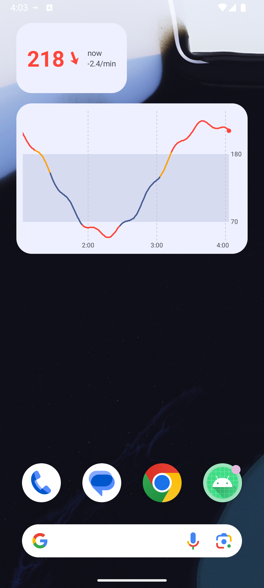
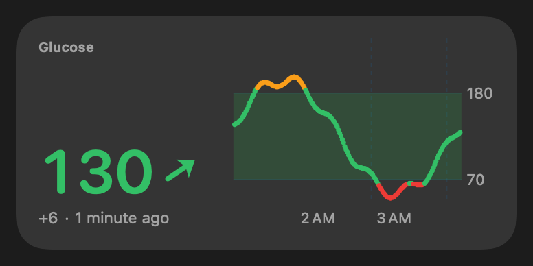

<p align="center">
  
</p>

<h1 align="center">Sukrara — your sugar, now</h1>

<p align="center">
  <a href="https://github.com/mauriciabad/cgm-reading-mac-spike/releases/download/v0.10.5/Sukrara-0.10.5.apk"><b>Download for Android</b></a>
  &nbsp;·&nbsp;
  <a href="https://github.com/mauriciabad/cgm-reading-mac-spike/releases/download/v0.10.3/Sukrara-mac-0.10.3.zip"><b>Download for Mac</b></a>
  &nbsp;·&nbsp;
  <a href="https://github.com/mauriciabad/cgm-reading-mac-spike/releases">All releases</a>
  &nbsp;·&nbsp;
  <a href="https://sukrara.mauri.app">sukrara.mauri.app</a>
</p>

Sukrara shows live glucose from a **FreeStyle Libre 3** wherever you look: the **Mac menubar**, the **Android status
bar and home screen**, a **Garmin watch**, and the phones and Macs of the people who look after you. Readings travel
**end-to-end encrypted**, over **Bluetooth** when you're nearby or over **public Nostr relays** when you're not. There's
no cloud account to create and no server to host. The name is Catalan-ish: *sucre* (sugar) + *ara* (now).

> **This is an alpha, built from research spikes.** Each feature started as a throwaway proof of concept with a
> written report, and v0.10 bundles them into one app to see how it feels day to day. The real Sukrara will be
> rebuilt from scratch, properly and with more features, using what these spikes taught us.
> **Not a medical device** (see the [disclaimer](#disclaimer)).

<p align="center">
  
  
  
  
</p>
<p align="center">
  
</p>
<p align="center">
  
  &nbsp;
  
  &nbsp;
  
  &nbsp;
  
</p>

<sub>Android screenshots are from the emulator with a synthetic source. The trend arrow turns continuously with the rate
of change (flat at 0, vertical at ±3 mg/dL/min, double beyond) instead of Libre's 5 fixed arrows. Colours follow
personal thresholds of 65 / 145 / 185 mg/dL.</sub>

## Features

**On your phone** (Android 16+)
- Current value, continuous trend arrow and a 12 h chart. Source: Juggluco (default) or the Libre 3 read directly
  (opt-in): scan the sensor with NFC to start a new one or take one over, and Sukrara pairs with it over Bluetooth by
  itself. [02](docs/02-direct-sensor.md), [10](docs/10-showcase.md)
- Glucose in the status bar: a Live Update chip next to the clock and the number as the notification icon. The
  spike also proved system icons and a coloured LSPosed hook (root), not in the alpha yet.
  [05](docs/05-android-status-bar.md)
- Home-screen widgets: value, graph, and graph + value, resizable, light/dark, stale state.
  [12](docs/12-android-widgets.md)
- Log insulin, carbs and notes, and upload them (and glucose) to LibreView. Off until you set it up.
  [04](docs/04-libreview.md)

**On your Mac** (Sukrara for Mac, formerly GlucoseBar)
- The number and trend arrow in the menubar, coloured by range, with a 3 h sparkline. [01](docs/01-connectivity.md)
- Follows a wearer over Bluetooth (no network needed) or over Nostr, with the same match-code pairing as the phone.
  Keys stay in the macOS Keychain. [07](docs/07-bluetooth-followers.md)
- Follower alarms: low (≤ 65), high (≥ 185) and no data for 20 minutes, as macOS notifications; toggle in the menu.
- Treatments sync with the phone in 1–2 s and can go to LibreView too. [04](docs/04-libreview.md)
- Desktop and Notification Center widgets (value, graph, graph + value) with live readings, redrawn every minute.
  They need a build signed with an Apple certificate: a free Apple ID works on your own Mac, others need Developer
  ID. [13](docs/13-macos-widgets.md)

**Sharing and family**
- Share with a QR code or link that holds no secret. The other person asks, both screens show the same 4-digit
  code, and you tap **Allow**. [06](docs/06-sharing-and-keys.md)
- Followers get alarms for low, high and no data for 20 minutes.
- Remove a follower at any time: the read key rotates and everyone else keeps going without doing anything.
- Pair nearby over Bluetooth with no internet at all. [07](docs/07-bluetooth-followers.md)
- Let a follower add entries (for example, a parent logging a meal); the wearer's phone accepts only approved writers.

**Watch and smart home**
- Garmin: Sukrara speaks the same local web API as Juggluco, so the CGM+ app, datafield and watch faces work
  unchanged. [08](docs/08-garmin.md)
- Nightscout-compatible adapter: stock Home Assistant, xDrip+, Nightguard, LoopFollow and others read it without
  changes. Proven in the Nostr spike, not in the alpha app yet. [03](docs/03-nostr.md)

**Privacy and keys**
- Every reading is signed by your phone and encrypted to a read key only your followers have. Relays only see
  ciphertext, and it expires on its own. [03](docs/03-nostr.md), [06](docs/06-sharing-and-keys.md)
- No account, no server of ours, no Abbott cloud in the loop.
- Back up your identity to Proton Pass, Bitwarden or KeePassDX as a normal password item. No passkeys, so you can
  move between password managers. [06](docs/06-sharing-and-keys.md)
- New phone? Restore from the password manager and your followers carry on without a new invite.

## Use cases

- **Glucose at a glance while you work.** The number sits in the Mac menubar, about 0.3 s behind the phone.
- **A parent follows their kid.** Scan the QR, check the code, Allow. Alarms on the parent's phone; remove them later
  with one tap.
- **No internet nearby.** On a plane or in a basement, the Mac or a family phone in the same room follows over
  Bluetooth.
- **Away from home on mobile data.** Followers anywhere get each reading through public Nostr relays in about a
  second.
- **A bedroom light at night.** Home Assistant's built-in Nightscout integration reads the adapter as-is, so "turn the
  light red if I'm above 180 for 10 minutes" is a normal automation. [03](docs/03-nostr.md)
- **The doctor still sees LibreView.** Glucose and treatments from the phone and the Mac arrive once each, no
  duplicates. [04](docs/04-libreview.md)
- **Glucose on the wrist.** Garmin watch faces and datafields keep working without Juggluco. [08](docs/08-garmin.md)

## By the numbers

All measured during the investigations (real phone and Mac unless noted). Details in each report.

| What | Result | Report |
|---|---|---|
| Phone → Mac over Wi-Fi / Bluetooth | ~0.3 s / 0.2–1 s; 17/17 readings with the phone unplugged and screen off | [01](docs/01-connectivity.md) |
| Phone → public relays → Mac menubar | 0.2–0.5 s (typically 0.3 s) | [03](docs/03-nostr.md) |
| New follower catches up on the last 12 h | 8 s, from hourly chunks | [03](docs/03-nostr.md) |
| Phone publishing every reading to 4 relays | 0.2 % of one CPU core, ~5.5–9 MB/day | [03](docs/03-nostr.md) |
| Mac following over Nostr | ~1.3 s of CPU per hour, ~3 MB/day download | [03](docs/03-nostr.md) |
| Load on public relays | 24 stored events per user per day, all self-expiring | [03](docs/03-nostr.md) |
| Nightscout clients | 17/17 request shapes pass; stock Home Assistant 2026.10 works | [03](docs/03-nostr.md) |
| Sharing protocol, end to end over real relays | 19/19 checks (incl. forged keys, revoke, phone change) | [06](docs/06-sharing-and-keys.md) |
| Android follower vs. wearer | 720/720 readings identical; 719/719 after a phone change, no re-invite | [06](docs/06-sharing-and-keys.md) |
| Mac forgery self-test | 13/13 forged inputs rejected | [07](docs/07-bluetooth-followers.md) |
| Bluetooth follower | 24 h backlog (~50 KB) in ~2.3 s ≈ 20 KiB/s; live ≈ 0.9 s | [07](docs/07-bluetooth-followers.md) |
| Reading the sensor directly | 3 h of history in ~1 s; 0 wakelocks (Juggluco: 973 in the same session) | [02](docs/02-direct-sensor.md) |
| Android widgets | ≈ 0.4 s CPU per minute update (emulator), nothing while the screen is off | [12](docs/12-android-widgets.md) |

## How it works

```
                                    ┌──── Bluetooth LE (nearby, no internet) ────┐
Libre 3 ──BLE──▶ phone (Sukrara) ───┤                                            ├──▶ followers: Android, Mac,
            (via Juggluco, or       └──── public Nostr relays (anywhere) ────────┘    (Home Assistant via adapter)
             read directly)         same signed + encrypted events on both paths
                 │
                 ├── status bar, widgets
                 ├── 127.0.0.1:17580 ──▶ Garmin Connect ──▶ watch
                 └── LibreView (optional, for the doctor)
```

- Your **identity key** lives in your password manager. It signs a list of your devices.
- Your phone's **device key** signs each reading; a shared **read key** encrypts it. Each approved follower gets the
  read key privately. Removing someone rotates it.
- Relays keep one live event per reading (expires in an hour) and one replaceable chunk per hour (expires in a week).
  Bluetooth carries exactly the same events, so a follower checks them the same way whichever path they came by.

The protocol is written down in [`spikes/nostr/PROTOCOL-v2.md`](spikes/nostr/PROTOCOL-v2.md).

## Investigations

| # | Topic | Result | Report |
|---|---|---|---|
| 01 | Live glucose onto a Mac without the cloud | Wi-Fi and Bluetooth both work, also with no shared network; Mac ↔ sensor directly works but isn't practical | [docs/01](docs/01-connectivity.md) |
| 02 | The phone reads the sensor itself | Works without Juggluco, values match exactly, no wakelocks | [docs/02](docs/02-direct-sensor.md) |
| 03 | Nostr relays as a no-hosting Nightscout | Works: ~1 s live, 12 h in 8 s, stock Home Assistant reads it; relay policies are the main risk | [docs/03](docs/03-nostr.md) |
| 04 | Treatments and glucose to LibreView | Phone and Mac upload as one device, synced over Bluetooth, no duplicates | [docs/04](docs/04-libreview.md) |
| 05 | Glucose in the Android status bar | All four approaches work; the coloured hook needs root | [docs/05](docs/05-android-status-bar.md) |
| 06 | Sharing and keys without lock-in | QR + match code + Allow, revoke by rotation, password-manager restore; 19/19 checks | [docs/06](docs/06-sharing-and-keys.md) |
| 07 | Bluetooth followers and nearby pairing | Same encrypted events over BLE, works fully offline, on Android and Mac | [docs/07](docs/07-bluetooth-followers.md) |
| 08 | Glucose on a Garmin watch | Existing watch apps work with our server; the watch polls every 5 min | [docs/08](docs/08-garmin.md) |
| 09 | Name, icon and style | **Sukrara**, the sugar cube with a live dot | [docs/09](docs/09-brand.md) |
| 10 | Sukrara, the showcase app | Every feature in one Android app, running daily as the wearer | [docs/10](docs/10-showcase.md) |
| 11 | Battery cost, with and without root | *In progress* | — |
| 12 | Android home-screen widgets | Value, graph, graph + value; ~0.4 s CPU per update | [docs/12](docs/12-android-widgets.md) |
| 13 | macOS widgets | Built without Xcode; run in Sukrara for Mac with a free Apple ID certificate; every 1/min reload honoured | [docs/13](docs/13-macos-widgets.md) |
| 14 | Nostr identity: profiles, short invites, Nostr login | Kind 0 on a separate profile key, Blossom pictures (EXIF removed), 241 → 63-char invites, derived accounts from an nsec and via Amber | [docs/14](docs/14-nostr-identity.md) |

## Try it

Downloads: [v0.10.5](https://github.com/mauriciabad/cgm-reading-mac-spike/releases/tag/v0.10.5)
([all releases](https://github.com/mauriciabad/cgm-reading-mac-spike/releases)).

**Android** (Android 16+, arm64)
1. If you wear the sensor, either set up Juggluco first and turn on *Settings → Web server* ("Local only" can stay
   on), or skip Juggluco: after step 3, *Settings → Glucose source → Libre 3 directly → Scan sensor* (Juggluco's
   alarms don't ring while Sukrara holds the sensor).
2. Install `Sukrara-0.10.5.apk` (allow installing from your browser or file manager). Grant *Notifications* and
   *Nearby devices*.
3. Choose **I wear the sensor → Start fresh**, or **Restore from password manager** on a new phone.
4. Tap **Save to password manager** so a lost phone doesn't mean re-inviting everyone.
5. For the status-bar chip, tap *Allow Live Updates for Sukrara* in Settings. Add widgets from the home screen's
   widget picker.

**Sharing**
- Wearer: **Share with someone** shows a QR code and a link. The follower installs Sukrara, chooses
  **I follow someone** and scans or opens the link. Check that both screens show the same code, then tap **Allow**.
- Nearby with no internet: wearer taps **Pair nearby**, the follower picks the phone from the list.

**Mac — Sukrara for Mac** (Apple Silicon, macOS 14+)
```sh
unzip Sukrara-mac-0.10.3.zip && xattr -dr com.apple.quarantine Sukrara.app && open Sukrara.app
```
The app is ad-hoc signed, hence the `xattr`. Allow Bluetooth. To follow end-to-end encrypted: on the phone,
**Share** (copy the `https://sukrara.mauri.app/join#…` link, or *Copy Mac link* for the `cgmshare:` form; both work),
then in the menubar **Follow someone…**, paste, and Allow on the phone. On the Mac, the link's web page also has an
**Open in Sukrara** button. Nearby pairing over
Bluetooth works the same way with a match code. (The Mac also picks up the phone's older, unencrypted Bluetooth link
with no setup. It is read-only: entries from the Mac go only over the encrypted path. Turn it off in the phone's
Settings → Mac once you follow over the encrypted path.)

## Repository layout

```
docs/                     reports (one per investigation), images, evidence; also the sukrara.mauri.app site
spikes/
  showcase-android/       Sukrara — the alpha Android app (Kotlin), bundles everything below
  menubar/                Sukrara for Mac (formerly GlucoseBar) — menubar app and follower (Swift, AppKit, CoreBluetooth)
  nostr/                  Nostr transport, protocol v2 (Python reference + tests), Android sharing app, Nightscout adapter
  glucobridge-android/    phone companion: Juggluco or direct sensor → Bluetooth, LibreView, Garmin server
  libreview/              LibreView upload spec + reference tool
  statusbar-android/      status-bar experiments (app + LSPosed module)
  widgets-android/        Android widgets (Jetpack Glance)
  widgets-macos/          macOS WidgetKit widgets built without Xcode
  brand/                  name and icon candidates, asset exporter
  ble-scan/               tiny BLE advertisement scanner
```
Build instructions per spike: [spikes/README.md](spikes/README.md).

## The real app

These spikes answered "can it be done, and what does it cost?". The real Sukrara will start from a clean codebase
with that knowledge: the same ideas (no account, nothing to host, end-to-end encryption, Bluetooth and Nostr), done
properly and with more features. It will probably keep the name.

## Disclaimer

- **Not a medical device.** Research prototypes; values may be wrong, late or missing. Don't make treatment
  decisions or rely on alarms from anything in this repo.
- FreeStyle Libre is a trademark of Abbott. This project is not affiliated with Abbott or with Juggluco.
- The sensor is read for interoperability with the author's own glucose data. Per-sensor pairing data is a secret
  and is never committed here.
- The direct-sensor code also compiles [Juggluco](https://github.com/j-kaltes/Juggluco)'s GPLv3 sources, which are
  fetched separately and not included in this repo.

## License

[GPL-3.0-or-later](LICENSE). Use it, change it, share it — but anything you build on it has to stay open source
under the same terms, and if you distribute a binary you have to offer its source too.

```
Copyright (C) 2026 Maurici Abad

This program is free software: you can redistribute it and/or modify it under the terms of the
GNU General Public License as published by the Free Software Foundation, either version 3 of the
License, or (at your option) any later version. It is distributed WITHOUT ANY WARRANTY; without
even the implied warranty of MERCHANTABILITY or FITNESS FOR A PARTICULAR PURPOSE. See the GNU
General Public License for more details.
```
