<p align="center">
  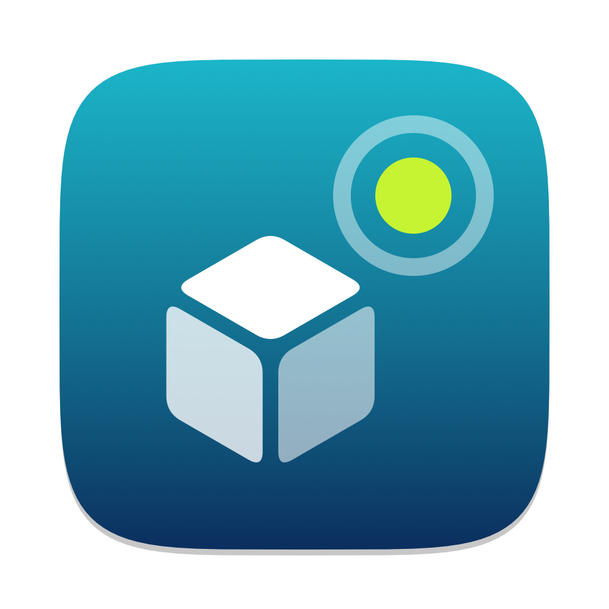
</p>

<h1 align="center">Sukrara — your sugar, now</h1>

<p align="center">
  <a href="https://github.com/mauriciabad/cgm-reading-mac-spike/releases/download/v0.11.44/Sukrara-0.11.44.apk"><b>Download for Android</b></a>
  &nbsp;·&nbsp;
  <a href="https://github.com/mauriciabad/cgm-reading-mac-spike/releases/download/v0.11.44/Sukrara-0.11.44.dmg"><b>Download for Mac</b></a>
  &nbsp;·&nbsp;
  <a href="https://github.com/mauriciabad/cgm-reading-mac-spike/releases">All releases</a>
  &nbsp;·&nbsp;
  <a href="https://sukrara.mauri.app">sukrara.mauri.app</a>
</p>

Sukrara shows live glucose from a **FreeStyle Libre 3** wherever you look: the **Mac menubar**, the **Android status
bar and home screen**, a **Garmin watch**, and the phones and Macs of the people who look after you. Readings travel
**end-to-end encrypted**, over **Bluetooth** when you're nearby or over **public Nostr relays** when you're not. There's
no cloud account to create and no server to host. The name is Catalan-ish: *sucre* (sugar) + *ara* (now).

> **This is an alpha, built from research spikes.** Each feature started as a throwaway proof of concept with a
> written report, and v0.10 bundles them into one app to see how it feels day to day. The real Sukrara will be
> rebuilt from scratch, properly and with more features, using what these spikes taught us.
> **Not a medical device** (see the [disclaimer](#disclaimer)).

<p align="center">
  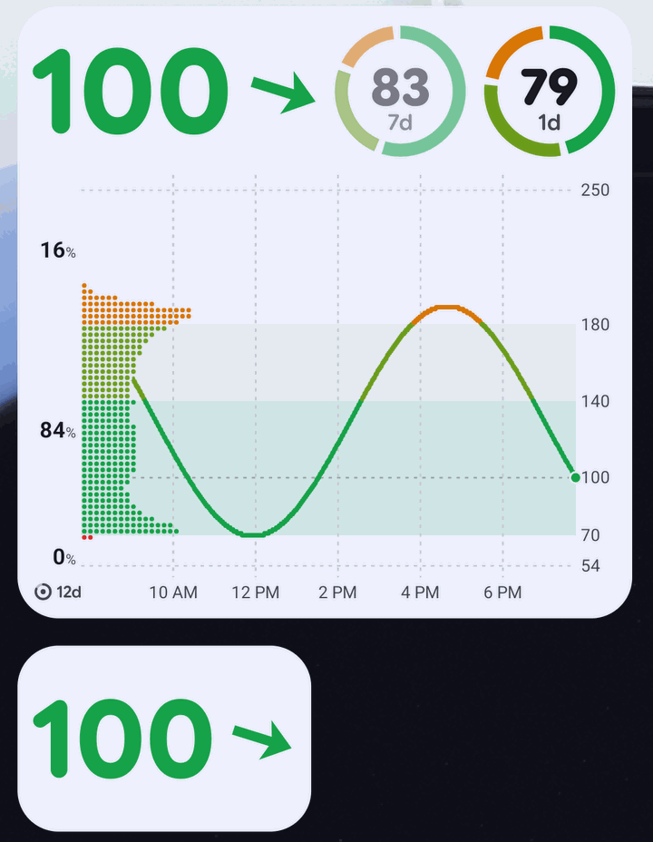
  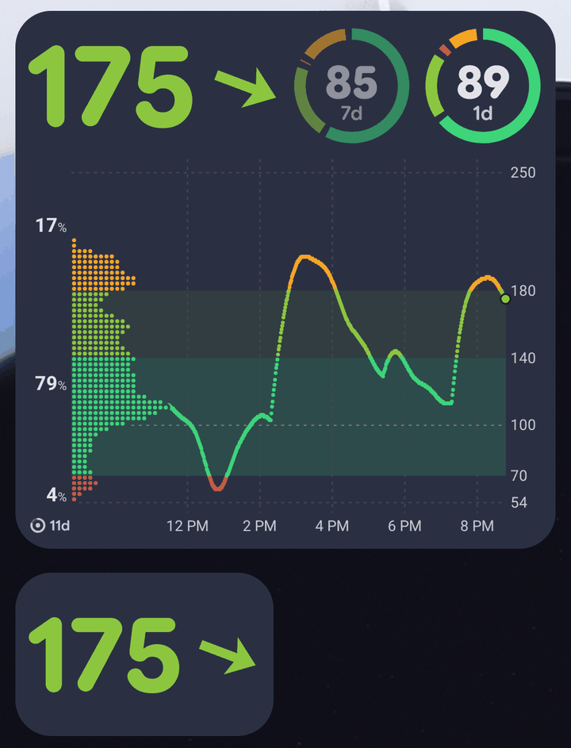
  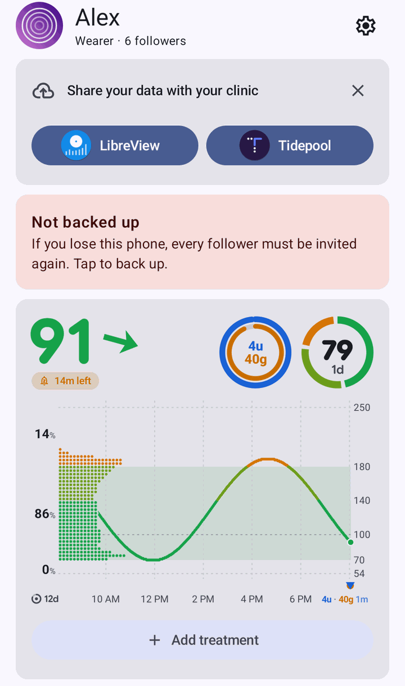
</p>
<p align="center">
  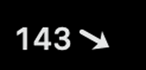
  &nbsp;
  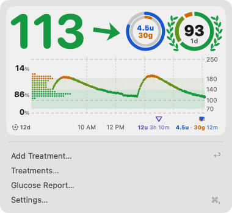
  &nbsp;
  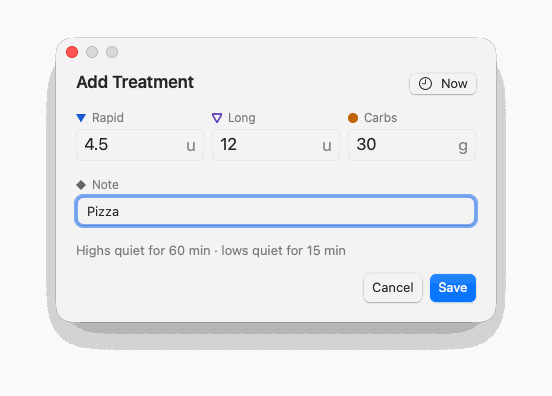
</p>
<p align="center">
  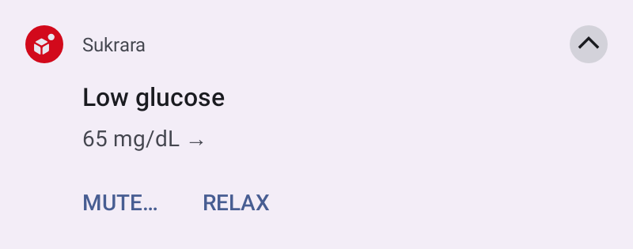
  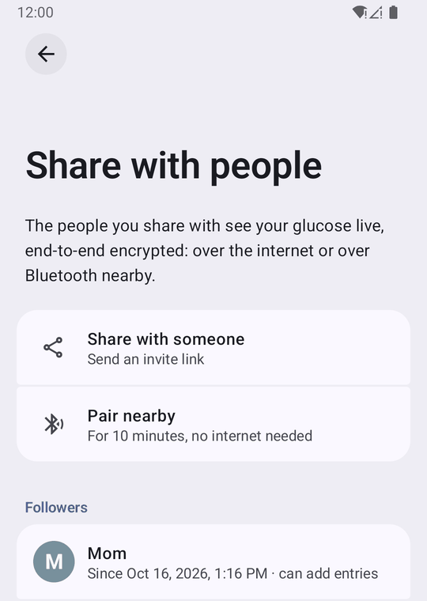
  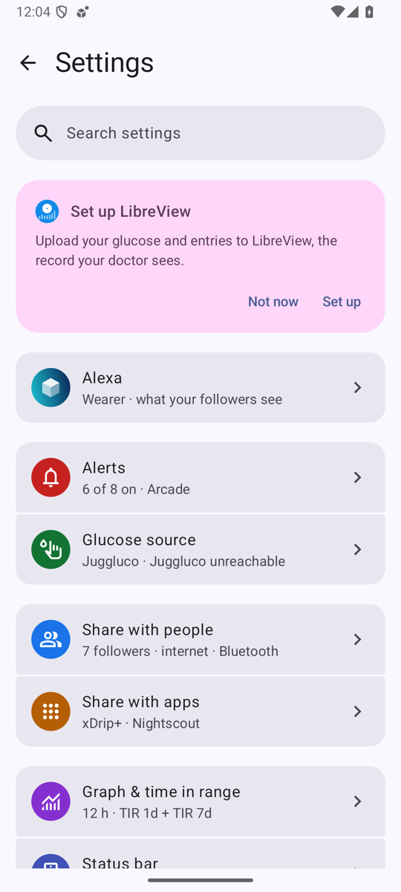
</p>
<p align="center">
  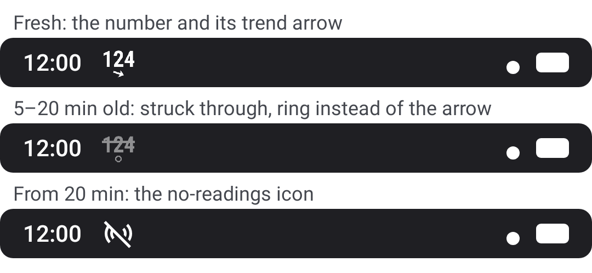
</p>

<sub>Android screenshots are from the emulator fed a synthetic day with meals, Mac ones from a test copy fed with synthetic data. The trend arrow turns continuously with the rate
of change (flat at 0, vertical at ±3 mg/dL/min, double beyond) instead of Libre's 5 fixed arrows. Colours follow
your ranges (default 54 / 70 / 140 / 180 / 250 mg/dL, the levels of LibreView's report). The status-bar sheet is drawn
by the app's icon code.</sub>

## Features

**On your phone** (Android 16+)
- Current value, continuous trend arrow and one glucose graph everywhere (app, widgets, notification, Mac): a 12 h
  chart with the time spent at each level beside it, the share of time below / in / above range (very low, very
  good and very high inside), and time-in-range rings for 1, 7 or 14 days. A perfect window earns a green crown (on
  the ring and over the 100 beside the chart) with a flowered laurel; 90 % earns a laurel and
  95–99 % a flowered one (lavender, forget-me-not, daisy, cherry, rosette); both can be turned off in the graph settings. No "time ago": the reading's time
  appears only once it's late, then (5 min) the number is struck through and grey, then (20 min) hidden behind a
  "no readings" icon, then (3 h) the chart goes too: the same steps on every surface, the status bar and the Mac
  menubar included, redrawn on time without a new reading. No trend from the sensor: a hollow ring instead of the arrow. A dashed line at 100 plus lines of
  your own, the very good part of the range in its own colour, and extremely high (≥ 300) in magenta. Ranges,
  lines, vertical hour lines (off, or every 1–12 h), windows (per place and per widget) and rings are settings.
  Drag or fling the home screen's chart to go back in time and pinch it to zoom from 2 hours to the whole month: the %
  and the distribution beside it, the scale, the time labels and the treatments follow what's on screen, and a *Now*
  pill brings you back. [16](docs/16-graph.md)
- Your doctor's report on the home screen: time in the five ranges, average glucose, GMI (% and mmol/mol) and
  variability (CV), each against the consensus goal, for 1, 7, 14 or 30 days; a share next to its goal gets
  decimals when rounding would put it on the wrong side (5.2 %, not 5 %, against < 5 %). Any of them can sit beside the number
  in the app and the widgets instead of a ring (for example GMI over 30 days). [18](docs/18-metrics.md) Source: the Libre 3 read directly (default): scan the
  sensor with NFC to start a new one (tied to your LibreView account, so LibreLink or Juggluco can take it over
  later) or take one over, and Sukrara pairs with it over Bluetooth by itself. Or
  Juggluco's web server, if Juggluco keeps the sensor (the way to use a Libre 2 / 2 Plus: Sukrara itself refuses those). When the sensor ends (15 days, or earlier if it fails), Sukrara says *Sensor ended*
  and stops trying to connect until you scan the new one. [02](docs/02-direct-sensor.md), [10](docs/10-showcase.md)
- **Other sensors, untested**: Dexcom G7 / ONE+ / Stelo (read along with the Dexcom app, sending nothing to the
  sensor), Accu-Chek SmartGuide (the PIN from the cap in Android's pairing dialog), Aidex X / LinX / GlucoRx (the
  serial from the box) and Dexcom G6 / ONE (the transmitter ID). They were built from open-source protocol work and
  checked against recorded traces, but nobody has tried them on a real sensor: choosing one asks you to confirm
  (a red warning whose *Continue anyway* waits 10 seconds), and while you use it home shows a banner under the graph asking for feedback as a
  GitHub issue. The banner goes away for a sensor once enough people confirm it works. Only the Libre 3 is tested.
  Untested sensors never reach other apps on the phone (no broadcasts, so a closed loop like AAPS can't dose from
  them), and every export names the real sensor ("Dexcom G7 / ONE+ (untested)"), never a Libre 3.
  [23](docs/23-sensors.md#in-sukrara)
- A guided *New sensor* screen: *Pair new sensor* on home (when there's no sensor, it has ended, or in its last
  day), the *Replace sensor* pill and the reminders open it. It starts by asking which sensor (the Libre 3 is
  preselected, and tapping it right away works too). For a Libre 3 it waits for the tap with a drawing of where this
  phone's NFC antenna is, vibrates when the sensor answers, then shows the Bluetooth pairing step by step, the
  warm-up countdown and the first reading. Turning NFC or Bluetooth on, the LibreView sign-in and every problem
  (ended sensor, Libre 2, a failed scan, another app holding the sensor) are handled on the same screen. Tapping a
  sensor while Sukrara is closed opens this screen and uses that tap. [21](docs/21-new-sensor-flow.md)
- Sensor end reminders that fit your day: at the times you choose (default: the day before and on the end day at
  09:00, "Sensor ends tomorrow at 14:30"), or earlier at your first unlock of the morning (from 05:00); on the last
  day "Take your spare sensor with you"; and if the sensor ends during your night (23:00–07:00, editable), a reminder
  the evening before, at 21:00 or your first unlock from 19:00 ("Sensor ends tonight at 3:10 · Change it before bed").
  Also a live countdown notification in the sensor's last hours (8 by default) and another while a
  new sensor warms up ("Readings at 19:45", "Almost ready" once its time is up, then "Sensor ready"). The countdowns
  show a timer in the status bar when the glucose chip doesn't need it, and never run below zero. Settings → Sensor end.
- Sensor life on the card (phone, widgets, lock screen, notification, Mac): a small sensor disc with the time left
  (`13d`, `20h`, `45m`) at the start of the graph's time row, under the % of time in range (cards
  without a graph show just the number; each place and widget can hide it), a ring over the main ring that counts down the sensor's last 8 hours (1–24 h,
  a setting), and during a new sensor's warm-up the minutes until the first reading (`42m`, *Ready at 19:45*; then
  *Almost ready* until it comes; also in the status bar text and the Quick Settings tile) with a ring that fills up. Every card (app, widgets, lock screen, notification, Mac) is drawn by one renderer, so it looks and decides the same everywhere. Once the sensor has ended every surface says *Sensor ended* with a *Replace sensor* pill (a checkered flag in the status bar and the Mac menubar) and no-data alerts stop. Followers and
  the Mac see the same (it travels with the live readings).
- Sensor end in your calendar (opt-in, like Juggluco's but without a tap): Sukrara makes its own "Sukrara" calendar
  on the phone (or uses one of your calendars, e.g. Google, to sync it everywhere) and keeps one "Sensor ends" event
  per sensor up to date; turning it off removes them. Google Calendar hides Sukrara's own calendar until you turn on
  "Sukrara" under its Settings → Manage accounts; the setting reminds you.
- Glucose in the status bar: a Live Update chip next to the clock and the number as the notification icon. The
  glucose notification shows the value, the same slots as the widgets (time in range, report numbers, last treatment)
  and the graph. With root: the value as system icons (by default right before the mobile signal once the LSPosed
  module runs; first among the system icons with root alone). With root
  + LSPosed: system icons or a coloured value next to the clock; as system icons, glucose keeps its place when the
  row fills up (other icons fold into Android's overflow dot first, and number and arrow go together, never just the
  arrow, as close as on the app's card). Settings detects root and the LSPosed module (via
  LSPosed's own service) and says what's missing: grant root, add System UI to the scope, restart System UI. After an
  update, home asks for a System UI restart only when the code System UI runs has changed (not on every install).
  [05](docs/05-android-status-bar.md)
- Settings drawn with Android's own settings library (AOSP SettingsLib SPA, as the Settings app uses): an overview
  with sections, large titles that collapse into the top bar, search (the index is built from the pages themselves,
  so it never goes out of date), the system's page and back-gesture motion, one number input everywhere (presets plus
  a custom value with its unit and range, the same choices on the Mac), the ring order by drag and drop,
  export / import / reset of the options, and a reminder to share your data with your clinic (LibreView or Tidepool). Apps and services show their real icons,
  drawn like the system Settings app's list; every other row has an icon too, with custom ones for diabetes things
  (the sensor, insulin, carbs, ranges, each alert). Each alert has its own page
  (threshold, reminders, sound, volume, test); sound previews play the alert's vibration too.
  [10](docs/10-showcase.md)
- Home-screen widgets: value (+ rings), graph, and graph + value, resizable, light/dark. Add the same widget twice
  and give each its own window and rings (touch & hold → Reconfigure). Until one is placed, home offers *Add widget*
  (the launcher's own dialog), dismissible. Every tip card you close offers *Undo* right away, and Settings →
  *Show closed tips* brings them all back. [12](docs/12-android-widgets.md),
  The big numbers are rounded on both (SF Pro Rounded on the Mac, Google Sans Flex rounded on Android).
  [16](docs/16-graph.md)
- Log rapid and long-acting insulin, carbs and a note in one dialog (carbs first when you're low), now or earlier: pick
  the time, or type how many minutes ago (or tap 5 / 15 / 30 / 60), on Android and Mac. Tapping a widget or the glucose notification
  opens it on top of whatever app you're in, and over the lock screen without unlocking. Also a Quick Settings tile,
  *Add treatment*. The charts and lists show how long ago each was (`4.5u 12m`), and a line on the chart shows how long
  it keeps alerts quiet. On the charts the labels sit under their markers, in the time axis' row, never over the
  line; a meal shares one label (`4.5u · 45g 1h 35m`), and close ones slide or take a second row, the same way on
  Android and Mac. For each kind you choose what the graphs show: the point, the mute line, the amount and the time
  (Settings → Graph → Treatments on the graph; carbs show only their point by default), on every graph and for
  followers that use the wearer's settings. [10](docs/10-showcase.md), [16](docs/16-graph.md#treatment-labels-under-the-markers-2026-10-18)
- Under the number, a badge says what to do when you're out of range (*Eat carbs*, *Take insulin*; tap it to log
  carbs or insulin right away, on the phone and the Mac), or that alerts
  are paused while a logged treatment works (and for how long). Beside it, your last insulin or carbs with the time
  since and a ring for the quiet time left (carbs eaten while insulin works: two rings, `8u` over `5g`); without a
  recent one, a 30-day time-in-range ring. [16](docs/16-graph.md)
- Lock screen (root + LSPosed): the value, rings and graph in the empty space around the fingerprint icon. Tap it to
  log a treatment without unlocking. Frosted glass behind it by default (or none, shadow, dim, card), light or dark
  like the home widgets, or following the dark theme (Settings → Lock screen). [17](docs/17-lockscreen-widget.md)
- Export your readings and treatments as a CSV file (Settings → Export data): this sensor, the last 7, 14 or 30
  days or all time, saved with the system file picker or sent with the share sheet. It is laid out like LibreView's own export, so
  Tidepool's uploader imports it and any spreadsheet opens it, plus the time with its UTC offset, the trend and who
  entered each treatment (phone, Mac or follower, never a name). Followers export what is already on their phone.
  [22](docs/22-ecosystem-outputs.md#in-sukrara-csv-export)
- Upload glucose and treatments to LibreView (Settings → Share with apps → LibreView). Off until you sign in and switch it on; then
  everything uploads by default. [04](docs/04-libreview.md)
- Upload glucose (one reading every 5 minutes) and insulin, carbs and notes to Tidepool (Settings → Share with apps →
  Tidepool, Android). Off until you sign in and switch it on; the first upload includes the last 31 days, edits and
  deletions follow, and a phone that was offline catches up by itself. Sukrara keeps only Tidepool's session, never your
  password. A follower uploads the person it follows only if you choose so. [27](docs/27-tidepool.md)
- Upload every glucose reading, insulin, carbs, notes, sensor changes and the phone battery to your own Nightscout
  site (Settings → Share with apps → Nightscout → Nightscout upload, Android, wearer only). Off until you set up the
  site with an access token (recommended) or the API secret, kept encrypted; https only, plain http only on your home
  network (with a warning). The first upload includes the last 30 days; edits, moves and deletions follow; an outage or
  a site that lost data heals by itself; if another app already uploads to the site, Sukrara pauses and asks. Upload
  only, nothing is read back. LoopFollow, nightguard, Trio, Home Assistant and Nightscout's own pages read it.
  [25](docs/25-nightscout-upload.md)
- Glucose alerts: very low, low, high, very high, extremely high, falling/rising fast and no data, each with its own threshold,
  reminder and sound (lows alert strictly below the threshold). Highs stay quiet for a while after rapid insulin and while
  glucose is already falling back into range; lows (also very low) stay quiet for a while after carbs, and alert at once
  when that window ends if still low ("Low glucose · eat more"; highs say "still high after insulin", never "take more").
  A short dip back into range doesn't restart the alert. Insulin never quiets extremely high. Every alert notification
  has two buttons: *Mute…* (pick 15 min, 30 min, 1 h, 2 h or type a length) and *Remind less* (every 30 min instead).
  They cover only that side (a high's mute never silences a low, very low and extremely high included) and end at their
  time or once glucose is back in range with a margin (10 mg/dL for 10 min, so hovering at the edge doesn't end them).
  *Mute alerts* on the home screen and in the Mac menu silences every alert for 30 min to 8 h or until you turn them back
  on, shown on every card as a *Muted* pill. Mutes only quiet the device you tap them on, so the Mac and followers keep
  alerting. Every quiet state has a way back: *Unmute* / *Change…* on the muted notification, the pill's sheet (or the
  Mac panel's rows), *Unmute*, and Settings › Alerts › *Active now* (also *Remind as usual* and *Alert me
  anyway* after carbs or insulin). Every muted state counts down (*Low alerts muted after carbs · 12 min left*). Durations read *1 h*, *2 h*, never *60 min*. Video-game sound packs ([listen](https://sukrara.mauri.app/sounds/)) with a different sound each time, and a
  vibration per alert you can tell apart in your pocket. [15](docs/15-alerts.md)
- In English or Spanish (Spain), settings included: follows the phone's language, or pick one for Sukrara alone in
  Android's app settings.

**On your Mac** (Sukrara for Mac, formerly GlucoseBar)
- The number and trend arrow in the menubar, coloured by range. A click opens a glance panel (like Control Center's):
  the same graph card as the phone (rings, 12 h chart, distribution, treatment marks with their quiet-time lines, the
  *Eat carbs* / *Take insulin* badge and the last-treatment slot; swipe the chart sideways with two fingers to go back
  in time, pinch or ⌘-scroll to zoom, *Now* to return) on the system material, then **Add Treatment…** (or Return),
  which opens the same form as the phone's dialog: rapid, long, carbs and a note at once, the time, Return saves. **Treatments…** opens the last 7
  days of treatments (delete there), **Glucose Report…** the 1/7/14/30-day report (with *Export CSV…*: the same file
  and periods as the phone's, this sensor, 7, 14 or 30 days or all time); right-click for Settings and Quit.
  [01](docs/01-connectivity.md), [16](docs/16-graph.md)
- A macOS Settings window (General, Graph, Rings, Alerts, Following) laid out after Apple's guidelines, reopening on the
  last pane. **Settings from**: the wearer's own settings (default), Sukrara's defaults, or Custom; only Custom shows
  the ranges, time shown, rings, lines and alert rules as controls (with *Copy the Wearer's Settings…* and *Reset to
  Defaults…* as a starting point), the other modes show what's in use. Sounds, the no-data alert, the notification's
  buttons and each place's own time shown (menu bar, widgets) are always the Mac's. Every number is a menu of presets
  plus *Custom…* that takes any value in range (the range is shown), the same formats as the phone; drag the ring order.
- Follows a wearer over Bluetooth (no network needed) or over Nostr, with the same match-code pairing as the phone
  (Settings → Following, with who you follow, name and picture; **Edit…** changes how the Mac appears to them: name
  and generated picture, like the phone). Keys stay in the macOS Keychain. Hours
  the Mac missed (asleep, offline) are filled in from the wearer's history. [07](docs/07-bluetooth-followers.md)
- The same glucose alerts and sound packs as the phone (Settings → Alerts): alert when the wearer's phone does
  (Settings from: Wearer), or with the defaults or the Mac's own rules; a test alert per alert. The same Mute… / Remind less
  notification actions and a *Mute Alerts* menu in the dropdown (bell-slash in the menu bar while on). Pick the pack, or another sound per alert, from a list with ▶ on each one.
  [15](docs/15-alerts.md)
- When Add Treatment isn't available (waiting for approval, or the wearer hasn't let this Mac add entries), the panel
  says why right under it.
- Treatments sync with the phone in 1–2 s and can go to LibreView too. [04](docs/04-libreview.md)
- Desktop and Notification Center widgets (value, graph, graph + value) with the same card, redrawn every minute.
  They need a build signed with an Apple certificate: a free Apple ID works on your own Mac, others need Developer
  ID. [13](docs/13-macos-widgets.md)

**Sharing and family**
- Share with a short link (63 characters) or a small QR code, optionally labelled with who it's for. Opening it shows
  who is inviting (name and picture); the other person asks and can close the app. You get a notification and a
  dialog with their name, picture and your label, and tap **Allow**. No code to compare: each link works once (24 h),
  and anyone who tries it after is told it was already used. [06](docs/06-sharing-and-keys.md), [14](docs/14-nostr-identity.md)
- Names and generated pictures for wearer and followers, so the follower list shows faces, not keys. They travel
  only end-to-end encrypted to the people you share with and are never posted publicly. The picture is sent as a few
  versioned numbers, not an image, so every Sukrara draws it the same, also after the drawing style changes.
  [14](docs/14-nostr-identity.md)
- Followers take their settings from the wearer (ranges, graph, rings, alert rules: the wearer's phone sends them,
  encrypted), from the defaults, or customise them, starting from either (Settings from, phone and Mac). They alert
  when the wearer's phone alerts (the alert itself is sent, encrypted) or with their own rules.
  [15](docs/15-alerts.md)
- Followers (phone and Mac) see the graph, ranges and alerts with the wearer's own settings by default (*Settings
  from: Wearer*, sent encrypted like the readings, over the internet or Bluetooth), or the defaults, or their own.
- Remove a follower at any time: the read key rotates and everyone else keeps going without doing anything.
- Pair nearby over Bluetooth with no internet at all, and see which followers are connected now and on what (phone or Mac; each device proves who it is) (Settings →
  Share with people → Nearby devices; tap one to *Forget* it, and pair it again any time). The phone broadcasts no name and shows who it is only while
  *Pair nearby* is open; followers send nothing to a phone until it proves it's the wearer's, and both sides limit
  what a stranger in range can send. [07](docs/07-bluetooth-followers.md), [24](docs/24-open-standard.md)
- Let a follower add entries (for example, a parent logging a meal); the wearer's phone accepts only approved writers,
  and a writer can change or delete only the entries it made.

**Watch and smart home**
- Garmin: Sukrara speaks the same local web API as Juggluco and xDrip+, so the CGM+ app, datafield and watch faces
  work unchanged (Settings → Share with apps → xDrip+ server, off by default; Garmin Connect is listed under Apps on
  this phone with the same switch). [08](docs/08-garmin.md)
- Nightscout-compatible adapter: stock Home Assistant, xDrip+, Nightguard, LoopFollow and others read it without
  changes (Settings → Share with apps → Nightscout, off by default). [03](docs/03-nostr.md)
- Apps on the same phone: AAPS, GlucoDataHandler (and through it Wear OS, Android Auto, WatchDrip+, Tasker) and
  xDrip+ get each reading as the xDrip+, LibreLink and Juggluco broadcasts, with the sensor named `Libre3`. Each app
  has its own switch (Settings → Share with apps → Apps on this phone), all off by default; only the wearer's phone
  reading the sensor itself sends them, never a follower. [22](docs/22-ecosystem-outputs.md#in-sukrara)
- Health Connect: blood glucose (interstitial fluid) for health apps, off until you allow it in Health Connect's own
  sheet; then the stored history once and every reading, one record per minute (no duplicates).
  [22](docs/22-ecosystem-outputs.md#in-sukrara)

**Privacy and keys**
- Every reading is signed by your phone and encrypted to a read key only your followers have. Relays only see
  ciphertext, and it expires on its own. [03](docs/03-nostr.md), [06](docs/06-sharing-and-keys.md)
- No account, no server of ours, no Abbott cloud in the loop.
- Back up your identity to Proton Pass, Bitwarden or KeePassDX as a normal password item. No passkeys, so you can
  move between password managers. [06](docs/06-sharing-and-keys.md)
- New phone? Restore from the password manager and your followers carry on without a new invite.

## Use cases

- **Glucose at a glance while you work.** The number sits in the Mac menubar, about 0.3 s behind the phone.
- **A parent follows their kid.** Scan the QR, Allow. Alarms on the parent's phone; remove them later
  with one tap.
- **No internet nearby.** On a plane or in a basement, the Mac or a family phone in the same room follows over
  Bluetooth.
- **Away from home on mobile data.** Followers anywhere get each reading through public Nostr relays in about a
  second.
- **A bedroom light at night.** Home Assistant's built-in Nightscout integration reads the adapter as-is, so "turn the
  light red if I'm above 180 for 10 minutes" is a normal automation. [03](docs/03-nostr.md)
- **The doctor still sees LibreView.** Glucose and treatments from the phone and the Mac arrive once each, no
  duplicates. [04](docs/04-libreview.md)
- **Glucose on the wrist.** Garmin watch faces and datafields keep working without Juggluco. [08](docs/08-garmin.md)

## By the numbers

All measured during the investigations (real phone and Mac unless noted). Details in each report.

| What | Result | Report |
|---|---|---|
| Phone → Mac over Wi-Fi / Bluetooth | ~0.3 s / 0.2–1 s; 17/17 readings with the phone unplugged and screen off | [01](docs/01-connectivity.md) |
| Phone → public relays → Mac menubar | 0.2–0.5 s (typically 0.3 s) | [03](docs/03-nostr.md) |
| New follower catches up on the last 12 h | 8 s, from hourly chunks | [03](docs/03-nostr.md) |
| Phone publishing every reading to 4 relays | 0.2 % of one CPU core, ~5.5–9 MB/day | [03](docs/03-nostr.md) |
| Mac following over Nostr | ~1.3 s of CPU per hour, ~3 MB/day download | [03](docs/03-nostr.md) |
| Load on public relays | 24 stored events per user per day, all self-expiring | [03](docs/03-nostr.md) |
| Nightscout clients | 17/17 request shapes pass; stock Home Assistant 2026.10 works | [03](docs/03-nostr.md) |
| Sharing protocol, end to end over real relays | 19/19 checks (incl. forged keys, revoke, phone change) | [06](docs/06-sharing-and-keys.md) |
| Android follower vs. wearer | 720/720 readings identical; 719/719 after a phone change, no re-invite | [06](docs/06-sharing-and-keys.md) |
| Mac forgery self-test | 13/13 forged inputs rejected | [07](docs/07-bluetooth-followers.md) |
| Bluetooth follower | 24 h backlog (~50 KB) in ~2.3 s ≈ 20 KiB/s; live ≈ 0.9 s | [07](docs/07-bluetooth-followers.md) |
| Reading the sensor directly | 3 h of history in ~1 s; 0 wakelocks (Juggluco: 973 in the same session) | [02](docs/02-direct-sensor.md) |
| Android widgets | ≈ 0.4 s CPU per minute update (emulator), nothing while the screen is off | [12](docs/12-android-widgets.md) |
| Nightscout upload (local Nightscout 15.0.8) | 48 h backfilled in 6 requests; an outage + 20 lost entries healed with 0 gaps / 0 duplicates | [25](docs/25-nightscout-upload.md) |

## How it works

```
                                    ┌──── Bluetooth LE (nearby, no internet) ────┐
Libre 3 ──BLE──▶ phone (Sukrara) ───┤                                            ├──▶ followers: Android, Mac,
            (via Juggluco, or       └──── public Nostr relays (anywhere) ────────┘    (Home Assistant via adapter)
             read directly)         same signed + encrypted events on both paths
                 │
                 ├── status bar, widgets, lock screen
                 ├── 127.0.0.1:17580 (xDrip+ server) ──▶ Garmin Connect ──▶ watch
                 ├── 127.0.0.1:17581 (Nightscout API) ──▶ Home Assistant, xDrip+, Nightguard…
                 ├── broadcasts ──▶ AAPS, GlucoDataHandler, xDrip+; Health Connect
                 ├── uploads (optional): LibreView, Tidepool, your Nightscout site
                 └── CSV export
```

- Your **identity key** lives in your password manager. It signs a list of your devices.
- Your phone's **device key** signs each reading; a shared **read key** encrypts it. Each approved follower gets the
  read key privately. Removing someone rotates it.
- Relays keep one live event per reading (expires in an hour) and one replaceable chunk per hour (expires in a week).
  Bluetooth carries exactly the same events, so a follower checks them the same way whichever path they came by.

The protocol is written down in [`spikes/nostr/PROTOCOL-v2.md`](spikes/nostr/PROTOCOL-v2.md), and as a vendor-neutral
open standard, the Open Glucose Stream, in [`spec/`](spec) ([24](docs/24-open-standard.md)). A clean-sheet draft 3,
reviewed ([24c](docs/24c-draft3-review.md)) and not yet in the apps, is in [`spec/draft3/`](spec/draft3)
([24b](docs/24b-open-standard-draft3.md)); Sukrara moves to it next. The spec is published (CC0) at
[github.com/mauriciabad/open-glucose-stream](https://github.com/mauriciabad/open-glucose-stream). It is a work in
progress: when Sukrara 1.0 ships, only the latest version is kept, older drafts are deleted and the numbering restarts.

## Investigations

| # | Topic | Result | Report |
|---|---|---|---|
| 01 | Live glucose onto a Mac without the cloud | Wi-Fi and Bluetooth both work, also with no shared network; Mac ↔ sensor directly works but isn't practical | [docs/01](docs/01-connectivity.md) |
| 02 | The phone reads the sensor itself | Works without Juggluco, values match exactly, no wakelocks | [docs/02](docs/02-direct-sensor.md) |
| 03 | Nostr relays as a no-hosting Nightscout | Works: ~1 s live, 12 h in 8 s, stock Home Assistant reads it; relay policies are the main risk | [docs/03](docs/03-nostr.md) |
| 04 | Treatments and glucose to LibreView | Phone and Mac upload as one device, synced over Bluetooth, no duplicates | [docs/04](docs/04-libreview.md) |
| 05 | Glucose in the Android status bar | All four approaches work; the coloured hook needs root | [docs/05](docs/05-android-status-bar.md) |
| 06 | Sharing and keys without lock-in | QR + match code + Allow, revoke by rotation, password-manager restore; 19/19 checks | [docs/06](docs/06-sharing-and-keys.md) |
| 07 | Bluetooth followers and nearby pairing | Same encrypted events over BLE, works fully offline, on Android and Mac | [docs/07](docs/07-bluetooth-followers.md) |
| 08 | Glucose on a Garmin watch | Existing watch apps work with our server; the watch polls every 5 min | [docs/08](docs/08-garmin.md) |
| 09 | Name, icon and style | **Sukrara**, the sugar cube with a live dot | [docs/09](docs/09-brand.md) |
| 10 | Sukrara, the showcase app | Every feature in one Android app, running daily as the wearer | [docs/10](docs/10-showcase.md) |
| 11 | Battery cost, with and without root | Harness ready ([spikes/power](spikes/power)); the run waits for the app to settle | — |
| 12 | Android home-screen widgets | Value, graph, graph + value; ~0.4 s CPU per update | [docs/12](docs/12-android-widgets.md) |
| 13 | macOS widgets | Built without Xcode; run in Sukrara for Mac with a free Apple ID certificate; every 1/min reload honoured | [docs/13](docs/13-macos-widgets.md) |
| 14 | Nostr identity: profiles, short invites, Nostr login | Kind 0 on a separate profile key, Blossom pictures (EXIF removed), 241 → 63-char invites, derived accounts from an nsec and via Amber. **In Sukrara 0.11:** the short invites and private names + generated pictures; public profiles, Blossom and Nostr login left out ([why](docs/14-nostr-identity.md#in-sukrara-what-was-added-and-what-was-left-out)) | [docs/14](docs/14-nostr-identity.md) |
| 15 | Glucose alerts, sound packs and haptics | One rule set on Android and Mac (15 + 53 tests), alerts mirrored to followers, packs served into native channels with a random variant each time, a vibration per alert | [docs/15](docs/15-alerts.md) |
| 16 | One glucose graph everywhere | One renderer (Android + Swift port) for app, widgets, notification and Mac: time at level beside the chart, time-in-range rectangles and rings, six ranges, freshness steps, per-widget settings. **In Sukrara 0.11.5** ([added / discarded](docs/16-graph.md#in-sukrara-0115)) | [docs/16](docs/16-graph.md) |
| 17 | Glucose and quick treatments on the lock screen | With root: SystemUI hosts a Sukrara widget under the Compose lock screen, around the fingerprint icon; taps (never on the sensor) open the treatment dialog over the lock screen. Without root: glanceable hub, the notification, a Quick Settings tile (asks to unlock). **In Sukrara 0.11.10** ([added / discarded](docs/17-lockscreen-widget.md#in-sukrara)) | [docs/17](docs/17-lockscreen-widget.md) |
| 18 | The doctor's report in the app | Time in ranges, average, GMI, CV with the consensus goals, as a home-screen card and as slots in the widgets; time-weighted like the rings. **In Sukrara 0.11.7** ([added / discarded](docs/18-metrics.md#in-sukrara-0117)) | [docs/18](docs/18-metrics.md) |
| 19 | Notification templates: the space under the icon | Custom views stay right of the icon; only Android 17's Live Update layout draws a ProgressStyle bar and action buttons across the whole card. Range bar with a tracker at the value, colours honoured (darkened when colorized), at most 10 segments and 4 points, no bar when collapsed. **Not in Sukrara yet** (proposal: the Live Update as ProgressStyle) | [docs/19](docs/19-notification-templates.md) |
| 20 | Publishing on every platform | Research; since v0.11.14 the own Homebrew tap is live. Mac: notarized dmg + Sparkle, own Homebrew tap (unsigned casks were disabled upstream on 2026-09-01). Android: new Play account (12 testers × 14 days) for a flavor without root features, GitHub/Obtainium + IzzyOnDroid for the full one, one release key registered for developer verification. Garmin: Connect IQ Store. 99 USD/year + 25 USD once | [docs/20](docs/20-publishing.md) |
| 21 | Starting a new sensor | One guided screen from home's *Pair new sensor* to the first reading: waits for the tap on this phone's antenna spot, Bluetooth steps, warm-up countdown, every detour on the same screen; a tap that opens Sukrara is used. **In Sukrara 0.11.16** ([added / discarded](docs/21-new-sensor-flow.md#in-sukrara)) | [docs/21](docs/21-new-sensor-flow.md) |
| 22 | Sukrara in the diabetes-tech ecosystem | Spike emits the three local broadcasts Juggluco has (xDrip+ `BgEstimate`, patched-LibreLink, `glucodata.Minute`) plus Health Connect: GlucoDataHandler 2.5 accepts all three, AAPS's own test classes give a `Libre3` label advanced filtering, 36 Health Connect records written. Dexcom BYODA from a Libre discarded. Top gap: Nightscout upload. **In Sukrara**: the three broadcasts per allowed app (wearer only) and Health Connect ([in Sukrara](docs/22-ecosystem-outputs.md#in-sukrara)) | [docs/22](docs/22-ecosystem-outputs.md) |
| 23 | More sensors, more brands | Matrix of every sensor the open projects can read, with the same yardstick as the Libre 2 decision. **Ported as a PoC** ([spikes/sensors-android](spikes/sensors-android)): Dexcom G7 / ONE+ / Stelo (reads along with the official Dexcom app, writing nothing — its own pairing needs a Dexcom app certificate, refused), Dexcom G6 / ONE, Accu-Chek SmartGuide (standard Bluetooth CGM Service), Aidex X; 36 tests against traces from LoopKit / DiaBLE / Juggluco, none on hardware. Discarded: CareSens Air, Sibionics, Libre 2 / 1, Medtrum (vendor algorithm or finger-sticks), Eversense / iCan / Ottai / Syai (no open implementation). **In Sukrara**: step 1, the `SensorDriver` abstraction and per-brand `SensorProfile`s with the Libre 3 moved behind them unchanged; steps 2–5, the four other families as **untested** (a brand step, a 5-second confirmation and a feedback banner under the graph until each is verified on real sensors) ([added / discarded](docs/23-sensors.md#in-sukrara)); step 6 (Lingo) not yet ([shopping list](docs/23-sensors.md#hardware-to-buy-if-the-user-wants-these-verified)) | [docs/23](docs/23-sensors.md) |
| 24 | An open standard for CGM sharing | **Open Glucose Stream (OGS) draft 1** in [`spec/`](spec): data model, a NIP-style Nostr spec, a Bluetooth GATT spec, conformance checklist, deterministic test vectors with an acceptance scenario; an independent Python reference (stdlib crypto) interoperates with the repo's v2 code and rust-nostr, also live on public relays. Bluetooth SIG CGMS: an optional read-only bridge, not the sharing protocol. 15 proposed changes. Published (CC0, work in progress) at [open-glucose-stream](https://github.com/mauriciabad/open-glucose-stream). **In Sukrara: the security fixes** (writers edit only their own entries, Bluetooth privacy and limits, Mac wrap expiry / stream id / chunk checks); the draft-2 wire changes wait for v1 ([added / open](docs/24-open-standard.md#in-sukrara), [proposals](spec/PROPOSALS.md)) | [docs/24](docs/24-open-standard.md) |
| 24b | Open Glucose Stream draft 3 | A clean-sheet redesign from requirements and a fresh state-of-the-art review: records signed by their authors, a day-key tree so a grant is exactly the agreed days (history start and end enforced by keys), envelope keys blinded per day, rotating inboxes, invites with an offer, contributors without echo, emergency invites, HI/LO and quality flags, sensor sessions, carers' alert acks, no constant Bluetooth UUID. MLS rejected. Python reference with deterministic vectors (42-step scenario) and a live run on 3 public relays (9/9). **In Sukrara: next** (decided 2026-10-19; about 30 agent-days, every follower re-invited) | [docs/24b](docs/24b-open-standard-draft3.md) |
| 24c | Independent review of OGS draft 3 | A skeptical review (cryptography, Nostr, BLE, health data). Sound core (GGM tree, BIP-340 tweaking, NIP-44/59 reuse), but 2 critical holes, both fixed and tested: a removed carer or a lost phone could keep writing into the old epoch (false insulin, false glucose) and members accepted it; any stranger who connected over Bluetooth got the envelopes. Also fixed: overclaimed unlinkability, `ended`/grant ordering, emergency invites could acknowledge alerts, 96-bit invite fingerprint, merge ties, re-subscription cost, grants carry each epoch's membership. 26 findings: 22 accepted, 3 rejected, 1 deferred; third-party publishers decided out of draft 3. **In Sukrara: nothing** (spec only) | [docs/24c](docs/24c-draft3-review.md) |
| 25 | Nightscout upload | PoC uploader library + CLI ([spikes/nightscout-upload](spikes/nightscout-upload)): queue, backoff, backfill by diffing the server, dedupe, API v1 + v3, API secret or least-privilege access token. Against a local Nightscout 15.0.8: 48 h backfilled in 6 requests, an outage + 20 lost entries healed with 0 gaps / 0 duplicates; LoopFollow / nightguard / Trio / Home Assistant 24/24, Trio's and LoopFollow's own decoders, stock Home Assistant and the Nightscout web client read it. Upload only, wearer only, long-acting insulin kept out of IOB. **In Sukrara (Android)** ([added / discarded](docs/25-nightscout-upload.md#in-sukrara)) | [docs/25](docs/25-nightscout-upload.md) |
| 26 | The full AGP report: percentile profile, daily profiles, a page for the doctor | The IDC AGP layout and goals (2019/2023 consensus, 2025 tight range); method as Tidepool's IDC-licensed print view (1 h bins, type-7 percentiles, 1-4-1 smoothing) on a 5-minute grid so 1-minute live data can't outweigh history (up to ~20 mg/dL otherwise). Kotlin engine + Swift port + pandas/numpy and d3-array checks agree to 0.0000 mg/dL on 3 synthetic 14-day fixtures (DST both ways, sensor change, gaps, sparse); one display list painted by Java2D and CoreGraphics (vector PDF). **Not in Sukrara:** the in-app AGP report will be its own investigation, reusing this engine and fixtures (no PNG/PDF export as the experience) | [docs/26](docs/26-agp-report.md) |
| 27 | Tidepool upload | How apps upload to Tidepool: OAuth needs a client id registered with Tidepool (Loop, xDrip+, AAPS have their own), so Sukrara uses Tidepool's own session login (`/auth/login`, no client id, password never stored); platform data model (`cbg` per 5-minute slot, `food`, `insulin` for injections, notes as Tidepool notes), deduplicated by origin id. Verified against production with a synthetic night across a DST change, then deleted. **In Sukrara (Android)** ([added / discarded](docs/27-tidepool.md#in-sukrara)) | [docs/27](docs/27-tidepool.md) |
| 28 | Choosing an insulin pump: Tandem Mobi, t:slim X2 or MiniMed 780G | Research for the user's own pump choice at Hospital Trueta (ICS). In Spain all three come with their own sensor (Tandem: Dexcom G7; 780G: Guardian 4 / Simplera / Abbott Instinct = pump-locked Libre 3 Plus, supplied at Trueta). A DIY loop is possible only on the Mobi; 100 % in range is not reachable on any system. **Most DIY freedom: Mobi**: pumpX2's open protocol, keyed by the pump's own 6-digit code, has bolus + temp basal + suspend + profiles (AAPS/Trio drivers in testing); t:slim X2 = read + bolus only; 780G = closed, cloud-only, MiniMed Mobile refuses root. Recommended: Mobi (iPhone app until Android in 2027). Sketch of what Sukrara needs: cloud read → local pumpX2 read → commands, with the data model, UI and uploads per step | [docs/28](docs/28-insulin-pump.md) |

## Try it

Downloads: [v0.11.44](https://github.com/mauriciabad/cgm-reading-mac-spike/releases/tag/v0.11.44) (Android and Mac)
([all releases](https://github.com/mauriciabad/cgm-reading-mac-spike/releases)).

### Install on Android

Android 16+, arm64. Download `Sukrara-0.11.44.apk` on the phone and open it. Android asks to allow installs from your
browser (or file manager) the first time: tap **Settings**, turn on **Allow from this source**, go back and tap
**Install** ([Android: install unknown apps](https://developer.android.com/distribute/marketing-tools/alternative-distribution#unknown-sources)). Updates
install over the old version and keep your data. Optional: [Obtainium](https://obtainium.imranr.dev/) with this repo's
URL picks up new releases automatically.

### Install on Mac

Apple Silicon, macOS 14+. Either way works:

- **Download** `Sukrara-0.11.44.dmg`, open it and drag **Sukrara** onto **Applications**.
- **Homebrew**: `brew install --cask mauriciabad/tap/sukrara` ([tap](https://github.com/mauriciabad/homebrew-tap);
  `brew upgrade` gets new releases).
- **Scripts**: the release also has `Sukrara-mac-0.11.44.zip` (same app); after unzipping, `xattr -dr
  com.apple.quarantine Sukrara.app` skips the first-open step below.

**First open (once).** The app isn't notarized by Apple yet, so macOS stops the first launch with *"Sukrara" Not
Opened — Apple could not verify "Sukrara" is free of malware that may harm your Mac or compromise your privacy.*
1. Click **Done** (not *Move to Trash*).
2. Open **System Settings → Privacy & Security** and scroll down to **Security**. It says *"Sukrara" was blocked to
   protect your Mac.* Click **Open Anyway** (shown for about an hour after the attempt).
3. Confirm with **Open Anyway** and your password or Touch ID. Sukrara starts and from then on opens normally.

Control-click → Open no longer skips this on macOS 15+ ([Apple: open a Mac app from an unknown
developer](https://support.apple.com/guide/mac-help/mh40616/mac), [Safely open apps on your
Mac](https://support.apple.com/en-us/102445)). Sukrara lives in the **menu bar** (no Dock icon): click the value for
the panel, **⌘,** for Settings.

### Set up on Android

1. If you wear the sensor, Sukrara reads it directly: after step 3, tap *Pair a sensor* and hold the back of the
   phone against it (stop Juggluco or LibreLink first). To keep Juggluco on the sensor instead, turn on its *Settings → Web
   server* ("Local only" can stay on) and pick *Settings → Glucose source → Juggluco* in Sukrara.
2. Open Sukrara. Grant *Notifications* and *Nearby devices*.
3. Choose **I wear the sensor**, type your name (Shuffle or Customize the picture if you like), then **Start fresh**,
   or **Restore from password manager** on a new phone.
4. Tap **Save to password manager** so a lost phone doesn't mean re-inviting everyone.
5. For the status-bar chip, tap *Allow Live Updates for Sukrara* in Settings. Add widgets from the home screen's
   widget picker.
6. Rooted with LSPosed: enable the Sukrara module (scope System UI) and restart System UI for the coloured status bar
   value and the lock screen widget.

**Sharing**
- Wearer: **Share with someone** shows a QR code and a link. The follower installs Sukrara, chooses
  **I follow someone** and scans or opens the link. Sukrara shows who is inviting; the follower types their name and
  asks. You see their name next to your label for the invite ("Who is it for?") and tap **Allow**. Each link works
  for one person.
- Tap your name at the top of the home screen to change your name or picture; followers see it at once.
- Nearby with no internet: wearer taps **Pair nearby** (Settings → Share with people), the follower picks the phone from the list, and the wearer types
  the 4-digit code shown on the follower's screen (a Bluetooth offer reaches every phone in range).

### Set up on Mac

Allow Bluetooth when asked. Desktop widgets: right-click the desktop → **Edit Widgets…** → Sukrara. To follow
end-to-end encrypted: on the phone, **Share** (copy the `https://sukrara.mauri.app/join#…` link), then in Sukrara's **Settings → Following → Follow with Invite Link…** (or **Follow Someone…** in
the panel before the first follow), paste, and
Allow on the phone. Update the phone and the Mac together (a Mac older than 0.11.22 can't write treatments over
Bluetooth to a newer phone). On the Mac, the link's web page also has an
**Open in Sukrara** button. Nearby pairing over
Bluetooth works the same way, with a code the wearer types. Following is the only way the Mac gets glucose from Sukrara for
Android (Juggluco's web server on the same network also works).

## Repository layout

```
docs/                     reports (one per investigation), images, evidence; also the sukrara.mauri.app site
spec/                     Open Glucose Stream: the open sharing standard, test vectors, independent Python reference
spikes/
  showcase-android/       Sukrara — the alpha Android app (Kotlin), bundles everything below
  menubar/                Sukrara for Mac (formerly GlucoseBar) — menubar app and follower (Swift, AppKit, CoreBluetooth)
  nostr/                  Nostr transport, protocol v2 (Python reference + tests), Android sharing app, Nightscout adapter
  glucobridge-android/    phone companion: Juggluco or direct sensor → Bluetooth, LibreView, Garmin server
  libreview/              LibreView upload spec + reference tool
  statusbar-android/      status-bar experiments (app + LSPosed module)
  widgets-android/        Android widgets (Jetpack Glance)
  widgets-macos/          macOS WidgetKit widgets built without Xcode
  brand/                  name and icon candidates, asset exporter
  ble-scan/               tiny BLE advertisement scanner
  alerts/                 alert rules spec, timeline scenarios, sound packs
  graph-fixtures/         shared graph test cases (Android + Mac)
  outputs-android/        broadcasts and Health Connect PoC (22)
  export-fixtures/        CSV export fixtures
  sensors-android/        more sensor brands PoC (23)
  nightscout-upload/      Nightscout uploader PoC (25)
  agp-report/             AGP report engine (26)
  notification-android/   notification templates (19)
  power/                  battery harness (11)
```
Build instructions per spike: [spikes/README.md](spikes/README.md).

## The real app

These spikes answered "can it be done, and what does it cost?". The real Sukrara will start from a clean codebase
with that knowledge: the same ideas (no account, nothing to host, end-to-end encryption, Bluetooth and Nostr), done
properly and with more features. It will probably keep the name.

## Disclaimer

- **Not a medical device.** Research prototypes; values may be wrong, late or missing. Don't make treatment
  decisions or rely on alarms from anything in this repo.
- FreeStyle Libre is a trademark of Abbott. This project is not affiliated with Abbott or with Juggluco.
- The sensor is read for interoperability with the author's own glucose data. Per-sensor pairing data is a secret
  and is never committed here.
- The direct-sensor code also compiles [Juggluco](https://github.com/j-kaltes/Juggluco)'s GPLv3 sources, which are
  fetched separately and not included in this repo.

## License

[GPL-3.0-or-later](LICENSE). Use it, change it, share it — but anything you build on it has to stay open source
under the same terms, and if you distribute a binary you have to offer its source too.

```
Copyright (C) 2026 Maurici Abad

This program is free software: you can redistribute it and/or modify it under the terms of the
GNU General Public License as published by the Free Software Foundation, either version 3 of the
License, or (at your option) any later version. It is distributed WITHOUT ANY WARRANTY; without
even the implied warranty of MERCHANTABILITY or FITNESS FOR A PARTICULAR PURPOSE. See the GNU
General Public License for more details.
```
