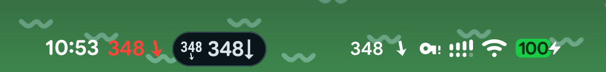
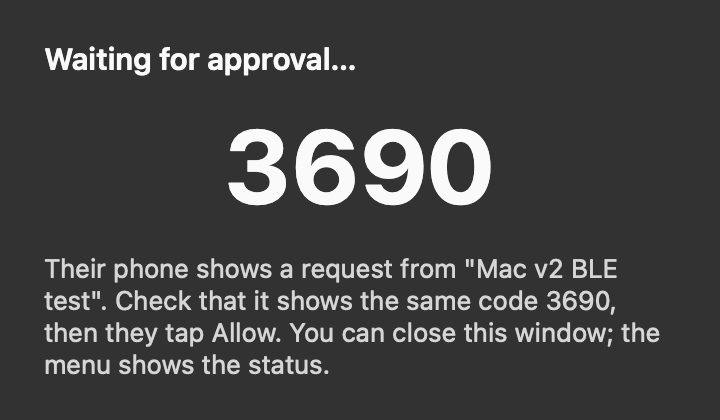

<p align="center">
  
</p>

<h1 align="center">Sukrara — your sugar, now</h1>

<p align="center">
  <a href="https://github.com/mauriciabad/cgm-reading-mac-spike/releases/download/v0.11.16/Sukrara-0.11.16.apk"><b>Download for Android</b></a>
  &nbsp;·&nbsp;
  <a href="https://github.com/mauriciabad/cgm-reading-mac-spike/releases/download/v0.11.16/Sukrara-0.11.16.dmg"><b>Download for Mac</b></a>
  &nbsp;·&nbsp;
  <a href="https://github.com/mauriciabad/cgm-reading-mac-spike/releases">All releases</a>
  &nbsp;·&nbsp;
  <a href="https://sukrara.mauri.app">sukrara.mauri.app</a>
</p>

Sukrara shows live glucose from a **FreeStyle Libre 3** wherever you look: the **Mac menubar**, the **Android status
bar and home screen**, a **Garmin watch**, and the phones and Macs of the people who look after you. Readings travel
**end-to-end encrypted**, over **Bluetooth** when you're nearby or over **public Nostr relays** when you're not. There's
no cloud account to create and no server to host. The name is Catalan-ish: *sucre* (sugar) + *ara* (now).

> **This is an alpha, built from research spikes.** Each feature started as a throwaway proof of concept with a
> written report, and v0.10 bundles them into one app to see how it feels day to day. The real Sukrara will be
> rebuilt from scratch, properly and with more features, using what these spikes taught us.
> **Not a medical device** (see the [disclaimer](#disclaimer)).

<p align="center">
  
  
  
  
</p>
<p align="center">
  
</p>
<p align="center">
  
</p>
<p align="center">
  
  &nbsp;
  
  &nbsp;
  
  &nbsp;
  
</p>

<sub>Android screenshots are from the emulator with a synthetic source. The trend arrow turns continuously with the rate
of change (flat at 0, vertical at ±3 mg/dL/min, double beyond) instead of Libre's 5 fixed arrows. Colours follow
your ranges (default 54 / 70 / 140 / 180 / 250 mg/dL, the levels of LibreView's report).</sub>

## Features

**On your phone** (Android 16+)
- Current value, continuous trend arrow and one glucose graph everywhere (app, widgets, notification, Mac): a 12 h
  chart with the time spent at each level beside it, the share of time below / in / above range (very low, very
  good and very high inside), and time-in-range rings for 1, 7 or 14 days. No "time ago": the reading's time
  appears only once it's late, then the number is struck through, then hidden. A dashed line at 100 plus lines of
  your own, the very good part of the range in its own colour, and extremely high (≥ 300) in magenta. Ranges,
  lines, vertical hour lines (off, or every 1–12 h), windows (per place and per widget) and rings are settings.
  [16](docs/16-graph.md)
- Your doctor's report on the home screen: time in the five ranges, average glucose, GMI (% and mmol/mol) and
  variability (CV), each against the consensus goal, for 1, 7, 14 or 30 days. Any of them can sit beside the number
  in the app and the widgets instead of a ring (for example GMI over 30 days). [18](docs/18-metrics.md) Source: the Libre 3 read directly (default): scan the
  sensor with NFC to start a new one (tied to your LibreView account, so LibreLink or Juggluco can take it over
  later) or take one over, and Sukrara pairs with it over Bluetooth by itself. Or
  Juggluco's web server, if Juggluco keeps the sensor (the way to use a Libre 2 / 2 Plus: Sukrara itself refuses those). When the sensor ends (15 days, or earlier if it fails), Sukrara says *Sensor ended*
  and stops trying to connect until you scan the new one. [02](docs/02-direct-sensor.md), [10](docs/10-showcase.md)
- A guided *New sensor* screen: *Pair new sensor* on home (when there's no sensor, it has ended, or in its last
  day), the *Replace sensor* pill and the reminders open it. It waits for the tap with a drawing of where this
  phone's NFC antenna is, vibrates when the sensor answers, then shows the Bluetooth pairing step by step, the
  warm-up countdown and the first reading. Turning NFC or Bluetooth on, the LibreView sign-in and every problem
  (ended sensor, Libre 2, a failed scan, another app holding the sensor) are handled on the same screen. Tapping a
  sensor while Sukrara is closed opens this screen and uses that tap. [21](docs/21-new-sensor-flow.md)
- Sensor end reminders at the times you choose (default: the day before and on the end day at 09:00, "Sensor ends
  tomorrow at 14:30"), a live countdown notification in the sensor's last hours (8 by default) and another while a
  new sensor warms up ("Readings at 19:45", then "Sensor ready"). The countdowns show a timer in the status bar
  when the glucose chip doesn't need it. Settings → Sensor end.
- Sensor life on the card (phone, widgets, lock screen, Mac): a small sensor disc next to the trend arrow with the
  time left (`13d`, `20h`, `45m`), a ring over the main ring that counts down the sensor's last 8 hours (1–24 h,
  a setting), and during a new sensor's warm-up the minutes until the first reading (`42m`, *Ready at 19:45*) with a
  ring that fills up. Once the sensor has ended every surface says *Sensor ended* with a *Replace sensor* pill (a checkered flag in the status bar and the Mac menubar) and no-data alerts stop. Followers and
  the Mac see the same (it travels with the live readings).
- Sensor end in your calendar (opt-in, like Juggluco's but without a tap): Sukrara makes its own "Sukrara" calendar
  on the phone (or uses one of your calendars, e.g. Google, to sync it everywhere) and keeps one "Sensor ends" event
  per sensor up to date; turning it off removes them.
- Glucose in the status bar: a Live Update chip next to the clock and the number as the notification icon. The
  glucose notification shows the value, the same slots as the widgets (time in range, report numbers, last treatment)
  and the graph. With root
  + LSPosed: system icons or a coloured value next to the clock. Settings detects root and the LSPosed module (via
  LSPosed's own service) and says what's missing: grant root, add System UI to the scope, restart System UI.
  [05](docs/05-android-status-bar.md)
- Settings drawn with Android's own settings library (AOSP SettingsLib SPA, as the Settings app uses): an overview
  with sections, large titles that collapse into the top bar, search (the index is built from the pages themselves,
  so it never goes out of date), the system's page and back-gesture motion, number options with a custom value,
  export / import / reset of the options, and a reminder to set up LibreView. Each alert has its own page
  (threshold, reminders, sound, volume, test); sound previews play the alert's vibration too.
  [10](docs/10-showcase.md)
- Home-screen widgets: value (+ rings), graph, and graph + value, resizable, light/dark. Add the same widget twice
  and give each its own window and rings (touch & hold → Reconfigure). [12](docs/12-android-widgets.md),
  The big numbers are rounded on both (SF Pro Rounded on the Mac, Google Sans Flex rounded on Android).
  [16](docs/16-graph.md)
- Log rapid and long-acting insulin, carbs and a note in one dialog (carbs first when you're low). Tapping a widget or the glucose notification
  opens it on top of whatever app you're in, and over the lock screen without unlocking. Also a Quick Settings tile,
  *Add treatment*. The charts and lists show how long ago each was (`4.5u 12m`), and a line on the chart shows how long
  it keeps alerts quiet. On the charts the labels sit under their markers, in the time axis' row, never over the
  line; a meal shares one label (`4.5u · 45g 1h 35m`), and close ones slide or take a second row, the same way on
  Android and Mac. [10](docs/10-showcase.md), [16](docs/16-graph.md#treatment-labels-under-the-markers-2026-10-18)
- Under the number, a badge says what to do when you're out of range (*Eat carbs*, *Take insulin*), or that alerts
  are paused while a logged treatment works (and for how long). Beside it, your last insulin or carbs with the time
  since and a ring for the quiet time left; without a recent one, a 30-day time-in-range ring. [16](docs/16-graph.md)
- Lock screen (root + LSPosed): the value, rings and graph in the empty space around the fingerprint icon. Tap it to
  log a treatment without unlocking. Frosted glass behind it by default (or none, shadow, dim, card), light or dark
  like the home widgets, or following the dark theme (Settings → Lock screen). [17](docs/17-lockscreen-widget.md)
- Upload glucose and treatments to LibreView (Settings → Share with apps → LibreView). Off until you sign in and switch it on; then
  everything uploads by default. [04](docs/04-libreview.md)
- Glucose alerts: very low, low, high, very high, extremely high, falling/rising fast and no data, each with its own threshold,
  reminder and sound (lows alert strictly below the threshold). Highs stay quiet for a while after rapid insulin and while
  glucose is already falling back into range; lows (also very low) stay quiet for a while after carbs, and alert at once
  when that window ends if still low ("Low glucose · eat more"; highs say "still high after insulin", never "take more").
  A short dip back into range doesn't restart the alert. Extremely high is never muted. Video-game sound packs ([listen](https://sukrara.mauri.app/sounds/)) with a different sound each time, and a
  vibration per alert you can tell apart in your pocket. [15](docs/15-alerts.md)
- In English or Spanish (Spain), settings included: follows the phone's language, or pick one for Sukrara alone in
  Android's app settings.

**On your Mac** (Sukrara for Mac, formerly GlucoseBar)
- The number and trend arrow in the menubar, coloured by range. A click opens a glance panel (like Control Center's):
  the same graph card as the phone (rings, 12 h chart, distribution, treatment marks with their quiet-time lines, the
  *Eat carbs* / *Take insulin* badge and the last-treatment slot) on the system material, then a log field — type
  `4.5u`, `30g`, `12 long` or a note and press Return (Undo right after). **Glucose Report…** opens a window with the
  1/7/14/30-day report and the last 7 days of treatments (delete there); right-click for Settings and Quit.
  [01](docs/01-connectivity.md), [16](docs/16-graph.md)
- A macOS Settings window (General, Graph, Alerts, Following) with every option that used to sit in submenus, plus the
  six ranges and Open at Login; it reopens on the last pane.
- Follows a wearer over Bluetooth (no network needed) or over Nostr, with the same match-code pairing as the phone
  (Settings → Following, with who you follow, name and picture). Keys stay in the macOS Keychain. Hours
  the Mac missed (asleep, offline) are filled in from the wearer's history. [07](docs/07-bluetooth-followers.md)
- The same glucose alerts and sound packs as the phone (Settings → Alerts): alert when the wearer's phone does, or
  with the Mac's own settings. [15](docs/15-alerts.md)
- Treatments sync with the phone in 1–2 s and can go to LibreView too. [04](docs/04-libreview.md)
- Desktop and Notification Center widgets (value, graph, graph + value) with the same card, redrawn every minute.
  They need a build signed with an Apple certificate: a free Apple ID works on your own Mac, others need Developer
  ID. [13](docs/13-macos-widgets.md)

**Sharing and family**
- Share with a short link (63 characters) or a small QR code, optionally labelled with who it's for. Opening it shows
  who is inviting (name and picture); the other person asks and can close the app. You get a notification and a
  dialog with their name, picture and your label, and tap **Allow**. No code to compare: each link works once (24 h),
  and anyone who tries it after is told it was already used. [06](docs/06-sharing-and-keys.md), [14](docs/14-nostr-identity.md)
- Names and generated pictures for wearer and followers, so the follower list shows faces, not keys. They travel
  only end-to-end encrypted to the people you share with and are never posted publicly. The picture is sent as a few
  versioned numbers, not an image, so every Sukrara draws it the same, also after the drawing style changes.
  [14](docs/14-nostr-identity.md)
- Followers alert when the wearer's phone alerts (the alert itself is sent, encrypted), or use their own settings.
  [15](docs/15-alerts.md)
- Remove a follower at any time: the read key rotates and everyone else keeps going without doing anything.
- Pair nearby over Bluetooth with no internet at all. [07](docs/07-bluetooth-followers.md)
- Let a follower add entries (for example, a parent logging a meal); the wearer's phone accepts only approved writers.

**Watch and smart home**
- Garmin: Sukrara speaks the same local web API as Juggluco and xDrip+, so the CGM+ app, datafield and watch faces
  work unchanged (Settings → Share with apps → xDrip+ server, off by default). [08](docs/08-garmin.md)
- Nightscout-compatible adapter: stock Home Assistant, xDrip+, Nightguard, LoopFollow and others read it without
  changes (Settings → Share with apps → Nightscout, off by default). [03](docs/03-nostr.md)

**Privacy and keys**
- Every reading is signed by your phone and encrypted to a read key only your followers have. Relays only see
  ciphertext, and it expires on its own. [03](docs/03-nostr.md), [06](docs/06-sharing-and-keys.md)
- No account, no server of ours, no Abbott cloud in the loop.
- Back up your identity to Proton Pass, Bitwarden or KeePassDX as a normal password item. No passkeys, so you can
  move between password managers. [06](docs/06-sharing-and-keys.md)
- New phone? Restore from the password manager and your followers carry on without a new invite.

## Use cases

- **Glucose at a glance while you work.** The number sits in the Mac menubar, about 0.3 s behind the phone.
- **A parent follows their kid.** Scan the QR, check the code, Allow. Alarms on the parent's phone; remove them later
  with one tap.
- **No internet nearby.** On a plane or in a basement, the Mac or a family phone in the same room follows over
  Bluetooth.
- **Away from home on mobile data.** Followers anywhere get each reading through public Nostr relays in about a
  second.
- **A bedroom light at night.** Home Assistant's built-in Nightscout integration reads the adapter as-is, so "turn the
  light red if I'm above 180 for 10 minutes" is a normal automation. [03](docs/03-nostr.md)
- **The doctor still sees LibreView.** Glucose and treatments from the phone and the Mac arrive once each, no
  duplicates. [04](docs/04-libreview.md)
- **Glucose on the wrist.** Garmin watch faces and datafields keep working without Juggluco. [08](docs/08-garmin.md)

## By the numbers

All measured during the investigations (real phone and Mac unless noted). Details in each report.

| What | Result | Report |
|---|---|---|
| Phone → Mac over Wi-Fi / Bluetooth | ~0.3 s / 0.2–1 s; 17/17 readings with the phone unplugged and screen off | [01](docs/01-connectivity.md) |
| Phone → public relays → Mac menubar | 0.2–0.5 s (typically 0.3 s) | [03](docs/03-nostr.md) |
| New follower catches up on the last 12 h | 8 s, from hourly chunks | [03](docs/03-nostr.md) |
| Phone publishing every reading to 4 relays | 0.2 % of one CPU core, ~5.5–9 MB/day | [03](docs/03-nostr.md) |
| Mac following over Nostr | ~1.3 s of CPU per hour, ~3 MB/day download | [03](docs/03-nostr.md) |
| Load on public relays | 24 stored events per user per day, all self-expiring | [03](docs/03-nostr.md) |
| Nightscout clients | 17/17 request shapes pass; stock Home Assistant 2026.10 works | [03](docs/03-nostr.md) |
| Sharing protocol, end to end over real relays | 19/19 checks (incl. forged keys, revoke, phone change) | [06](docs/06-sharing-and-keys.md) |
| Android follower vs. wearer | 720/720 readings identical; 719/719 after a phone change, no re-invite | [06](docs/06-sharing-and-keys.md) |
| Mac forgery self-test | 13/13 forged inputs rejected | [07](docs/07-bluetooth-followers.md) |
| Bluetooth follower | 24 h backlog (~50 KB) in ~2.3 s ≈ 20 KiB/s; live ≈ 0.9 s | [07](docs/07-bluetooth-followers.md) |
| Reading the sensor directly | 3 h of history in ~1 s; 0 wakelocks (Juggluco: 973 in the same session) | [02](docs/02-direct-sensor.md) |
| Android widgets | ≈ 0.4 s CPU per minute update (emulator), nothing while the screen is off | [12](docs/12-android-widgets.md) |

## How it works

```
                                    ┌──── Bluetooth LE (nearby, no internet) ────┐
Libre 3 ──BLE──▶ phone (Sukrara) ───┤                                            ├──▶ followers: Android, Mac,
            (via Juggluco, or       └──── public Nostr relays (anywhere) ────────┘    (Home Assistant via adapter)
             read directly)         same signed + encrypted events on both paths
                 │
                 ├── status bar, widgets
                 ├── 127.0.0.1:17580 ──▶ Garmin Connect ──▶ watch
                 └── LibreView (optional, for the doctor)
```

- Your **identity key** lives in your password manager. It signs a list of your devices.
- Your phone's **device key** signs each reading; a shared **read key** encrypts it. Each approved follower gets the
  read key privately. Removing someone rotates it.
- Relays keep one live event per reading (expires in an hour) and one replaceable chunk per hour (expires in a week).
  Bluetooth carries exactly the same events, so a follower checks them the same way whichever path they came by.

The protocol is written down in [`spikes/nostr/PROTOCOL-v2.md`](spikes/nostr/PROTOCOL-v2.md).

## Investigations

| # | Topic | Result | Report |
|---|---|---|---|
| 01 | Live glucose onto a Mac without the cloud | Wi-Fi and Bluetooth both work, also with no shared network; Mac ↔ sensor directly works but isn't practical | [docs/01](docs/01-connectivity.md) |
| 02 | The phone reads the sensor itself | Works without Juggluco, values match exactly, no wakelocks | [docs/02](docs/02-direct-sensor.md) |
| 03 | Nostr relays as a no-hosting Nightscout | Works: ~1 s live, 12 h in 8 s, stock Home Assistant reads it; relay policies are the main risk | [docs/03](docs/03-nostr.md) |
| 04 | Treatments and glucose to LibreView | Phone and Mac upload as one device, synced over Bluetooth, no duplicates | [docs/04](docs/04-libreview.md) |
| 05 | Glucose in the Android status bar | All four approaches work; the coloured hook needs root | [docs/05](docs/05-android-status-bar.md) |
| 06 | Sharing and keys without lock-in | QR + match code + Allow, revoke by rotation, password-manager restore; 19/19 checks | [docs/06](docs/06-sharing-and-keys.md) |
| 07 | Bluetooth followers and nearby pairing | Same encrypted events over BLE, works fully offline, on Android and Mac | [docs/07](docs/07-bluetooth-followers.md) |
| 08 | Glucose on a Garmin watch | Existing watch apps work with our server; the watch polls every 5 min | [docs/08](docs/08-garmin.md) |
| 09 | Name, icon and style | **Sukrara**, the sugar cube with a live dot | [docs/09](docs/09-brand.md) |
| 10 | Sukrara, the showcase app | Every feature in one Android app, running daily as the wearer | [docs/10](docs/10-showcase.md) |
| 11 | Battery cost, with and without root | *In progress* | — |
| 12 | Android home-screen widgets | Value, graph, graph + value; ~0.4 s CPU per update | [docs/12](docs/12-android-widgets.md) |
| 13 | macOS widgets | Built without Xcode; run in Sukrara for Mac with a free Apple ID certificate; every 1/min reload honoured | [docs/13](docs/13-macos-widgets.md) |
| 14 | Nostr identity: profiles, short invites, Nostr login | Kind 0 on a separate profile key, Blossom pictures (EXIF removed), 241 → 63-char invites, derived accounts from an nsec and via Amber. **In Sukrara 0.11:** the short invites and private names + generated pictures; public profiles, Blossom and Nostr login left out ([why](docs/14-nostr-identity.md#in-sukrara-what-was-added-and-what-was-left-out)) | [docs/14](docs/14-nostr-identity.md) |
| 15 | Glucose alerts, sound packs and haptics | One rule set on Android and Mac (15 + 53 tests), alerts mirrored to followers, packs served into native channels with a random variant each time, a vibration per alert | [docs/15](docs/15-alerts.md) |
| 16 | One glucose graph everywhere | One renderer (Android + Swift port) for app, widgets, notification and Mac: time at level beside the chart, time-in-range rectangles and rings, six ranges, freshness steps, per-widget settings. **In Sukrara 0.11.5** ([added / discarded](docs/16-graph.md#in-sukrara-0115)) | [docs/16](docs/16-graph.md) |
| 17 | Glucose and quick treatments on the lock screen | With root: SystemUI hosts a Sukrara widget under the Compose lock screen, around the fingerprint icon; taps (never on the sensor) open the treatment dialog over the lock screen. Without root: glanceable hub, the notification, a Quick Settings tile (asks to unlock). **In Sukrara 0.11.10** ([added / discarded](docs/17-lockscreen-widget.md#in-sukrara)) | [docs/17](docs/17-lockscreen-widget.md) |
| 18 | The doctor's report in the app | Time in ranges, average, GMI, CV with the consensus goals, as a home-screen card and as slots in the widgets; time-weighted like the rings. **In Sukrara 0.11.7** ([added / discarded](docs/18-metrics.md#in-sukrara-0117)) | [docs/18](docs/18-metrics.md) |
| 19 | Notification templates: the space under the icon | Custom views stay right of the icon; only Android 17's Live Update layout draws a ProgressStyle bar and action buttons across the whole card. Range bar with a tracker at the value, colours honoured (darkened when colorized), at most 10 segments and 4 points, no bar when collapsed. **Not in Sukrara yet** (proposal: the Live Update as ProgressStyle) | [docs/19](docs/19-notification-templates.md) |
| 20 | Publishing on every platform | Research; since v0.11.14 the own Homebrew tap is live. Mac: notarized dmg + Sparkle, own Homebrew tap (unsigned casks were disabled upstream on 2026-09-01). Android: new Play account (12 testers × 14 days) for a flavor without root features, GitHub/Obtainium + IzzyOnDroid for the full one, one release key registered for developer verification. Garmin: Connect IQ Store. 99 USD/year + 25 USD once | [docs/20](docs/20-publishing.md) |
| 21 | Starting a new sensor | One guided screen from home's *Pair new sensor* to the first reading: waits for the tap on this phone's antenna spot, Bluetooth steps, warm-up countdown, every detour on the same screen; a tap that opens Sukrara is used. **In Sukrara 0.11.16** ([added / discarded](docs/21-new-sensor-flow.md#in-sukrara)) | [docs/21](docs/21-new-sensor-flow.md) |

## Try it

Downloads: [v0.11.16](https://github.com/mauriciabad/cgm-reading-mac-spike/releases/tag/v0.11.16) (Android and Mac)
([all releases](https://github.com/mauriciabad/cgm-reading-mac-spike/releases)).

### Install on Android

Android 16+, arm64. Download `Sukrara-0.11.16.apk` on the phone and open it. Android asks to allow installs from your
browser (or file manager) the first time: tap **Settings**, turn on **Allow from this source**, go back and tap
**Install** ([Android: install unknown apps](https://developer.android.com/distribute/marketing-tools/alternative-distribution#unknown-sources)). Updates
install over the old version and keep your data. Optional: [Obtainium](https://obtainium.imranr.dev/) with this repo's
URL picks up new releases automatically.

### Install on Mac

Apple Silicon, macOS 14+. Either way works:

- **Download** `Sukrara-0.11.16.dmg`, open it and drag **Sukrara** onto **Applications**.
- **Homebrew**: `brew install --cask mauriciabad/tap/sukrara` ([tap](https://github.com/mauriciabad/homebrew-tap);
  `brew upgrade` gets new releases).
- **Scripts**: the release also has `Sukrara-mac-0.11.16.zip` (same app); after unzipping, `xattr -dr
  com.apple.quarantine Sukrara.app` skips the first-open step below.

**First open (once).** The app isn't notarized by Apple yet, so macOS stops the first launch with *"Sukrara" Not
Opened — Apple could not verify "Sukrara" is free of malware that may harm your Mac or compromise your privacy.*
1. Click **Done** (not *Move to Trash*).
2. Open **System Settings → Privacy & Security** and scroll down to **Security**. It says *"Sukrara" was blocked to
   protect your Mac.* Click **Open Anyway** (shown for about an hour after the attempt).
3. Confirm with **Open Anyway** and your password or Touch ID. Sukrara starts and from then on opens normally.

Control-click → Open no longer skips this on macOS 15+ ([Apple: open a Mac app from an unknown
developer](https://support.apple.com/guide/mac-help/mh40616/mac), [Safely open apps on your
Mac](https://support.apple.com/en-us/102445)). Sukrara lives in the **menu bar** (no Dock icon): click the value for
the panel, **⌘,** for Settings.

### Set up on Android

1. If you wear the sensor, Sukrara reads it directly: after step 3, tap *Pair a sensor* and hold the back of the
   phone against it (stop Juggluco or LibreLink first). To keep Juggluco on the sensor instead, turn on its *Settings → Web
   server* ("Local only" can stay on) and pick *Settings → Glucose source → Juggluco* in Sukrara.
2. Open Sukrara. Grant *Notifications* and *Nearby devices*.
3. Choose **I wear the sensor**, type your name (Shuffle or Customize the picture if you like), then **Start fresh**,
   or **Restore from password manager** on a new phone.
4. Tap **Save to password manager** so a lost phone doesn't mean re-inviting everyone.
5. For the status-bar chip, tap *Allow Live Updates for Sukrara* in Settings. Add widgets from the home screen's
   widget picker.
6. Rooted with LSPosed: enable the Sukrara module (scope System UI) and restart System UI for the coloured status bar
   value and the lock screen widget.

**Sharing**
- Wearer: **Share with someone** shows a QR code and a link. The follower installs Sukrara, chooses
  **I follow someone** and scans or opens the link. Sukrara shows who is inviting; the follower types their name and
  asks. You see their name next to your label for the invite ("Who is it for?") and tap **Allow**. Each link works
  for one person.
- Tap your name at the top of the home screen to change your name or picture; followers see it at once.
- Nearby with no internet: wearer taps **Pair nearby** (Settings → Share with people), the follower picks the phone from the list, and the wearer types
  the 4-digit code shown on the follower's screen (a Bluetooth offer reaches every phone in range).

### Set up on Mac

Allow Bluetooth when asked. Desktop widgets: right-click the desktop → **Edit Widgets…** → Sukrara. To follow
end-to-end encrypted: on the phone, **Share** (copy the `https://sukrara.mauri.app/join#…` link), then in Sukrara's **Settings → Following → Follow with Invite Link…** (or **Follow Someone…** in
the panel before the first follow), paste, and
Allow on the phone. Sukrara for Mac 0.11 and the phone app 0.11 must be used together: older builds read only the
old, long links. On the Mac, the link's web page also has an
**Open in Sukrara** button. Nearby pairing over
Bluetooth works the same way, with a code the wearer types. Following is the only way the Mac gets glucose from Sukrara for
Android (Juggluco's web server on the same network also works).

## Repository layout

```
docs/                     reports (one per investigation), images, evidence; also the sukrara.mauri.app site
spikes/
  showcase-android/       Sukrara — the alpha Android app (Kotlin), bundles everything below
  menubar/                Sukrara for Mac (formerly GlucoseBar) — menubar app and follower (Swift, AppKit, CoreBluetooth)
  nostr/                  Nostr transport, protocol v2 (Python reference + tests), Android sharing app, Nightscout adapter
  glucobridge-android/    phone companion: Juggluco or direct sensor → Bluetooth, LibreView, Garmin server
  libreview/              LibreView upload spec + reference tool
  statusbar-android/      status-bar experiments (app + LSPosed module)
  widgets-android/        Android widgets (Jetpack Glance)
  widgets-macos/          macOS WidgetKit widgets built without Xcode
  brand/                  name and icon candidates, asset exporter
  ble-scan/               tiny BLE advertisement scanner
```
Build instructions per spike: [spikes/README.md](spikes/README.md).

## The real app

These spikes answered "can it be done, and what does it cost?". The real Sukrara will start from a clean codebase
with that knowledge: the same ideas (no account, nothing to host, end-to-end encryption, Bluetooth and Nostr), done
properly and with more features. It will probably keep the name.

## Disclaimer

- **Not a medical device.** Research prototypes; values may be wrong, late or missing. Don't make treatment
  decisions or rely on alarms from anything in this repo.
- FreeStyle Libre is a trademark of Abbott. This project is not affiliated with Abbott or with Juggluco.
- The sensor is read for interoperability with the author's own glucose data. Per-sensor pairing data is a secret
  and is never committed here.
- The direct-sensor code also compiles [Juggluco](https://github.com/j-kaltes/Juggluco)'s GPLv3 sources, which are
  fetched separately and not included in this repo.

## License

[GPL-3.0-or-later](LICENSE). Use it, change it, share it — but anything you build on it has to stay open source
under the same terms, and if you distribute a binary you have to offer its source too.

```
Copyright (C) 2026 Maurici Abad

This program is free software: you can redistribute it and/or modify it under the terms of the
GNU General Public License as published by the Free Software Foundation, either version 3 of the
License, or (at your option) any later version. It is distributed WITHOUT ANY WARRANTY; without
even the implied warranty of MERCHANTABILITY or FITNESS FOR A PARTICULAR PURPOSE. See the GNU
General Public License for more details.
```
