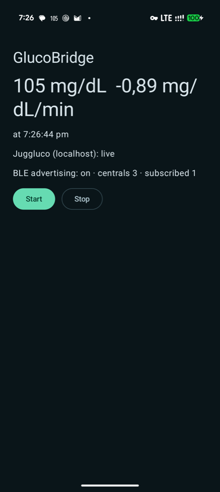

# CGM on the Mac — research spikes

Research repo for a **macOS menubar app that shows live FreeStyle Libre 3 glucose** (number + a precise trend arrow)
**without the cloud** (no LibreView / LibreLinkUp), and for a future **Android app that replaces Juggluco**.
Each investigation is a set of throwaway proofs of concept plus a written report; the code here is meant to be read and
learned from, not shipped.

<p>
  
  &nbsp;
  
</p>


<sub>The arrow angle is continuous in the sensor's rate of change (0 → flat, ±3 mg/dL/min → vertical, double chevron
beyond) instead of Libre's 5 fixed arrows. Colours follow personal thresholds 65 / 145 / 185 mg/dL.</sub>

## Investigations

| # | Date | Topic | Report |
|---|---|---|---|
| 01 | 2026-10-15 | Getting live glucose onto a Mac: direct sensor BLE, Juggluco over Wi-Fi, and Bluetooth when there's no shared network | [docs/01-connectivity.md](docs/01-connectivity.md) |
| 02 | 2026-10-15 | The phone app reads the sensor itself (no Juggluco), and what that costs in battery | [docs/02-direct-sensor.md](docs/02-direct-sensor.md) |
| 03 | 2026-10-15 | Nostr relays as the backbone of a no-hosting Nightscout alternative: remote + shared, E2E-encrypted, works with stock Home Assistant | [docs/03-nostr.md](docs/03-nostr.md) |

## Current conclusions

| Question | Answer |
|---|---|
| Can a Mac read the Libre 3 sensor directly over Bluetooth? | **Yes, proven.** It authenticated and decrypted live 1-minute readings using Juggluco's open-source C port of the Libre 3 security. But a phone must still start the sensor (NFC) and hand over its pairing secrets, and the sensor talks to **one** device at a time — so it can't run alongside the phone. |
| Can Juggluco feed the Mac without internet? | **Yes, proven** over Wi-Fi (auto-discovery, ~0.3 s latency) and USB. Requires Juggluco's web server with "Local only" off. |
| …with **no shared network** (Mac offline, or Mac on home Wi-Fi + phone on mobile data)? | **Yes, proven over Bluetooth LE** with a small companion app (GlucoBridge) that relays Juggluco to the Mac: every reading delivered within ~1 s, also with the phone on mobile data and with the phone unplugged/screen-off for 17 min. |
| Can the companion app read the sensor itself, dropping Juggluco? | **Yes, proven** (investigation 02). It resumed the sensor session on its own and delivered a reading a minute to the Mac, matching Juggluco's values exactly. Still needs a phone to activate a new sensor (NFC). |
| Recommended architecture | **Phone app = sensor reader + BLE GATT server; Mac app = BLE central** (Wi-Fi as a secondary transport). Both halves are now proven. |

## Try it (PoC 1, works today with Juggluco)

Downloads are on the [Releases page](https://github.com/mauriciabad/cgm-reading-mac-spike/releases).

1. **Phone**: Juggluco connected to your Libre 3, with *Settings → Web server* **Active** ("Local only" may stay on).
   Install `GlucoBridge-*.apk`, open it, allow *Nearby devices* + *Notifications*. It shows the latest value and
   "BLE advertising: on".
2. **Mac** (Apple Silicon, macOS 14+): unzip `GlucoseBar.app.zip`, then
   `xattr -dr com.apple.quarantine GlucoseBar.app` (it's ad-hoc signed) and open it. Allow Bluetooth (and Local
   Network if you also want the Wi-Fi transport). The number appears in the menubar within a few seconds.



Not a medical device — see the [disclaimer](#disclaimer).

## Repository layout

```
docs/                     reports (one per investigation), images, raw evidence logs
spikes/
  menubar/                GlucoseBar — macOS menubar app (Swift, AppKit, CoreBluetooth). Wi-Fi + BLE transports
  glucobridge-android/    GlucoBridge — Android companion (Kotlin), two flavors:
                            juggluco = Juggluco on localhost → BLE GATT server (PoC 1)
                            direct   = reads the Libre 3 sensor itself (PoC 2)
  ble-scan/               tiny BLE advertisement scanner
```
The direct Mac ↔ sensor experiment is summarized in the report but its code is not published.

Build instructions per spike: [spikes/README.md](spikes/README.md).

## Disclaimer

- **Not a medical device.** Research prototypes; values may be wrong, late or missing. Don't make treatment
  decisions or rely on alarms from anything in this repo.
- FreeStyle Libre is a trademark of Abbott. This project is not affiliated with Abbott or with Juggluco.
- The sensor is read for interoperability with the author's own glucose data. Per-sensor pairing data is a secret
  and is never committed here.
- The `direct` flavor also compiles [Juggluco](https://github.com/j-kaltes/Juggluco)'s GPLv3 sources, which are
  fetched separately and not included in this repo.

## License

[GPL-3.0-or-later](LICENSE). Use it, change it, share it — but anything you build on it has to stay open source
under the same terms, and if you distribute a binary you have to offer its source too.

```
Copyright (C) 2026 Maurici Abad

This program is free software: you can redistribute it and/or modify it under the terms of the
GNU General Public License as published by the Free Software Foundation, either version 3 of the
License, or (at your option) any later version. It is distributed WITHOUT ANY WARRANTY; without
even the implied warranty of MERCHANTABILITY or FITNESS FOR A PARTICULAR PURPOSE. See the GNU
General Public License for more details.
```
