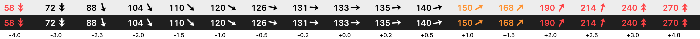

# 01 — Getting live Libre 3 glucose onto a Mac, without the cloud

*2026-10-15 · investigation report · code in [`spikes/`](../spikes)*

## Goal

Replace the current setup — an [xbar](https://xbarapp.com) plugin polling **LibreLinkUp** over the internet — with a
macOS menubar item showing the glucose number and a precise trend arrow, with data that never leaves the user's devices.

Questions:
1. Can macOS read the FreeStyle Libre 3 sensor itself?
2. Otherwise: can Juggluco on the phone send the data to the Mac **without internet**?
3. Added during the investigation: it must also work **with no shared network** — Mac with no Wi-Fi at all, or Mac on
   home Wi-Fi while the phone is on mobile data. USB is not acceptable.

## Setup

| | |
|---|---|
| Sensor | FreeStyle **Libre 3 Plus** (15-day wear), started 2026-10-03 |
| Phone | Pixel 10 Pro, Android 17 (SDK 37), rooted (KernelSU Next); **Juggluco 11.4.1**; GlucoDataHandler |
| Mac | macOS 27.0.1, Apple Silicon; Swift 6.4 (Command Line Tools only, no Xcode) |
| Units | mg/dL; personal thresholds low 65 / slightly high 145 / high 185 |

## Results at a glance

| Path | Works? | Latency | Notes |
|---|---|---|---|
| Mac ↔ sensor directly (BLE) | ✅ proven | — | Phone must release the sensor; per-sensor pairing data from the phone; NFC still needed to start a sensor |
| Juggluco web server → Mac over USB (`adb forward`) | ✅ | instant | Not practical (cable) |
| Juggluco web server → Mac over Wi-Fi | ✅ | ~0.3 s | Needs a shared network and Juggluco "Local only" **off** |
| Juggluco → **GlucoBridge** (phone) → Mac over **BLE** | ✅ | ~0.2–1 s | Works with Mac offline / phone on mobile data; 17/17 readings with phone unplugged + screen off |
| Bluetooth PAN tethering | ❌ | — | macOS 27 has no Bluetooth PAN support |
| Juggluco's built-in "BLE mirror" | ⚠️ not built | — | Feasible but large, undocumented, moving target |

## 1. Can macOS read the Libre 3 directly?

**Yes — but not as the everyday path.**

- While Juggluco is connected, a BLE scan from the Mac (`spikes/ble-scan`) sees **no** Libre: the sensor stops
  advertising once a device is connected to it.
- Juggluco (GPLv3) ships an open-source, portable implementation of the Libre 3 app-side protocol (since v10.10).
  It builds unmodified for macOS/arm64. On iOS, LibreLoop and Trio v1.0 already read Libre 3 natively; no macOS app
  existed.
- **Experiment (2026-10-15 18:33):** with the phone's Bluetooth turned off, the Mac found the sensor after ~10 s,
  connected, authenticated using the pairing data Juggluco had stored for this sensor, and received two live
  1-minute readings: **182 mg/dL, −0.24 and −0.32 mg/dL/min**. Nothing was sent to the sensor beyond what's needed to
  connect and subscribe. The phone was off Bluetooth ~75 s.
- **Cross-check:** when the phone reconnected, Juggluco backfilled the gap with exactly the same values
  ([evidence](evidence/01-juggluco-backfill-after-mac-read.tsv), rows `17310`/`17311`: 182, 182 — backfilled rows
  carry no rate). Live data resumed with no loss.

**Constraints that rule it out as the main path:**
- **One device at a time.** While the Mac holds the sensor, the phone (and its alarms) gets nothing.
- **A phone is still required** to start each sensor (NFC — Macs have none) and to provide that sensor's pairing data.
- Legal grey zone: the protocol implementation is a port of Abbott's app logic. The experiment's code is kept out of
  this public repo.

Possible future use: an emergency fallback when the phone is gone (dead battery, left at home).

## 2. Juggluco → Mac without internet

Juggluco has a built-in, Nightscout-compatible **web server** (*Settings → Web server*). Facts confirmed from its source
and live:

- Port **17580** (HTTP), 17581 (HTTPS). **"Local only"** accepts the TCP connection and then resets non-loopback
  clients — so over Wi-Fi it must be **off**; over USB (`adb forward tcp:17580 tcp:17580`) it can stay on.
- Optional API secret: header `api-secret: <sha1 hex of secret>`, or `?token=<secret>`.
- `GET /api/v1/entries.json?count=N` — newest first. Default output is **thinned to ~5 min**; add **`interval=0`** to
  get every 1-minute Libre 3 value.
- **`delta` is the sensor's rate × 5**, not a difference between readings → `rate = delta / 5` (mg/dL/min).
  A missing rate is reported as `delta: 0` with `direction: ""`.
- **`GET /x/live`** — Server-Sent Events: one `glucose` event per new reading, pushed as soon as the phone gets it,
  with `glucoseMgDl` and **`rateMgDlPerMinute`**. Heartbeat every 20 s.
- `/x/stream` — TSV with the per-minute `Rate` column (handy for analysis).
- Juggluco bug: **"SingleDown" is never emitted** — any rate ≤ −2 becomes "DoubleDown". Use the numeric rate.
- The Nightscout uploader can also POST to any plain-HTTP LAN URL (must answer exactly HTTP 200) — a push alternative.

**Rate precision:** the sensor reports the rate with 0.01 mg/dL/min resolution; in a 5 h sample 98 % of values were
non-integer (short runs of exact `0` occur). Enough to draw a continuous arrow.

**Wi-Fi results** (`spikes/menubar`, "auto" mode):
- Juggluco has no mDNS/Bonjour, so GlucoseBar sweeps the Mac's subnet for `:17580` and checks
  `/api/v1/status.json` → found the phone in **~1 s** on a /24.
- History via `entries.json?count=180&interval=0`, then live via `/x/live`: **~0.3 s** from the phone receiving a
  reading to the Mac showing it.
- After the phone's Wi-Fi came back from an outage, GlucoseBar rediscovered the phone by itself.
- A macOS `.app` needs the *Local Network* permission for this.

## 3. With no shared network

| Option | Mac offline | Mac Wi-Fi + phone mobile data | Verdict |
|---|---|---|---|
| Phone hotspot | ✓ (Mac joins it) | ✗ (one Wi-Fi radio) | Partial |
| Bluetooth PAN tethering | — | — | **macOS 27 dropped it** (no "Bluetooth PAN" port, no driver) |
| Tailscale / VPN | ✗ | ✓ | Needs internet |
| Juggluco "BLE mirror" | ✓ | ✓ | Mac would have to speak Juggluco's mirror sync protocol (handshake + session crypto + acking its internal file-sync stream). ~1–1.4k lines of Swift against an undocumented protocol that changed several times in 2026. Rejected. |
| **Companion app + BLE GATT** | ✓ | ✓ | **Chosen** |

### GlucoBridge (`spikes/glucobridge-android`, Kotlin)

A foreground service on the phone that:
- follows Juggluco on **`127.0.0.1:17580`** (so "Local only" can stay **on**), and
- runs a **BLE GATT server** + advertises a custom service. The Mac (CoreBluetooth central) connects, reads a
  3-hour per-minute **history** once, and subscribes to **reading** notifications.

| Characteristic | UUID | Properties | Value (little-endian) |
|---|---|---|---|
| service | `6c1f0001-5b8a-4d8e-9a3c-676c75636f42` | | |
| READING | `6c1f0002-…` | read, notify | `u32 epoch s ‖ u16 mg/dL ‖ i16 rate×100` (`0x8000` = unknown) |
| HISTORY | `6c1f0003-…` | read (long) | `u32 newest epoch s ‖ u16 mg/dL per minute, newest first` (180 slots, 0 = gap) |

### Tests

| Test | Result |
|---|---|
| BLE only (`GlucoseBar -lan NO`) | Found GlucoBridge in 3 s; every reading ~0.3 s after the phone |
| **Phone Wi-Fi off** (phone on mobile data, Mac on home Wi-Fi) | Wi-Fi transport dropped; **BLE delivered every minute** (19:03–19:05, ≤ 1.2 s) |
| **Phone unplugged + screen off**, 19:08–19:25 | **BLE 17/17 readings**, 0 missed, worst 0.2 s, never disconnected |
| Both transports at once | Same reading arrives twice (BLE ~1 s earlier); the app merges them |

Raw log: [evidence/01-transport-tests.log](evidence/01-transport-tests.log). (Wi-Fi readings stop at 19:12 because
"Local only" was switched back on — not a failure.)

**Not yet validated:** deep Doze (phone unplugged and still > 30–60 min), Mac sleep/wake, Mac with Wi-Fi truly off
(simulated with `-lan NO`), range, long-term reconnect behaviour.

**Gotchas:**
- Android's `BluetoothGattServerCallback.onConnectionStateChange` also fires for the phone's *own* outgoing links (the
  sensor, a watch), so "connected centrals" is noisy — count subscriptions instead.
- The GATT service is **unauthenticated**: anyone nearby can read the value. Real app: encrypted characteristics with
  bonding, or an app-level key exchanged once (QR).

## 4. Menubar UI (GlucoseBar)

- **Arrow**: drawn in code (template image, so it follows light/dark menubar). Angle = rate / 3 mg/dL/min × 90°,
  clamped; a second chevron at ≥ 3 mg/dL/min. Keeps Libre's bucket centres (±1.5 → 45°) but shows 0.4 vs 0.9.
- **Rate source**, in order: the sensor's own rate → least-squares slope over the last 15 min → Nightscout direction.
- **Colour**: red < 65 or > 185, orange > 145. **Stale** (> 5 min): dimmed + strikethrough.
- **Dropdown**: value + rate, reading time and age, a 3 h sparkline, which transport delivered the latest reading.

 

## Decisions

1. **Mac app**: BLE central to the phone app is the primary transport; Wi-Fi to the phone is secondary; both merged.
2. **Phone app** (future Juggluco replacement, Kotlin): owns the sensor and serves the Mac over BLE GATT.
   GlucoBridge is its seed — only the data source changes.
3. Don't build on Juggluco's BLE mirror. Keep "Mac reads the sensor directly" only as a possible fallback.

## Open questions / next PoCs

- [ ] **PoC 2:** the phone app reads the sensor itself instead of Juggluco (test by force-stopping Juggluco).
- [ ] Sensor start / switch-receiver from the own app (NFC).
- [ ] Secure the BLE link (bonding or app-level encryption) and pairing UX between phone and Mac.
- [ ] Deep-Doze soak (phone unplugged ≥ 1 h), Mac sleep/wake, range, reconnects after Bluetooth toggles.
- [ ] Backfill on the Mac after sleep (HISTORY covers 3 h — enough?).
- [ ] Define the full feature list for the real apps (alarms? multiple Macs? watch?).

## Toolchain notes

- adb: `brew install --cask android-platform-tools`.
- **Android CLI** (Google's CLI for agents): `curl -fsSL https://dl.google.com/android/cli/latest/darwin_arm64/install.sh | bash`,
  then `android init`. Used for `android create empty-activity`, `android run --apks … --install-options=-g`,
  `android screen capture`, `android docs search`. It installs SDK packages on demand into `~/Library/Android/sdk`.
- **JDK 17** (AGP 9 requirement): `brew install openjdk@17`, then
  `export JAVA_HOME=$(brew --prefix openjdk@17)/libexec/openjdk.jdk/Contents/Home`.
- Swift spikes build with Command Line Tools only (`swift build`); `bundle.sh` wraps GlucoseBar into an ad-hoc-signed
  `.app` (`LSUIElement`, Bluetooth + Local Network usage strings).
- macOS formats times with a narrow no-break space before AM/PM (`U+202F`) — remember it when parsing logs.

## References

- Juggluco — https://github.com/j-kaltes/Juggluco · https://www.juggluco.nl/Juggluco/libre3/
- LibreLoop — https://github.com/LoopKit/LibreLoop · Trio v1.0 — https://github.com/nightscout/Trio/releases/tag/v1.0
- RoundWhiteDiscKit — https://github.com/airedev326/RoundWhiteDiscKit
- DiaBLE (archived) — https://github.com/gui-dos/DiaBLE
- Android CLI for agents — https://developer.android.com/tools/agents
- 37 CFR 201.40(b)(7) (medical device data exemption) — https://www.law.cornell.edu/cfr/text/37/201.40
