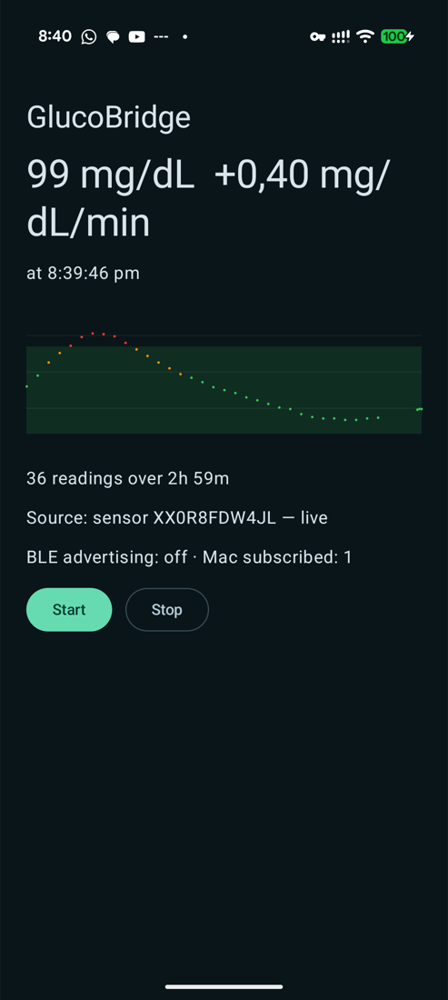

# 02 — The phone app reads the sensor itself (no Juggluco)

*2026-10-15 · investigation report · follows [01 — connectivity](01-connectivity.md)*

## Goal

In [PoC 1](01-connectivity.md) the phone companion (GlucoBridge) got its data from Juggluco's local web
server. That means two apps, an HTTP server on loopback, and a dependency on an app whose UI the user wants to
replace. **PoC 2: GlucoBridge talks to the Libre 3 sensor itself**, and does it in a battery-conscious way.

## Result

**It works.** GlucoBridge resumed the sensor's BLE session on its own, decrypted the 1-minute glucose packets and
pushed them to the Mac — with Juggluco force-stopped the entire time.

| | |
|---|---|
| First reading | 2026-10-15 19:59:47 — **83 mg/dL, −0.59 mg/dL/min**, delivered to the Mac the same second |
| Steady state | a reading every minute for 7+ minutes, no disconnects, Mac latency ~1 s |
| History | the sensor's own stored 5-minute values: **34 points (~3 h) in about a second** on connect |
| Correctness | values matched Juggluco's own backfill exactly (80, 82, 83, 84 at 20:09–20:13) once it took the sensor back |
| Sensor state | Juggluco reconnected afterwards and filled its gap by itself |

Architecture now:

```
Libre 3 sensor ──BLE──▶ GlucoBridge (Android) ──BLE GATT──▶ GlucoseBar (Mac)
```

No Juggluco, no HTTP server, no network of any kind.



*99 mg/dL at +0.40 mg/dL/min, 36 readings over 3 h — all from the sensor. "BLE advertising: off · Mac subscribed: 1"
is the power optimisation below doing its job: a client is connected, so the phone stops advertising.*

## How it is built

Two Gradle **product flavors** share everything except where glucose comes from, so PoC 1 stays runnable:

| Flavor | Source | Build |
|---|---|---|
| `juggluco` | Juggluco's web server on `127.0.0.1:17580` (PoC 1) | `./gradlew assembleJugglucoDebug` |
| `direct` | the sensor itself (PoC 2) | `./gradlew assembleDirectDebug` |

Shared `src/main` holds the Mac-facing GATT server, the foreground service and the UI; each flavor provides
`createGlucoseSource(context)`. Everything is Kotlin; the only native code is the sensor's security core
(C, called through a small JNI layer).

Pairing data (which sensor, and the credentials to resume its session) is read from a private file in the app's
data directory. For the spike it is imported once from the app that activated the sensor; the real app will
produce it during its own NFC activation. It is a per-sensor secret and never leaves the phone.

## History

A sensor-reading app starts with nothing and would take hours to fill a chart, because each packet only carries
the current minute. The sensor also stores a value every 5 minutes, but it only sends them when **asked**.

On connect GlucoBridge now reads the sensor's current position from its status packet, then requests the last
3 hours of stored values. They arrive as a short burst of notifications (6 values each) and are merged into the
same series as the live readings. Cost: well under a second.

This is the one place the app writes to the sensor — the request is the same one Juggluco sends on every
connection, so it is routine traffic, not a state change. Everything else is listen-only.

## Battery

Design choices, and what they are worth:

| Choice | Why |
|---|---|
| **No scanning.** Connect to the sensor by address with `autoConnect`, so the Bluetooth controller does the waiting. | Measured: **zero BLE scan time** attributed to the app in `batterystats`. App-level scanning is one of the most expensive things a BLE app can do. |
| **No wakelocks.** The notification callback does the work and returns. | Measured: **no partial wakelocks** held by the app. For comparison, Juggluco took **973 partial wakelocks** (~16 s cumulative) in the same battery session — it holds one for up to 30 s per reading. |
| **Advertise only while no Mac is subscribed**, in `ADVERTISE_MODE_LOW_POWER`. | The Mac scans continuously, so a slow advertising interval costs nothing; advertising to nobody is pure waste. See the trap below. |
| **One persistent sensor connection** instead of connect-per-reading. | See the finding below — reconnecting is far more expensive than idling. |
| History blob built on demand, not per reading. | Trivial, but it keeps the per-minute path to "decrypt, 8-byte notify". |

### Finding: trimming subscriptions backfires

The sensor exposes seven notifying characteristics; GlucoBridge only parses two. Subscribing to just the ones we
use looked like an easy saving. It is not:

| Subscriptions | Behaviour |
|---|---|
| Only the ones we parse | Sensor **dropped the link at exactly 60 s**, every time → reconnect loop, **one reading per 2 minutes** (half the data, plus a full reconnect and re-handshake each time) |
| All seven (what Juggluco does) | **Stable**, one reading per minute |

The sensor runs a full data cycle every minute and does not tolerate a partially subscribed client. Staying
subscribed to everything is both more reliable *and* cheaper than the reconnect loop it causes. The code keeps the
trimmed set behind a flag plus an automatic fallback, so a bad choice self-heals instead of silently halving the data.

**Caveat:** that test also changed the connection interval at the same time (a low-power interval was requested in
the failing run, not in the passing one), so the 60 s drop is not isolated to the subscription set — only strongly
implied by its exact 1-minute period. Worth isolating before treating it as settled.

### Not yet measured

Real battery drain. `batterystats` only attributes power while the phone is **discharging**, and the phone was on
USB for the whole session (needed for the test tooling). A proper A/B — same hours, screen off, unplugged, PoC 1 vs
PoC 2 vs Juggluco alone — is the obvious next step. The CPU totals in `batterystats` are not comparable as they
stand: they cover different time windows, and GlucoBridge's include Compose UI startups.

### Trap: your own sensor link looks like an incoming client

Stopping the adverts while a client is connected broke the Mac's ability to find the phone at all. Android reports
the phone's **outgoing** connections — the sensor — through the *same* GATT-server callback as incoming clients, so
connecting to the sensor made the app believe a Mac had arrived.

The fix is to ignore connection events entirely and key off the subscription write, which only a real client of ours
performs. The logs now distinguish the two peers plainly. Worth
remembering for the real app — on Android, "a device connected to my GATT server" does not mean what it sounds like.

## Also fixed: the Mac could go deaf without noticing

During the stable run the phone kept notifying every minute to a subscribed central, but the Mac stopped showing
new values after ~2 minutes — with **no disconnect callback**. CoreBluetooth left the peripheral in `.connected`
while the link was actually gone.

GlucoseBar now treats silence as a disconnect: if a connected bridge sends nothing for 150 s (readings are
1/minute), it drops the peripheral and rescans. Worth remembering for the real Mac app — "still connected" is not
evidence that data is flowing.

## Libre 2 / 2 Plus (2026-10-18)

The user's Libre 3 Plus ended and the next sensor is a European **FreeStyle Libre 2 Plus** (15 days, 1 h warm-up),
to be started by Sukrara with neither Juggluco nor Abbott's app installed.

**Juggluco can't be ported here.** For the Libre 2 it calls Abbott's closed `libcalibrate.so` (taken from LibreLink,
shipped inside Juggluco's APK, `CARRY_LIBS`) for every step: `getActivationPayload`, `getEnableStreamingPayload`,
`getStreamingUnlockPayload` and `processStream` (decrypt + glucose algorithm) — `Common/src/main/cpp/libre2.cpp:1231-1380`,
loading at `:830-930`. We can't ship that library. From Juggluco we kept only the NFC framing (`02 A1 07` patch info,
`02 23 b n` block reads, `uid[6] != 7` → Libre 3: `AlgNfcV.java:80-86, 236-243, 295-320`, `ScanNfcV.java:254`), the
GATT order (login write → subscribe → 20 + 18 + 8 byte notifications: `Libre2GattCallback.java:240-270, 330-370,
415-445`) and the generation rule (`SensorGlucoseData.hpp:1125-1140`).

**The port is DiaBLE's open, reverse-engineered gen-1 crypto** (MIT; `third_party/DiaBLE` at e6a909c, same code in
LibreTools and LibreTransmitter, both MIT), in pure Kotlin (`direct/Libre2Crypto.kt`, file:line in its header):
activation `A1 1B` + `usefulFunction(uid, 0x1B, 0x1B6A)` (`NFC.swift:39-45, 112-122`; LibreTools
`Libre2.swift:98-101`), streaming enable `A1 1E` + code + `usefulFunction(uid, 0x1E, info[4..5] ^ code)`
(`Libre2.swift:190-198`; LibreTransmitter `SensorPairingService.swift:338-362`), FRAM decryption (`:133-171`), the
12-byte BLE unlock payload (`:238-292`), BLE decryption with its CRC (`:300-332`), packet layout (`:343-394`), serial
from UID (`Libre.swift:278-298`). Patch info → type/Plus/generation from `Libre.swift:9-81`: EU Libre 2 Plus is
`C6 09 31 01` or `7F 0E 31 01`, **security generation 1**, so this applies; US/Canada (Gen2, `2C 0A 3A 02`) needs
Abbott's library and is refused.

**The BLE values are raw, not mg/dL** (on the gen-1 Libre 2 and Libre 2 Plus; only the Libre 3 sends glucose). Sukrara
applies DiaBLE's open factory-calibration formula (`Glucose.swift:165-453`, from xDripSwift `LibreMeasurement.swift`)
to the calibration constants i1–i6 in the decrypted FRAM (`Libre.swift:186-194`). It approximates Abbott's
algorithm and is not validated for the Libre 2 Plus, so the app labels the values approximate and asks for
fingerstick checks; they are not uploaded to LibreView.

**Safety of the one-shot start.** Nothing is written to the sensor until the patch info is gen 1 and the FRAM
decrypts with valid header/footer CRCs and a usable calibration; a new sensor then needs *Start sensor* and a second
tap. A Libre 2 has no receiver binding (unlike the Libre 3's receiver ID): whoever last enables streaming gets the
BLE link, so Juggluco can still take the sensor over later.

**Vectors.** `Libre2Test` checks the Kotlin against DiaBLE's own Swift: `Libre2.swift` / `Libre.swift` /
`Glucose.swift` function bodies compiled unchanged with `swiftc` plus a small driver (UID + patch info + serial of a
real Libre 2 from DiaBLE `App.swift:238`) printing `usefulFunction`, the activate / enable commands, an unlock
payload, a FRAM decryption, a BLE packet round trip, its parsed raw values and four factory-calibrated glucose
values (`spikes/showcase-android/tools/libre2-vectors/gen.sh` regenerates them). All match exactly. Real-sensor vectors: pending the user's first scan.

### Could Sukrara use Abbott's library like Juggluco? (feasibility, 2026-10-18)

- **How Juggluco gets it:** bundled. The official `Juggluco-11.5.0-arm64.apk` (SourceForge, sha256 `0ff898d1…df985`)
  carries `lib/arm64-v8a/libcalibrat2.so` (3.4 MB, sha256 `c15a1efa…49a93`) — Abbott's `libDataProcessing.so` from a
  LibreLink build (`mklibs.sh`, `mklibsca.sh`: LibreLink DE 2.4.2, Libre 2 CA 2.5.3), kept out of Juggluco's git. It
  is used for every Libre 2, gen 1 too (`libre2.cpp:870-910`, `gen2 = true`).
- **Integrity checks it works around:** the shipped copy is binary-patched (`llvm-nm -D`: imports `getTimeofday`,
  `pthread_Detach` resolve to Juggluco's hooks; `share/hooks.cpp` also has `Fork`, `Pipe`, `FOpen`, `d1sym`, …); no
  `Java_` exports, only `JNI_OnLoad`, called with a fake JavaVM/JNIEnv (`jnisub.cpp`) whose `RegisterNatives` grabs
  the 20/22 entry points (`libre2.cpp:145-200`); a fixed 72-byte token on every call (`libre2.cpp:61`); a faked
  `pm path` answer (`package:<libdir>/libcalibrate.so`) through the fork/pipe hooks, swapped `PATH`/`environ`; and a
  ptrace "debug clone" that intercepts raw syscalls against root/debugger detection (`debugclone.cpp`, 2258 lines).
- **Coverage:** everything (activation command/payload, streaming enable, unlock, `processStream` → official mg/dL,
  trend, history, warm-up/wear) for the Libre 2 Plus EU.
- **Effort:** re-creating that native layer (libre2.cpp, jnisub, hooks, debugclone, scan state, fake env) plus a
  pinned build-time fetch: ~5–8k lines of tightly coupled C++, verifiable only on a device, fragile to library
  updates, and an anti-tamper trip tends to give wrong results rather than a crash. Several days; not attempted here.
- **xDrip+** (third_party/xDrip at 8532095) doesn't decode the Libre 2 itself: it hands raw NFC/BLE data to the closed
  OOP2 app by broadcast (`LibreOOPAlgorithm.java:90-183`) or receives glucose from a patched LibreLink / Juggluco
  (`LibreReceiver.java`); `WebLibre2ConnectCode` only re-serves OOP2's unlock buffer.

### In Sukrara

- **Added:** NFC routing by chip; Libre 2 / 2 Plus (EU) start with confirmation, takeover, streaming enable; BLE
  client with unlock, decryption, warm-up, wear length from FRAM, ended detection; approximate mg/dL; en + es texts;
  `Libre2Test`; QA Q11.
- **Discarded:** Juggluco's Libre 2 path (Abbott's closed library: can't commit it, and the anti-tamper glue is a multi-day port, above). Gen2 (US/Canada) sensors (closed
  crypto). FRAM history backfill on scan (BLE trend + 3 history values cover the last 15 min; a new sensor has none).
  LibreView upload of Libre 2 values (approximate, and the uploader models a Libre 3 device).

## Open questions / next PoCs

- [ ] Isolate the 60 s drop: subscription set vs connection interval, one variable at a time.
- [ ] Real unplugged battery A/B (PoC 1 vs PoC 2 vs Juggluco), screen off, several hours.
- [ ] Verify the Mac watchdog actually recovers the link (the fix is written, not yet observed firing).
- [x] Sensor **activation** from the app (NFC): Libre 3 since Sukrara 0.10.5, Libre 2 / 2 Plus (EU) above.
- [ ] Libre 2 Plus: compare the open factory calibration with fingersticks / the official app on the real sensor.
- [ ] Persist history across app restarts (it is in memory only; a restart re-fetches 3 h from the sensor).
- [ ] Secure the phone↔Mac link (still unauthenticated) and survive Mac sleep.
- [ ] Long soak: deep Doze, Bluetooth toggles, out-of-range and back.

## Reproducing

```sh
cd spikes/glucobridge-android
export JAVA_HOME=$(brew --prefix openjdk@17)/libexec/openjdk.jdk/Contents/Home PATH="$HOME/.local/bin:$PATH"
./gradlew assembleDirectDebug
android install --apks=app/build/outputs/apk/direct/debug/app-direct-debug.apk --install-options=-g
./tools/import-pairing.sh            # one-time, needs root; imports this sensor's pairing data
adb shell am force-stop tk.glucodata # the sensor serves one app at a time
adb shell am start -n dev.spike.glucobridge/.MainActivity
```
Afterwards, relaunch Juggluco to hand the sensor back; it reconnects and backfills the gap on its own.

Toolchain added in this investigation: NDK 28.2.13676358 and CMake 4.1.2 (`android sdk install ndk/… cmake/…`).
