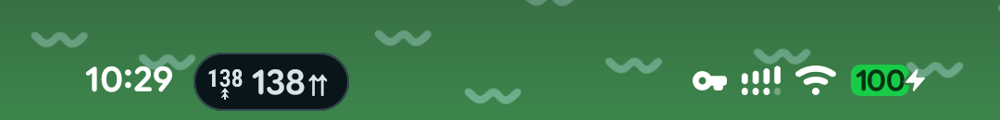
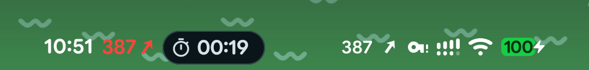
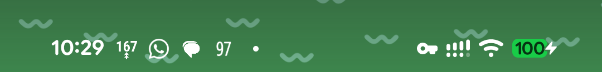
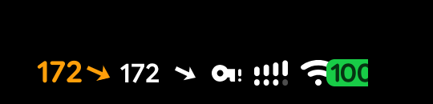
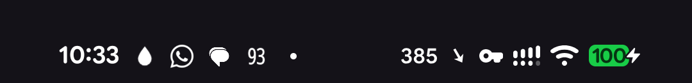
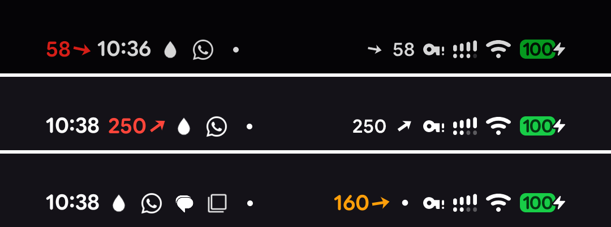
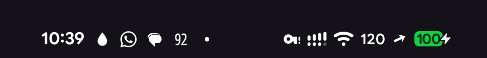

# 05 — Glucose in the Android status bar

*2026-10-15 · investigation report · Pixel 10 Pro, Android 17 (CP3A.261005.005), rooted with KernelSU Next + LSPosed*

## Goal

Show the glucose number and trend **permanently in the phone's status bar**, like the Mac menubar item. Three
candidate approaches were given (Live Update chip, number as the notification icon, an icon among the system icons
with a choosable position), plus the question of whether there are others. Spike code:
[`spikes/statusbar-android`](../spikes/statusbar-android) (GlucoStatus, one APK that is the app *and* the LSPosed
module).

## Result

**All approaches work on the phone**, side by side:


*From left: LSPosed hook after the clock (red = above 185), the Live Update chip (its icon is approach 2's bitmap),
and the system-icon pair next to the VPN key, Wi-Fi and battery.*

| # | Approach | Needs | Colour | Position | Verdict |
|---|---|---|---|---|---|
| 1 | **Live Update chip** | nothing | no | fixed (after clock) | Works; yields to other Live Updates. Hidden while the app is open, and number lost whenever ≥ 2 chips show |
| 2 | **Number as the notification icon** | nothing | no | first notification icon | Works, but a 2–3 digit number squeezed into a square icon is small |
| 3a | **System icons** (next to Wi-Fi/battery) via `IStatusBarService.setIcon` | **adb or root** — no LSPosed | no (tinted like the other icons) | leftmost of the system icons | Works; real system rendering, follows light/dark |
| 3b | **LSPosed hook in SystemUI**: our own TextView | root + LSPosed | **yes** | before/after the clock, left of the system icons, lock screen | Works; best looking |
| 3a+3b | 3a's icons **reordered** by a tiny hook | root + LSPosed | no | **exactly** after any icon (e.g. between Wi-Fi and battery) | Works |

Recommendation for the real app: **3b (hook) when LSPosed is present, 3a (root/Shizuku) otherwise, and always the
Live Update (1) + dynamic icon (2)** — they cost nothing, and the promoted notification is also what shows the value
on the lock screen/AOD card.

## 1 — Live Update chip



The foreground-service notification asks to be promoted (`setRequestPromotedOngoing(true)`) and sets
`setShortCriticalText("138⇈")`. Android 17 granted it straight away (`FLAG_PROMOTED_ONGOING`), no user action.

What the device's own SystemUI code (decompiled) and the screen say:
- **Eligibility**: ongoing, has a title, style ∈ {none, BigText, Call, Progress, *MetricStyle*}, no custom views,
  **not colorized**, channel importance > MIN, and the user hasn't revoked "Live Updates" for the app.
- **Chip content**: the notification's **small icon** (so approach 2's bitmap shows up in the chip) + the short text.
  Max text width ~74 dp; 4–5 characters fit. **No colour**: the API to style the chip exists but is flag-disabled on
  this build.
- **Hidden while our app is on screen** (SystemUI hides an app's chip when the app is visible).
- **Not on the lock screen** status bar (the lock screen shows promoted notifications as a card instead).
- **No battery/process benefit** from being promoted — the foreground service is what keeps the app alive.
- Updating every minute is far below the rate limit (5 updates/s).

**Priority vs. other chips** (e.g. Google Maps navigation). There is no API for it: chips are sorted newest first,
one per app, max 3 — and **as soon as 2 or more chips show, all of them become icon-only**, so the number would be
lost anyway. Implemented instead: a `NotificationListenerService` watches other apps' notifications for
`FLAG_PROMOTED_ONGOING` (it is visible to listeners) and re-posts ours **without** the promotion request while one
exists. Tested with the Clock stopwatch:



*Only the stopwatch chip shows; the value stays visible through 3a/3b. When the stopwatch was reset, our chip came
back by itself.* While yielding, the notification is posted as a **colorized** foreground-service notification,
which keeps its icon first in the status bar (see 2).

**Android 17 `MetricStyle`**: a new notification style made for exactly this (a value + unit + "semantic style").
The semantic style colours the value **green / yellow / red in the notification card** (shade, lock screen, AOD) —
mapped here to in range / slightly high / low-or-high. It does *not* colour the chip.

## 2 — Number as the notification icon



The small icon is `Icon.createWithBitmap(…)`, re-rendered on every reading: number on top, rotated trend arrow below
(the `97` further right is the user's existing GlucoDataHandler doing the same thing).
- Status bar notification icons are an **alpha mask** (tinted by SystemUI) **fitted into a square** (~15 dp): wide
  bitmaps are shrunk, not widened. So 3 digits + arrow are small; number-only would be more readable.
- Up to **4** notification icons show, then a dot. Order is by section, then newest — the old knobs
  (`PRIORITY_MAX`, category, importance HIGH) no longer decide it. What puts ours **first**: being promoted (1), or
  a **colorized foreground-service** notification. Either also counts as "not silent", so the icon is shown even
  though the channel is IMPORTANCE_LOW (no sound, no heads-up) and "hide silent notification icons" is on.
- New Android 17 setting `notification_icons_status` (0 all / 1 hide silent / **2 none**) is read but ignored on this
  build — if Google wires it up, this approach could disappear for users who pick "none".

## 3a — System icons, no SystemUI code

The same hidden API the keyboard uses for its status icon:

```
IStatusBarService.setIcon(slot, iconPackage, iconResId, iconLevel, contentDescription)
```

It needs `android.permission.STATUS_BAR`, which **the adb shell already holds** — so it works from adb, from a
Shizuku-style helper, or as root. SystemUI then loads the icon **from our APK's resources**:

 

*Right: `385 ↘` set by the app through its root helper. Left: lock screen, with the hook's coloured view (3b) next
to it.*

Findings:
- On Android 17 the right side of the status bar is **Jetpack Compose**. It renders external icons **leftmost** of
  the system icons, newest first, sized by height with their real aspect ratio (wide icons stay wide), tinted like
  the rest — and it **ignores the icon level**, so a single level-list drawable can't select the number. The app
  therefore ships **one vector per value**: `sb_n40 … sb_n400`, `sb_lo/sb_hi`, and the arrow every 5°
  (`sb_t00 … sb_t36` + double arrows), generated from Google Sans Flex (SIL OFL) by
  [`tools/gen-slot-drawables.swift`](../spikes/statusbar-android/tools/gen-slot-drawables.swift). ~400 small
  drawables; number and arrow are two slots so the arrow angle stays fine-grained.
- Implementation: a tiny Kotlin `main()` in the APK, started with `app_process` (`SlotDaemon`), reading
  `set …`/`remove …` lines on stdin. The app launches it through `su`; the same command works over adb as the shell
  user. When the app goes away the pipe closes and the daemon removes its icons, so no stale value is left on screen.
- **SystemUI restarts re-deliver icons in hash order**, which can swap number and arrow. The daemon watches
  SystemUI's pid (and its age when the daemon starts) and re-adds both icons in order a few seconds later — verified.
- Position: fixed (leftmost of the system icons). The framework's slot order list (`config_statusBarIcons`) doesn't
  apply to external icons on this build, and runtime overlays can't change string arrays. Exact positioning needs 3b.

**Without root**: `adb shell` can run the very same daemon (tested, uid 2000). A real app would use Shizuku (the
helper runs as the shell user) — the only rootless route to a true system-icon look.

## 3b — LSPosed hook inside SystemUI



*Before the clock (58, red = low), after the clock (250, red = high), left of the system icons (160, orange =
slightly high). The right-side pair in the first rows is 3a running at the same time.*

The module (same APK, **libxposed API 102**: `META-INF/xposed/{java_init.list,module.prop,scope.list}`, scope
System UI) hooks:
- `PhoneStatusBarView.onFinishInflate` — the collapsed status bar is still a View hierarchy on Android 17 (Compose only
  wraps it and adds the chips and the right-side icons). A `TextView` is inserted before/after the `clock`, or into
  `status_bar_end_side_content` left of the Compose icon row.
- `KeyguardStatusBarView.onFinishInflate` — the lock screen bar, left of its system icons.
- The view copies the clock's text size and font, follows its tint (light/dark bars) and **its alpha/visibility**
  (the clock fades on the lock screen and under heads-up notifications; without this the view lingered as a ghost).
  In-range values use the clock colour; slightly high is orange, low/high red; stale (> 5 min) is dimmed with a
  strikethrough. The arrow is the Mac's continuous-angle arrow drawn by a custom `Drawable`.
- Data: the app sends a broadcast to SystemUI, protected by a **signature permission** only the app holds; SystemUI
  says "hello" when it (re)starts so the value appears immediately. Changing position is live (no restart).

**Exact position among the right-side icons** ("between Wi-Fi and battery"): those icons are Compose, so a View can't
be inserted between them. Instead the hook reorders the list SystemUI renders, moving 3a's two icons right after the
chosen slot (the list is built in an R8-named lambda, found by its shape rather than its name):



Not viable: *right of the battery* — the end of that container is clipped by the rounded screen corner.

### Safety (no bootloop risk, but a factory-reset prompt risk)

Nothing here modifies `/system`, the boot image or KernelSU modules; LSPosed only injects into SystemUI. The real
risk is different: **SystemUI is exempt from the crash-recovery cap**, so 5 SystemUI crashes within 60 s escalate to a
warm reboot and then to the recovery screen offering *"Factory data reset"* (choose *Try again*). Mitigations used:
- every hook body is wrapped (`ExceptionMode.PROTECTIVE` + catch-all), so a bug degrades to "no glucose view";
- `tools/hook-safety.sh arm` raises the crash-recovery threshold (`device_config`, no root) during experiments,
  `disarm` restores it; `kill` makes the hook a no-op on the next SystemUI start via a global setting;
- SystemUI is restarted with a *kill*, not `am crash` (crashes count towards the escalation);
- last resorts: `adb uninstall dev.spike.glucostatus`, or KernelSU safe mode (Volume Down ×3 at the boot logo
  disables all modules incl. LSPosed).

The one real failure during the spike (a `Handler` created before the main looper existed) was caught by LSPosed:
the module didn't load and SystemUI kept running normally.

## Other approaches considered

| Approach | Verdict |
|---|---|
| Accessibility overlay drawn over the status bar (`TYPE_ACCESSIBILITY_OVERLAY`) | Rootless and can be coloured, but it's a floating window: no knowledge of icon layout, collides with the cutout/icons, sideloaded apps hit the "restricted setting" gate, Play policy risk. Not built |
| `CallStyle` notification (green call chip) | Requires a real call context; misuse. Not built |
| Quick Settings tile with the value | Only visible with the shade open. Not built |
| Runtime resource overlay of `config_statusBarIcons` (KernelSU module) | Doesn't affect external icons on Android 17's Compose status bar — useless here |
| SystemUI plugins | Need a debuggable SystemUI (not on user builds) |

## For the real app

- Keep **1 + 2** always (zero setup): the promoted MetricStyle notification is also the coloured lock-screen/AOD card;
  yield the chip via a notification listener.
- Offer **3a through Shizuku or root** (no LSPosed): genuine system-icon look, position fixed.
- Offer **3b** when LSPosed is installed: colour, font match, clock-side or exact placement. Keep hooks few and
  shape-based (the R8 lambda names change between builds), keep everything wrapped, ship a kill switch.
- Number-only small icon (2) is probably more readable than number + tiny arrow.

## In Sukrara

**Added** (0.11.13 onward, docs/10 *Root status bar*): 1 + 2 always; 3a through root (`SlotDaemon`), 3b through the
LSPosed module, with the placements *With the system icons* (3a alone) and *After the VPN / Bluetooth / mobile / Wi-Fi
icon* (3a reordered by 3b).

**Full status bar (round f34, 2026-10-22).** With vibrate / mute / hotspot icons on, the user saw only the arrow. Cause
(AOSP `EllipsizingRow.measureIcons`, Android 17, and the Pixel's SystemUI read with jadx): the row is fitted right to
left, the first icon that doesn't fit becomes the overflow dot and everything left of it is hidden; external icons
(ours) come first in the list, "the lowest priority", so the number (leftmost) went first.

- *Added*: the module hooks the row's measure policy (`EllipsizingRowKt$EllipsizingRow$1$1` in
  `com.android.systemui.common.ui.compose` on the Pixel build, found by shape; PROTECTIVE). It finds our icons by
  walking each child's LayoutNode to the semantics of SystemUI's `Image` (our content description), hands SystemUI's
  own measurement the list with ours at the priority end (one call: Compose measures each child once per pass), then
  sorts SystemUI's visible indices back into on-screen order; if only part of our pair fits, both go into the dot (and
  the row's width is corrected). Pure logic + tests: `hook/IconFit`, `IconFitTest` (SystemUI's algorithm incl.
  FillDirection, the pair as one unit, the single no-readings / ended icon). Not verified on a device yet: the
  emulators have no LSPosed.
- *Added*: "after X" while X is hidden. On the Pixel build SystemUI's list already leaves hidden icons out (unlike the
  AOSP `android17-release` source, which filters later), so the target wasn't found and ours jumped to the far left.
  They now go after the last shown icon ranked no later than X in `config_statusBarIcons`.
- *Discarded*: one combined icon (number + arrow) per reading, so that root alone keeps them together. The Compose
  status bar ignores the icon level, so it needs one resource per (value, mark): 14,883 layer-lists generated at build
  time (percentage insets, since SystemUI scales icons to 13 sp). Measured: release APK 20.33 → 26.76 MB (+6.4 MB;
  +5.4 MB with `--no-xml-namespaces`); about 160 B per resource is zip and table overhead, so no variant gets under
  ~3 MB without coarser arrows. Root without the module therefore can still be split by SystemUI's overflow.
- *Added* (round f35, the user: "the arrow and number closer, less spacing"): with the module, the trend sits at the
  card's own gap from the number, 0.27 of the digits' height (renderer geometry + font, `IconFitTest`) = 8 px ≈ 3 dp
  on the Pixel instead of SystemUI's 16 px. The measure hook narrows the row by the difference and a hook on SystemUI's
  own placement block (the policy's synthetic lambda) lowers our number's `Placeable.width` by it while the block
  runs, so the block places the trend and everything after it closer; restored right after. Each icon is still placed
  once, by SystemUI; neighbour gaps stay 6 dp. The trend slot reads *Glucose trend ↗* so the module can tell the two
  apart. Discarded for this: an offset on our `Image` (moves pixels, not layout, so neighbour gaps would grow by half
  the pull each) and re-placing our icons ourselves (Compose's placement state lives in SystemUI's block). Root alone
  keeps SystemUI's spacing.
- *Added* (round f36, the user: after a System UI restart "the arrow is on the left, and after some seconds it jumps
  into the correct position"): the jump was the daemon's re-add (3a above). The module's order hook now always emits
  number then trend (also for the plain placement), and its hello says the order hook is in place; the app then sends
  the daemon `order module`, which skips the re-add for that System UI pid. Root alone keeps the re-add.
- *Added* (round f37, the user: the dot showed where vibrate would fit): SystemUI fitted the row with our pair at its
  6 dp gap and the pull narrowed it only afterwards, so those 8 px were never offered to other icons. The measure hook
  now hands SystemUI's fit Constraints with maxWidth + the pull (Compose's `Constraints.copy` `$default` bridge: R8
  dropped the plain copy's receiver in the Pixel build), decided before measuring like the permutation; the pull then
  takes exactly that back. Ours are fitted first, so the pair is either shown side by side (the pull applies, the row
  ends within the real width) or folded into the dot with nothing else shown; never wider (also clamped). Only with the
  number right before the trend and the gap hook in place.
- *Discarded*: hiding the mobile network type (LTE / 5G) or the signal bars to make room. SystemUI hides the type only
  when mobile data isn't the active connection; hiding it while on mobile data drops real information without any
  sign, whereas the overflow dot is the platform's own "more icons" signal.
