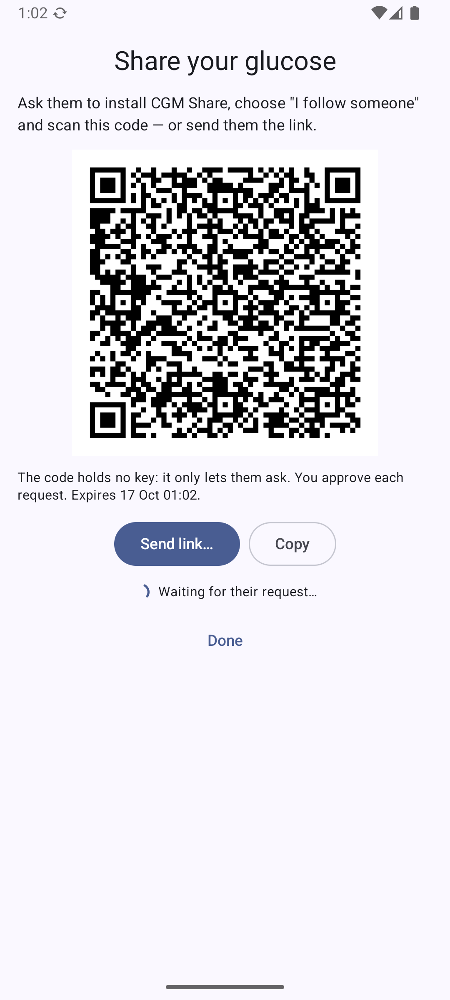
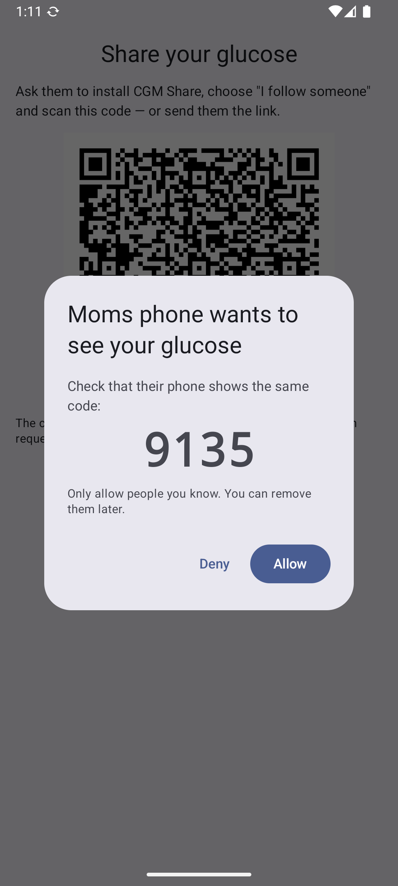
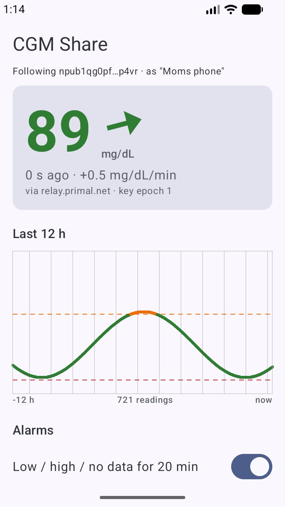
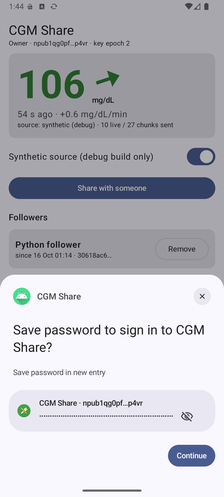

# 07 — Sharing, follower apps and key management without lock-in

*2026-10-16 · investigation report · follows [03 — Nostr](03-nostr.md) · spec: [PROTOCOL-v2](../spikes/nostr/PROTOCOL-v2.md)*

## Goal

## Result

**All of it works on emulators, end to end, across two independent implementations.** A non-technical flow (scan a
QR → both screens show the same 4-digit code → Allow) shares glucose without any secret ever being shown; removing a
follower rotates the key while everyone else keeps going; a new phone restores everything from **one password-manager
entry** and followers notice nothing. Real-phone tests with Proton Pass / Bitwarden are the remaining step.

## Context

[03](03-nostr.md) proved Nostr carries the data. It left the user-facing parts open, and the user asked for them:

1. **Follower apps**, not just the Mac menubar — starting with Android.
2. **Password-manager integration** for the keys — at least **Proton Pass** and **Bitwarden** — without lock-in
   (the user was explicitly worried that passkeys can't be moved between managers).
3. A **non-technical way to share** glucose with someone, and to **stop sharing**.
4. **Key rotation that keeps everything working** without anyone re-doing setup.
5. One app for both roles (closer to the final product) — **without false positives**: a follower must never look
   like it works because it reads the publisher's local data.

## Findings that shaped the design (research, with sources in the appendix)

| Topic | Finding | Consequence |
|---|---|---|
| Password managers | Android **Credential Manager password items** work with Proton Pass (≥ 1.32), Bitwarden, Google Password Manager, KeePassDX on Android 14+; no domain / `assetlinks.json` needed; no length limit that matters | Back up the identity key as a **password item** |
| Proton Pass quirk | Returns a saved item only to an app with the **same signing certificate** | Sign every build with one key |
| Passkeys | Need a domain + `assetlinks.json`; **Bitwarden Android doesn't return PRF**; Proton Pass has **no passkey export (CXP)** yet → a passkey in Proton Pass can't move to Bitwarden today | **No passkeys** for now — exactly the lock-in the user feared |
| Group crypto (MLS / Marmot) | Mature-ish but every member must process every commit in order; followers (Mac, Home Assistant) can be offline for days | **Not used**: one shared read key, delivered privately per follower (gift wrap), rotated on revoke — the pattern of the open NIP-DA proposal (nips#2411) |
| Delegation / key migration NIPs | NIP-26 unrecommended; all migration NIPs unmerged | App-defined: identity key signs a **roster** of device keys |
| The 03 QR | It contained the read key → a screenshot = permanent access | v2 invites contain **no secrets** |

## Design (PROTOCOL v2)

```
 identity key I ──(password manager backup)          follower F (own key, per device)
   │ signs roster: devices=[D], epoch n                  ▲
   │ seals key deliveries ──── gift wrap (NIP-59) ───────┘  {sid, epoch n, read key G_n, devices}
 device key D (phone) ── signs live + chunks, encrypted to G_n ──► relays ──► followers (accept only roster devices)
```

- **Share** = owner shows a QR / sends a link with *no secrets* → follower app asks → owner taps **Allow** (both
  screens show the same 4-digit match code) → the read key travels privately to that follower only.
- **Stop sharing** = new read key epoch, delivered to everyone else; the removed follower gets nothing new.
- **New phone** = restore the identity from Proton Pass/Bitwarden → the app pulls its encrypted *owner backup*
  (followers, epochs, stream id) from the relays → new device key + new epoch → followers continue untouched.
- **Missed a rotation** = a follower that sees an unknown key id asks for it again; still-approved followers get it.

## Reference implementation + end-to-end tests (Python, real public relays)

[`spikes/nostr/v2/`](../spikes/nostr/v2): `cgm2.py` (protocol), `nodes.py` (owner / follower), `scenarios.py`.
Every node has its own keys, own SQLite and own relay connections — **the only shared thing is the public relays**,
so a follower can only show data that really travelled through Nostr. Result: **19/19 checks pass**
([`results/v2-scenarios.txt`](../spikes/nostr/results/v2-scenarios.txt)):

| # | Scenario | Result |
|---|---|---|
| 1 | Share: request → approve → 12 h backfill + live | ✅ approved in ~1 s; 724/724 readings identical to the owner's; every row records the relay it came via |
| 2 | **Negative**: owner denies a request | ✅ no key, 0 readings |
| 3 | **Negative**: forged key delivery (sealed by an attacker) | ✅ rejected — not sealed by the identity key |
| 4 | **Negative**: reading signed by a non-roster key | ✅ never delivered (subscriptions are roster-filtered) **and** rejected if a relay delivers it anyway |
| 5 | Revoke follower A while B keeps working | ✅ B gets epoch 2 and continues; A gets "access removed", 0 new readings, its rekey requests refused |
| 6 | Phone change (restore identity only) | ✅ followers + stream restored from the relay backup; B continues on the new phone **without re-inviting**; readings signed by the old phone are rejected |
| 7 | Follower missed a rotation | ✅ asks for the key, gets it, recovers |

Bugs these tests caught (fixed, and written into the spec):
- **Relay AUTH**: relay.nostr.net and relay.damus.io only serve gift wraps after **NIP-42 AUTH** as the recipient.
  nos.lol, relay.primal.net, nostr.mom (and offchain.pub, nostr.oxtr.dev, snort, wellorder) serve them without.
- **Same-second replacement**: two versions of an addressable event in the same second → the second is rejected
  ("replaced: have newer event") → a stale owner backup. `created_at` must strictly increase per `d`.
- A new follower must open its relay connections *after* reading the invite (it learns the relays from it).

## Android app — "CGM Share"

[`spikes/nostr/android-app`](../spikes/nostr/android-app) (`dev.spike.cgmshare`, Kotlin, ~3.6k lines). **One app,
two roles** picked at onboarding — "I wear the sensor" / "I follow someone" — with **separate databases, separate
Keystore keys and separate state files**; only the chosen role's engine is ever created.

<p>




</p>

- **Owner**: Juggluco (or a debug synthetic source) → live + hourly chunks + roster + owner backup on 4 relays;
  **Share** (QR, share sheet, copy link); **Allow / Deny** dialog with the match code; **followers list → Remove**
  (full rotation); **Save to password manager / Restore** via Credential Manager (provider-agnostic, no Play
  Services), plus paste-nsec / NIP-49 "recovery code" fallback; Restore runs the phone-change flow.
- **Follower**: join by `cgmshare:` link, paste, **camera QR** (CameraX + zxing-cpp, FOSS) or QR-from-image; waits
  with the match code; big number + continuous trend arrow + 12 h chart + "via relay X · key epoch n";
  **alarms**: low/high (65/185) and **no data for 20 min**; "access removed" screen.
- **Transport seam for the next spike**: both engines take events through one `onEvent(eventJson, via)` with all
  acceptance rules behind it, and publish through a `Transport` interface — Bluetooth will plug in next to the relays.
- Library: `org.nostrdevkit:nostr-sdk` 0.45.1 (rust-nostr, renamed from `org.rust-nostr`) for keys/NIP-44/NIP-49/
  NIP-59; own OkHttp relay layer (paced writes, subscriptions, NIP-42 AUTH). Release APK 14 MB (7.6 MB native lib).

Tested on **two emulators = two separate devices** (and against the Python reference); evidence in
[`android-app/evidence/`](../spikes/nostr/android-app/evidence):

| Scenario | Result |
|---|---|
| Share → join → approve | request reached the owner in 1.2 s; follower **720/720 readings identical** to the owner's 12 h |
| **Negative**: owner denies | follower stays "waiting", 0 readings |
| **Negative**: forged key delivery | rejected: "not sealed by the identity key" |
| **Negative**: insider who knows the read key publishes live/chunk/roster from a non-roster key | 4× "author not in roster", 1× "roster not signed by identity", **0 forged values stored** (with relay-side author filtering deliberately disabled to exercise the app's own rule) |
| Revoke A, B keeps going | A got "access removed" in 0.2 s and nothing after; B (Python follower) moved to epoch 2 and continued |
| Phone change | cleared owner app data → **restored from a password manager (KeePassDX)** → same identity, new device key, epoch 3; app follower + Python follower continued **without re-inviting**, 719/719 identical, no gap |
| Password manager | KeePassDX as the emulator's credential provider: **Save and Restore work** through the same API Proton Pass and Bitwarden implement |
| Cross-implementation | app follower ↔ Python owner: 770/770 readings equal; Python follower ↔ app owner: same match codes, epochs 1→2→3 |
| Alarms | "HIGH glucose" and "No glucose data" notifications fired |

**Bugs the tests caught (fixed):**
- **The false positive the user worried about, for real**: "Stop following" deleted the follower DB file under an
  open SQLite handle, so **old readings stayed visible**. Now the tables are cleared in place.
- Owner source never published (a name clash made the history handler recurse); QR-from-image decoded on the main
  thread (ANR); NIP-42 AUTH re-sent REQs in a loop; chunks lost if the app was killed mid-backfill.
- relay.nostr.net rejects AUTH ("relay needs serviceUrl") → it can't serve gift wraps; the other 3 relays can.

**Battery-relevant choices**: no polling, no WebSocket pings; owner wakes briefly per reading and checks for access
requests when it publishes a chunk (~5 min); the follower keeps one inexact, idle-allowed alarm re-armed to
"last reading + 6 min", so it never fires while data flows.

**Not done**: Proton Pass / Bitwarden on the real phone (needs the user's accounts), camera decoding on a real camera
(only proven via "from image"), restart after reboot, real-phone Doze. Emulator latency numbers are inflated.

## How the "false positive" worry is handled

1. Owner and follower are **separate devices** in every test (two emulators; Python nodes with separate storage).
2. The follower role has its **own database and keys**; each stored reading records **which relay** it came from.
3. **Negative tests must fail closed**: denied requester, forged key, non-roster author, revoked follower — all show
   no (new) data.
4. Two independent implementations (Kotlin app, Python reference) agree reading-for-reading in both directions.
5. The worry was justified: testing found a real one (stale data after "Stop following") — fixed.

## Open questions / next

- [ ] **09 — Bluetooth as a second transport**: the same signed/encrypted v2 events over BLE (private without relying
      on BLE pairing), **nearby pairing** (request + match code + key over BLE, no QR, no internet), Android follower
      and Mac menubar over BLE, and **followers allowed to add treatments** (roster `writers`) that reach LibreView
      through the phone.
- [ ] Proton Pass + Bitwarden save/restore on the real phone (needs the user's accounts).
- [ ] Printable recovery sheet (NIP-49 `ncryptsec` + generated passphrase) for people without a password manager.
- [ ] Mac menubar + Home Assistant follower on v2 (today they still speak v1).
- [ ] Follower alarms on Android under Doze (unplugged, overnight) — and iOS (push gateway).
- [ ] Converge with NIP-DA if it gets merged.

## Appendix: sources

- Credential Manager: https://developer.android.com/identity/passwords · androidx.credentials 1.6.0
- Bitwarden Android credential provider (source); passkey asset-link issue https://github.com/bitwarden/android/issues/7451
- Proton Pass: Credential Manager passwords since 1.32.0; cert-bound app association (`StoredPasswordAppAssociationAuthorizer`)
- Passkey PRF support: https://www.corbado.com/blog/passkeys-prf-webauthn
- Passkey export (CXP): https://bitwarden.com/resources/july-2026-spotlight-your-passkeys-can-now-move-freely-heres-how/ ·
  https://9to5google.com/2026/09/10/android-passkey-password-transfer/
- NIP-59 gift wrap https://github.com/nostr-protocol/nips/blob/master/59.md · NIP-49 · NIP-42 ·
  NIP-DA proposal https://github.com/nostr-protocol/nips/pull/2411 · Marmot/MDK https://github.com/marmot-protocol/mdk
