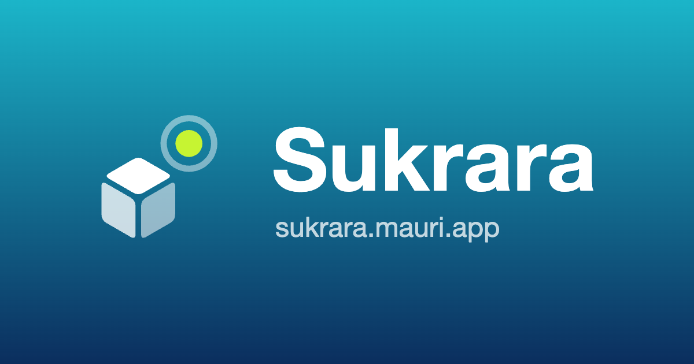
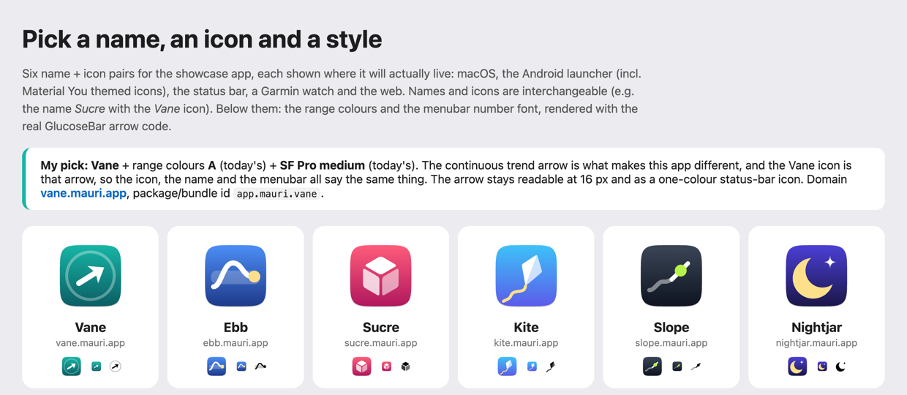
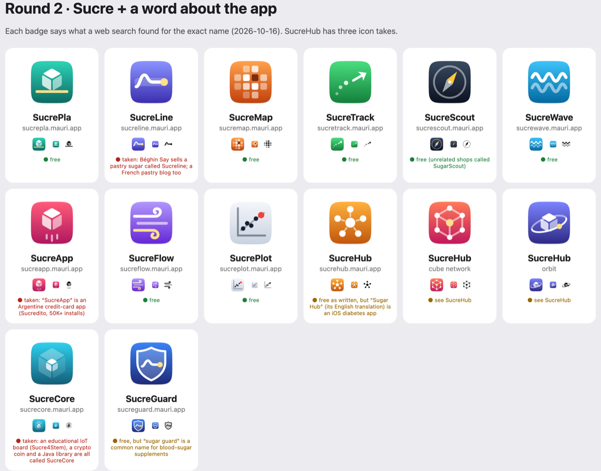
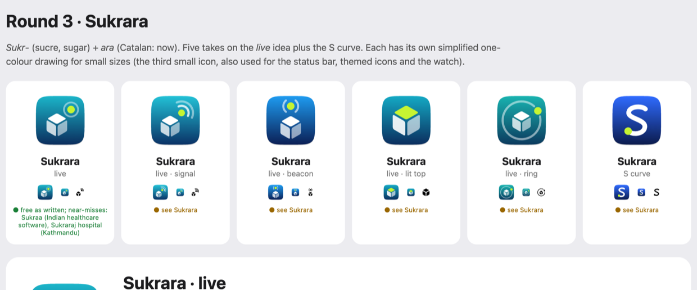
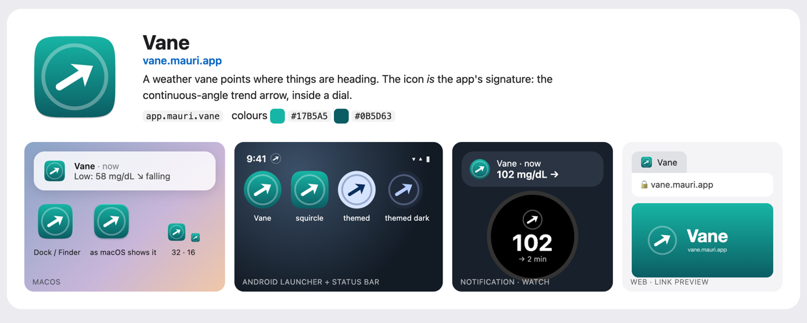
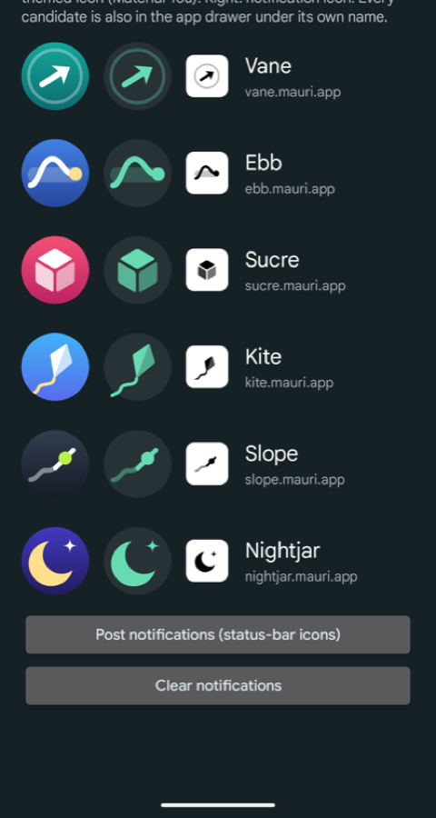
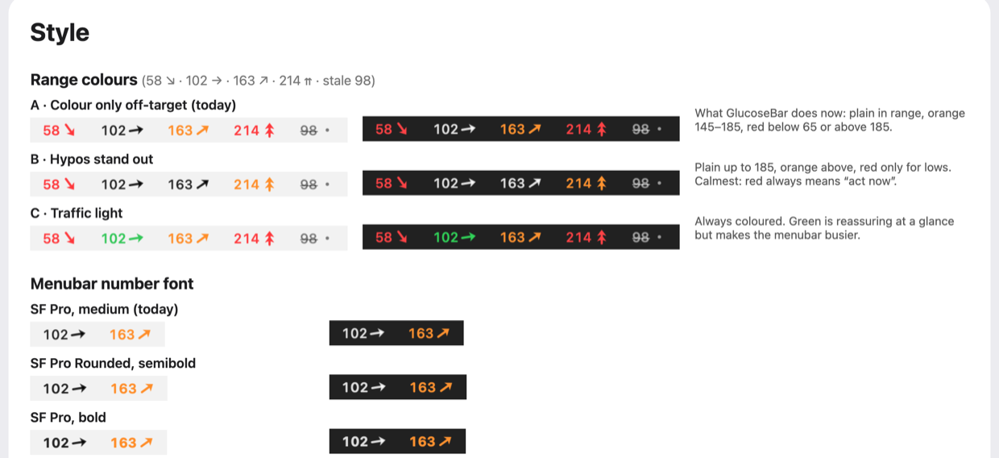

# 09 — A name, an icon and a basic style for the showcase app

*2026-10-16 · investigation report · macOS 27, Pixel 10 Pro (Android 17)*

## Goal

The next step bundles every proven feature (menubar, BLE bridge, direct sensor, LibreView, Nostr, status bar,
Garmin) into one **showcase app** that the user runs for a few days. It needs a temporary identity: a name, a
`<name>.mauri.app` domain, an icon for every place the app appears, and a few style decisions. The final app is
built from scratch later and may change all of this.

This spike produces **candidates to pick from**, not a final brand. It also includes the tooling that turns the
chosen candidate into platform-ready files.

## Result

> **Decision (2026-10-16): Sukrara, with the "live" icon.** *Sukr-* (sucre, sugar) + *ara* (Catalan: now),
> so "your sugar, now". The icon is a sugar cube with a neon live dot. Domain `sukrara.mauri.app`; ids
> `app.mauri.sukrara` (final) and `app.mauri.sukrara.poc` (showcase); range colours A and SF Pro medium (today's,
> not changed). Assets: [`poc/spikes/brand/assets/sukrara/`](../poc/spikes/brand/assets/sukrara/README.md).

<p>
&nbsp; </p>

How we got there: six name + icon pairs in round 1 and fourteen "Sucre…" candidates in round 2, three range-colour kits and four menubar number fonts. They're shown in a local gallery
(`poc/spikes/brand/build/gallery/index.html`) and, on the phone, in a preview app where every candidate is a real
launcher entry. `brand.py export <id>` turns the chosen one into macOS, Android, Garmin and web assets.



| Name | Domain | Idea | Icon |
|---|---|---|---|
| **Vane** | vane.mauri.app | A weather vane points where things are heading | The app's own continuous-angle trend arrow, inside a dial |
| **Ebb** | ebb.mauri.app | Ebb and flow: glucose rises and falls like a tide | A wave through the target band, ending on the current reading |
| **Sucre** | sucre.mauri.app | Catalan (and French) for *sugar*; personal, warm | An isometric sugar cube |
| **Kite** | kite.mauri.app | Stays up inside a band of wind; the string shows the direction | A kite with a curving tail |
| **Slope** | slope.mauri.app | The trend *is* the slope of the curve | The tangent line at the last point of a curve |
| **Nightjar** | nightjar.mauri.app | A bird that keeps watch at night: remote follow, Nightscout heritage | A crescent moon with a star |

A web search found no glucose or diabetes app using any of these names. Names close to existing products in this
space were avoided: Glimp (a Libre app), Tidepool, Nightscout, Gluroo, Libre, Dex…. Names and icons are
interchangeable.

Round-1 recommendation (superseded): **Vane**, range colours **A** (today's), **SF Pro medium** (today's). What sets these apps apart is
the continuous trend arrow, and the Vane icon *is* that arrow, so the name, the icon and the menubar all say the
same thing. At 16 px the dial fades but the arrow stays clear, and it works as a one-colour themed icon.

### Round 2: "Sucre" + a word about the app

The user liked *Sucre* but wanted a compound name that is easy to say and write and unique enough to rank in
search. So round 2 is "Sucre" plus a word about what the app does: 12 names, with three icon takes for SucreHub.
The badges show what a web search for the exact name found on 2026-10-16:



| Name | Search | Notes |
|---|---|---|
| **SucrePla** | free | *pla* = flat, plan, film shot. Icon: sugar cube standing on a flat line |
| SucreMap, SucreTrack, SucreWave, SucreFlow, SucrePlot | free | — |
| SucreScout | free | unrelated "SugarScout" shops; reads as a Nightscout alternative |
| **SucreHub** | free as written | but **"Sugar Hub: Glucose & Insulin"** is an iOS diabetes app, and SugarPixel *Hub* is a CGM display companion. Its meaning fits the architecture (the phone as the hub). The "-Hub" suffix is generic |
| SucreGuard | free | "sugar guard" is a common blood-sugar-supplement name |
| SucreLine | **taken** | Béghin Say's *Sucreline* pastry sugar, plus a French pastry blog |
| SucreApp | **taken** | Argentine credit-card app (Sucredito), 50K+ installs |
| SucreCore | **taken** | educational IoT board (Sucre4Stem), a crypto coin and a Java library |

The search engine matches near-spellings too, so "free" means nothing came up, not that the name is cleared.
Round-2 favourite: **SucrePla**.

`python3 -I brand.py exports` writes the complete asset set for every round-2 candidate into `build/exports/`. On
the phone, only the round-2 icons are launcher entries; the preview app still lists all of them.

### Round 3: Sukrara

The user's own coinage: *sukr-* (sucre, sugar) + *ara* (Catalan: now), so "your sugar, now". All takes use
technical blues with a neon "now" dot, deliberately far from the pink/floral look of the many "Sakura" wellness
apps. The user liked the **live** idea (a sugar cube with a live signal), so it has five variants: live, signal,
beacon, lit top and ring. There is also an **S curve** monogram.



The user found the small one-colour version weak: the semi-transparent faces turned grey and the badge ring merged
into the cube. Two generator changes fix that for every candidate:
- **A separate small-size drawing** (`mono=` in a concept) is used for the Android themed icon, the status-bar
  icon, the menubar glyph and the watch. The cube there has **opaque faces with wider gaps** (no alpha), and nothing
  overlaps. This is how SF Symbols and Material icons stay legible.
- **The themed icon can have its own drawing too** (`themed=`). Android tints the monochrome layer but keeps its
  alpha, so Sukrara · live's themed icon uses three face opacities, with the dot tucked against the cube. The tiny
  glyphs keep their solid faces.
- **The small glyph is cropped to its content.** Each glyph is cropped tight around its paths, so it fills the
  16–24 px box. Arcs are measured exactly; the first version used only the endpoints and cut off the status ring.

`python3 -I brand.py sheet sukrara` renders just these variants at 24 and 16 px on white and on dark.

Search (2026-10-16): no exact use. The near-misses are [Sukraa](https://sukraa.in/), Indian healthcare ERP software,
and Sukraraj Tropical and Infectious Disease Hospital in Kathmandu. Sanskrit *śukra* (Venus) shows up as well.

### In context

Each candidate is shown where it will live: a macOS notification and Dock, the Android launcher (circle and
squircle masks, themed light/dark), the status bar, a notification row, a Garmin watch, and a browser tab with the
link-preview image:



### On the phone



`poc/spikes/brand/android` (**Brand preview**, `dev.spike.brandpreview`) puts every candidate in the app drawer under
its own name, using one `activity-alias` per icon. In the app, each row shows:
- the launcher icon **as the phone masks it**, from `PackageManager.getActivityIcon`;
- the **themed icon**: the monochrome layer tinted with the wallpaper's Material You colours (here the user's
  green), the same way Pixel's themed icons do it;
- the notification small icon.

Findings on the Pixel 10 Pro (Android 17):
- All six adaptive icons, including their `<monochrome>` layers, render correctly from the generated
  VectorDrawables. Themed icons work for every candidate.
- **Notification rows show the app's launcher icon, not the small icon.** The six test notifications were grouped
  under the Vane alias's launcher icon. So the launcher icon matters inside notifications too.
- While the glucose Live Update chip from [05](05-android-status-bar.md) was showing, the status bar showed **no
  notification icons for any app**, including WhatsApp. So the small icon couldn't be checked in place; the preview
  app shows it instead. It is still required by the API and is generated as `ic_stat_<id>.xml`.

<br clear="right">

### Style decisions



These are rendered by the real `TrendArrow.swift` and AppKit fonts, on light and dark menubars:

| Kit | Below 65 | 65–145 | 145–185 | Above 185 |
|---|---|---|---|---|
| **A · Colour only off-target** (today) | red | plain | orange | red |
| **B · Hypos stand out** | red | plain | plain | orange |
| **C · Traffic light** | red | green | orange | red |

Number font: SF Pro medium with monospaced digits (today), SF Pro Rounded semibold, SF Pro bold, or SF Mono. The
differences are small at menubar size. Rounded looks friendlier; Mono looks more "instrument".

Carried over unchanged:
- mg/dL, with thresholds 65 / 145 / 185;
- stale after 5 min (grey + strikethrough);
- the continuous arrow (±3 mg/dL/min = vertical, double chevron beyond);
- Apple system colours on **both** platforms, so the Mac and the phone show the same red, orange and green.

## How it works

```
brand.py ── concept = shapes on Android's 108-unit adaptive canvas (one definition per icon)
   ├─▶ SVG: macOS squircle (Big Sur grid), Android masks, themed, glyph, favicon, link preview ──▶ gallery (HTML)
   ├─▶ VectorDrawable XML: adaptive background / foreground / monochrome + ic_stat ──▶ preview APK / showcase app
   └─▶ render.swift (AppKit) ──▶ PNGs, .icns (iconutil), menubar mock-ups (real TrendArrow), "what macOS shows"
```

- Each icon is a list of paths (filled or stroked, with alpha) in **one coordinate system**: Android's 108-unit
  adaptive-icon canvas. The visible area is 18..90 and the glyph stays inside a radius of about 26. For macOS, that
  visible area is mapped onto the 824-px squircle of Apple's 1024 grid. For small mono uses (status bar, menubar,
  watch), the canvas is cropped to 24..84. No external tools are needed: Python stdlib, `swiftc`, `iconutil`, and
  Chrome for one image.
- **macOS 27 shows the generated `.icns` unchanged.** `NSWorkspace.icon(forFile:)` on a stub `.app` returns the
  icon as drawn, with no grey "legacy icon" frame (the gallery's "as macOS shows it" tile). The stub needs a real
  executable; without one macOS shows its "can't open" icon instead.
- AppKit's built-in SVG renderer handles gradients, alpha and arcs but **ignores `font-weight`**. The one image
  with text (`og.png`, the link preview) is therefore rendered with headless Chrome.
- Strokes thinner than about 4 units (Kite's tail, Slope's curve) are the first to break up at 16 px; the solid
  shapes (Sucre, Nightjar, the Vane arrow) hold up best.

## Use it

```sh
cd poc/spikes/brand
python3 -I brand.py gallery            # build everything, open the gallery
python3 -I brand.py export vane a      # chosen candidate + range kit → assets/vane/ (commit this)
cd android && ./gradlew assembleDebug && adb install -r -g app/build/outputs/apk/debug/app-debug.apk
adb uninstall dev.spike.brandpreview   # removes the six launcher entries again
```

`export` writes `assets/<id>/`:
- `brand.json`: name, domain, application ids, colours, thresholds;
- `macos/`: `AppIcon.icns`, a 1024 master, the menubar template glyph, `Brand.swift`;
- `android/res/`: the adaptive icon with its monochrome layer and `ic_stat_<id>`, plus `Brand.kt` and a 512 store icon;
- `garmin/`: launcher icons, colour and mono, 40–80 px;
- `web/`: favicon (SVG + 32), apple-touch-icon, PWA 512, `og.png`.

A `README.md` in the folder says what goes where.

## For the showcase app

- Name **Sukrara**. Ids: **`app.mauri.sukrara.poc`** for the showcase app, which leaves `app.mauri.sukrara` free
  for the final app so both can be installed side by side. Website: `https://sukrara.mauri.app`.
- Everything is in `poc/spikes/brand/assets/sukrara/` (its README says what goes where). `brand.json`, `Brand.kt` and
  `Brand.swift` carry the name, URL and colours.
- Copy `assets/sukrara/android/res` into the app and set `android:icon="@mipmap/ic_launcher"`. On the Mac, put
  `AppIcon.icns` in `Contents/Resources` and set `CFBundleIconFile`. Use `ic_stat_sukrara` as the notification
  small icon; on the Mac, `MenubarGlyph` is a template image for menus and "no data yet".
- The battery spike (`poc/spikes/power`, session *cgm-reading-mac-spike-02*) will measure the showcase app. What it
  needs from the app (adb/DUMP-protected feature toggles, upload intervals…) is in `poc/spikes/power/README.md`. Message
  that session when the app is installed on the phone.

## Open

- [x] Name and icon picked: Sukrara · live. Assets exported to `assets/sukrara/`.
- [ ] Range colours and menubar font were left at today's defaults (A, SF Pro medium). To change them, run
      `brand.py export sukrara <kit>`.
- [ ] Register `sukrara` as a domain you own outright (plus the likely misspelling *sucrara*) before the final app.
- [ ] Final app: a macOS 26+ **Icon Composer** `.icon` (Liquid Glass layers). That needs Xcode's `actool`, which
      this machine doesn't have (Command Line Tools only).
- [ ] A wordmark/logotype, if the website needs more than the name set in the system font.
- [ ] Garmin: check the `launcherIcon` size the Connect IQ device profile wants for the Instinct 3 when the watch app
      is built.
