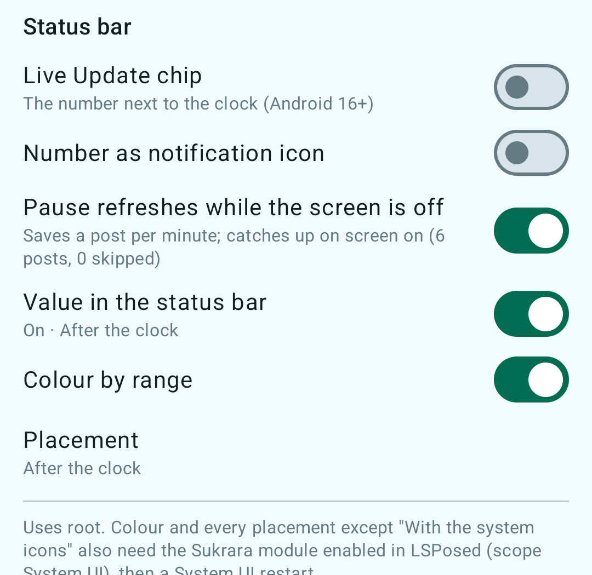
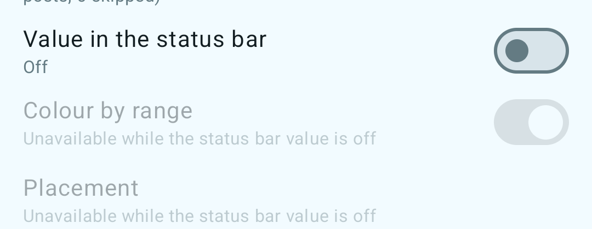

# 10 — Sukrara: the showcase app

*2026-10-16 · investigation report · Pixel 10 Pro (Android 17), Juggluco + Libre 3 Plus, Sukrara for Mac (was GlucoseBar)*

## Goal

Put every feature proven in investigations 01–09 into **one Android app** that the user runs for a few days, to judge
whether it's useful, what's buggy and how it feels day to day. It's still a throwaway alpha. The final app gets
rebuilt from scratch.

## Result

**Sukrara `0.1-inv10` (release, R8, signed with the debug key) is installed and running on the phone as the
wearer, with Juggluco as the source.** Checked on the phone at 09:05–09:17:

| Feature | Default | Verified on the phone |
|---|---|---|
| Glucose from Juggluco (`127.0.0.1:17580`, history + `/x/live` SSE) | **ON** | `live (Juggluco SSE)`, 1600-entry backfill at start |
| Status bar: Live Update chip + number as the notification icon | **ON** | notification flags `PROMOTED_ONGOING`, `MetricStyle`, bitmap icon 96×96 ([dump](../spikes/showcase-android/evidence/phone-statusbar-notification.txt)) |
| Sharing over Nostr (v2: live + hourly chunks, roster, owner backup) | **ON**, every reading | 25 chunks + live events published. **GlucoseBar paired over Nostr** (match code 4096 on both sides, approved) and shows live values ~1 s after the phone |
| Bluetooth followers (v2 GATT `7c6a0001-…`) | **ON** | GlucoseBar (v2) connected over BLE, got `INFO`, the backlog chunk and live readings `via ble:Tartaruga` |
| Garmin watch server (xDrip+-compatible, `127.0.0.1:17580`) | **ON** | Port taken by Juggluco, as expected: Juggluco keeps serving the watch. On the emulator (no Juggluco) it listens. **In the follower role it serves the followed person** (emulator: `/sgv.json` returned the phone's values) |
| Treatments (insulin / carbs / notes) | available | emulator: logged "2.5 U rapid · breakfast" |
| LibreView upload | **OFF** (setup screen) | never enabled, nothing posted |
| Direct Libre 3 source (inv. 02) | **OFF**, opt-in with a warning | compiled (`libsukrara_libre3.so` in the APK); **not run**: it would take the sensor from Juggluco |
| Follower role + alarms (CGM Share) | available at onboarding | **gap audit, 10:10–10:42:** an emulator running the release build followed the phone's wearer over Nostr (headless invite → `cmd follow` → match code **3308** on both sides → `cmd approve`). Live readings + 24 h of chunks, 0 rejected events |
| App Link invites `https://sukrara.mauri.app/join#…` | ON | `pm get-app-links`: **`sukrara.mauri.app: verified`** ([evidence](../spikes/showcase-android/evidence/phone-app-links.txt)) |
| **Home-screen widgets** (inv. 12: value, graph, graph + value) | in the widget picker | the 3 providers are registered on the phone ([dumpsys](../spikes/showcase-android/evidence/phone-widget-providers.txt)). The user has since pinned a *Glucose + graph* widget on the phone. **Follower role too** (gap audit): the emulator follower's value and graph + value widgets show the phone's real readings |
| **Status bar for followers** (gap audit) | follows the chip/icon switches | the follower service's only notification is now the wearer's chip + number icon, showing the followed person's value (emulator: number icon in the status bar, colored card in the shade) |
| **Nightscout read API** (inv. 03 tier 1, gap audit) | **ON**, `127.0.0.1:17581`; LAN **OFF** | phone (wearer, next to Juggluco): `api_check.py` **17/17** ([log](../spikes/showcase-android/evidence/phone-wearer-nightscout-api-check.txt)); emulator follower: 17/17 ([log](../spikes/showcase-android/evidence/emu-follower-nightscout-api-check.txt)); LAN mode: 401 without / with a wrong secret, 200 with `?token=` or `api-secret` ([log](../spikes/showcase-android/evidence/emu-follower-nightscout-lan-auth.txt)) |
| Restart after reboot / app update | ON | the phone update at 09:29 restarted the wearer service on its own (`MY_PACKAGE_REPLACED`), with the identity, follower and settings kept. Updated in place again at 10:25 and 10:33 (gap-audit build): wearer back at once. **Followers now restart too**: emulator log `Background started FGS: Allowed … MY_PACKAGE_REPLACED` for `FollowerService` |

Screenshots come from the emulator, because the phone's screen is locked with a PIN. The source there is the
debug build's synthetic one:

| | | |
|---|---|---|
|  |  |  |
| Home (wearer): value, feature summary | Home, scrolled: backup, 12 h chart | Share: QR with the https App Link, "Copy Mac link" |
|  |  |  |
| Settings: source, sharing, Mac, status bar | Settings: status bar, Garmin, LibreView | Treatments + LibreView setup (off) |
|  |  | |
| Widget picker: Sukrara, 3 widgets (generated preview) | Value widget on the emulator. It shows the *stale* style (struck through, "9 min ago") because the release build has no synthetic source and the emulator has no Juggluco | |

**Follower view with real data** (gap audit, 10:17–10:42). The emulator runs the release build as a follower of the
phone's wearer, over Nostr, so these are the user's real readings:

| | | |
|---|---|---|
|  |  |  |
| Follower home: value, 12 h chart, alarms, local servers. The history starts at 09:00 here (see Known issues) | *Glucose + graph* widget in the follower role | The follower's notification: number icon + colored card ("following · via relay.primal.net") |
|  |  |  |
| *Glucose* widget (follower) | Graph + value after a restart, **with the R8 fix**. Struck through: the overloaded emulator had lost DNS for 9 min | The bug the audit found: after a process restart, *Glucose + graph* lost its value header (R8 merged two widget classes) |

## What's in it (code)

`spikes/showcase-android/`, Kotlin only, GPL header on every file. It's built on CGM Share
(`spikes/nostr/android-app`) and renamed to `app.mauri.sukrara` (applicationId **`app.mauri.sukrara.poc`**),
with brand icons from `spikes/brand/assets/sukrara/`. compileSdk/targetSdk 37, minSdk 36.

| Package | From | What |
|---|---|---|
| `owner/`, `follower/`, `core/` | CGM Share (06, 07) | v2 engines, relays, BLE transport, password-manager backup, QR, alarms. `OwnerEngine` now follows the feature switches (Nostr on/off + interval, BLE on/off, source) |
| `wearer/` | new | `Live`: the one glucose fan-out. `WearerExtras`: status bar, Mac link, Garmin + Nightscout API, LibreView, follower treatments → shared log. `follower/FollowerExtras` (gap audit): the same widgets, status bar and local servers fed by the follower DB |
| `status/` | statusbar-android (05) | `GlucoseNotification`: chip + number icon on the service's **only** notification |
| `bridge/` | glucobridge (01, 04, 08), nostr (03) | `XdripServer` (Garmin, plus a second listener), `NightscoutApi` (inv. 03 tier 1, ported from `follower.py`), `LocalServers` (both listeners per role, live switches) |
| `treatments/`, `libreview/` | glucobridge (04) | treatment store (SPEC §1; followers and Macs over v2, §5), LibreView uploader, gated by `Features.libreview` |
| `direct/` + `src/main/cpp` | glucobridge `direct` (02) | Libre 3 client + JNI core, plus the NFC scan (`Libre3Nfc`), the receiver ID (`ReceiverId`) and the first-time Bluetooth pairing (see "Sensor scan" below). Built from `third_party/Juggluco` (this checkout's or the main checkout's) when it's present |
| `features/` | new | `Features` (all switches, prefs + StateFlow) and the adb `DebugReceiver` |
| `widgets/` | widgets-android (12) | Glance widgets, graph renderer, `WidgetUpdater` (dedupe + skip while the screen is off). `RecentHistory`: the last 8 h in memory, read from the role's own store (`owner.db` + `treatments.json`, or `follower.db`) — no copy on disk. `SukraraHooks` feeds it from `WearerExtras` or `FollowerExtras` (each reading, history, screen on, minute tick). Trend arrow, range colours, staleness and age text come from `core/Glucose.kt`, shared with the status bar, system icons and the SystemUI hook; the widgets use the status bar's `sb_t*` arrows. `StartReceiver` restarts the role's service (wearer or follower) after a boot or an update. R8 keep rule for the Glance classes (see Known issues). Glance 1.2.0 + WorkManager 2.12.0 (pinned, see Known issues) |

Changes from the source spikes:

- **CGM Share's debug-exported `CMD`/`DUMP` receivers are deleted.** The headless commands now go through the
  `DUMP`-protected `DebugReceiver`, in debug and release.
- **One process and one foreground service** (`OwnerService`, type `connectedDevice`). The status-bar notification
  is that service's notification, so the chip costs no extra post.
- **Invites are App Links**: since 0.11 the v3 short link `https://sukrara.mauri.app/join#<32 chars>`, with an
  `autoVerify` filter on https/`sukrara.mauri.app`/`/join`. The web page's *Open in Sukrara* button uses the app's
  own `sukrara:join#<32 chars>` scheme (Mac, and phones without verified App Links). The old `#i=…&t=…` and
  `cgmshare:` forms are gone (see "Short invites and private profiles" below).
- Follower treatments (v2 writers) are merged into the shared treatment log, so they reach the Mac (v2) and
  LibreView (if enabled).

## Daily use

1. **Install** the release APK. Grant notifications and Nearby devices. Choose **"I wear the sensor" → Start fresh**
   (or *Restore from password manager* on a new phone).
2. **Backup**: on the home screen, *Save to password manager* (Proton Pass / Bitwarden / KeePassDX via Credential
   Manager). Both builds are signed with the same key, so the saved entry works for both.
3. **Status bar**: the chip needs "Live Updates" allowed. If Settings shows *Allow Live Updates for Sukrara*, tap it.
   On the phone, `adb shell appops set app.mauri.sukrara.poc POST_PROMOTED_NOTIFICATIONS allow` did it. **System
   icons** (root) and the **SystemUI hook** (LSPosed) are bundled since 2026-10-16 (see "Root status bar" below):
   Sukrara needs root in KernelSU and its own LSPosed module enabled (scope System UI), then one System UI restart.
4. **Share**: *Share with someone* shows the QR / link and "They'll see [picture] name". The follower installs
   Sukrara and chooses *I follow someone*. The link opens the app directly (verified App Link), or
   `https://sukrara.mauri.app/join/` if the app isn't installed. The app shows who is inviting; the follower types
   their name (Shuffle / Customize the picture) and asks. The wearer checks the 4-digit code and taps *Allow*. Change
   your own name or picture by tapping it at the top of the home screen (wearer) or *You appear as … Edit* (follower). **Nearby**: *Pair nearby* (10 min), and the
   follower picks the phone from the list.
5. **Mac (Sukrara for Mac, `spikes/menubar/build/Sukrara.app`, was GlucoseBar)**: follows end-to-end encrypted over
   Nostr + BLE like any follower: Share → *Copy* (the `https://sukrara.mauri.app/join#…` link) → Sukrara for Mac
   (0.11 or later) → *Follow someone…* → paste →
   Allow on the phone. Low / high / no-data alarms on the Mac too. The old GlucoseBar follow state is migrated once.
   Details: [`spikes/menubar/FOLLOWER.md`](../spikes/menubar/FOLLOWER.md).
6. **Garmin**: nothing to do while Juggluco is the source, because Juggluco keeps port 17580 and serves the watch.
   Sukrara's server takes over only when the port is free (direct mode, Juggluco stopped). Settings → Garmin shows
   which one is serving. On a **follower's** phone Sukrara's server takes the port and serves the followed person.
7. **Widgets**: long-press the home screen → Widgets → Sukrara → *Glucose*, *Glucose graph* or *Glucose + graph*
   (resizable). They show the wearer's readings, or on a follower's phone the followed person's, and don't refresh
   while the screen is off.
8. **LibreView** (off): Settings → LibreView → *Account* (email + password) → *Upload to LibreView*. Glucose,
   insulin/carbs/notes and *Use this phone as the account's device* are on by default, so everything uploads.
   **Uploaded entries can't be deleted from LibreView**, so try a throwaway account first. Using this phone as the
   account's device logs the Libre app / Juggluco out of LibreView.
9. **Direct sensor** (the default source): home → *Scan your sensor*, or Settings → Glucose source → *Sensor*, then hold the phone against
   the sensor. A new sensor starts (60 min warm-up); a running one moves over from LibreLink or Juggluco (stop
   Juggluco first: *Pause app* **and** *Force stop*, see "Sensor scan"). Sukrara then pairs over Bluetooth by itself. **Juggluco's alarms stop**; scanning with
   Juggluco gives the sensor back.
10. **Nightscout API** (Settings → Nightscout API, or the follower's home screen): `http://127.0.0.1:17581` on the
   phone, on by default, works next to Juggluco. Apps on the same phone (xDrip+ follower, a Garmin app in
   Nightscout mode) point at it. *Also on this network* binds it to Wi-Fi so Home Assistant's
   built-in Nightscout integration, Nightguard or an ESP32 clock can read it at `http://<phone IP>:17581`. They need
   the **API secret** shown there (HA: "API key"; Nightguard/Garmin: `?token=`). Plain HTTP, so only on trusted
   networks. Treatments come from the shared log (rapid → Correction Bolus, carbs → Carb Correction, long/note →
   Note).

## DebugReceiver (for investigation 11's battery lab)

The receiver is protected by `android.permission.DUMP` (only shell/root can send to it). Each switch applies at
once, without restarting the process. Settings and the receiver share the same prefs. The reply (`resultData`) is
JSON: `features` (every switch), `runtime` (last reading, source state, Mac link
advertising/subscribed, Garmin state, LibreView state, `notificationPosts` / `notificationSkipped`, `screenOn`) and
`owner` (epoch, followers, `liveSent`, `chunksSent`, BLE centrals).

```
adb -s 62240DLCH0005W shell am broadcast -n app.mauri.sukrara.poc/app.mauri.sukrara.features.DebugReceiver [extras…]
```

| Extra | Type / values | Default | Effect |
|---|---|---|---|
| *(none)* | | | read the state only |
| `nostr` | `--ez` true/false | true | relays on/off. Off closes all relay sockets: no publishes, no inbox checks |
| `nostrInterval` | `--ei` minutes 0–240 | 0 | 0 = a live event per reading + a chunk every 5 min. N = no live events to relays, one chunk batch every N min (BLE followers still get live) |
| `libreview` | `--ez` | false | arms the LibreView uploader. **It still needs a saved login.** Don't use it on the real account |
| `libreviewInterval` | `--ei` minutes 1–240 | 5 | LibreView cycle |
| `bleFollowers` | `--ez` | true | v2 GATT server + advertising (BALANCED) |
| `chip` | `--ez` | true | Live Update chip (promoted notification). Off = colorized ongoing notification |
| `icon` | `--ez` | true | number as the small icon (off = Sukrara glyph) |
| `hook` | `--ez` | false | root status bar on (Settings: "Value in the status bar") |
| `hookColor` | `--ez` | true | colour by range (module only); off = like the clock / System UI's tint |
| `hideNotifIcon` | `--ez` | true | while the root status bar shows the value, the module drops Sukrara's notification icon from the status bar (shade, lock screen and AOD unchanged) |
| `hookPosition` | `--es` after_clock\|before_clock\|icons:0\|slot:\|slot:vpn\|slot:bluetooth\|slot:mobile\|slot:wifi | after_clock | `after/before_clock`, `icons:0`: drawn by the LSPosed module. `slot:…`: as Android system icons (root daemon) — `slot:` works with root alone; with the module they're coloured by range and `slot:wifi` etc. moves them right after that icon |
| `systemIcons` | read-only | | derived: `hook` and a `slot:` placement; the daemon's state is in the reply's top-level `systemIcons` |
| `previewSgv`, `previewRate` | `--ei`, `--ef` | | screenshots: show a made-up value in the root status bar only, until the next real reading |
| `restartSystemUi` | `--ez` true | | root: kill System UI to (re)load the module. Follow `spikes/statusbar-android/HANDOFF.md` (safety) |
| `screenOffSkip` | `--ez` | false | don't re-post the notification while the screen is off (catches up on screen on) |
| `garmin` | `--ez` | true | xDrip/Garmin server on 127.0.0.1:17580 (binds only if the port is free) |
| `nightscout` | `--ez` | true | Nightscout read API on 127.0.0.1:17581 (inv. 03 tier 1; both roles) |
| `nightscoutLan` | `--ez` | false | the same API on all interfaces; non-loopback callers need the API secret |
| `connPriority` | `--es` default\|low\|balanced\|high | default | sensor-link priority, **direct mode only**, applied on the next sensor connection |
| `source` | `--es` juggluco\|direct | juggluco | `direct` also needs `--ez confirmDirect true`. **Takes the sensor from Juggluco** |
| `cmd` | `--es` owner\|invite\|pair\|approve\|writer\|follow | | headless setup: `owner` = create the wearer identity + start the service, `invite` = new invite link in the reply, `pair` = nearby pairing 10 min, `approve` = allow the first pending request, `writer --es f <hex> --ez on true`, `treat --es k rapid|long|carbs|note --ef a <amount> --es n <note>` (both roles), `untreat --es id <id>` (wearer), `widgetprobe` = measure every graph widget's real size again (logcat `Sukrara.widgets`; the reply's `widgets` lists each widget's reported sizes). **Follower side** (e.g. an emulator following the phone): `follow --es link <https link> [--es name <n>]` looks the invite up on the relays, sets the follower role and sends the request; the reply then has a `follower` object (status, code, epoch, readings, rejects, last). Start the follower service by opening the app once (a broadcast can't start a foreground service). `profile --es name <one word> [--ez shuffle true]` (both roles) sets your name / a new random picture; the reply shows `owner.profile` + `owner.followerNames`, or `follower.me` + `follower.wearer` |

Example: `… --ez nostr true --ei nostrInterval 15 --ez chip false --ez screenOffSkip true`. The process is
`app.mauri.sukrara.poc` (one process). Partial wakelocks are held only for the work itself: 10 s per reading, 90 s
for a history backfill, 20 s for an inbox check.

## Phone state (handed over to the user at 09:30)

- **Sukrara** (`app.mauri.sukrara.poc`, release; installed 09:05, updated in place at 09:29 to add the widgets) is
  installed and running: role **wearer**, new identity
  `npub1l79v5…86st` (epoch 1), source **Juggluco**, every feature at its default (above). The permissions
  (notifications, nearby devices, camera) were granted with `pm grant`, and promoted notifications with `appops`.
  The identity is **not yet saved to a password manager**: do it from the home screen.
- Follower: **"Mac (GlucoseBar)"** (approved, code 4096). No other followers. CGM Share's old followers aren't
  carried over (new identity).
- **Uninstalled** (user request): `dev.spike.glucobridge`, `dev.spike.cgmnostr`, `dev.spike.cgmshare` (its
  identity is gone with it), `dev.spike.glucostatus` (the LSPosed module: see Daily use step 3). No brand-preview
  or `dev.spike.glucowidgets` package was installed.
- **Kept**: `dev.spike.powerlab` (investigation 11), Juggluco `tk.glucodata` (untouched, still reads the sensor and
  serves 17580), GlucoDataHandler.
- No widgets pinned (the user adds them). Bluetooth/Wi-Fi not toggled. No reboot. Nothing posted to LibreView.

**Gap audit update (10:10–10:45):** the phone was updated in place twice (10:25 and 10:33, data kept, wearer back at
once, no crash). New: Nightscout API listening on `127.0.0.1:17581` (LAN off), followers' widgets and status bar,
the Glance R8 fix. The user had pinned a *Glucose + graph* widget by then. A second follower was approved headlessly:
**"Emulator follower inv10"** (code 3308), a test leftover. Removing it in Sukrara rotates the key; Sukrara for Mac
and any other follower pick up the new key by themselves. The previous APK is kept at
`/tmp/sukrara-backup/phone-before-audit.apk` (Mac, temporary) in case a rollback is needed. The repo build differs from the phone's 10:33 build only in UI labels ("GlucoseBar" → "Sukrara for Mac"); the user unplugged the phone before it could be installed.

## Known issues

- On a fresh install the wearer has to allow Live Updates once (the button in Settings). The emulator (API 36)
  doesn't show the chip.
- Settings writes and the receiver's reply are asynchronous: the `runtime` part of the reply can be one step behind
  a switch it just flipped. Read again to see the applied state.
- Turning BLE followers off and on quickly can leave the "connected followers" count stale (cosmetic).
- ~~`relay.nostr.net` rejects NIP-42 AUTH ("needs serviceUrl")~~ Replaced by relay.snort.social in 0.11.
- LibreView's payload still names the device "GlucoBridge" (unchanged from inv. 04, kept on purpose because that
  format was tested).
- Direct mode was not run end to end inside Sukrara: compiled only.
- The first widget build crashed at start in **release** (`Failed to create an instance of androidx.work.impl.WorkDatabase`:
  Glance's transitive WorkManager under R8). Fixed by pinning `work-runtime-ktx` 2.12.0 (as in the widgets spike)
  and a keep rule for `RoomDatabase` subclasses. Caught on the emulator before the phone update.
- ~~Widgets show the **wearer's** readings only.~~ Fixed in the gap audit: `FollowerExtras` seeds them from the
  follower DB and feeds every stored batch.
- **Fixed (gap audit): after a process restart the release build drew *Glucose + graph* as the plain graph.** R8
  had horizontally merged `GraphWidget` into `CombinedWidget` (`mapping.txt`: both → `g8.d`), and Glance keys its
  widget bookkeeping by that class name, so `GraphWidget().updateAll()` also rendered into the combined widget.
  A keep rule for `GlanceAppWidget` / `GlanceAppWidgetReceiver` subclasses keeps them apart; verified on the
  emulator after a restart + update. The *Glucose + graph* widget the user pinned on the phone could show this until the 10:33 update.
- **Thin history for a new follower**: the emulator follower first got only the last ~1.5 h of chunks (plus one
  24-h-old hour), although the wearer has 12 h+. When the phone was updated at 10:25 the wearer republished its
  last 24 h and the follower filled in. Likely the 25-chunk burst at 09:05 didn't all stick on the relays (pacing /
  rate limits). **Polish round 2:** all four relays keep every chunk (29 hours measured), so retention wasn't the
  cause. Fix: the wearer republishes the last 24 h on every approval and rotation, and a follower that sees missing
  hours asks for them (`history` gift wrap, PROTOCOL-v2). Not yet seen end to end with a fresh follower.
- On some Android 16 (API 36) images `Notification.Builder.setRequestPromotedOngoing` doesn't exist
  (`NoSuchMethodError`, the emulator follower crashed on it). The chip now falls back to the colorized notification.
- Widget battery cost was measured on the emulator only (docs/12: ≈ 0.4 s CPU per minute-update with 3 widgets).

## Root status bar (investigation 05, added 2026-10-16)

Ported from `spikes/statusbar-android` (GlucoStatus): `status/RootStatusBar.kt` (driven from
`WearerExtras.render()`), `status/SlotDaemon.kt` (root helper via `app_process`), `hook/SystemUiHook.kt` (libxposed
API 102 module, `resources/META-INF/xposed/`), the 403 `sb_*` drawables (kept from resource shrinking by
`res/raw/keep_status_icons.xml`), R8 keep rules for the daemon and the module entry. Settings → status bar follows the Android settings guidelines
([pattern](https://developer.android.com/design/ui/mobile/guides/patterns/settings),
[AOSP](https://source.android.com/docs/core/settings/settings-guidelines)): the switch "Value in the status bar"
(disabled with "Unavailable: needs root…" until `su` works), then its dependents, which stay visible and disabled
with a reason while it's off: "Colour by range" and "Placement" (current value as summary; radio buttons in a
dialog, like a ListPreference). A footer below a divider explains the root/LSPosed requirements.

 


Sukrara. System-icon placements are coloured by range through a hook on System UI's Compose `Image` (our icons are
recognised by their content description); the digits match the clock's height (27 px) and the arrow drawables are
trimmed to their width. Verified on the phone (release, updated in place): system icons `on (ok)`, module
"attached to MAIN/KEYGUARD", "icon order hooks: 1", after clock / before clock / icons after Wi-Fi.


**Hide Sukrara's notification icon** (polish round 2, on by default, under "Value in the status bar"): the module
removes Sukrara's entries from the status bar's notification-icon row (`NotificationIconContainerStatusBarViewModel`,
status bar only; shelf/AOD untouched), so the always-present logo disappears while the value is shown. There is no
rootless way on Android 17: a foreground-service notification on a MIN channel is raised to LOW (and the channel
rewritten), and "silent" icons hide only with a global user setting and without the coloured card. Wearer role only
(the follower doesn't feed the module yet). ([shown](../spikes/showcase-android/evidence/n-icon-statusbar-shown.png),
[hidden](../spikes/showcase-android/evidence/n-icon-statusbar-hidden.png))

Safety, kill switch (`settings put global sukrara_hook_disabled 1`) and what not to do (never `adb uninstall`
Sukrara to recover — it holds the identity): `spikes/statusbar-android/HANDOFF.md`.

## Polish round 2 (2026-10-16 afternoon, NEXT.md §1)

Five agents in parallel worktrees, merged into one build line, installed on the phone in place (data kept) and on
the Mac. Checked end to end on the phone + Mac at 14:25: a note logged on the phone reached Sukrara for Mac over v2
Bluetooth within seconds, its marker showed in the phone's Live Update graph, the delete propagated
([card](../spikes/showcase-android/evidence/n-e2e-phone-card-treatment.png), [Mac log](../spikes/showcase-android/evidence/n-e2e-mac-log.txt)).

- **Live Update chip = value + arrow.** On Android 17 the chip's icon is always the notification's small icon (no
  public API removes it), and SystemUI hides a notification's status-bar icon while its chip shows. So with the chip
  on, the small icon is just the trend arrow and the short critical text the value: the chip reads "→ 134". With the
  chip off the small icon is the number (or the logo), as before. ([chip](../spikes/showcase-android/evidence/n2-chip.png))
- **Expanded card.** A promoted (Live Update) notification can't have custom views, a colour or a large picture
  (`hasPromotableCharacteristics`), so: chip on → a MetricStyle card (value coloured by range, arrow + rate, live
  "ago"), minimal header, no graph ([card](../spikes/showcase-android/evidence/n3-card-chipon.png)); chip off → a
  colorized custom card with the big value, arrow, rate, age and a 3 h graph with treatments
  ([card](../spikes/showcase-android/evidence/n3-card-chipoff.png)). The system header (icon + "Sukrara") above a
  custom card can't be removed. The graph is cached per reading/theme/5 min and not redrawn while the screen is off.
- **Treatments for followers.** The wearer publishes its whole merged log (own, Mac, accepted writer entries,
  deletes) as SPEC §5 events signed by its device key, over relays and v2 BLE, and republishes the last 30 days on
  approval, rotation and weekly. Followers (Android and Mac) accept authors = roster devices ∪ writers, merge LWW,
  show them, and the follower's Nightscout API serves them. Spec: PROTOCOL-v2 "Treatments"; SPEC §5 is built.
- **Writer gating.** "Add entry" only when the follower's key is in the roster `writers`; otherwise "The wearer
  hasn't allowed you to add entries". Own entries show *sending → sent → accepted* (the wearer's device key echoes
  the same id) or *not accepted yet* after 2 min ([follower screens](../spikes/showcase-android/evidence/n1-follower-writer-accepted-ble-offline.png)).
  **Macs too**: a Mac adds entries only over v2, as a roster writer, and disables "Log treatment…" with the reason
  when it isn't one. Mac debug commands `-debugsend '{"cmd":"log"|"remove"|"paths"}'`.
- **Treatments in every chart**: home chart (both roles), the 3 widgets (read from the role's treatment store, so
  they survive a restart), the Live Update graph, the Mac menu chart and the macOS widget
  views. Rapid = filled blue triangle "4.5U", long = outlined violet, carbs = amber dot "30g", notes = grey diamond
  (text in the app chart only). The range band is now 65–185, the same thresholds as the line colours.
- **Home screen**: value card → 12 h chart directly below, above the fold down to 360×640 dp, the rest below
  ([wearer](../spikes/showcase-android/evidence/n5-home-wearer.png), [follower](../spikes/showcase-android/evidence/n5-home-follower-small-phone.png)).
- **Thin history**, **Home Assistant** and the Garmin state label: see Known issues and the gap audit.
- **Hide Sukrara's notification icon** (root): see "Root status bar".
- **Animations** (`ui/Motion.kt`): M3 shared-axis screen transitions with **predictive back** (NavigationEvent +
  `SeekableTransitionState`, the leaving screen shrinks under the finger), fade-through for role/onboarding changes,
  rolling digits for the value, colour cross-fade, the trend arrow turning with a spring, new chart points growing in,
  list rows expanding in/out, status labels cross-fading. Everything runs on Compose's frame clock: it respects
  *Remove animations* and stops in the background (idle home: 14 frames in 20 s)
  ([navigation](../spikes/showcase-android/evidence/n7-nav-shared-axis-predictive-back.gif),
  [value](../spikes/showcase-android/evidence/n7-value-rolling-digits.gif),
  [rows](../spikes/showcase-android/evidence/n7-treatment-row-add-delete.gif)).
- Released as **v0.10.2** (`versionName` 0.10.2 / Mac 0.10.2), with the Juggluco-port fix from the morning.
- **v0.10.3**: the legacy Mac link is read-only for entries; the *Accept entries over the unencrypted Mac link*
  switch and the Mac's legacy entry path are gone (Mac entries go over v2 only). Also ships the macOS widgets (docs/13).
- **v0.10.4** (Android only): widget cleanup after the docs/12 review (see "Widgets: one model, no second store").
- **v0.10.5** (Android only): direct mode scans the sensor with NFC and pairs over Bluetooth by itself, with no
  pairing file (see "Sensor scan (NFC)").
- **v0.10.6** (Android only): graph widgets are drawn at the size the launcher really gives them (see "Widgets:
  the launcher's reported size is wrong").
- **v0.10.7** (Android only): the graphs' y-axis fits the readings (see the end of that section).
- **v0.10.8** (Android only): the graph widgets are no longer squashed vertically (the launcher's near-duplicate
  sizes; confirmed by the user from the test-square screenshots).
- **v0.10.9**: the legacy Mac link (GATT `6c1f0001-…`, Settings → Mac → *Legacy Mac link*) is gone from both apps.
  Sukrara for Mac gets readings and treatments only over v2 (Nostr + BLE) and no longer uploads to LibreView: its
  entries reach the phone over v2 and the phone uploads the merged log. No backwards compatibility in this repo.

### Widgets: the launcher's reported size is wrong (v0.10.6)

User report: the 4×2 *Glucose + graph* on the phone lost the bottom and right of its graph (no time labels, no
65/185). Glance's Exact mode composes for the size the launcher reports (`OPTION_APPWIDGET_SIZES`), and the Glance
docs warn that *"the available size might differ depending on the launcher's implementation"*. On the user's Pixel
10 Pro (Pixel Launcher, 6-column grid) it reports **296×202 dp** and lays the widget out at **244×149 dp**: 82 % of
the width, 74 % of the height ([sizes](../spikes/showcase-android/evidence/n9-phone-widget-sizes.txt)). The emulator's
launcher lays widgets out at the reported size and scales them down evenly, so nothing was ever clipped there.

- **First fix** (graph image fills the remaining space, bitmap scaled into it): no longer clipped, but the bitmap,
  drawn for 296×202, was squeezed into a box of another shape — wide text, oval dots. The user found it looked bad.
- **Fix: measure the real size.** The launcher sends no other option, but its `AppWidgetHostView` knows the size:
  from a size → RemoteViews map it applies the layout that fits its real laid-out size most closely
  (`RemoteViews.findBestFitLayout`, re-picked in `onLayout`; at most 16 layouts). `widgets/WidgetProbe.kt` sends
  16 tiny layouts whose image is a `content://` URI naming its size, and `ProbeProvider` sees which one the
  launcher loads. Round 1 brackets 100…55 % of the reported size, round 2 narrows it to ≈ 4 %
  (measured: 240.5×148.9 dp for the real 244.2×148.6). The graph widgets then lay out and draw for that size; the
  image still fills its space, so being a few dp off doesn't clip.
- It runs only when a graph widget is placed or resized (`onAppWidgetOptionsChanged`), or has no measurement yet
  (e.g. the first refresh after this update), and only while the screen is on; a launcher that doesn't answer is
  asked again after 2 min. About 1.5 s, the widget is blank meanwhile. Results are kept per widget and reported size
  (`shared_prefs/widget-sizes.xml`), so updates and restarts don't measure again. The value widget doesn't need it.

| Before (0.10.5): clipped | First fix: stretched | Measured (0.10.6) |
|---|---|---|
|  |  |  |

**Then (v0.10.7): the y-axis fits the readings.** At the right size the graph still looked squeezed: the y-axis
was fixed at 40 to ≥ 250 mg/dL, so in an ≈ 80 dp plot the line used a thin strip. It now runs from just below
min(65, lowest reading) to just above max(185, highest reading), keeps a strip at the bottom only when treatment
marks are shown, and the *Glucose + graph* header is 6 dp shorter (value 32 sp). Same renderer for the status-bar
card's graph. 

**Still squashed in 0.10.6 / 0.10.7 (fixed in v0.10.8).** The user saw the current-value dot as an
ellipse. A temporary test pattern in place of the graph (a square with an inscribed circle) measured it on the
phone: **height/width 0.760** before, **0.989** after. Cause: Pixel Launcher reports two near-identical portrait
sizes (296×201.9 and 296×201.1). Glance composes one layout per reported size, and the probe's measurement was
stored only under the first. The launcher fits neither, so it applies the smaller one, which was still drawn for
296×201 and squeezed into 244×149. A measurement now applies to every reported size within 4 dp.

| Test square, before | Test square, after | Graph, after |
|---|---|---|
|  |  |  |

### Widgets: one model, no second store (v0.10.4)

The docs/12 review kept all three widgets: the user has a *Glucose + graph* widget pinned and also uses a graph-only
widget from another app. What made them costly to maintain was duplication, so that was removed:

- **One glucose model.** `core/Glucose.kt` holds the trend mapping, range thresholds and colours, staleness and age
  text. Before, `widgets/Glucose.kt` and `status/GlucoseNotification.kt` each had their own copy, and the widget
  `Reading` was a third reading type. The widgets now use `core.Reading`.
- **One arrow set.** The widgets draw the status bar's trimmed `sb_t*` vectors (`Trend.drawable`); the 39 square
  `arrow_*` copies are deleted. `RootStatusBar` uses the same function instead of building resource names.
- **No second history.** `GlucoseStore` (an 8 h `history.csv` + `widget-treatments.json` written on every reading)
  is replaced by `RecentHistory`, which reads the role's own store on the first render in a process and then keeps
  an in-memory window. It reloads on follower start, *Stop following* and role change. Wearer readings are merged in
  from the live fan-out, because `Live` reaches the widgets before the owner engine has written `owner.db`. The
  status-bar card's graph reads the same window. Old installs keep their two small orphaned files (≈ 10 KB);
  nothing reads them.

Checked on two emulators (wearer = debug build with the synthetic source, follower = release build following it over
Nostr):

| | | |
|---|---|---|
|  |  |  |
| Wearer: *Glucose* + *Glucose graph* after `kill -9` of the process: history from `owner.db`, the 30 g carbs from `treatments.json` | Follower, release (R8): *Glucose + graph* after an in-place update (process restart), data from `follower.db`; the keep rule still holds | Follower after *Stop following*: "No data" at once |

The status-bar card's graph also reads the new window ([screenshot](../spikes/showcase-android/evidence/n8-wearer-notification-graph.png)).

## Sensor scan (NFC), 2026-10-16 evening

The user opened Sukrara to read the sensor directly and found it asking for a pairing file copied from Juggluco.
Direct mode now does the whole flow itself, like LibreLink or Juggluco:

1. **NFC tap** on Settings → Glucose source → *Sensor*. Reader mode is on only while that screen is open, so a tap
   there goes to Sukrara. The sensor answers with its serial number and state. Sukrara then **starts** a sensor that
   was never started, or **takes over** a running one. Either way it gets the sensor's Bluetooth address, its PIN and
   its start time.
2. **First Bluetooth connection: fresh pairing.** Sukrara exchanges certificates and keys with the sensor, using the
   same portable C core from Juggluco as the resume path, plus four new JNI calls. It saves the resulting
   authorization in `files/sensor.json`, and later connections resume with it. No file comes from another app any
   more.
3. **Warm-up**: during a new sensor's first hour the client waits for the end of warm-up instead of reconnecting
   every 2 minutes.

**Receiver ID.** A Libre 3 remembers a 32-bit receiver ID from the moment it was started, and a takeover only works
with that same ID. Sukrara has two candidates:
- its own random ID, made per install;
- the ID that LibreLink-era apps and Juggluco derive from the **LibreView account ID**.

Sukrara learns the account ID with a read-only LibreLinkUp sign-in. It keeps only the derived number, not the
password. Unlike LibreView's app login, this sign-in doesn't make the phone the account's upload device, so
Juggluco's or LibreLink's LibreView uploads keep working.

If Sukrara's own LibreView setup (Treatments & LibreView) has a saved login, the Sensor screen does this sign-in on
its own. A sensor started by Juggluco therefore moves over with one tap. Without a saved login, the screen asks for
it after the sensor turns down the first try.

Checked on 2026-10-16:
- On the Mac, a LibreLinkUp sign-in with the user's account returned the exact account ID that the user's Juggluco
  uses. Juggluco is in its default mode: no manual ID, and the LibreView-derived ID used for both start and takeover.
- Unit tests (`app/src/test`) pass. They cover the patch-info and takeover answers quoted in Juggluco's sources,
  the command CRC vectors and the receiver-ID hash.
- The screen works on an emulator (no NFC there, so it says so).
- The build is installed on the user's phone and keeps reading from Juggluco until a scan.

**Real sensor, 2026-10-16 22:25** (user's Libre 3 Plus, 13 days in, running under Juggluco; Sukrara 0.10.5):
- **One tap** took the sensor over. Sukrara got the receiver ID from its saved LibreView login, so the user saw no
  sign-in prompt.
- The **fresh pairing** finished 4.6 s after the second Bluetooth connection ("sensor paired"). The saved
  authorization record (149 bytes) went into `files/sensor.json`. Sukrara then backfilled 24 h of history.
- **Live readings** every minute from then on. Later connections resume with the saved record, no NFC needed.
- Lingo sensors are refused (not built).

**Pause isn't enough.** For 4 minutes every connection failed 1.6 s in: the phone's Bluetooth stack rejected
Sukrara's first security write. `dumpsys bluetooth_manager` showed why: Juggluco, *paused* but still running, kept its
own GATT client for the sensor and shared the link ("ACL holders: … tk.glucodata"). It kept trying to log in with
its now-outdated pairing. After `am force-stop tk.glucodata` the next connection authorized and stayed up. The
app's texts now say to *Pause app* **and** *Force stop* Juggluco before a takeover.

**Open on scan (v0.11.2).** Like LibreLink, holding the phone against a Libre sensor now opens Sukrara when it isn't
already in front. It's an NfcV `TECH_DISCOVERED` filter on an activity alias (`.ui.NfcLaunch` → `MainActivity`), so
it only opens the app: it never starts or takes over a sensor (that still needs the Sensor screen, whose reader mode
takes the tap first while it's open). The switch *Open Sukrara when you scan a sensor* on the Sensor screen is the
alias' enabled state (`PackageManager.setComponentEnabledSetting`), on by default. Juggluco doesn't register for NFC
dispatch, so no "open with" chooser appears on the user's phone.

## Treatments dialog and settings cleanup (2026-10-17)

The user asked: default source *Libre 3 directly* with no "recommended" label; LibreView options that depend on
the upload switch, with defaults that upload everything; LibreView setup moved to Settings; and a treatments
dialog for rapid, long, carbs and a note at once, which a tap on a widget or the notification opens over any app.

Designed from the official guidance, read first:
[Android settings pattern](https://developer.android.com/design/ui/mobile/guides/patterns/settings) ("Disabling the
parent switch disables the dependent controls"; "Place a dependent setting below the setting on which it depends,
with a brief explanation"; radio buttons "in a dialog or child screen"; defaults "represent the default most users
would choose"), [AOSP settings guidelines](https://source.android.com/docs/core/settings/settings-guidelines) (summary
shows the status; footer below a divider), [Compose dialogs](https://developer.android.com/develop/ui/compose/components/dialog)
("forms and multiple buttons … use `Dialog` with custom content") and the
[widget overview](https://developer.android.com/develop/ui/views/appwidgets/overview) (widgets offer "generative
functions … create new content").

| Added | Where |
|---|---|
| Default source = Libre 3 directly; Juggluco is the alternative; no "recommended" | `Features.source`, Settings |
| Source, sensor link priority, Nostr interval, LibreView interval: rows that show the value and open a radio dialog (`ChoiceDialog`) | `ui/WearerScreens.kt` |
| Settings → LibreView: *Account* row (sign-in dialog, sign out), *Upload to LibreView* as the parent switch, then *Glucose readings*, *Insulin, carbs & notes*, *Use this phone as the account's device*, *Upload every*. Each is disabled with a reason while the upload is off. Footer: the doctor's record, no deletes | `LibreViewSettings` |
| Uploader defaults: glucose, treatments and take-over **on**, so switching the upload on uploads everything. Glucose goes up from the moment the upload is switched on, and switching off ends that window. New `treatments` switch | `LibreViewUploader` |
| `TreatmentDialog`: Rapid U, Long U and Carbs g side by side, a note below, all optional. Each filled field becomes its own entry. A time chip (Now, or an M3 time picker; a later time means yesterday). No helper text: the filled fields say it all (the user removed the hint, the footer and the "Adds …" line); only an out-of-range amount shows a red line. The number pad opens at once; Next goes rapid → long → carbs → note; Done saves | `ui/TreatmentDialog.kt` |
| `QuickTreatmentActivity`: translucent, not in Recents, draws the M3 scrim and the dialog surface in its own window (a `Dialog` window over a translucent activity got neither the dim nor the keyboard on the emulator). A widget tap and the glucose notification (card and Live Update chip) open the dialog over any app. It has *Open Sukrara*; a phone that can't add entries (no identity, or a follower without *Can add entries*) opens the app instead | `ui/QuickTreatmentActivity.kt`, widgets, `GlucoseNotification` |
| Home: *Treatments (24 h)* with *Add treatment*, the chart markers per entry, LibreView ⇡/✓, tap to delete (with a confirmation) | `TreatmentsSection` |
| Followers with *Can add entries* use the same dialog, at a chosen time too | `FollowerScreens.AddEntry`, `FollowerEngine.addTreatment(at)` |

| Discarded | Why |
|---|---|
| The *Treatments & LibreView* screen and its button | entry is the dialog; the list is on the home screen; LibreView is in Settings |
| Kind chips + one amount field (one entry per save) | all four at once, as the user asked |
| Inline *Save login* form with the email always visible | an *Account* row + dialog: summary shows the status, and the form is out of the settings list |
| Filter chips for single choices (source, priority, intervals) | the guidelines put single choices in a radio dialog |
| The uploader's unused `upload` pref | the parent switch is `Features.libreview` (no backwards compatibility) |
| One shared note on every entry | a note is its own entry, so nothing is duplicated |
| Explanatory text in the dialog ("Fill in any of them…", "Your followers and Sukrara for Mac see it", the "Adds …" summary) | the user: unnecessary, the filled fields already show it |

**On the phone (0.11.3, 2026-10-17 01:55).** The user added a real entry through the quick dialog. With the upload
switched on (the user's call), the next cycle posted it: `libreview post: 1 treatment(s) → status 0` (accepted), then
the current glucose reading (`glucose 0+1 → status 0`). Sukrara is now the account's LibreView device; glucose goes up
from 01:55 on.

## One graph everywhere (investigation 16, v0.11.5)

The user drew an improved graph for every surface: a distribution of glucose beside the chart with time-in-range
rectangles and %, a "very good" 70–140 band, segmented time-in-range rings, freshness instead of "time ago", 12 h by
default with per-place and per-widget windows, configurable ranges. Report: [16](16-graph.md). Widget configuration
follows the [Glance configuration guide](https://developer.android.com/develop/ui/compose/glance/configuration)
(`reconfigurable|configuration_optional`: a new widget needs no setup, touch & hold → Reconfigure).

| Added | Where |
|---|---|
| One renderer for the whole card (value, arrow, rings, chart) on a plain `Canvas`: the home panel, the three widgets, the notification graph | `graph/` (`GlucoseStats`, `Freshness`, `GlucoseGraph`, `GlucoseCard`), `ui/Widgets.kt` `GlucosePanel`, `widgets/Widgets.kt`, `GlucoseNotification` |
| Distribution beside the chart: time at level, band-exact, rows of dots; rectangles for below / in range / above with very low / very good / very high inside; % labels | `GlucoseStats.profile`, `GlucoseGraph` |
| Six ranges 54 / 70 / 140 / 180 / 250, configurable; they colour the number, line, rings, status bar (hook gets them in its broadcast), notification style | `GraphSettings`, `core/Glucose.kt` `Range` |
| Freshness: fresh → late (reading's time) → stale (struck) → old (no number) → gone (no chart); notification and Live Update card follow it | `Freshness`, `GlucoseNotification` |
| 0–3 time-in-range rings (12 h – 14 d), "in range" or "very good" in the middle; the wearer keeps 15 days (was 8) | `TirRing`, `GraphData`, `OwnerEngine` prune |
| Settings → Graph & time in range (both roles), with a live preview | `ui/GraphScreen.kt` |
| Per-widget window, rings, ring range, distribution on/off | `widgets/WidgetConfigActivity.kt`, `GraphSettings.widget` |
| Mac: the same card in the menubar dropdown and the widgets (shared Swift port), a Graph submenu, a 15-day reading store | `widgets-macos/Shared/SukraraGraph.swift`, `menubar` |
| DebugReceiver `--es graph JSON`, `--es widgetGraph ID:JSON`, `cmd pinWidget` | `features/DebugReceiver.kt` |

| Discarded | Why |
|---|---|
| `GraphRenderer`, `GlucoseChart`, `BigGlucose`, the Mac 3 h sparkline | replaced by the one renderer |
| Histogram, two Gaussian kernels, plain time at level, the area style | the user picked time at level, band-exact, dots |
| Colour thresholds 65 / 145 / 185, red above 185 | the configurable ranges; above range is orange as in the draft |
| "x min ago", the rate (+0.1 mg/dL/min) on the home panel, widgets, notification and Mac | the user: not useful; freshness steps instead |
| Widget windows by width (2–6 h) | 12 h default + per place + per widget |
| Per-widget settings on the Mac (App Intents, 0.11.7) | without an Xcode project chronod never registered the intent and the widgets froze; removed in 0.11.8 |
| The in-app chart's grow-in animation for new points | the chart is drawn by the shared renderer; the number still rolls and the arrow still turns |

## The doctor's report in the app (investigation 18, v0.11.7)

The user showed LibreView's report page (time in ranges with goals, average glucose, GMI, glucose variability) and
asked for the same numbers in the app and the widgets, e.g. GMI in the third widget slot. Report: [18](18-metrics.md).

| Added | Where |
|---|---|
| *Glucose report* card on both home screens: the five ranges as one stacked bar with shares and consensus goals, average glucose, GMI (% and mmol/mol), CV; 1/7/14/30 days; a note under 70 % sensor coverage | `ui/ReportCard.kt`, `graph/GlucoseMetrics.kt` |
| Slots beside the number: time-in-range ring, GMI, average or CV gauge, each with its window and "fainter" switch | `graph/GlucoseCard.kt` (`SlotKind`, `MetricGauge`), `GraphSettings.slots`, Settings → Graph |
| 30-day windows; the wearer keeps 31 days (was 15) | `RING_WINDOWS_S`, `OwnerEngine` prune |
| Mac: the same numbers in the menubar dropdown and the widget slots | `widgets-macos/Shared/SukraraGraph.swift`, `menubar` |

| Discarded | Why |
|---|---|
| The AGP percentile curve and daily profiles from the full LibreView report | the user asked for the summary numbers; the chart and the time-at-level distribution already show the shape |
| Per-widget slot kinds | the app-wide slots already put GMI in a widget; per widget stays window, slot count, ring range, side |

## Short invites and private profiles (v0.11.0)

*2026-10-17. Investigation 14 brought into Sukrara (Android + Mac). Kept and left out, with reasons:
[docs/14 → In Sukrara](14-nostr-identity.md#in-sukrara-what-was-added-and-what-was-left-out).*

**Added**
- **v3 short invites only**: `https://sukrara.mauri.app/join#<32 chars>` (63 chars, QR version 5 instead of 11). The
  wearer publishes the details (expiry, relays, its profile) as a NIP-59 gift wrap sealed by the identity and
  addressed to a key derived from the link; the follower looks it up and checks the seal against the link's
  fingerprint before showing "Alex wants to share their glucose with you". Code: `core/Derive.kt`,
  `Proto.newInvite / openInvite`, `FollowerEngine.resolveInvite`; Mac `V2.parseLink / resolveInvite`,
  `RelayPool.fetch`. `cgmshare:` and the `#i=…&t=…` links are deleted in both apps and on the join page.
- **Private names and generated pictures** (`core/Avatar.kt`, `ui/Profiles.kt`; Mac `Avatar.swift`): wearer
  onboarding and *Your profile* (name, Shuffle, Customize: shape chips + colour swatches), the follower's join screen
  ("How they will see you") and *You appear as … Edit*. Shown in the home header, the follower list, the approval
  dialog, the share screen, the follower's header and waiting screen, and on the Mac (menu line, pairing window,
  nearby dialog). They travel only inside the encrypted invite, request, roster, `profile` message and owner
  backup ([PROTOCOL-v2 → Profiles](../spikes/nostr/PROTOCOL-v2.md#profiles)). The picture is versioned numbers
  (`v`), and each app keeps every renderer version; an unknown version shows a grey initial.
- **Relay set**: nos.lol, relay.primal.net, nostr.mom, **relay.snort.social** (was relay.nostr.net, which can't serve
  gift wraps). The wearer no longer stores a relay list: it always uses the current set, and the roster tells
  followers.
- **Fixes found on the way**: gift wraps now get an absolute expiration (24 h invites and 1-day history requests were
  rejected as already expired); invites are really single-use (other pending requests on a used invite are dropped).
- **Upgrade**: an existing wearer gets a random picture and "Add your name" in the header; existing followers show
  a grey initial until they set a picture (needs their app ≥ 0.11 and a `profile` update, or a new invite).

**Left out**: public kind 0 / profile key, Blossom and photo upload, Nostr login (nsec / words / Amber), "Delete
account everywhere".

**Tested** (two emulators, wearer upgraded in place from 0.10.6; a test copy of Sukrara for Mac with a throwaway
Keychain item; the Mac was overloaded at load ≈ 25, so some steps used the DebugReceiver instead of taps):

| | |
|---|---|
| Kotlin unit tests | `InviteTest` 4/4: RFC 5869, link = Python vector, old/foreign forms rejected, avatar dots = Python |
| Mac `-qrselftest` | 6/6: QR round trip, link codec, invite key = Python, `sukrara:join#`, old forms rejected, dots = Python |
| Mac follows the Android wearer | resolved "Alex" from the link; request with the Mac's picture; code 8461 on both; Allow → key + readings |
| Android follower (App Link) | preview card "Alex"; request; Allow → active, 1728 readings, live via relay.snort.social |
| Rename | wearer "Alexa" → follower header in ~30 s (roster); follower "Mum" + new picture → wearer's list |
| Single use | 2 requests on one invite → approve one → 0 pending |

| | | |
|---|---|---|
|  |  |  |
| After the upgrade: "Add your name", random picture; an old request shows the grey initial | *Your profile* → Customize | Header with name and picture |
|  |  |  |
| Share: QR version 5, "They'll see Alex" | Request from the Mac with its generated picture | Follower: who is inviting, before asking |
|  |  |  |
| Follower header after the wearer renamed to "Alexa" | Follower list with pictures | Sukrara for Mac waiting, with the wearer's picture |

**Match code**: replaced in 0.11.6, see "Single-use invites" below.

## Single-use invites (v0.11.6)

*2026-10-17, the user's proposal after the match-code research: "make the link work once, so only the person I send it
to uses it; then no code is needed and the follower can finish on their own".*

**What changed**
- **Each link works for one person.** The first request the wearer's phone receives claims the invite; anyone who
  tries it later gets *"This invite was already used. Ask Alex for a new one, and tell them, in case it wasn't
  someone they invited."* (new `invite-used` message), and the wearer's dialog warns that another phone tried it.
- **No code on links.** The follower asks and can close the app ("Request sent… Sukrara tells you when it happens").
  If the wearer denies, the follower is told (new `declined` message) instead of waiting forever.
- **"Who is it for?"** on the share screen: a label kept only on the wearer's phone.
- **New Allow dialog** (Material basic dialog, centred variant, custom content; actions end-aligned, Allow last —
  [MDC Dialog guidance](https://github.com/material-components/material-components-android/blob/master/docs/components/Dialog.md)):
  the follower's picture (96 dp) and **name as the headline**; a card with the wearer's label for the invite and a
  ✓ *Matches* / *Different name* pill, when it was sent and when they asked; a red card if other phones tried the
  same invite; "Allowing sends Mom your last 24 hours and every new reading."
- **Request notification** with the follower's picture, the label, and *Deny* / *Allow* actions; Allow requires an
  unlocked phone (`setAuthenticationRequired`). Not offered when other phones tried the invite or for nearby pairing.
- **Nearby (Bluetooth) keeps a code**, now typed by the wearer: a Bluetooth offer reaches every phone in range. The
  follower (or Mac) shows the code; Allow unlocks only when the typed code matches.
- **Sukrara for Mac**: no code for links, "Request sent" window, and *already used* / *didn't allow this Mac* outcomes.
- **Invite lookup retries** (5 × 5 s): the share screen shows the link before its wrap reaches the relays, and a
  fast scan found nothing.

Why the Allow tap stays (research, sources in the agent's report summarised in NEXT.md): "one use" means at most one
person gets in, not that it's the right one — a forwarded link or a photo of the QR lets someone ask first with any
name. Approving sends the last 24 h at once, so it can't be undone. Products that skip approval (Dexcom, LibreLinkUp,
Find My, Family Link) bind invites to an account; Sukrara's link is a bearer token like Signal's group links, which
offer admin approval for that reason. Code-typing for nearby follows the finding that copy-entry beats
compare-and-confirm (Uzun et al. 2007).

**Tested** (emulator wearer + Sukrara for Mac test copies with throwaway Keychain items; the Mac was at load 30–60,
the emulator's system process kept ANR-ing):

| | |
|---|---|
| Invite "Mom" → Mac "Mom" asks | wearer: request "for invite 'Mom'"; dialog ✓ *Matches*; Allow → key + readings on the Mac |
| Same link, second Mac "Intruder" | `invite-used` → Mac shows *This invite was already used*; wearer's dialog shows the red warning |
| Invite "Dad" → Mac "Grandpa" | dialog *Different name*; Deny → Mac shows *Alex didn't allow this Mac* |
| Unit tests | `LabelMatchTest` 3/3 ("Mom's phone" ≈ "Mom", whole words only), `InviteTest` 4/4, alerts 15/15, NFC 7/7 |
| Release build on a clean emulator | invite "Mom" → Mac "Mom" → dialog ✓ *Matches*; a second phone also named "Mom" → `invite-used` + red warning; tapping **Allow** → approved. CPU with the dialog open: 0.04 s per 30 s |
| Lookup race | the first scan right after *Share* found nothing (wrap not on the relays yet) → lookups now retry 5 × 5 s on Android and Mac |

Not tested: nearby pairing with the typed code (emulators have no Bluetooth; the code path is the same `ApproveDialog` with
a code field, Allow enabled only on a match). The "isn't responding" dialogs seen during testing were the overloaded
emulators (system, launcher and Digital Wellbeing too; WorkManager / startup timeouts), not the dialog.

| | | |
|---|---|---|
|  |  |  |
| Allow dialog: name as headline, your label, ✓ *Matches* | Another phone (also calling itself "Mom") tried the same invite | Sukrara for Mac: the second requester is told |
|  |  | |
| Denied: the requester is told | Waiting on the Mac: no code for a link | |

## Next

- Widget cost on the phone in investigation 11's lab (both roles).
- Run investigation 11's battery lab on this build with the DebugReceiver table above.
- Follower-role check on a second real phone (the emulator check and screenshots are done).
- The remaining rows of the gap audit below.

## Gap audit (2026-10-16)

Every report's result and "not done" sections (01–09, 12, 13; 11 is in progress elsewhere) checked against what
Sukrara for Android and Sukrara for Mac actually contain. **Status** is after this session's work (10:00–10:50).
Value/effort: H/M/L.

| Inv. | Proven capability | Android | Mac | Gap | Value / effort | Status |
|---|---|---|---|---|---|---|
| 01 | Juggluco → phone → Mac over BLE, Mac offline | yes (v2 GATT) | yes (v2) | none | | ok |
| 01 | Mac reads Juggluco over Wi-Fi | n/a | yes | none | | ok |
| 01/02 | Mac reads the Libre 3 itself | no | no | decided against (fallback only, docs/01) | L / H | won't do |
| 02 | Phone reads the sensor itself (no Juggluco) | compiled, off | n/a | never run inside Sukrara | H / M (needs the user to give up Juggluco's alarms for a while) | open, user decision |
| 02 | Sensor activation (NFC) | no | n/a | never proven anywhere | H / H | out of scope (new spike) |
| 03 | E2E Nostr stream, hourly chunks, 12 h backfill | yes | yes (v2) | thin backfill for a new follower until the wearer republishes (Known issues) | M / M | **fixed** (republish on approval + `history` request; not yet seen end to end) |
| 03 | **Nightscout read API (tier 1)**, HA / xDrip+ / Nightguard / clocks / Garmin | only the xDrip subset on 17580, and never on the phone (Juggluco holds the port) | no | API on its own port, in both roles | **H / M** | **done**: `127.0.0.1:17581`, LAN opt-in with API secret, 17/17 on the phone and on the follower |
| 03 | Home Assistant validated (stock `nightscout` integration) | — | — | re-run against Sukrara on the phone (loopback via `adb forward`) | M / L | **done** (polish round 2: HA 2026.10.1, `sensor.blood_sugar` matched, [log](../spikes/showcase-android/evidence/n-ha-check-phone.txt)) |
| 03 | HA add-on as always-on follower / "no data" watchdog | no | no | separate product | M / H | out of scope |
| 03 | Tier 2 upload endpoint (xDrip+/AAPS → Sukrara) | no | no | not built anywhere | M / M | open |
| 04 | Phone → LibreView (treatments + glucose) | yes, off | yes | real-account run is the user's call | M / L | ok (off by design) |
| 04 | Treatments sync phone ↔ Mac | yes (v2) | yes (v2) | the phone uploads Mac entries to LibreView; the Mac doesn't upload | | ok |
| 04/07 | Followers add treatments (v2 writers) | yes | yes (send only) | — | | ok |
| 07 | **Followers see treatments** | no (follower drops the treatment chunk) | no (v2) | decode `treatmentsC` chunks, show in the 12 h chart / list, serve in the follower's Nightscout API | M / M | **done** (polish round 2, Android + Mac) |
| 05 | Live Update chip + number icon | yes (wearer) | n/a | follower had a plain text notification | **M / L** | **done**: follower gets the same chip/icon with the followed value |
| 05 | System icons (root) and LSPosed SystemUI hook | yes (wearer) | n/a | follower role not wired | | **done** 2026-10-16 (see "Root status bar") |
| 06 | Invite QR / link, match code, Allow/Deny, remove + key rotation | yes | yes | — | | ok |
| 06 | Password-manager save / restore (Credential Manager), NIP-49 paste | yes | n/a | proven with KeePassDX on an emulator only; Proton Pass / Bitwarden on the real phone need the user | H / L (user, 5 min) | open, user action |
| 06 | Printable recovery sheet | no | no | — | L / L | open |
| 06 | Camera QR scanning | yes (CameraX + zxing-cpp) | QR from image only | never tested with a real camera | M / L (user) | open, user action |
| 06 | Follower alarms low / high / no data | yes | **no** | Mac had none | **H / L** | **done** (Mac `Alarms.swift`, same thresholds; not yet seen firing) |
| 06/07 | Follower survives reboot / app update | wearer only | n/a | `FollowerService` never restarted | **H / L** | **done** (`StartReceiver` for both roles; verified on update) |
| 07 | BLE followers + nearby pairing | yes | yes | — | | ok |
| 07 | GATT abuse limits, `INFO` privacy gating | no | — | — | M / M | open |
| 08 | Garmin via the xDrip+ server | wearer, only if 17580 is free | n/a | a follower phone (e.g. a parent with a Garmin) couldn't serve the watch | M / L | **done**: follower serves 17580 |
| 08 | Own watch app / push via Connect IQ | no | n/a | next spike | H / H | out of scope |
| 09 | Brand: name, icon, ids | yes | **no** (GlucoseBar, `dev.spike.*`) | Mac app not renamed | M / L | **done**: `Sukrara.app`, `app.mauri.sukrara.poc`, brand icon, state migrated |
| 10 | App Link invites `https://sukrara.mauri.app/join#…` | yes | **no** (`cgmshare:` only) | Mac couldn't paste the https link | **H / L** | **done** (both forms; https clicks on the Mac still open the browser: Universal Links need a Team ID) |
| 12 | Home-screen widgets | wearer only | n/a | **followers saw empty widgets** | **H / L** | **done** (follower DB as source) |
| 12 | Widget rendering in release | combined drawn as graph after a restart (R8 merge) | n/a | found during this audit | H / L | **done** (keep rule) |
| 12 | Real-phone widget screenshot, 1×1 / 2×2 layouts, config screen, mmol/L | no | n/a | — | M / L (screenshots need the unlocked phone) | open |
| 13 | macOS widgets (WidgetKit) | n/a | no | blocked by signing: needs an Apple Team ID certificate | M / L once a cert exists | blocked (user decision) |
| 13 | Mac local reading DB (beyond 3 h) | n/a | no | every launch backfills 12 h / ~25 h | L / M | open |
| 10 | Screenshots | emulator only | — | no follower view, no real data | M / L | **done for the follower** (emulator, real data); wearer screenshots need the unlocked phone |

## What's left

The remaining polish (user requests, known issues, rules for whoever continues) is tracked in
[`spikes/showcase-android/NEXT.md`](../spikes/showcase-android/NEXT.md).
