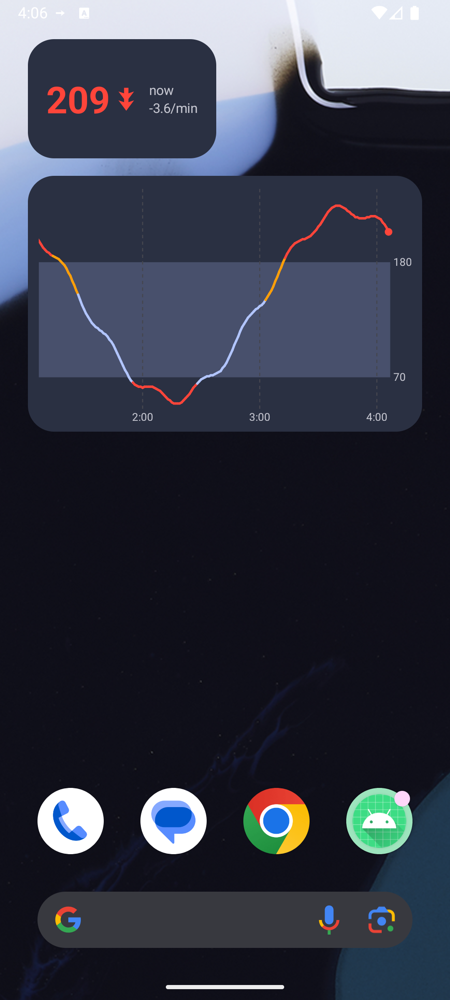
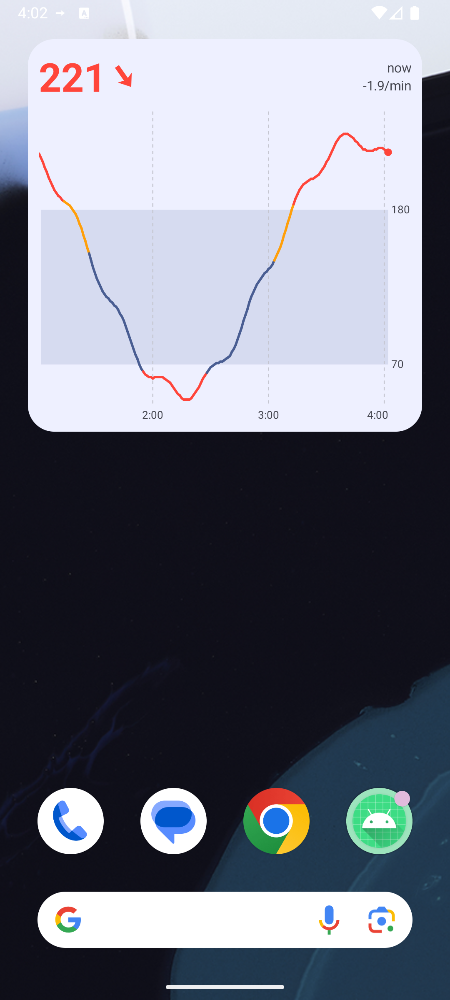
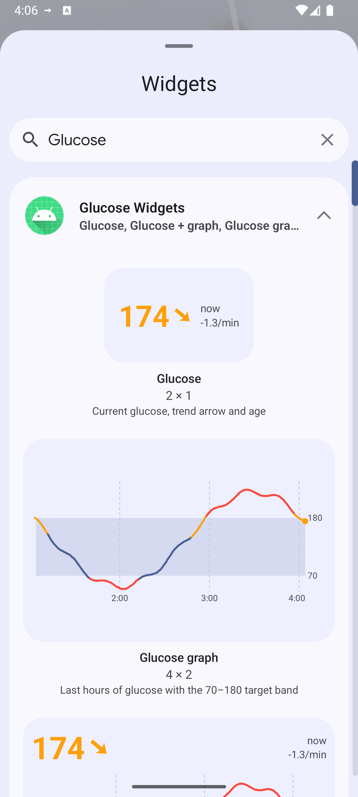
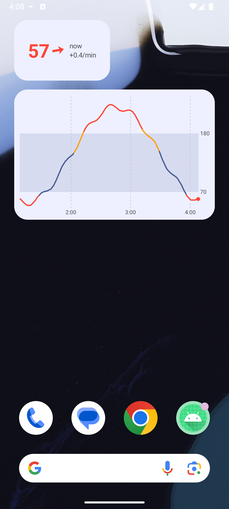
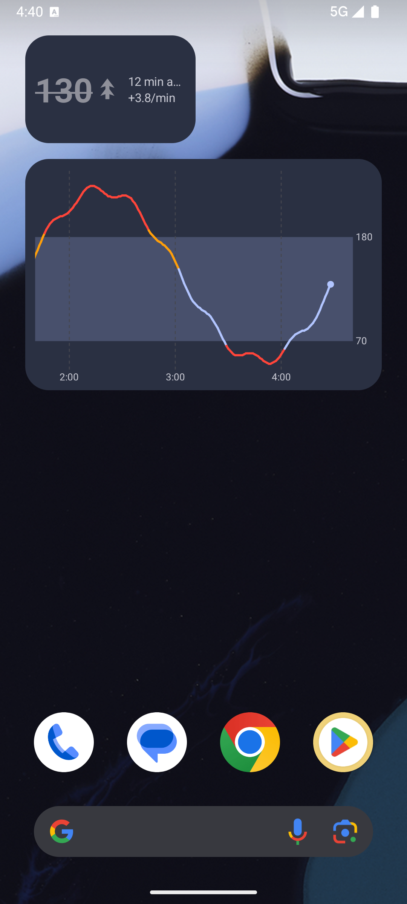
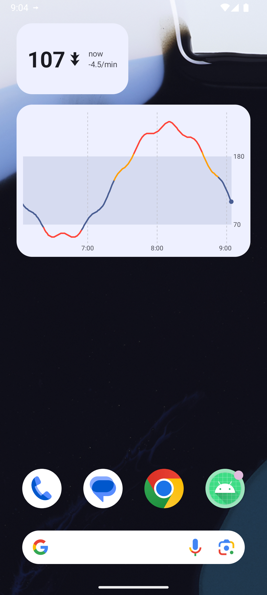

# 12 — Android home-screen widgets

*2026-10-16 · investigation report · Android 16 emulator (API 36, Pixel Launcher), Jetpack Glance 1.2.0*

## Goal

Glucose on the home screen with native-feeling widgets: **current value** (number, continuous trend arrow, age,
colour by range, stale state), **graph** (last hours, 70–180 target band, coloured by range, more hours when wider)
and **graph + value**, several sizes each, picker previews, tap → app — updated **every minute** without hurting the
battery. Spike code: [`spikes/widgets-android`](../spikes/widgets-android) (app *Glucose Widgets*,
`dev.spike.glucowidgets`, Kotlin + Glance only).

## Result

| Item | Status | Notes |
|---|---|---|
| Value widget (1×1 / 2×1 / 2×2) | **Works** | `SizeMode.Responsive` with 3 breakpoints; 2×1 verified on the launcher, 1×1/2×2 layouts exist but weren't screenshotted |
| Graph widget (4×2, resizable) | **Works** | `SizeMode.Exact`, bitmap drawn at the real pixel size; 2 h < 200 dp wide, 3 h < 400 dp, 4 h < 520 dp, 6 h beyond |
| Graph + value widget (4×3, resizable) | **Works** | Exact; value header on top when ≥ 120 dp tall, value column on the left when shorter |
| Trend arrow, continuous angle | **Works** | 0 → flat, ±3 mg/dL/min → vertical, quantised to 5° (37 vector drawables reused from the status-bar spike, tinted); ≥ 3 → double arrow |
| Colour by range | **Works** | Same mapping as the Mac / status bar: red < 65 or > 185, orange 146–185, theme colour otherwise; graph segments coloured the same way |
| Stale (> 5 min) | **Works** | Number + arrow turn the theme's `outline` grey and the number is struck through; age keeps counting |
| Light / dark, dynamic colour | **Works** | `GlanceTheme` (dynamic colours); the graph bitmap reads the API 34+ `system_*_light/dark` colour tokens and is re-rendered on night-mode change |
| Generated previews in the picker (Android 15+) | **Works** | `providePreview` + `GlanceAppWidgetManager.setWidgetPreviews` (rate-limited by the system) |
| Tap → opens the app | **Works** | `actionStartActivity<MainActivity>()` |
| Pin from the app | **Works** | `requestPinGlanceAppWidget` (the launcher's "Add to home screen" sheet) |
| Live updates every minute | **Works** (synthetic source) | Foreground service pushes `updateAll()` on each reading; ~60–150 ms per refresh of 3 widgets on the emulator |
| Juggluco source (127.0.0.1:17580) | Built, **not tested** | Same code as the status-bar spike (history + `/x/live` SSE), plus a network-security-config for cleartext to 127.0.0.1 |
| Release build (R8) | **Works** | `assembleRelease` (minified, shrunk, signed with `~/.android/debug.keystore`), 2.7 MB; screenshot 07 is the release APK |
| Real phone screenshot | **Not done** | An outage stopped the run; afterwards the phone was reserved for the showcase install. Never installed on the phone |
| CPU measurement (10 min) | **Done (emulator)** | 3.8 s CPU in 10 min (≈ 0.6 % of one core) with 3 widgets on screen, screen on, 10 renders — see "Battery" |

Screenshots ([`spikes/widgets-android/evidence`](../spikes/widgets-android/evidence)):

| | |
|---|---|
|  |  |
| Value 2×1 (218 mg/dL, falling) + graph 4×2, light | Same in dark mode (−3.6/min → double arrow) |
|  |  |
| Graph + value | Widget picker with generated previews |
|  |  |
| Low (57, red) | Stale: last reading 12 min ago, struck through and grey |
|  | |
| Release (R8) build, in range (theme colour), falling fast | |

## How updates work

- The system's own periodic update is ≥ 30 min, so `updatePeriodMillis="0"` and the **app pushes** updates.
- `LiveService` (foreground service, `specialUse`) follows the source — Juggluco's `/x/live` SSE, or the synthetic
  sine (one reading per minute, on the minute) — and stores readings in `GlucoseStore` (last 8 h in memory + a
  ~10 KB CSV so a system-initiated re-render after process death still has the graph).
- Every change goes through **`WidgetUpdater.refresh(context, reason)`**, which:
  - computes a key = (latest reading time, age in whole minutes, night mode, history size) and **does nothing if it
    hasn't changed** (`skippedSame` counter);
  - **skips while the screen is off** (`PowerManager.isInteractive`; `skippedScreenOff` counter). A `SCREEN_ON`
    receiver in the service catches up with one render — the widget can show the old value for a fraction of a second
    when unlocking;
  - publishes a `Frame(history, now)` `StateFlow` that the widgets' compositions collect, then calls
    `updateAll()` only for widget classes that have instances.
- A **ticker** in the service wakes at `latest.epoch + n·60 s + 1 s` (the instants where "3 min ago" changes) only
  while the screen is on; coroutine `delay` doesn't run during CPU suspend, so it adds no wake-ups.
- Night-mode changes arrive through `Service.onConfigurationChanged` → re-render (the bitmap has baked colours).
- **Fallback**: `RefreshWorker` (WorkManager, every 15 min) pulls the last 30 entries and refreshes when the service
  isn't running — background FGS starts from widget broadcasts (`onEnabled`/`onUpdate`) can be refused
  (`ForegroundServiceStartNotAllowedException` was seen from an adb broadcast); opening the app always starts it.
- Stopping: when the last widget is removed (`onDisabled` + no ids left) the service and the worker stop.

### Battery notes

- One Glance refresh of the 3 widgets took **58–145 ms** wall time on the (heavily loaded) emulator, i.e. at most
  ~1 render/min while the screen is on, **zero while it's off**. The SSE connection itself is the remaining
  per-minute cost; in the showcase app it already exists for the status bar / Mac link, so widgets add only the
  renders.
- Glance runs each update through a short WorkManager-backed session (`GlanceAppWidget.update` → session worker);
  that's heavier than building `RemoteViews` by hand. If measurements show it matters, `GlanceRemoteViews`
  (compose to `RemoteViews` directly, then `AppWidgetManager.updateAppWidget`) avoids the session.
- **Measured on the emulator** (release build, screen kept on, the 3 widgets visible, synthetic source = 1 reading/min,
  10 min, 09:04:54–09:14:54): process CPU went from 86+88 to 305+250 ticks (utime+stime, 100 Hz) → **3.81 s of CPU in
  600 s ≈ 0.6 % of one core**, for **10 renders** (11 ticker wake-ups skipped as unchanged, last render 45 ms wall).
  That is ≈ **0.38 s CPU per minute-update** covering: Glance session start (WorkManager), composing 3 widgets in all
  their sizes (Responsive = 3 layouts, Exact = 2 orientations each), 4 graph bitmaps, the synthetic source and the
  ticker. Emulator numbers are indicative only (arm64 guest on an M-series host); repeat on the phone in
  investigation 11's lab with `ps -o TIME` / `/proc/<pid>/stat` and the `screenOffSkip` toggle
  (`DebugReceiver --es cmd screenOffSkip --ez value false|true`).
- With the screen **off** the widgets cost nothing beyond receiving the reading (renders skipped, ticker cancelled).
  Not measured separately.
- Cheaper options if 0.4 s/min matters on the phone: render only the sizes actually placed (Exact everywhere), drop
  the Glance session (`GlanceRemoteViews` → `AppWidgetManager.updateAppWidget`), and reuse the graph bitmap between
  the portrait/landscape sizes.
- Zero-service alternative (not built): Juggluco can send xDrip-style broadcasts to listed packages; a manifest
  receiver could then refresh the widgets without our own FGS. Needs a Juggluco setting change (not touched tonight).

## API choices

- **Jetpack Glance 1.2.0** (stable; 1.3.0 is alpha) + `glance-material3`. Compose-style Kotlin, `GlanceTheme` gives
  Material 3 dynamic colours and widget background/corner radius tokens for free (`appWidgetBackground()`,
  `system_app_widget_background_radius`).
- **Value: `SizeMode.Responsive`** (48×48, 110×48, 110×110 dp). **Graph / combined: `SizeMode.Exact`** — with
  Responsive the bitmap is rendered for the breakpoint size and stretched to the real size, distorting the line and
  labels; Exact renders once per orientation at the real size (2 renders) and the hours adapt to the width.
- **Graph = `Bitmap` drawn with `Canvas`** (`GraphRenderer`), shown with `Image(ContentScale.FillBounds)` at the exact
  dp size, pixels = dp × density (capped at 1400 px per side to stay well under the RemoteViews bitmap budget of
  screen × 1.5). Glance has no canvas/path primitives; a bitmap is the standard approach.
- **Arrow**: Glance can't rotate views, so 5°-step vector drawables tinted with `ColorFilter.tint` (crisp at any
  size, no bitmap).
- **Previews**: `providePreview()` composes sample data (the synthetic curve) and `setWidgetPreviews()` publishes it
  (Android 15+; on older launchers you'd add a static `previewLayout`). `previewSizeMode` gives the picker realistic
  sizes for the Exact widgets.
- Widget-provider XML: `targetCellWidth/Height` (2×1, 4×2, 4×3), resizable both ways, `home_screen|keyguard`,
  Glance's `glance_default_loading_layout` as the initial layout.

## Not done

- Real-data screenshot on the phone (and the Juggluco source untested end-to-end in this app; the code is the
  proven one from the status-bar spike).
- CPU/battery measurement on the phone (emulator only) and with the screen off.
- Screenshots of the 1×1 and 2×2 value layouts and of wider (5-column / tablet) graphs — the layouts exist; resizing
  through the launcher via adb wasn't done in time.
- Accessibility pass (content descriptions exist for the arrow and graph), widget configuration screen (e.g. hours,
  units), mmol/L.

## Integration notes for the showcase app (`app.mauri.sukrara.poc`)

Copy from `spikes/widgets-android/app/src/main/`:

| File | What | Changes needed |
|---|---|---|
| `Widgets.kt` | 3 `GlanceAppWidget`s + receivers + shared composables | package; `actionStartActivity<MainActivity>` → Sukrara's activity; receivers' `onEnabled/onUpdate` should start Sukrara's existing service instead of `LiveService` |
| `GraphRenderer.kt` | bitmap graph | none (uses `Range`) |
| `WidgetUpdater.kt` | dedupe + screen-off skip + `updateAll` | replace `GlucoseStore.load(c)` with Sukrara's history accessor |
| `Glucose.kt` | `Reading`, `Trend.drawable`, `Range`, `ageText` | merge with Sukrara's existing model (it already has `Reading`/`Trend`/`Range` from the status-bar spike) |
| `res/drawable/arrow_*.xml` | 39 arrow vectors | same files as the status-bar spike's `sb_t*`; reuse whichever Sukrara already has |
| `res/xml/widget_*.xml`, `strings.xml` entries, manifest `<receiver>`s | provider info | none |
| (optional) `RefreshWorker.kt` | 15-min fallback | only if Sukrara's FGS can be off while widgets exist |

Not needed: `LiveService`, `Sources.kt`, `GlucoseStore.kt`, `DebugReceiver`, `MainActivity` — Sukrara already has the
foreground service, the Juggluco/direct sources and a reading store.

What the widgets need from Sukrara's data layer:

1. **History**: the last ≥ 6 h of readings (time, mg/dL, rate or null), oldest first, readable synchronously from any
   thread and **after process death** (persisted — the system can ask for a render with no service running).
2. **A hook on every new reading**: call `WidgetUpdater.refresh(context, "reading")` from the service's coroutine
   scope (it's cheap when nothing changed and when the screen is off).
3. **Screen-on + minute ticker + configuration change** hooks in the service (copy the `screen` receiver,
   `startTicker()` and `onConfigurationChanged` from `LiveService`), so age/stale and dark mode stay right.
4. Call `WidgetUpdater.publishPreviews(context)` once after install/update (e.g. app start, guarded by a version
   pref — the system rate-limits it).
5. Dependencies: `androidx.glance:glance-appwidget` and `glance-material3` 1.2.0 (needs the Compose compiler plugin,
   which Sukrara already has); WorkManager comes transitively.

## In Sukrara (follow-up, 2026-10-16)

- Integrated in Sukrara ([10](10-showcase.md)). The widgets now work in **both roles**. The wearer feeds them from
  its source, and a follower from its own `follower.db` (`FollowerExtras`: it loads the last 8 h on start, then adds
  every stored batch, and clears them on "Stop following"). Verified on an emulator following the real phone over
  Nostr ([screenshot](../spikes/showcase-android/evidence/10-follower-widget-combined-real-data.png)).
- **R8 trap:** in Sukrara's release build R8 merged `GraphWidget` into `CombinedWidget`. Glance keys its
  bookkeeping by the `GlanceAppWidget` class name, so after a process restart the graph + value widget was drawn as
  the plain graph ([before](../spikes/showcase-android/evidence/13b-combined-widget-r8-merge-bug.png),
  [after](../spikes/showcase-android/evidence/13-follower-widget-combined-after-r8-fix.png)). An app with more than
  one Glance widget needs `-keep,allowoptimization class * extends androidx.glance.appwidget.GlanceAppWidget { <init>(); }`
  (and a keep for the receivers).
- **Review + cleanup (v0.10.4).** Worth keeping in Sukrara: the code is small and self-contained, and both the
  graph-only and the combined layout are in daily use on the user's phone. The cost was duplication, now removed
  ([10](10-showcase.md#widgets-one-model-no-second-store-v0104)): the widgets share `core/Glucose.kt` (trend,
  range, staleness, age) and the `sb_t*` arrows with the status bar, and `GlucoseStore`'s CSV copy is replaced by
  `RecentHistory`, which reads the role's own `owner.db` / `follower.db` / treatment store. The integration notes
  above describe the spike; they predate this.
- **Real size (v0.10.6).** Pixel Launcher on the user's Pixel 10 Pro reports 296×202 dp for a 4×2 widget it lays
  out at 244×149, so Exact mode's bitmap was clipped. Graph widgets now measure the real size with a one-off probe
  (16 sized layouts; the launcher loads the image of the one it applies):
  [10](10-showcase.md#widgets-the-launchers-reported-size-is-wrong-v0106).
