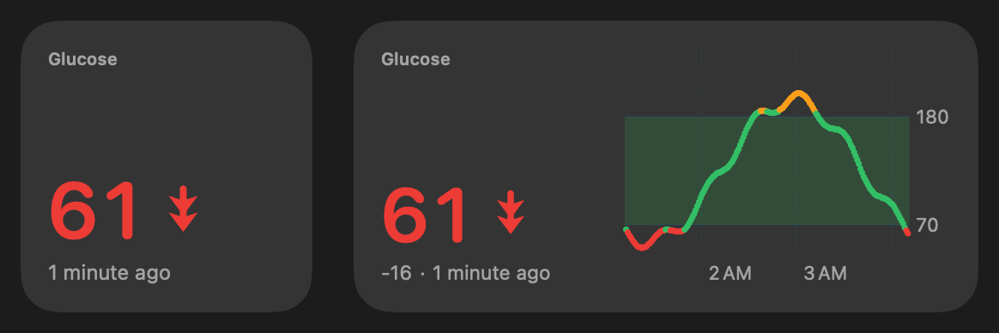
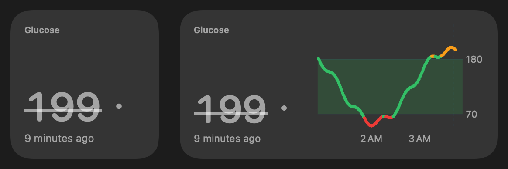
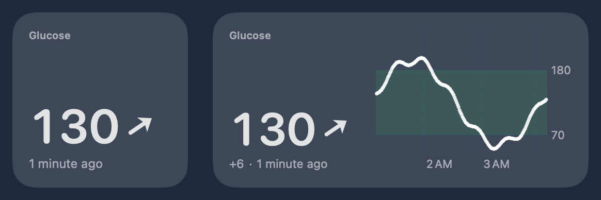
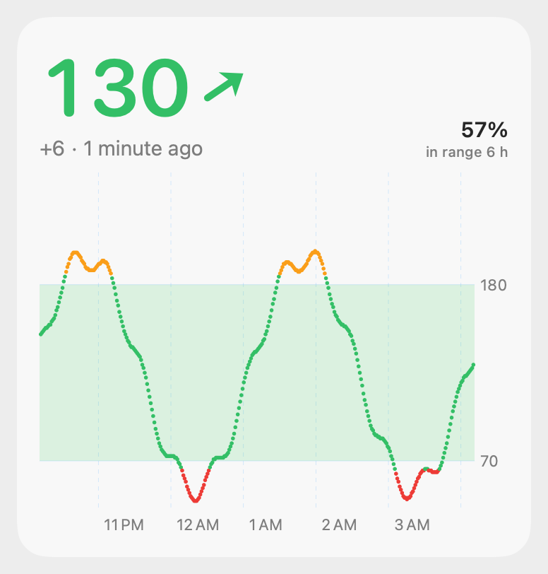
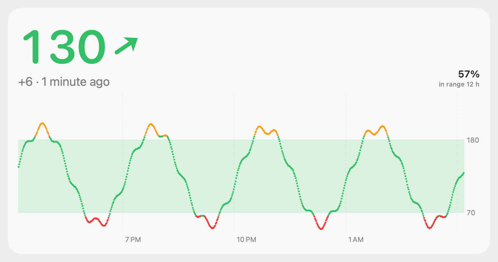
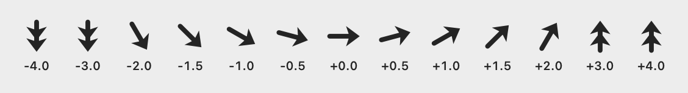

# 13 — macOS widgets (desktop + Notification Center)

*2026-10-16 · investigation report · macOS 27.0.1 (26A434), Command Line Tools only (Swift 6.4, MacOSX27.sdk); Xcode
installed later only to get a free Apple Development certificate · **update: the widgets run** (see [Resolved](#resolved-the-widgets-run))*

## Goal

WidgetKit widgets for the Mac (desktop and Notification Center) that show glucose:

1. **Current value**: number, a trend arrow at a continuous angle, the reading's age, colour by range, and a stale state.
2. **Graph**: Swift Charts, last 3 h (more on bigger widgets), 70–180 target band.
3. **Graph + value** combined.

The key question: **can this be built and run with only the Command Line Tools**, because installing Xcode needs
the user's Apple ID?

## Result

| Question | Answer |
|---|---|
| Compile a WidgetKit + Swift Charts extension with `swiftc` (CLT only) | **Yes.** About 11 s (`-Onone`) |
| Assemble `.app` + `PlugIns/*.appex` by hand, sign ad hoc, register | **Yes.** `pluginkit -m` lists it and chronod sees it ("Added extensions") |
| macOS loads it (widget gallery, desktop) | **Yes, with a free Apple Development certificate + `_NSExtensionMain` entry point.** Ad hoc, chronod drops it within 7 ms: *"Extension is not entitled to run in the App Sandbox"* |
| Can we get past that without an Apple-issued certificate? | **No.** Eight signing and install variants all fail the same way (table below). A free Apple ID personal team is enough |
| Widget views | **Done**, rendered to PNG with `ImageRenderer` from the same SwiftUI code ([evidence](../spikes/widgets-macos/evidence/)) |
| Data sharing host → sandboxed widget | Ad hoc: localhost HTTP, a `/Users/Shared` file and the widget's own container work, the App Group does not. **With a Team ID the team-prefixed App Group works too** (no provisioning profile) |
| Refresh cadence the system honours | **Not measurable** while chronod refuses the extension. The app's reloads reach chronod within 1–3 ms |

So the CLI-only route stopped at one wall, signing, plus a hidden second one, the entry point (see [Resolved](#resolved-the-widgets-run)). Everything else (compiler, SDK, Swift
Charts, bundle layout, Info.plist, entitlements, registration) works without Xcode. To make it run you need **an
Apple-issued code-signing certificate with a Team ID**:

- an "Apple Development" certificate (a free Apple ID personal team works, but you get it through Xcode's account
  sign-in), or
- a paid Developer Program account. That one can make the certificate on developer.apple.com from a CSR, so even
  then Xcode is not required.

With such a certificate, `./build.sh install` picks it up by itself (it also derives the Team ID and the App Group from it).

## Resolved: the widgets run

After the user installed Xcode, signed in with a free Apple ID (*Settings → Accounts*, personal team) and created an
**Apple Development** certificate (*Manage Certificates → + → Apple Development*), three things were needed. The
widgets then appeared in *Edit Widgets…*, on the desktop, with live data from the App Group and HTTP.

1. **The WWDR G3 intermediate.** `security find-identity -v` listed the new identity as **not valid**: the Mac only
   had the old WWDR intermediate (expired 2023). Importing Apple's `AppleWWDRCAG3.cer`
   (apple.com/certificateauthority) into the login keychain made it valid. Xcode normally installs it.
2. **Team-ID signature.** With `TeamIdentifier=QWUV9H4A3G` chronod no longer says "not entitled". It launches the
   extension and asks for `getAllDescriptors`. That confirms the Team ID inference above.
3. **Entry point `_NSExtensionMain`.** The launched extension then crashed with `EXC_BREAKPOINT` in
   `_EXRunningExtension._shared` (ExtensionFoundation), called from `WidgetBundle.main()`, before any of our code
   ran. CodexBar's widget binary imports `_NSExtensionMain` and starts there, which is how Xcode links extensions.
   Linking ours with `-Xlinker -e -Xlinker _NSExtensionMain` fixed it. The earlier claim that "no
   `-e _NSExtensionMain` is needed" was wrong: launched by hand, the binary only *looked* fine because the trap
   comes right after WidgetKit's first log lines.

Then [`evidence/chronod-accepted.log`](../spikes/widgets-macos/evidence/chronod-accepted.log) shows
`getAllDescriptors` returning all three kinds and chronod precaching placeholders for every family. Once a widget
was placed, [`evidence/widget-gettimeline.log`](../spikes/widgets-macos/evidence/widget-gettimeline.log) shows
`getTimeline` with every transport readable: `appgroup-api=ok appgroup-path=ok own-container=ok users-shared=ok`
and HTTP.

**App Group.** The group is `<TEAMID>.dev.spike.glucosewidgets`, written into both Info.plists (`GlucoseAppGroup`)
and entitlements by `build.sh`. The host must open it through `containerURL(forSecurityApplicationGroupIdentifier:)`.
A hand-built `~/Library/Group Containers/…` path still failed with 513 until the container had been created that
way. No provisioning profile is needed on macOS for a team-prefixed group.

**Limits of the free route.** The certificate lasts a year (here until 2027-10-16) and only this Mac trusts the
build. Widgets in a downloadable release zip need a **Developer ID** certificate (paid program) and
notarization. The same `build.sh` takes that identity via `SIGN_ID`. Without any certificate the build stays
ad hoc: it still builds, the widgets just don't load.

## Widgets (rendered with ImageRenderer)

The same `GlucoseWidgetView` is used in the extension and in the renderer, with the container imitated (16 pt
margins, rounded background). Widget sizes are the macOS points: small 170×170, medium 364×170, large 364×382,
extra large 746×382.

| | |
|---|---|
| Combined, medium |  |
| Value small / Combined medium, **low** |  |
| **Stale** (> 5 min): strikethrough, grey, dot instead of the arrow |  |
| **Accented** rendering mode (tinted desktop) |  |
| Combined, large (6 h, time in range) |  |
| Combined, extra large (12 h) |  |
| Trend arrow, −4 … +4 mg/dL/min |  |

All families × light/dark: `value-{small,medium}`, `graph-{small,medium,large,xl}`, `combined-{small,medium,large,xl}`
`-{light,dark}.png`, plus `state-{low,high,flat,stale,nodata}.png`.

What the widgets do:
- **Trend arrow**: the same geometry and mapping as the menubar's `TrendArrow`: 0 mg/dL/min points right,
  ±3 mg/dL/min is vertical, linear in between, and a second chevron at ≥ 3. Here it is a SwiftUI `Shape`, rotated.
  The rate comes from the source, or from a least-squares fit over the last 5 min.
- **Colour**: red below 65, orange above 185, green between. The graph points use the same colours, over a
  70–180 band.
- **Age**: `Text(.currentDate, format: .reference(to: reading, allowedFields: [.hour, .minute]))`, which renders
  "1 minute ago". The system keeps it ticking, so it **needs no timeline reloads**.
- **Stale**: the timeline adds a second entry at *last reading + 5 min*. It flips to stale on time even if the app
  never reloads.
- **Graph window**: 3 h (small/medium), 6 h (large), 12 h (extra large). The large layouts add % time in range.
- **Native bits**: `containerBackground(.fill.tertiary, for: .widget)`, `widgetAccentable()` on the
  value/arrow, a monochrome chart in accented/vibrant mode, and
  `widgetURL(glucosewidgets://open?from=<kind>)`. The host app registers that URL scheme; tested with `open`, and
  the host logs `opened via URL glucosewidgets://open?from=combined`.
- **Families**: Value is small and medium. Graph and Combined are small, medium, large and extra large.

## How it is built (no Xcode)

`spikes/widgets-macos/build.sh`:

```
swiftc -parse-as-library -application-extension  Shared/*.swift Widget/GlucoseWidgets.swift -Xlinker -e -Xlinker _NSExtensionMain
                                                                                              → GlucoseWidget.appex/Contents/MacOS/GlucoseWidget
swiftc  Shared/GlucoseData.swift Host/main.swift                                              → GlucoseWidgets.app/Contents/MacOS/GlucoseWidgets
cp Info.plists;  codesign --sign "Apple Development: …" --options runtime --entitlements …  (appex first, then app; ad hoc if no identity)
lsregister -f -R ~/Applications/GlucoseWidgets.app;  pluginkit -a …/GlucoseWidget.appex
```

- **Entry point**: `@main struct GlucoseWidgets: WidgetBundle`, linked with **`-e _NSExtensionMain`** (Foundation
  sets up the extension, then runs the WidgetBundle). *Originally built without it, which crashes once chronod
  launches the extension (see Resolved).*
- **Extension Info.plist**: `CFBundlePackageType = XPC!` and
  `NSExtension.NSExtensionPointIdentifier = com.apple.widgetkit-extension`. It has the same keys as a shipping
  third-party widget built with Xcode (CodexBar), minus the `DT*` build-info keys.
- **Extension entitlements**: `app-sandbox`, `network.client`, `application-groups` (`<TEAMID>.dev.spike.glucosewidgets`), and a read-only
  temporary exception for `/Users/Shared/GlucoseWidgets/`.
- **Host**: headless (`LSUIElement`), not sandboxed. Once a minute it writes a synthetic 12 h history to every
  transport and calls `WidgetCenter.shared.reloadAllTimelines()`.

### What blocks it

[`evidence/chronod-rejection.log`](../spikes/widgets-macos/evidence/chronod-rejection.log):

```
chronod [com.apple.extensionkit:discovery] Extension is not entitled to run in the App Sandbox : <_EXExtensionIdentity: …>
chronod [com.apple.chrono:extensions-verbose] Added extensions: [<WidgetExtension - identifier: dev.spike.GlucoseWidgets::dev.spike.GlucoseWidgets.widget, … isApple: false>]
chronod [com.apple.chrono:descriptor] Requested to add extension, but purging instead because we shouldn't cache it: <WidgetExtension …> - isApple? false
chronod [com.apple.chrono:descriptor] Purging descriptors for extensions: [dev.spike.GlucoseWidgets::dev.spike.GlucoseWidgets.widget]
chronod [com.apple.chrono:extensions] Ignoring restricted or unknown extension dev.spike.GlucoseWidgets      ← every reloadAllTimelines()
```

chronod never asks the extension for its widget descriptors, so nothing appears in the gallery and the extension
process is never launched.

| Variant | Result |
|---|---|
| Ad hoc, hardened runtime, full entitlements | rejected |
| Ad hoc, minimal entitlements (`app-sandbox` + `network.client` only) | rejected |
| Ad hoc without hardened runtime | rejected |
| Self-signed code-signing certificate (temporary keychain) | rejected |
| Self-signed, CN/OU styled `Developer ID Application: … (SPIKE12345)` | rejected (codesign still sets `TeamIdentifier=not set`) |
| Ad hoc + fake `com.apple.developer.team-identifier` / `application-identifier` entitlements | rejected |
| `pluginkit -e use` (explicitly elected, shows `+`) | rejected |
| Installed in `/Applications` instead of `~/Applications` | rejected (then removed again) |

**Why.** The in-process check passes. ExtensionFoundation's own `_EXExtensionIdentity`, built from our
LaunchServices record, says `hasSandboxEntitlement = true` and `app-sandbox = 1` ([`evidence/exid.txt`](../spikes/widgets-macos/evidence/exid.txt),
`Diag/exid.swift`). So chronod is not reading a missing entitlement; it does not trust entitlements from this
signature. The one difference LaunchServices shows between our extension and the two working third-party widgets
on this Mac (CodexBar `Y5PE65HELJ`, BetterTouchTool `DAFVSXZ82P`) is **`teamIdentifier = nil`**. A Team ID only
comes from an Apple-issued certificate, so that is the requirement. (We can't read chronod's code, so the exact
check is inferred; every variant without a Team ID failed.)

## Data sharing (host app → sandboxed widget)

Tested with **`Probe/`**: the widget's exact loader (`Shared/Loader.swift`) in a CLI. It is signed ad hoc with the
widget's entitlements and runs inside the App Sandbox. With `PROBE_ID=dev.spike.GlucoseWidgets.widget` it runs *as*
the widget and gets the same container ([`evidence/probe-sandbox.txt`](../spikes/widgets-macos/evidence/probe-sandbox.txt)).

| Transport | Ad hoc result | Notes |
|---|---|---|
| **App Group** container (`group.dev.spike.glucosewidgets`) | ✗ | `containerURL(forSecurityApplicationGroupIdentifier:)` returns a path, but **writes fail with 513 (EPERM)** from both the unsandboxed host and the sandboxed widget. The directory then can't be listed ("Operation not permitted"). Since macOS 15, group containers are protected and need a group the signing team is authorised for: `TEAMID.…` on macOS, or `group.…` with a provisioning profile |
| **Widget's own container** (`~/Library/Containers/<widget-id>/Data/…`), written by the host | ✓ | The unsandboxed host can write it and the widget reads it. It relies on the host *not* being sandboxed, and may hit "access data from other apps" prompts in future macOS |
| **`/Users/Shared/GlucoseWidgets/glucose.json`** + `temporary-exception.files.absolute-path.read-only` | ✓ | Temporary-exception entitlements are honoured with ad hoc signing. Mac App Store review would reject them |
| **`http://127.0.0.1:17591/glucose.json`** served by the host, widget has `network.client` | ✓ | Always fresh, and needs no file location or container. The widget gets nothing while the host isn't running, so it falls back to the files |

**Pick: localhost HTTP first, falling back to the newest file.** The loader tries every source and uses the newest
`written` timestamp. In production, with a Team ID, this becomes a **team-prefixed App Group** (`TEAMID.dev.…`).
That is the standard way: no profile needed on macOS, and no server needed. CodexBar does exactly this
(`Y5PE65HELJ.com.steipete.codexbar`). Keep HTTP as the live path while the host app runs.

## Refresh cadence

- **Measured**: `reloadAllTimelines()` from the headless host, once a minute, reaches chronod in **1–3 ms** every
  time ([`evidence/reload-delivery.log`](../spikes/widgets-macos/evidence/reload-delivery.log)). Reload IPC works
  from an ad hoc, unsandboxed `LSUIElement` app.
- **Not measured**: how many of those reloads chronod would honour. chronod refuses the extension, so `getTimeline`
  never runs. The widget logs every `getTimeline` call: `log show --predicate 'subsystem == "dev.spike.GlucoseWidgets"'`,
  plus `~/Library/Containers/dev.spike.GlucoseWidgets.widget/Data/Library/Caches/timeline.log`. Once it is signed
  with a Team ID, run it for an hour and count. This is the first follow-up.
- **Design that doesn't depend on the budget**. Apple documents a daily budget of roughly 40–70 reloads for a
  frequently viewed widget, about one every 15–60 min, so a 1/min reload can't be relied on. The widget is built
  so that a skipped reload never shows wrong information:
  1. The age text ticks by itself (`.reference(to:)`), so "x min ago" is always correct.
  2. A timeline entry at *last reading + 5 min* flips the widget to stale (strikethrough, grey, no arrow) on time.
  3. The policy is `.after(latest + 65 s)` to ask for the next reading, and the host calls `reloadAllTimelines()`
     on every new reading.

  Worst case, the widget shows an older value marked stale, never a wrong "fresh" one.

## Integration notes

- **GlucoseBar (menubar, now Sukrara for Mac, `app.mauri.sukrara.poc`)** becomes the widget's host app:
  1. Put `GlucoseWidget.appex` in `GlucoseBar.app/Contents/PlugIns/`. The extension bundle id must be prefixed by
     the app's (`dev.spike.GlucoseBar.widget`).
  2. Make `GlucoseBar` sign the appex first, then the app, with the *same* Team ID certificate.
  3. On every new reading (it already merges Wi-Fi, BLE and Nostr), write a `GlucoseSnapshot` (`Shared/GlucoseData.swift`:
     samples + rate) to the team App Group and call `WidgetCenter.shared.reloadAllTimelines()`.
  4. Optionally serve the same JSON on 127.0.0.1 for instant freshness.

  The widget code needs no changes beyond the group ID and bundle IDs.
- **Units/thresholds**: the widget hard-codes mg/dL and 65/185 (`GlucoseRange`). Put the user's unit and
  thresholds in the snapshot so the menubar settings drive the widget.
- **Showcase app (Sukrara)**: the views are plain SwiftUI and reuse straight away. The same
  `GlucoseWidgetView` can also serve iOS widgets later (WidgetKit API is the same; sizes differ).
- **Finishing the spike** (done 2026-10-16): `./build.sh install` with the Apple Development identity in the
  keychain, then *Edit Widgets…* → "Glucose". The group ID and bundle IDs come from `build.sh`; no code edits.

## Files

`spikes/widgets-macos/`:
- `Shared/GlucoseData.swift`: model, synthetic generator, thresholds, paths.
- `Shared/GlucoseViews.swift`: all widget SwiftUI/Charts views.
- `Shared/Loader.swift`: the transports.
- `Widget/`: `WidgetBundle`, providers, Info.plist and entitlements.
- `Host/`: headless host app (synthetic data, HTTP, file publishing, reloads, URL scheme).
- `Render/`: the ImageRenderer CLI that writes the PNGs.
- `Probe/`: sandbox data-sharing probe.
- `Diag/`: `exid.swift` (ExtensionKit identity check) and `chronolog.sh` (chronod log filter).
- `build.sh` modes: (none), `install`, `render`, `probe`.

Uninstall: `pkill -f GlucoseWidgets.app; lsregister -u ~/Applications/GlucoseWidgets.app; rm -rf ~/Applications/GlucoseWidgets.app /Users/Shared/GlucoseWidgets`.
