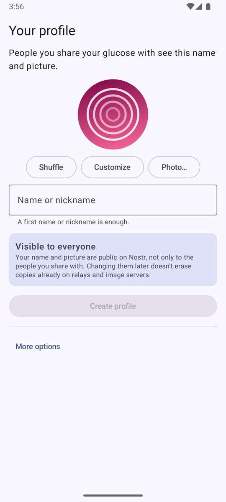
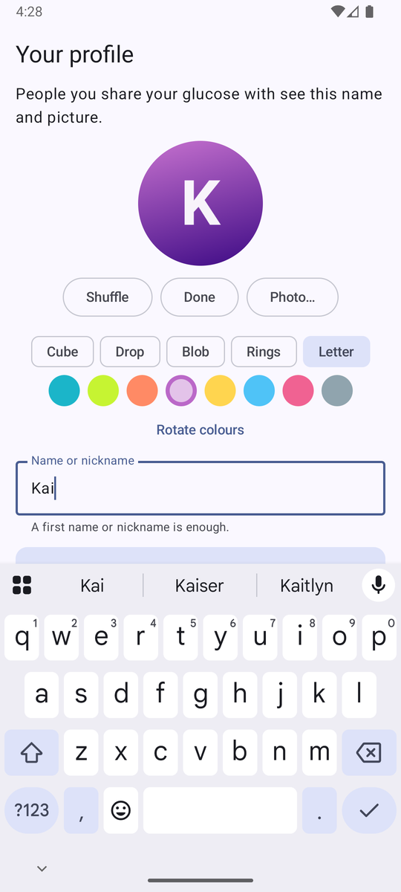
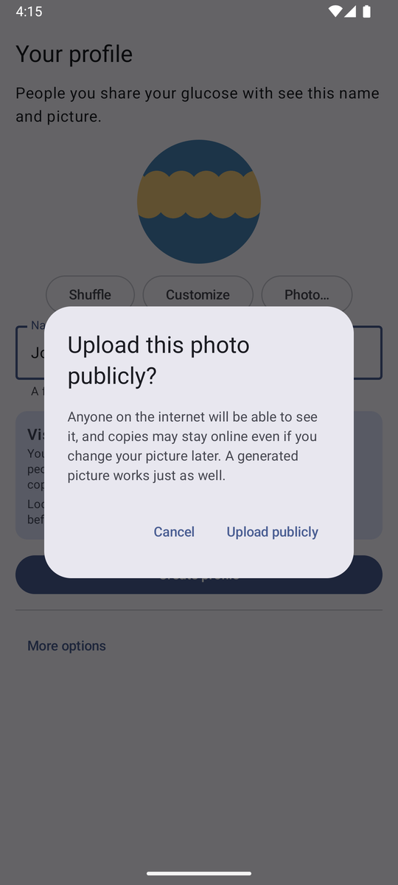
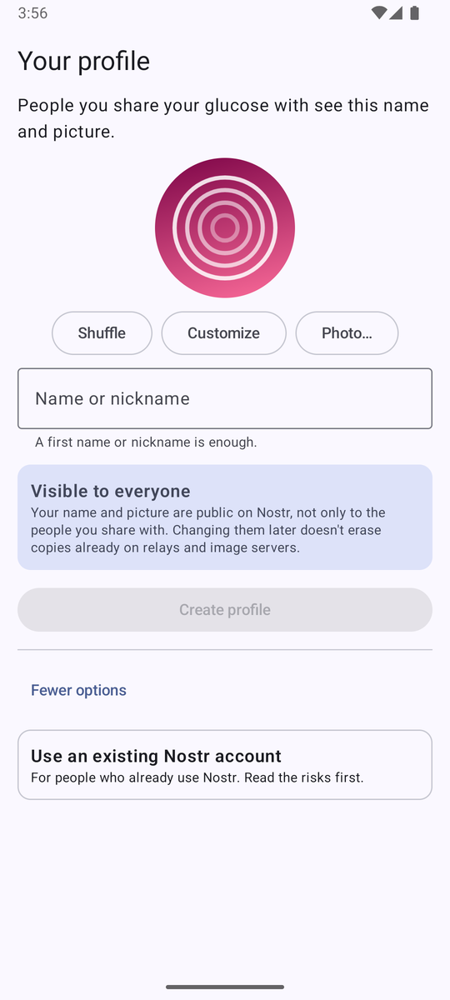
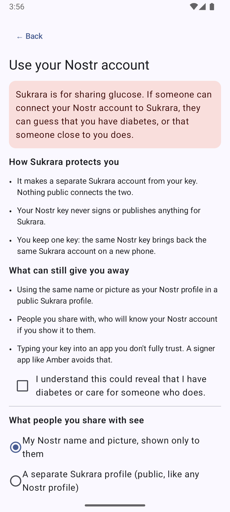
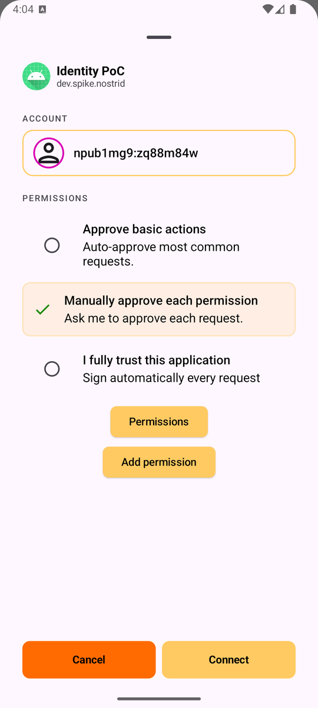
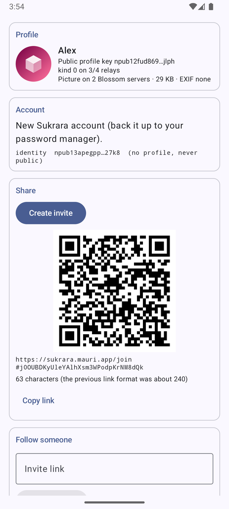
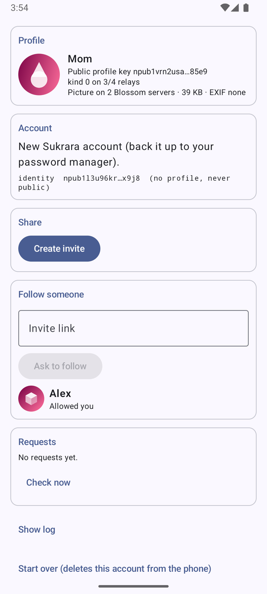

# 14 — Nostr identity: profiles, short invites, logging in with Nostr

*2026-10-16 · investigation report · follows [06 — Sharing and keys](06-sharing-and-keys.md) · spec:
[PROTOCOL-identity](../poc/spikes/nostr/PROTOCOL-identity.md) · PoC app:
[`poc/spikes/nostr/identity-android`](../poc/spikes/nostr/identity-android) · reference + tests:
[`poc/spikes/nostr/identity`](../poc/spikes/nostr/identity)*

## Goal

The user asked for:

1. **Proper kind 0 profiles**: names and pictures for the wearer and followers.
   - Warn that the picture is visible to everyone.
   - Offer a simple way to generate a picture instead of uploading one.
   - Make a random generated picture the default.
2. **A shorter share link.**
3. **"Log in with your Nostr account"** for advanced users:
   - Keep it a bit hidden.
   - Make sure users understand that it can reveal they have diabetes, or know someone who does.
   - Explore a **derived account**: a new key set made from the user's existing key, so their main account isn't
     exposed and they still keep only one key in their password manager.
4. **Standard Nostr kinds and features wherever they make sense.**

This is a PoC, not a change to the showcase app. The orchestrator will bring the pieces into Sukrara later.

## Result

| Question | Answer |
|---|---|
| Kind 0 names and pictures without linking a person to a glucose stream? | **Yes, with a separate profile key.** Kind 0 is signed by `P = HKDF(identity, "profile")`, a key that publishes nothing else. The identity (whose events are recognisable as Sukrara) never gets a profile. Followers learn `P` only through the encrypted invite. |
| Picture hosting? | **Blossom.** Upload signed by the profile key. 8 of 10 public servers took a free upload. URL in `picture`, mirrors as NIP-92 `imeta` `fallback`s. Clients check the bytes against the hash in the URL |
| Photo privacy | **EXIF removed.** A test photo carrying GPS 41°23′N 2°10′E, camera make/model and a timestamp was published as a 512 px JPEG with **no EXIF at all** (checked on the downloaded copy) |
| Generated pictures | **Default.** A random avatar on first launch, with *Shuffle* and *Customize* (5 shapes, 8 colours, a letter) or *Photo…*. It's uploaded like a photo, so every Nostr client shows it |
| "Public" warning | **Always visible** under the editor, plus one confirmation dialog, only when uploading a real photo |
| Shorter link | **241 → 63 characters, QR version 11 → 5** (61×61 → 37×37 modules). The link holds only an 8-byte identity fingerprint and a secret. Everything else is in a standard NIP-59 gift wrap on the relays. The 06 link format is removed: it no longer parses |
| Nostr login, hidden + warned | **Done.** *More options → Use an existing Nostr account* opens a full-screen explanation (risk, how we protect you, what can still give you away) and a required checkbox: *"I understand this could reveal that I have diabetes or care for someone who does."* |
| Derived account from an nsec / ncryptsec / 12–24 words | **Works.** HKDF of the main key gives the Sukrara root. The main key is dropped and never signs anything. **Same main key → same account** on both emulators, matching the Python reference |
| …through a signer app (Amber, NIP-55) | **Works, with a "sealed root".** Signers can't derive keys, so a random root is gift-wrapped *to yourself*. After wiping the app, logging in with Amber again **restored the same account** with two silent `nip44_decrypt` calls. One approval in Amber, nothing else |
| Show my real Nostr profile, but only to the people I share with | **Works.** The follower saw the main account's name and picture. Sukrara published nothing on, or linking to, the main key |
| Standards | NIP-01/24 kind 0, **NIP-92 imeta** on kind 0, **Blossom** BUD-01/02/11/12, NIP-59 gift wraps for the invite *and* the sealed root, NIP-40, NIP-42, NIP-44, NIP-49, NIP-06, **NIP-55** signers, **NIP-62** delete-everywhere. Details below |

## Design

```
 main Nostr key M (optional) ──HKDF──┐               never signs anything for Sukrara
                                      ▼
 random (default) ───────────▶ root R = identity I (v2)      roster, key deliveries, invites · no kind 0, ever
                                      │ HKDF("profile")
                                      ▼
                                profile key P               only kind 0 (+ its picture uploads)
```

### Why the profile has its own key

[PROTOCOL-v2](../poc/spikes/nostr/PROTOCOL-v2.md) is public. Anyone who reads it can spot the identity's events: a weekly
kind 30078 with a `gk` tag, plus gift wraps addressed to it. Putting a public name and photo on that key would put a
real person next to a recognisable glucose stream, the exact worry the user raised.

The profile key `P` only ever publishes a kind 0, so to an outsider it looks like any lurker account. The link
`P ↔ I` exists only inside the encrypted invite and key delivery, so only people the wearer shares with ever learn it.
`P` is derived from the root, so there's nothing extra to back up.

### Short invite

```
before: https://sukrara.mauri.app/join#i=npub1sx93…sma7v&t=pEzb2FHGbVDJllnfcXW-fg&x=1792238661&r=wss%3A%2F%2Fnos.lol%2C…   (241)
after:  https://sukrara.mauri.app/join#j0OUBDKyUleYAlhXsm3WPodpKrNM8dQk                                                    (63)
```

The 32-char fragment is `base64url(identity.pub[0:8] ‖ secret[16])`. The wearer publishes the rest (expiry, relays,
profile key, name) as a **standard NIP-59 gift wrap**:
- sealed by the identity,
- addressed to a key anyone with the link can derive,
- with a NIP-40 expiration, so relays drop it when the invite expires.

On the follower side:
1. Derive that key from the link and fetch the wrap.
2. Open it, and check that the seal's signer matches the fingerprint.
3. That gives everything the request needs. From here the 06 flow runs unchanged: request, the same 4-digit match code,
   Allow.

Why the fingerprint: anyone holding the link could also publish a wrap for that key. Matching 8 bytes of a secp256k1
key costs about 2⁶⁴ key generations, against an invite that expires in 24 h.

What the user gains:
- A QR that is far easier to scan (version 5 instead of 11).
- A link that fits in an SMS.
- The follower sees **who** is inviting (name and picture) *before* asking.
- Nothing in the link is long-lived: the 06 link carried the identity's npub in clear, forever.

The secret stays in the URL fragment, which browsers never send to the server, so the web fallback page still never
sees it.

### Nostr login

| The user brings… | Sukrara root | Public trace | Tested |
|---|---|---|---|
| **nsec, NIP-49 ncryptsec or NIP-06 words** (pasted once) | `HKDF(M)`: deterministic, so nothing new to back up | **none** | ✅ both emulators → same keys, = Python |
| **a NIP-55 signer app (Amber)** | random, **sealed to `M`**: a NIP-59 gift wrap to yourself | one kind 1059 addressed to `M`, the same shape as a NIP-17 DM copy | ✅ create → wipe app → restore = same account |
| a NIP-46 bunker | same as NIP-55 | same | not built (same calls as NIP-55) |
| Amber with recovery words | either of the above, or choose a NIP-06 *account index* inside Amber | none | not tested |

Why not derive through the signer? **No signer method returns anything both deterministic and secret.**
- NIP-46/55 expose only `get_public_key`, `sign_event`, `nip04/44_encrypt/decrypt` and `decrypt_zap_event`.
- rust-nostr and Amber sign with random aux data (re-signing the same message gives a different signature; checked).
- NIP-44 decrypt is deterministic, but a valid ciphertext can't be produced without the secret.

Nobody offers "derive a key for this app" today. Hence the sealed root: the signer encrypts and signs the seal, and
only the main key can ever open it again. Pre-authorising the three permissions in `get_public_key` makes Amber
answer every later call silently through its content resolver.

Profile choice for Nostr-login users:
- **"My Nostr name and picture, shown only to them"** (default). The follower gets `M` inside the encrypted invite
  and reads `M`'s existing kind 0. Sukrara publishes nothing.
- **"A separate Sukrara profile"**: a public kind 0 on the derived profile key, same as for everyone else.

The screen warns that reusing the Nostr name or picture there would make it recognisable.

## Reference implementation and tests

| Test | Result |
|---|---|
| Offline, Python ([`test_identity.py`](../poc/spikes/nostr/identity/test_identity.py)) | **24/24**: RFC 5869 vector, derivation determinism and separation, 06-style, `cgmshare:`, wrong-host and truncated links rejected, link/QR sizes, invite wrap shape and expiration, forged/expired/wrong-secret invites rejected, kind 0 fields |
| Kotlin ↔ Python ([`DeriveTest.kt`](../poc/spikes/nostr/identity-android/app/src/test/kotlin/dev/spike/nostrid/DeriveTest.kt)) | **4/4** against [`vectors.json`](../poc/spikes/nostr/identity/vectors.json): HKDF, derived root + profile keys, short link, every other link form rejected |
| Live relays + Blossom ([`live_check.py`](../poc/spikes/nostr/identity/live_check.py), [results](../poc/spikes/nostr/results/14-live.txt)) | invite resolvable by link alone within ~1 s; kind 0 on all relays; Blossom survey; deletion behaviour (below) |
| **Two emulators** (separate devices, separate keys, only relays in common) | wearer creates profile + invite → follower opens the 63-char link, sees "Alex" + picture, asks → wearer sees "Mom" from *her* kind 0, same match code **6611** on both → Allow → follower "Allowed you" |
| **Negative**: link with a changed fingerprint | rejected: *"sealed by 8f43940432b25257…, link expects 8f40140432b25257…"*, nothing added |
| Derived account | same throwaway main key on both emulators → identical identity + profile keys, equal to Python's |
| Amber (v6.6.9, release APK, checksum verified, "manually approve each app") | connect = one approval; root sealed (`nip44_encrypt` + `sign_event` via resolver); app data wiped; connect again → *"sealed root found → same Sukrara account restored"* via 2× `nip44_decrypt` ([log](../poc/spikes/nostr/identity-android/evidence/amber-sealed-root.log)) |
| Private Nostr profile | the Amber user (profile mode "nostr") invited the other emulator, which showed *"Riley (main Nostr profile)"* from the main key's own kind 0 |
| Photo with GPS EXIF via the Photo Picker | confirmation dialog → upload to 3 servers → downloaded copy: 512×512, **EXIF {} GPS {}** ([check](../poc/spikes/nostr/identity-android/evidence/exif-check.txt)) |
| Delete account everywhere | Blossom DELETE on all 3 servers → GET 404 on all three; empty kind 0 + NIP-62 accepted by the reachable relays (4/4, later 2/4 while nos.lol and nostr.mom timed out). One adb-driven attempt failed instantly: Android cuts network for a *cached* background app, so the test hook needs the app in the foreground. Sukrara's foreground service isn't affected |

<p>




</p>
<p>




</p>

UI choices were checked against the official guidance:
- [Android photo picker](https://developer.android.com/training/data-storage/shared/photo-picker): no storage
  permission, the user picks one image.
- [Material dialogs](https://github.com/material-components/material-components-android/blob/master/docs/components/Dialog.md):
  "Dialogs are purposefully interruptive, so they should be used sparingly". So there is one dialog, for the
  irreversible photo upload, and its buttons name the action ("Upload publicly" / "Cancel").
- The Nostr-login explanation is a full screen, not a dialog, because the user has to read it and tick a box.

## Findings

**Relays and servers (live, throwaway keys):**

| What | Result |
|---|---|
| Invite wrap fetched by link alone | nos.lol, relay.primal.net, nostr.mom, offchain.pub: ~1 s. **relay.damus.io now behaves like relay.nostr.net**: it accepts gift wraps but its NIP-42 AUTH answers *"relay needs serviceUrl to be configured before AUTH can work"*, so it can serve them to nobody. Default invite relays changed accordingly |
| Run-to-run variation | in the last run ([14-live.txt](../poc/spikes/nostr/results/14-live.txt), earlier run: [14-live-run1.txt](../poc/spikes/nostr/results/14-live-run1.txt)), nos.lol and nostr.mom timed out from this network while relay.primal.net, offchain.pub and relay.snort.social served the invite. Always publish and query on ≥ 4 relays |
| Kind 0 with URL picture | 7/7 relays accepted (5/7 in the last run: the same two timeouts) |
| Kind 0 with a `data:` picture (7–15 KB) | most relays accept it (offchain.pub refuses unknown keys: "not in our web of trust"), but other clients don't render `data:` pictures (Linky PR #563 hit this), so: Blossom |
| Blossom free upload with only a Nostr auth event | blossom.primal.net, nostr.download, blossom.band, blossom.nostr.build (→ blossom.band), files.sovbit.host, blossom.yakihonne.com, 24242.io, cdn.nostrcheck.me: yes. cdn.satellite.earth, blossom.f7z.io: 401 |
| **BUD-11 vs reality** | the spec says base64url without padding; **blossom.primal.net and nostr.download reject it** ("invalid base64 for auth event" / "Invalid auth string"). Standard padded base64 works on every server tried |
| Blossom DELETE | primal, nostr.download, sovbit, yakihonne, 24242 → 404 afterwards. **blossom.band / blossom.nostr.build answer 204 but keep serving the file** |
| Removing a profile ([last run](../poc/spikes/nostr/results/14-live.txt)) | **overwriting with an empty kind 0 works best**: the old name was still served by 1/7 relays afterwards (kind 0 is replaceable). A **NIP-09** deletion left it on 3/7. A **NIP-62** request to vanish is accepted (OK) by almost every relay, but only relay.damus.io removed everything; relay.primal.net, offchain.pub, relay.nostr.net and relay.snort.social kept serving. So "Delete account everywhere" does all three, in that order |
| Network | image servers were intermittently slow (primal 8.8 s, nostr.download unreachable for a while), so the app publishes the name immediately and adds the picture when an upload succeeds |

So "public, and copies may stay" is literally true. The warnings say exactly that, and "Delete account everywhere"
says it *asks* servers to erase, never that it does.

**Standards research (sources at the end):**
- **No merged NIP derives keys from an nsec.**
  - NIP-06 covers only mnemonics, and since 2026-05-31 it is marked *unrecommended* ("prefer a single nsec").
  - The open NIP-PNS (#1893) uses the same HKDF-over-nsec idea for private storage. It is the closest prior art.
  - Subkey proposals (NIP-26, now unrecommended, plus #1450, #1482 and keychains) publish the link to the main key on
    purpose, the opposite of what we want.
- **No signer offers app-specific derived keys.** That covers Amber, nsec.app, nsecBunker and the other bunkers
  checked.
- **No Nostr standard carries a secret in a link.** NIP-19 TLVs have no secret field. NIP-29 and NIP-46 use ad-hoc
  query parameters. Our fragment form is app-defined, like Iris's double-ratchet invites.
- **NIP-92 now covers kind 0** ("Profile metadata", merged 2026-10-05), which is what we use for hash, size and
  fallbacks. NIP-96 is *unrecommended*, replaced by Blossom.
- **Clients' default avatars:**
  - Damus loads robohash.org (which leaks the pubkey to a third party).
  - Amethyst draws robohash locally.
  - Nostrudel uses identicons, Coracle a gradient, Primal one static image.
  - Ours is generated locally *and* uploaded, so other clients show it too.
- NIP-DA (#2411, scoped data grants, the pattern v2 follows) is still an open PR with no maintainer review.

## How it maps onto Sukrara (for the integration)

*Plan as written before the integration; what was actually done is in [In Sukrara](#in-sukrara-what-was-added-and-what-was-left-out).*

| Piece | Where it goes | Notes |
|---|---|---|
| Profile key + kind 0 + Blossom + editor | wearer onboarding, both roles' settings | `P = HKDF(I, "profile")`; followers' `F` gets its own `HKDF(F, "profile")` |
| Request carries `profile` | v2 access request + key delivery | the wearer's list shows the follower's own name and picture; the request's `name` is used only if the kind 0 can't be fetched |
| Short invite | `Proto.kt inviteLink/inviteQueryOf`, Mac `FollowUI.swift` | **replace** the v2 link outright: remove `inviteQueryOf`, the `cgmshare:` scheme and the "Copy cgmshare: link (older Mac builds)" button, on Android and Mac (no backwards compatibility in this repo). The App Link filter (`/join`) stays |
| Nostr login | onboarding *More options*, both roles | derived (nsec, words) and sealed (Amber). A follower logging in with Nostr also gets a restorable `F` |
| Delete everywhere | settings | best effort, wording as in the PoC |
| Relay set | `Proto.RELAYS` (today nos.lol, relay.primal.net, nostr.mom, relay.nostr.net) | relay.nostr.net, and now relay.damus.io too, accept gift wraps but can't serve them (NIP-42 AUTH: "relay needs serviceUrl"). The invite lookup and every request/delivery wrap need relays that *serve* kind 1059: nos.lol, relay.primal.net, nostr.mom, offchain.pub worked on 2026-10-16 |

## In Sukrara: what was added and what was left out

*2026-10-17, Sukrara 0.11.0 (Android + Mac). Decided after a review of this report: keep what helps every user and
costs little to maintain; leave out what ties the app to outside services or serves only Nostr users.*

| Piece | In Sukrara? | Why |
|---|---|---|
| **Short invite links (v3)**, 63 chars, QR version 5 | **Added**, the only invite form (old `#i=…&t=…` and `cgmshare:` links removed, no compatibility) | Easier to scan, fits an SMS, shows who invites before asking, no long-lived npub in the link. Reuses the gift wraps v2 already needs |
| **Names + pictures** for wearer and followers | **Added, privately**: inside the encrypted invite, request, roster and a new `profile` message | Lists show faces instead of keys. Nothing public, so no "public, copies may stay" warnings |
| **Generated pictures** | **Added, as numbers** (`{"v":1,"c","s","a","n"}`), drawn by each app; **versioned**: every renderer version is kept so older pictures keep their look ([PROTOCOL-v2 → Profiles](../poc/spikes/nostr/PROTOCOL-v2.md#profiles)) | No image upload, no image server, a few bytes per person. Android and Mac draw the same picture (shared "dots" vectors) |
| Separate profile key `P`, **public kind 0** | **Left out** | Its only gain is that other Nostr clients can show the profile, and nobody looks at Sukrara's profile key from another client. It's also the privacy risk this report had to work around |
| **Blossom** picture hosting, EXIF stripping, photo upload | **Left out** | Servers disagree with the spec (BUD-11 base64), some keep "deleted" files, others are slow or reject free uploads: constant maintenance for a feature the private profile doesn't need. Real photos, if ever wanted, can go up encrypted with the key in the delivery |
| **"Log in with your Nostr account"** (nsec / words / Amber sealed root) | **Left out** (PoC kept as reference) | Very few people with diabetes or their carers have a Nostr account; backup is already solved with the password manager; pasting a main nsec into a health app is a habit not to teach; the Mac would need NIP-46 too |
| "Delete account everywhere" (Blossom DELETE, empty kind 0, NIP-62) | **Left out** | Only needed for public profiles |
| **Editing on the Mac** (2026-10-21) | **Added**: Settings › Following › Edit… edits the Mac follower's name and generated picture (Shuffle, Customize: shape, colour, Turn the colours) and sends the same `profile` message as the Android follower. Rules pinned by a shared fixture, [`profile-v1.json`](../poc/spikes/nostr/identity/profile-v1.json) | The user asked for it; the Mac only showed the name it was given at pairing |
| Photo / image picking with crop (any platform) | **Left out** (still) | Profiles carry numbers, never an image, and Android has no photo either; a photo would need encrypted image hosting (see Blossom above) |
| Relay set | **Changed**: relay.nostr.net → relay.snort.social | See below: offchain.pub, which this report suggested, turned out not to work for a wearer |

Found while integrating (fixed in 0.11.0):
- **Every invite wrap was rejected "invalid: event expired"** by all relays. The library's gift-wrap TTL counts from
  the wrap's `created_at`, which NIP-59 backdates by up to 2 days, so a 24 h invite was born expired (the PoC passed an
  absolute expiration tag and didn't hit it). Sukrara now always sets an absolute expiration; this also fixes its 1-day
  `history` requests, which had the same problem since they were added.
- **offchain.pub refuses a new key after ~8 events** ("Policy violated and pubkey is not in our web of trust"): a
  wearer's first start publishes ~25 chunks. A live probe of 12 relays (wrap from a new key + served back to its
  recipient; a 30- and 60-event burst from one new key) picked **relay.snort.social** (60/60, serves wraps without
  AUTH). Tools: [`relay_probe.py`](../poc/spikes/nostr/identity/relay_probe.py),
  [`relay_burst.py`](../poc/spikes/nostr/identity/relay_burst.py), [results](../poc/spikes/nostr/results/relay-probe-2026-10-17.txt).
- **Invites weren't really single-use**: approving or denying burnt the token, but other pending requests made with
  the same link could still be approved. Now they are dropped with it (tested: two requests on one invite, approve
  one → 0 pending).

Tested 2026-10-17 on two emulators (wearer upgraded in place from 0.10.6, follower fresh) and a test copy of Sukrara for
Mac (throwaway Keychain item): Mac resolved the 63-char link → "Alex", request with the Mac's generated picture, same
code 8461 on both → Allow → readings; Android follower opened the link as an App Link → preview "Alex wants to share…"
→ request → Allow → 1728 readings incl. via relay.snort.social; wearer rename reached the follower with the next
roster in ~30 s; follower rename + new picture reached the wearer's list. Kotlin 4/4 and Mac self-test 6/6 against
the Python vectors. Details and screenshots: [docs/10 → Short invites and private profiles](10-showcase.md#short-invites-and-private-profiles-v0110).

## Not done / open

- [ ] NIP-46 bunker login (same calls as NIP-55; needs a bunker to test against).
- [ ] Real phone + a real Amber account (the phone is the user's daily device; everything here ran on emulators).
- [ ] Editing a profile later: publishing a new kind 0 is all it takes. The PoC republishes only on account
      creation, apart from the adb hook.
- [ ] Mac side (Sukrara for Mac): parse v3 links, show the wearer's picture.
- [ ] A follower's own Nostr login restoring its follow list (NIP-51 private follow set, encrypted to self).
- [ ] Leftovers: the first test accounts on the emulators (generated avatars, test names such as "Alex" / "Mom") were
      wiped from the app before "Delete account everywhere" existed, so their kind 0s and pictures may remain on some
      relays and servers. They contain nothing personal. Every later test key was cleaned up (Blossom DELETE + NIP-62).

## Sources

- NIPs (local clone `third_party/nips` at a79e21d): [01](https://github.com/nostr-protocol/nips/blob/master/01.md),
  [06](https://github.com/nostr-protocol/nips/blob/master/06.md) (unrecommended since commit 5491bd5),
  [17](https://github.com/nostr-protocol/nips/blob/master/17.md), [19](https://github.com/nostr-protocol/nips/blob/master/19.md),
  [24](https://github.com/nostr-protocol/nips/blob/master/24.md), [26](https://github.com/nostr-protocol/nips/blob/master/26.md),
  [46](https://github.com/nostr-protocol/nips/blob/master/46.md), [51](https://github.com/nostr-protocol/nips/blob/master/51.md),
  [55](https://github.com/nostr-protocol/nips/blob/master/55.md), [59](https://github.com/nostr-protocol/nips/blob/master/59.md),
  [62](https://github.com/nostr-protocol/nips/blob/master/62.md), [92](https://github.com/nostr-protocol/nips/blob/master/92.md) (#2494)
- Proposals: [NIP-PNS #1893](https://github.com/nostr-protocol/nips/pull/1893), [#221 getDerivedKey](https://github.com/nostr-protocol/nips/pull/221),
  [#1450](https://github.com/nostr-protocol/nips/pull/1450), [#1482](https://github.com/nostr-protocol/nips/pull/1482),
  [NIP-DA #2411](https://github.com/nostr-protocol/nips/pull/2411)
- Blossom (local clone `third_party/blossom`): BUD-01/02/03/05/06/11/12 — https://github.com/hzrd149/blossom
- Amber v6.6.9: https://github.com/greenart7c3/Amber/releases/tag/v6.6.9 (multi-account, NIP-06 account index, no derive)
- rust-nostr `org.nostrdevkit:nostr-sdk` 0.45.1 (NIP-06/44/49/59, NostrConnect client; no NIP-55)
- Linky data-URI pictures → Blossom: https://github.com/linky-fit/linky/pull/563
- Default avatars: Damus `ProfilePicView.swift`, Amethyst `commons/robohash`, Nostrudel `identicon.ts`, Coracle `PlaceholderCircle.svelte`
- Android photo picker: https://developer.android.com/training/data-storage/shared/photo-picker
- Material dialogs: https://github.com/material-components/material-components-android/blob/master/docs/components/Dialog.md
