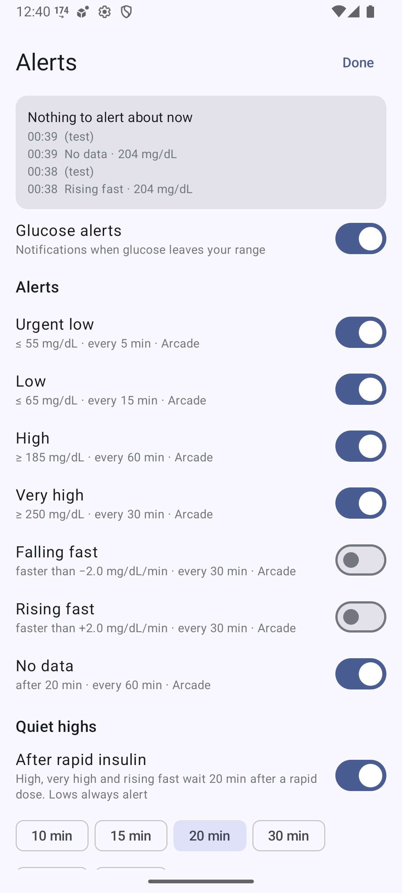
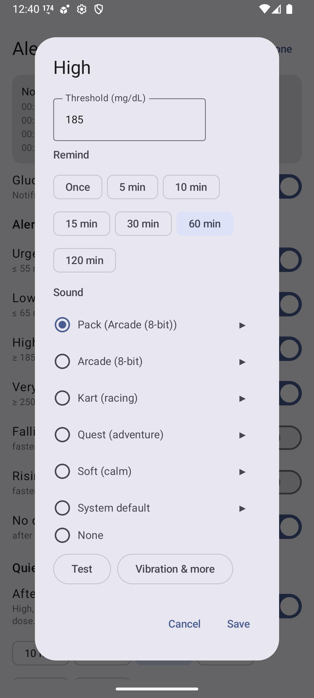
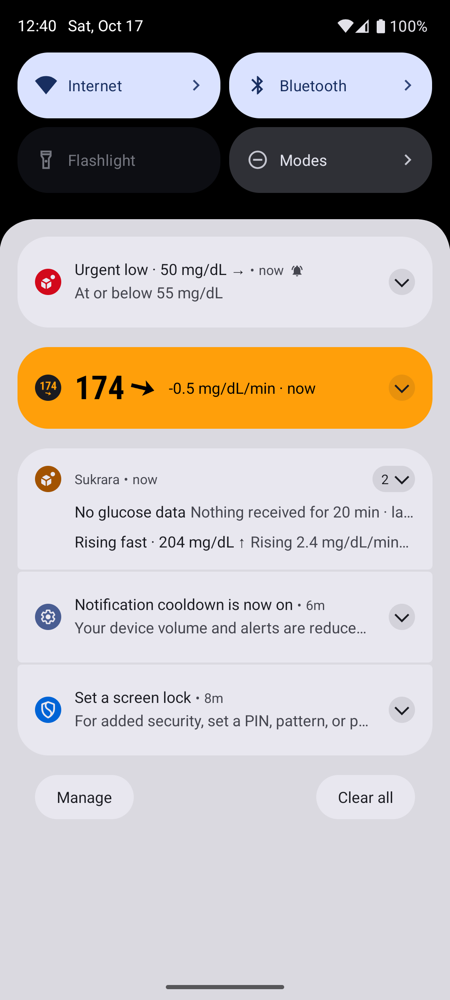
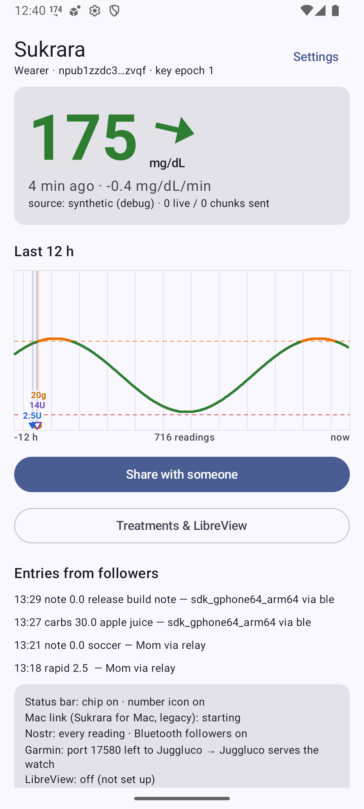
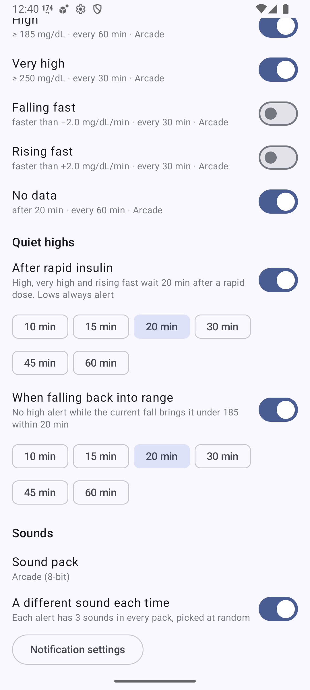
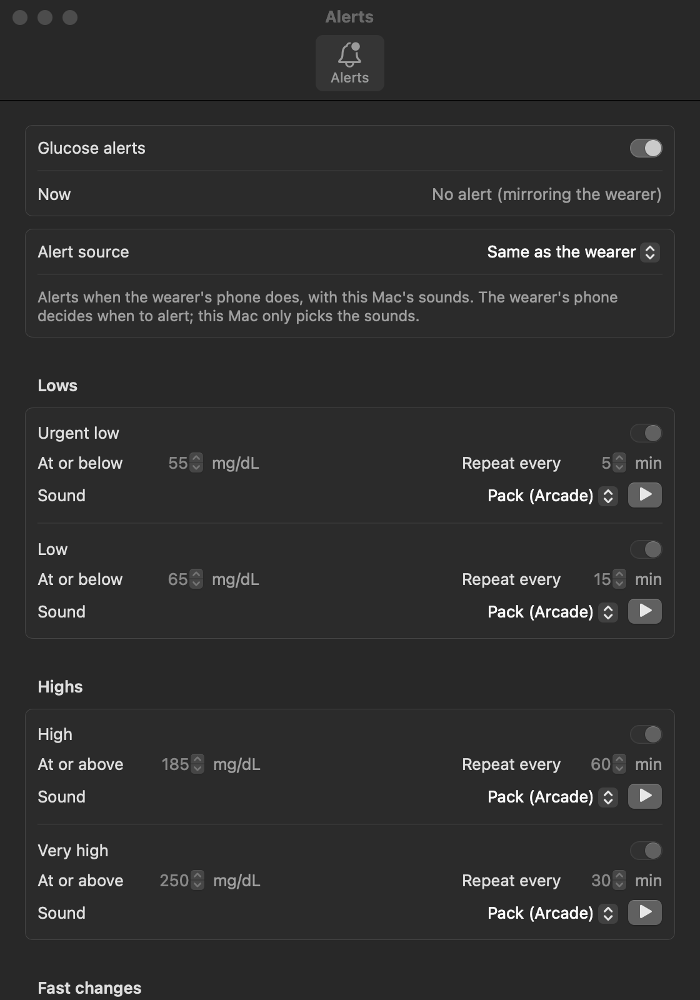

# 15 — Glucose alerts, sound packs and haptics

*2026-10-17 · investigation report · Pixel 10 Pro (Android 17), Android 16 emulators, Sukrara for Mac (macOS 27)*

## Goal

Alerts when glucose leaves your range, in **every Sukrara app** (Android wearer, Android follower, Mac), with:

- your own thresholds for very low, low, high, very high, falling fast, rising fast and no data;
- two ways to keep highs quiet: **after rapid insulin** (give it time to work) and **when glucose is already falling
  back into range**;
- **followers alert when the wearer's app alerts** (default), or use their own settings;
- the native per-app sound settings, plus **sound packs** inspired by video games, mixable per alert, with a
  **random variant** each time;
- on Android, a **vibration per alert** so you can tell them apart in your pocket.

## Result

**It works on Android and on the Mac.** One rule set ([`spikes/alerts/SPEC.md`](../spikes/alerts/SPEC.md)) is
implemented twice (Kotlin and Swift) and tested the same way. The wearer sends a new encrypted `alert` event to its
followers over relays and Bluetooth.

**Listen to the packs: [sukrara.mauri.app/sounds](https://sukrara.mauri.app/sounds/)** (4 packs × 8 alerts × 3
variants, plus each alert's vibration pattern drawn to scale).

| What | How it was checked | Result |
|---|---|---|
| Rules (thresholds, severity, episodes, treatment mutes and repeats, headlines, rate alerts, no data, stale readings, master switch, settings JSON) | the 31 shared timelines in [`spikes/alerts/scenarios`](../spikes/alerts/scenarios/) on both engines; Android [`AlertEngineTest`](../spikes/showcase-android/app/src/test/kotlin/app/mauri/sukrara/alerts/AlertEngineTest.kt) + `AlertStatusTest` + `AlertScenarioTest`; Mac `swift run GlucoseBar -alerts-selftest` | Android **61/61** (26 + 4 + 31), Mac **49/49** (31 scenarios + 18 checks), 2026-10-18 |
| Sound packs through the native channel | emulator: SystemUI's `RingtonePlayer` plays `content://app.mauri.sukrara.poc.alertsound/<kind>`; our provider logs every open | `sound high → arcade_high_2 for com.android.systemui`, `sound very_high → arcade_very_high_1`, `sound no_data → arcade_no_data_1`, `sound urgent_low → arcade_urgent_low_3` |
| Channel keeps our sound and vibration | `dumpsys notification` | `mSound=content://…alertsound/urgent_low`, `mVibrationEffect=Composed{…QUICK_FALL…}` (not reset to the default sound) |
| Insulin mute, live | emulator wearer: reading 214 → high fires; `cmd treat k=rapid`; next reading | `High · 214 mg/dL` → `High cleared`, state `muted: "insulin 0 min ago"` |
| Mac: notifications with pack sounds | test notifications from the bundled app | usernoted: `Playing notification sound { nam: arcade_urgent_low_1.caf } for app.mauri.sukrara.poc` — **not proof**: the same line appears when the default sound plays instead (2026-10-21); check systemsoundserverd for a non-built-in action and NotificationCenter's `Playing sound … for …` |
| Mac: accepts the wearer's `alert` events | `-v2selftest` | accepted once over relay + BLE; non-roster author rejected; `at` > 10 min ignored; wrong `type` rejected |
| Wearer → follower mirroring, end to end | two emulators over public relays (no Bluetooth in the emulator) | fire mirrored in ≈ 2 s, clear in < 1 s, "own settings" ignores the wearer: see [Mirroring](#mirroring-wearer--follower) |
| Real sensor | release build on the user's phone (direct Libre 3 source) | first real alert at 00:48:46: `High · 185 mg/dL`, SystemUI played `arcade_high_3` from the provider (so R8's resource shrinking keeps the sounds) |

Screenshots (emulator, debug build):

| | | |
|---|---|---|
|  |  |  |
| Settings → Alerts: what's active now, the master switch, one row per alert | One alert: threshold, reminders, sound (pack or any pack just for this alert, ▶ to listen), Test, *Vibration & more* opens the system channel | Urgent low in red with the alarm icon (alarm stream); high-side alerts in orange |
|  |  |  |
| Quiet highs: after rapid insulin, when falling back into range | Sounds: pack, "a different sound each time", system notification settings | Sukrara for Mac → **Alerts…** (here mirroring the wearer: the rules are greyed out, sounds stay editable) |

## The rules

| Alert | Default | Re-alert | Sound mood |
|---|---|---|---|
| Very low (`very_low`, "urgent low" until 2026-10-18) | < 55 mg/dL | 5 min, alarm volume | *game over*: longer (3–4.5 s), unmistakable, not harsh |
| Low | < 70 | 5 min | *lost a life*: short, falling |
| High | ≥ 180 | 15 min | *final lap*: a riff, then the same riff faster and higher (≈ 1 s, it's the frequent one) |
| Very high | ≥ 250 | 10 min | *boss incoming* |
| Extremely high | ≥ 300 | 5 min, alarm volume | *final boss* |
| Falling / rising fast | 2 mg/dL/min | 30 min, **off** | quick sweeps |
| No data | 20 min | 60 min | *connection lost* |

The defaults are the user's own settings since 2026-10-18 (before: low 65, high 185, repeats 15/30/30/15, Arcade).
Lows are **strictly below** the threshold since 2026-10-18 (low 70 alerts at 69, not at 70: 70 is in range, as in
LibreView's ranges); highs are at or above it. Very low 55 and very high 250 follow the consensus Time-in-Range levels
(Nightscout's `BG_LOW` is also 55).

- Level alerts: one at a time, the most severe wins; moving to a worse one fires at once (high → very high).
- Episodes, treatment-anchored repeats and the headlines: see [the 2026-10-18 round](#episodes-and-treatment-anchored-repeats-2026-10-18).
- Readings older than 15 minutes never alert (backfill, late chunks).

Notification text: the headline as the title (`Low glucose · eat more`), the value and arrow as the body (`69 mg/dL ↘`;
fast changes add the rate, `120 mg/dL ↓ · falling 2.4 mg/dL/min`). Until the evening of 2026-10-18 the body also had the
threshold (`· ≥ 180 mg/dL`) and, on the Mac, `· from the wearer's phone`: too much text (user). Until 2026-10-18 the title was `High · 185 mg/dL ↑` with
`≥ 185 mg/dL · reminder 2` below.

**Quiet highs** (both on by default):

- **After rapid insulin** (60 min; 30/45/60/90/120/180, 20 until 0.11.11): high, very high and rising fast wait N
  minutes after a rapid dose. A high that already fired is cleared when you log the dose. If it's still high when the
  window ends, it alerts then. 20 minutes was too short: rapid insulin barely acts by then (it peaks after 1–2 h), so
  glucose is usually still at or above the threshold and the alert fired 23 min after an 8 U dose on the user's phone.
- **When falling back into range** (20 min): no high alert while `sgv + rate × N < high` (the current fall brings it under
  180 within N minutes). Re-checked on every reading. It only postpones: when the trend flattens, an alert that came
  due meanwhile fires at once, otherwise the repeat keeps its time.

**Extremely high** (0.11.11, `extremely_high`, on, ≥ 300 mg/dL, every 5 min, *final boss* sounds and vibration):
the high side's safety net. **No rule mutes it**: not the insulin window, not the falling projection.
The user asked for it so the insulin mute can stay long (60 min) without hiding a real spike: with insulin logged,
251 stays quiet as very high, 300 alerts at once.

**Quiet lows** (0.11.11, on by default): **After carbs** (15 min; 10/15/20/30/45 on Android, 5–45 on the Mac): very
low, low and falling fast wait N minutes after a carbs entry, the same way as the insulin rule (cleared when you log
it, alerts when the window ends if it's still low). 15 min follows the "15-15 rule" for treating a low (15 g,
re-check after 15 min). Very low was never muted until 2026-10-18; the user asked for it to wait for the carbs too.

Prior art agrees: Nightscout's `treatmentnotify` snoozes alarms after a treatment (`TREATMENTNOTIFY_SNOOZE_MINS`,
default 10), and xDrip+'s *Smart Alerting* ("Don't alert if glucose is heading in the right direction") is on by
default. Neither combines both, and neither has a projection: xDrip+ only checks that the last readings dropped.

## Episodes and treatment-anchored repeats (2026-10-18)

The user's report: after a mute window ended while still low, the alert seemed to come only on a multiple of the
repeat interval counted from the start of the low, and a reading back at 70 for a minute started everything over.
They wrote down what should happen (repeat 5 min, carbs mute 5 min):

| min | | alert |
|---|---|---|
| 0 | glucose 69 | **Low glucose** (first of the episode) |
| 3 | logs 5 g carbs | (the alert goes away) |
| 5 | | nothing: would have been the repeat, the count starts at the carbs now |
| 8 | | **Low glucose · eat more** |
| 13 | | **Low glucose · eat more** |
| 14 | logs 5 g more | |
| 15–16 | 70 (in range), then 69 | nothing |
| 19 | | **Low glucose · eat more again** |
| 20–21 | 70, then 69 | nothing |
| 24 | | **Low glucose · eat more again** |

**Rules** (both platforms, [SPEC §1–§2](../spikes/alerts/SPEC.md)):

- **Episodes.** One per group and side (lows, highs, falling fast, rising fast, no data). It ends once nothing of that
  side has matched for the **hold time**, the kind's repeat interval (at least 5 min). A brief exit clears the
  notification, but doesn't start a new episode: no new "first" alert, the repeat count and the logged treatments
  carry on. Getting better within the side (very low → low) doesn't alert either.
- **A treatment restarts the count.** Carbs (for very low, low, falling fast) and rapid insulin (high, very high,
  rising fast) clear the alert and mute it for their window; when the window ends and it still matches, it alerts
  **at once**, and the next repeats count from there. Extremely high is never muted.
- **Headlines acknowledge treatments** logged in the episode: `Low glucose · eat more` / `· eat more again`. On the high
  side they never advise more insulin (stacking rapid doses risks a hypo): `High glucose · still high after insulin` /
  `· still high after more insulin`. The wearer sends the count (`tr`) in the `alert` event, so followers and the Mac
  show the same words.
- **Timer.** Android schedules the next check with an exact alarm (`setExactAndAllowWhileIdle`, `USE_EXACT_ALARM`,
  granted at install) instead of the inexact `setAndAllowWhileIdle`; the Mac adds a one-shot timer at the engine's
  next check to its 60 s tick.

**Why the old alert looked repeat-aligned.** Replaying the user's timeline on the old Android engine (per-minute
readings) gives alerts at 0, 8, 13, 19 and 24, the right times, so the Android carbs path itself wasn't it. What the
old code did get wrong:

- Every firing after a treatment was a new "first" alert (`n = 1`, same text), and a reading at 70 counted as low
  (`≤`), so nothing told the user the alert knew about the carbs.
- **The Mac** kept the episode's last alert through a treatment mute and only re-alerted at `last alert + repeat`:
  with a mute shorter than the repeat (e.g. low every 15 min, carbs mute 5–10) the alert after the carbs came on the
  episode's repeat grid, exactly the reported pattern.
- **Android, falling-high mute:** when it ended, the alert waited for `last alert + repeat`.
- **Android timer:** the check at the mute end was an inexact alarm; `AlarmManager` may deliver it well after the
  requested time (the window grows with the delay, more in Doze). With a reading every minute that doesn't matter (the
  next reading re-checks), but with readings every 5 min or a gap, the alert at the mute end waited for the next
  reading, i.e. on the 5-minute grid.

**Scenarios as the regression guard.** The rules are now timelines in
[`spikes/alerts/scenarios/`](../spikes/alerts/scenarios/) (the user's table verbatim first, then one per rule), run by
both platforms: Android `AlertScenarioTest` and the Mac `-alerts-selftest`. Every change to the rules adds or updates
one ([SPEC §7](../spikes/alerts/SPEC.md#7-scenarios-the-regression-guard)).

## Mirroring (wearer → follower)

The wearer publishes every firing and clearing as an **`alert` event**: kind **21079**, the same envelope as live
readings (signed by the device key, NIP-44 to the read key, `gk` tag, 1 h expiration). Content:
`{"v":2,"type":"alert","id","k","state":"fire"|"clear","at","t","sgv","r","th","n"}`. It goes out at once on relays
(LIVE lane, also when the upload interval batches readings) and over Bluetooth, where it keeps its own backlog slot so
a follower that connects a minute later still gets it.

Followers accept it with the live-reading checks (roster device, known epoch, decrypts, `v == 2`), dedupe by id
(it arrives over BLE and several relays) and ignore anything older than 10 minutes. Then:

- **Same as the wearer's app** (default): the follower posts the same alert with *its own* sound choice and removes
  it when the wearer clears it. The wearer's quiet rules apply automatically (a muted alert is never sent).
  **No data stays local**: it's about this phone's link to the wearer, which the wearer can't report.
- **This phone's own settings**: the same rules run on the follower's readings and the treatments it received.

Sukrara for Mac does the same, chosen by General › *Settings from* (round f28: *Wearer* mirrors, *Default* and
*Custom* run the rules on the Mac with the defaults or its own values). It can only mirror while it follows over Sukrara
sharing (v2). Otherwise the rules run on the Mac, and the window says so.

**Measured** (2026-10-17 01:31–01:33, two emulators running the debug build, relays only):

| Step | Wearer (medium_phone) | Follower (small_phone) |
|---|---|---|
| Test alert, shared | `alertTest very_high` | `Very high (from the wearer) · 262 mg/dL`; SystemUI played `arcade_very_high_1`; notification "Very high · 262 mg/dL →", sub-text *Following* |
| Real rules | reading 214 → `High · 214 mg/dL` at 01:32:03.9 | `High (from the wearer) · 214 mg/dL` at 01:32:06.0 (2.1 s, emulator clocks) |
| Rapid insulin logged | next reading → `High cleared` at 01:32:13.9 | `High cleared (by the wearer)` at 01:32:14.7; the notification is gone |
| Follower set to its own settings | `alertTest low` | event received (`alert low fire via nostr.mom`), nothing posted |

Bluetooth uses the same `publish` path as live readings (each alert has its own backlog key) and the Mac's
`-v2selftest` covers its BLE acceptance. A run on two real phones over Bluetooth only is still open.

## Sounds

**Native first.** Android lets the user change each notification channel's sound and vibration, and the app can't
change them afterwards ("you can't change the notification channel's visual and auditory behaviors programmatically",
[channels](https://developer.android.com/develop/ui/views/notifications/channels)). So every alert is **its own
channel**, and you can set its sound, vibration and Do Not Disturb behaviour in the system settings (*Vibration &
more*). macOS has no per-app sound picker, only "Play sound for notification" on/off
([Mac help](https://support.apple.com/guide/mac-help/mh40583)), so the Mac's Alerts window is the only place to pick.

**Packs inside a native channel.** A channel's sound is fixed when the channel is created, which seemed to rule out
packs and random variants. AOSP shows a way through. NotificationAttentionHelper calls SystemUI's
`RingtonePlayer.playAsync`, and SystemUI's `NotificationPlayer` builds a **new MediaPlayer for every alert** with
`setDataSource(context, uri)`. For a non-Settings `content://` URI that means a fresh
`ContentResolver.openAssetFileDescriptor`. So each channel's sound is `content://app.mauri.sukrara.poc.alertsound/<kind>`,
and our provider decides at play time: the chosen pack (or one pack just for this alert), a random variant (never the
same one twice in a row), the system default sound, or silence. The emulator log proves it: SystemUI opens the
provider on every alert, and a different file plays each time.

Conditions found in AOSP:

- `NotificationRecord.calculateGrantableUris()` checks that the app may grant read access to the sound URI. If not, it
  silently replaces it with the default sound (`Replacing … `). The provider is therefore **exported without a
  permission**. It serves only the bundled sounds.
- `canonicalize()` returns the URI itself, because backup/restore canonicalises channel sounds and the default (null)
  would reset them.
- The provider keeps one pick per kind for 5 s, because a notification can open the URI more than once.
- If the user picks another sound in the channel settings, that wins, as with any app (the Alerts screen then says
  "sound set in system settings").

**The packs** ([`gen.py`](../spikes/alerts/sounds/gen.py)): everything is synthesised with numpy (polyBLEP pulse/saw,
stepped triangle, additive brass, FM bells, Karplus-Strong harp, marimba, noise drums, echo/reverb). The melodies are
original, and loudness is normalised per kind. 84 files: OGG Vorbis for Android (1.5 MB in `res/raw`), IMA4 CAF for
the Mac (in the app bundle; files must be < 30 s), AAC for the web page. **Mac fix (2026-10-21):** naming the bundled
file played Apple's default sound on the user's Mac: Notification Center logged `Playing notification sound { nam:
quest_high_2.caf }`, then systemsoundserverd played built-in action 22 (the default AIFF, ~1 s) and never logged
`Playing sound … for …`, which a working bundled sound (WhatsApp's) does. The app's bundle is found through the system's
records, and many copies with this bundle id were registered (worktree builds, a dmg, deleted test copies). Now each
notification first copies its sound to `~/Library/Sounds/Sukrara <pack> <kind> <n>.caf` (the documented "app
container's Library/Sounds" of a non-sandboxed app, found by name) and names that copy (`NotificationSounds.swift`;
`-alerts-selftest` fails if any kind's notification names anything else).

| Pack | Character |
|---|---|
| **Arcade** (the default until 2026-10-18) | 8-bit: pulse leads at 12.5/25/50 % duty, stepped-triangle bass, NES-style noise. Very low includes a "wah wah wah wahhh" variant |
| **Kart** | racing: supersaw riffs, brass stabs, snare rolls, an engine rev for very high, a turbo whoosh for rising fast |
| **Quest** (default) | adventure: harp arpeggios, flute runs, bells, timpani; very low is a slow "you have fallen" |
| **Soft** | calm, not a game: marimba and glass, no drums |

## Haptics

You asked for vibrations that match the sounds, or at least one pattern per alert. Two mechanisms were checked:

1. **Haptics inside the sound file** (an OGG with an extra haptic channel, `ANDROID_HAPTIC=1`; the Pixel 10 Pro's
   audio HAL has a `haptic-playback` profile). **Not possible for notifications**:
   - AudioAttributes mute haptic channels by default.
   - A channel's attributes are saved without that flag.
   - On the phone, every SystemUI notification player shows `flags=0x800(FLAG_MUTE_HAPTIC)` (`dumpsys audio`). Only
     ringtones play audio-coupled haptics.
2. **A vibration effect per channel** (`NotificationChannel.setVibrationEffect`, API 36; the flag
   `notification_channel_vibration_effect_api` is enabled on the phone). **Used.** Each alert has a pattern built from
   the haptic primitives, shaped like its sounds:

| Alert | Pattern |
|---|---|
| Very low | three falls getting weaker, then two heavy thuds (≈ 2.2 s) |
| Low | two falls and a thud |
| High | clicks speeding up, then a rise (the "final lap") |
| Very high | thud-click, thud-click, spin |
| Falling / rising fast | a fall + low tick / a slow rise + tick |
| No data | three ticks fading out |

- The system plays it together with the sound (delayed to line up with it), and **alone in vibrate mode**. It plays
  nothing in silent mode (`!ringerModeSilent`).
- Built from primitives only: a channel persists "a composition created exclusively via addPrimitive" and nothing
  mixed. Delays are ≥ 50 ms and strengths 0.5 / 0.7 / 1.0, as the
  [haptics principles](https://developer.android.com/develop/ui/views/haptics/haptics-principles) recommend.
- The Pixel 10 Pro supports all 8 primitives (CLICK 29 ms, THUD 300 ms, SPIN 133 ms, QUICK_RISE 150 ms, SLOW_RISE
  500 ms, QUICK_FALL 100 ms, TICK 5 ms, LOW_TICK 12 ms). Its resonance is 129.5 Hz.
- Phones without the primitives get an on/off waveform with the same rhythm, chosen when the channel is created.
- The patterns are per alert, not per variant: a channel has one vibration. Variants of one alert share their mood
  and length, so the pattern fits all three.
- The Mac has no notification haptics.

## Volume: alarm or notification (0.11.4)

Every alert has a **Volume** choice (the user's request after 0.11.1): **Alarm** rings like an alarm clock, at the
alarm volume, and comes through Do Not Disturb when alarms are allowed. **Notification** uses the notification volume
and comes through Do Not Disturb only if reminders are allowed. Very low and extremely high default to Alarm, everything else to Notification (the user's settings; lows were Alarm
until 2026-10-18).
It's a per-device choice, also on a follower that mirrors the wearer.

Android doesn't let an app change a channel's audio attributes once it exists, so each alert has **two channels**:
`alert_n_<kind>` and `alert_a_<kind>`. In Android's settings they appear in two groups, "Glucose alerts" and "Glucose
alerts at alarm volume", and the setting picks which one Sukrara posts to. The 0.11.1 channels (`alert_<kind>`) are
deleted. Checked on an emulator: by default a low went to `alert_a_low` (category `alarm`, `USAGE_ALARM` →
`STREAM_ALARM`) and a high to `alert_n_high` (category `reminder`). With the two swapped, the high went to
`alert_a_high` and the low to `alert_n_low` (played as `USAGE_NOTIFICATION_EVENT`). All four played.

On the Mac there is no alarm volume. The same switch ("Like an alarm") means **Time Sensitive**, which only works in a
build signed with that entitlement; today's builds show it as a normal notification.

## Notification behaviour learned on the way

- **Notification cooldown muted the first test alerts.** On the emulator, three high alerts in a row played no sound,
  while the urgent low did; SystemUI then posted "Notification cooldown is now on". In NotificationAttentionHelper the
  cross-app *avalanche* strategy (after unlocking / many notifications) mutes everything except `CATEGORY_ALARM`,
  `CATEGORY_REMINDER`, `CATEGORY_EVENT`, calls and important conversations. The fix:
  - **Lows** (by default; any alert set to *Alarm* volume since 0.11.4): `CATEGORY_ALARM` + `USAGE_ALARM`. They follow the alarm volume, ring in "Alarms only" Do Not Disturb
    (`ZenModeFiltering.isAlarm`), and are exempt from every cooldown.
  - **Everything else** (*Notification* volume): `CATEGORY_REMINDER`. Exempt from the avalanche, and let through Do Not Disturb only if you
    allow reminders, so highs don't wake you through DND unless you want them to.
  - After that, high, very high and no data played.
- Per-app cooldown (only when the user applies cooldown to all apps) can still soften a second alert that comes within
  seconds of another one. Real alerts are minutes apart.
- **Two sounds at once after an app update (2026-10-18, user report).** Measured on the Pixel (`dumpsys audio`,
  `notification_alert` events): every Sukrara update made SystemUI start two players within 0.5 s, the system
  default sound (`USAGE_NOTIFICATION`, LSPosed's "Module update complete" notification, channel
  `lsposed_module_updated` of package `android`, posted because Sukrara is an LSPosed module) and the alert sound
  (`USAGE_NOTIFICATION_EVENT`, `alert_n_high`). The update kills the process and removes its notifications; the new
  process started with an empty engine and took the ongoing high for a new one, so it rang again at once. Not the
  cause: every alert channel already had its own `content://…alertsound/<kind>` sound, alert notifications set no
  sound/defaults/group of their own, the app plays nothing itself outside the settings preview, and a normal repeat
  (12:34) started one player only. Fix: `AlertEngine.snapshot()` is saved after every evaluation and
  `restore()`d on the first attach of a process; the alerts that were up come back silently (a group member with
  `GROUP_ALERT_SUMMARY`, what `NotificationCompat.setSilent` does) and the repeats keep their times. After the fix a
  reinstall started only LSPosed's player and logged "resumed High (no sound)". LSPosed's own sound stays (another
  app's channel; the user can silence it in Settings → Apps → Android System → Notifications). Guards:
  `AlertEngineTest.restartResumesWithoutRingingAgain`, `AlertNotifierTest` (every channel has its own sound, no
  sound/group on the alert, the re-shown alert is silent; Robolectric, runs with `GALLERY_JAVA_HOME`). The Mac had the
  same restart gap (relaunch or update of Sukrara.app rang an ongoing alert again): it now saves the snapshot in
  UserDefaults `alertEpisodes` after every evaluation and restores it at launch (seeded with the last stored reading),
  re-posting the alerts that were up with the same identifier and no sound; same tests in `-alerts-selftest`, and the
  shared timeline event `restart` (SPEC §7, `episodes.txt`) runs on both engines.
- **Mac Time Sensitive** needs `com.apple.developer.usernotifications.time-sensitive`, which only a provisioning
  profile grants. The app checks its own entitlement: lows are `.timeSensitive` when it has it, `.active` otherwise
  (today).

## Alert UX round f30 (2026-10-22)

The user's feedback on 0.11.38: two kinds of buttons on the notification, mutes that never end, a high's mute that
could hide the low after insulin, no global mute, very low / extremely high exceptions, "60 min" texts.

**Added to Sukrara** (Android + Mac, SPEC §2, scenarios `actions.txt` / `devices.txt`):
- Exactly two notification actions, *Mute…* (one direct reply / text input with the lengths as choices) and *Relax*
  (was *Slow down*; the interval in the secondary text), per Android's guidance (up to three actions, none
  duplicating the tap; RemoteInput choices).
- Mute / Relax per side, covering very low and extremely high, ending at their time or back in range by a margin
  (10 mg/dL for 10 min, settings `backMgdl` / `backMin`), not with the episode.
- *Mute all* (30 min … 8 h, Never, custom) on the Android home card and the Mac dropdown, a *Muted* pill on every
  card surface, the Mac menu bar's bell.slash.
- One duration formatter per platform (`Durations`, fixture `spikes/durations/durations.json`) and a `durations`
  check: on the code before this round it reported 98 hand-written minute texts.

**Discarded**: an *Until tomorrow morning* length (8 h covers a night without clock rules); ending a mute when merely
back in range (the user: glucose oscillates at the edge); the one-tap *Mute 30 min* button beside *Mute for…* (the
mixed chip styles the user found confusing); the very-low / extremely-high exception (the user's decision).

## Code

| Where | What |
|---|---|
| [`spikes/alerts/SPEC.md`](../spikes/alerts/SPEC.md) | the shared contract: kinds, mutes, settings JSON, `alert` event, platform notes |
| `spikes/alerts/sounds/` | `gen.py` (packs), `preview.py` (the sound test page, inline or for the site) |
| `showcase-android/…/alerts/` | `AlertEngine` (pure rules), `AlertSettings`, `Alerts` (roles, timer, mirroring), `AlertNotifier` (channels), `AlertSounds` (provider + preview), `AlertHaptics` |
| `showcase-android/…/ui/AlertsScreen.kt` | settings screen; Settings → Alerts (wearer), home → Alerts (follower) |
| `menubar/Sources/GlucoseBar/Alerts*.swift` | the Mac engine, window and self-test |

Debug (`DebugReceiver`, adb only): `--es alertTest high` fires one alert (and sends it to followers) and
`--es alertFeed '204,-0.5'` runs a made-up reading through the rules, both **debug builds only** (the release
app never shows an alert that isn't real; test them on the emulator), `--es alertSettings '<json>'`; the reply has
`alerts` (settings, state, last events). Mac: `-alert-test`, `-alert-feed`, `-alertsSnapshot`.

## Open

- **Not a medical device.** Alerts depend on the phone being on, the app not being killed, and Do Not Disturb. The
  very low can't be set to bypass DND unless the user allows alarms.
- macOS Time Sensitive needs a provisioned build (Developer ID).
- The follower's local "no data" uses its own threshold even when mirroring.
- Mirroring over Bluetooth only (no internet) between two real phones wasn't run; the emulators have no Bluetooth.
