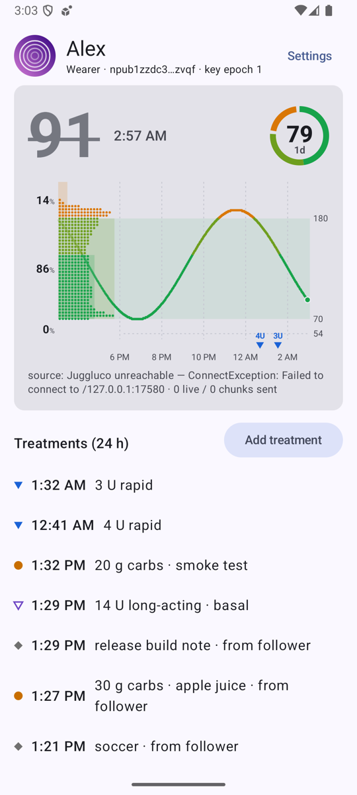
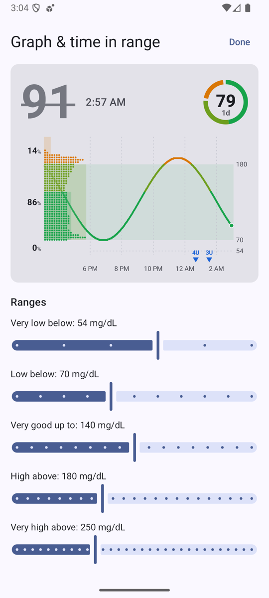

# 16 — One glucose graph everywhere: time in range, freshness, rings

*2026-10-17 · investigation report · Android 16 emulator (synthetic source), JVM renders (Robolectric native graphics),
Sukrara for Mac renders (ImageRenderer)*

## Goal

One improved picture for every place Sukrara shows glucose (app, home-screen widgets, the notification, the Mac
menubar and Mac widgets), from the user's draft:

- **Distribution on the left of the chart.** It grows rightwards from the chart's left edge and shows how much time
  was spent at each glucose level over the chart's window. The chart underneath fades out towards that edge.
- **Time in range as soft rectangles.** One per major band (high, in range, low), each as wide as its share of time,
  with the % next to it. A **"very good" band (70–140)** sits inside "in range" in a second green; **very high
  (> 250)** and **very low (< 54)**, the levels of the LibreView report, sit inside high and low.
- **No "x min ago", no "+0.1/min".** A value is assumed current. The older it gets, the less is shown: the reading's
  time, then struck through, then no value, then no graph.
- **Time-in-range rings.** A segmented ring per window (1 day, 7 days…) with the % in the middle, up to three, fading
  from the main one, hidden when they don't fit. Window and counted range ("in range" / "very good") are settings.
- **12 h by default**, a default the user can change, an optional window per place, and **per-widget settings**, so
  the same widget can be added twice and look different.
- **Configurable major ranges.**

## Result

**It works.** One renderer draws the whole card on a plain Android `Canvas`. The app (Compose's native canvas), the
three widgets and the notification (bitmaps) all use it, and the Mac has a line-for-line Swift port. The same code
renders the picture sheets below on the JVM, so the report pictures are the real thing.

| | |
|---|---|
|  |  |

*12 h chart, distribution as rows of dots (like the line), rectangles = time in each band, rings for today and the
last 7 days (the main ring on the right, the second faded). Synthetic two-week history with meals, a dawn rise and
afternoon dips.*

| What | How it was checked | Result |
|---|---|---|
| Renderer on Android | `GraphGallery` (Robolectric native graphics) draws all sheets; emulator (release build): app, settings, widget Reconfigure screen, combined widget on the launcher | same picture on the JVM and on the device |
| Statistics | `GlucoseStatsTest`: six bands, time weights with 1- and 5-minute data, gaps, band-exact areas = time in range, % add up to 100, freshness steps | 6/6 pass (one real bug found and fixed: the last reading of 5-minute history was under-counted) |
| Freshness steps | sheet with readings 30 s, 3 min, 12 min, 75 min, 5 h old; emulator (a late reading showed its time) | as designed, see [Freshness](#freshness) |
| Rings over days | wearer keeps 15 days in `owner.db` now; rings computed from the store, cached 5 min | 1d ring on the emulator (24 h of synthetic data; the 7d ring stays hidden until a quarter of its window has data) |
| Per-widget settings | `widgetFeatures="reconfigurable\|configuration_optional"` + `WidgetConfigActivity` | a new widget follows the app settings; touch & hold → Reconfigure changes only that one |
| Mac | see [Mac](#mac) | |

## The distribution: which algorithm?

There's no single right way to turn readings into "time at each level", so six options were built and shown to the
user side by side. All of them weigh every reading by the time it stands for (until the next reading, at most
15 min), so 1-minute live readings and 5/15-minute backfilled history count the same per hour, and a gap counts as
nothing.

| Option | How | Good | Bad |
|---|---|---|---|
| Bands only | just the rectangles | calm, nothing to explain | no shape inside a band |
| Histogram | time per 10 mg/dL bin (the user's "count per band", finer) | exact, no tuning | blocky; a 10 mg/dL step is coarse at lows |
| Gaussian (fixed) | each reading is a bell 10 mg/dL wide (the user's "gaussian" idea) | smooth | leaks across thresholds: a band's area ≠ its % |
| Gaussian (relative) | bell 7 % of the value (5 mg/dL at 70, 13 at 180), i.e. a kernel in log-glucose | sharper at lows, smooth at highs | same leak |
| Time at level | the curve between two readings is followed level by level (each mg/dL it passes gets its share of the time), then smoothed 4 mg/dL | the most literal answer to "how long was I at 150?" | a long flat stretch makes a tall spike |
| **Time at level, band-exact** | as above, then each band is rescaled so its area equals its time-in-range share | the shape and the % labels can never disagree | small steps at the thresholds |

Each could be drawn as rows of dots (like the draft and the line) or as a filled area.

**Decision (the user, 2026-10-17): time at level, band-exact, as dots.** The other five and the area style were
removed from the code; the only switch left is the distribution + rectangles on or off (app-wide and per widget).

## Freshness

| | age of the latest reading | value | reading's time | graph |
|---|---|---|---|---|
| fresh | ≤ 90 s | ✓ | – | ✓ |
| late | ≤ 5 min | ✓ | ✓ ("10:11 PM") | ✓ |
| stale | ≤ 20 min | struck through, grey, no arrow | ✓ | ✓ |
| old | ≤ 3 h | – ("No reading since 8:59 PM") | ✓ | ✓ |
| gone | older / none | – | ✓ | – (rings stay) |

90 s, not 60: readings come every minute, so one a few seconds past a minute is still on time. 20 min is when the
"no data" alert fires. A clock time instead of "3 min ago" also means a fresh widget never redraws just to tick.

Applied everywhere: app panel, widgets, notification (title "No reading since …" when old; no rate, no age while
fresh; the Live Update card's metrics are value + arrow, plus the reading's time when late), Mac menubar.

## Rings

- Segments clockwise from 12 o'clock in glucose order: low (red), very good (green), in range above very good
  (yellow-green), high (orange). The two greens touch (very good is part of in range); other bands get a gap.
- The middle shows the chosen range (default **in range**; "very good" puts the window label in the very-good green).
- 0–3 rings, each with its own window (12 h, 1d, 3d, 7d, 14d); defaults 1d + 7d (+14d as the third). Main ring on
  the right at full strength, then 55 %, then 35 %.
- A ring needs data for at least a quarter of its window; otherwise it's not drawn. The wearer now keeps 15 days of
  readings (was 8) so 14d works; a follower keeps what it received (relays hold a week).

## Sizes and per-widget settings

- The three widgets now draw the same card at the real pixel size of each placement (value: number + rings; graph:
  chart; combined: all). Short wide placements put the value beside the chart; rings that don't fit go.
- **Per widget:** Android widgets are configured per placement (`android:configure` +
  `widgetFeatures="reconfigurable|configuration_optional"`, per the
  [Glance configuration guide](https://developer.android.com/develop/ui/compose/glance/configuration)). A new widget
  needs no setup and follows the app; *touch & hold → Reconfigure* opens a screen with a live preview at that
  widget's size: window, number of rings, counted range, distribution on/off. The last tile above is the same 4×2
  widget reconfigured to 3 h, one "very good" ring, no distribution.
- **Windows:** one default (12 h), optionally one per place (app, notification, widgets), and per widget.

## Ranges

Very low below **54**, low below **70**, very good up to **140**, high above **180**, very high above **250**
(Settings → Graph & time in range, 5 mg/dL steps), the same levels as LibreView's report for the doctor. They replace
the old colour thresholds 65 / 145 / 185 everywhere: the number, the line, the rings, the status-bar colours (the
LSPosed hook gets them in its state broadcast) and the notification's semantic style (below = danger, above =
caution). Above range is now **orange** (very high a deeper red-orange), as in the draft; it was red above 185.
Alert thresholds are separate (investigation 15) and unchanged.

- In the chart, very high / very low get a faint dashed line when the y range reaches them; their value is shown
  unless it would collide with the 180 / 70 label.
- The rectangles: above (with very high inside), in range (with very good inside), below (with very low inside);
  the three % labels are above / in range / below. Labels too close for their bands are pushed apart.
- The ring has six segments; gaps only between below, in range and above.

## On the device

| | | |
|---|---|---|
|  |  |  |
| App home, release build, a real *stale* reading (the emulator's source had stopped): struck through, with its time | Settings → Graph & time in range: live preview, the five ranges | A widget's own settings (touch & hold → Reconfigure), preview at that widget's size |

The emulator ran under very heavy host load (load average 30–46 from parallel sessions); its "isn't responding"
dialogs came from Android's render thread and system server, not from Sukrara (main-thread stack checked).

## Mac

The same renderer, ported line for line to Swift + CoreGraphics in one shared file
([`spikes/widgets-macos/Shared/SukraraGraph.swift`](../spikes/widgets-macos/Shared/SukraraGraph.swift)) that both the
menubar app (a symlink in its SwiftPM target) and the widget extension compile. Same ranges, weights, six
algorithms, freshness steps, colours and layout.

| | |
|---|---|
|  |  |
| Menubar dropdown: the card (12 h) replaces the 3 h sparkline and the "x min ago / rate" lines; treatments as before | Large widget, light |

*The same medium widget twice: app settings (left) and its own settings (right: 3 h, one "very good" ring, no
distribution).*

- **Menubar number:** red below range, orange above, normal ink in range (the fixed 65/145/185 are gone); struck
  through when stale, "–" from 20 min. A **Graph** submenu sets window, rings, the ring's range and the distribution on/off.
  Settings are `UserDefaults` (`graphHours`, `menubarHours`, `widgetHours`, `ringCount`, `ringWindows`, `ringRange`,
  `bandVeryLow`/`bandLow`/`bandTight`/`bandHigh`/`bandVeryHigh`, `side`).
- **History for the rings:** the Mac kept 3 h (menu) / 12 h (widget feed). A small store
  (`~/Library/Application Support/Sukrara/readings.csv`, every reading merged ±20 s, 15 days) now feeds the rings.
- **Widgets:** the widget file (v2, replaces v1) carries the graph settings, 24 h of readings and the ring numbers
  precomputed from the store, so the sandboxed extension needs no database. The timeline adds an entry at each
  freshness step.
- **Per widget on macOS:** App Intents configuration (window, rings, ring range, distribution on/off), the macOS
  equivalent of Android's Reconfigure ("Edit Widget"). The widget is built without an Xcode project, so
  [`appintents.sh`](../spikes/widgets-macos/appintents.sh) runs Xcode's `appintentsmetadataprocessor` itself (needs
  Xcode installed; without it the widget builds without the options). The generated metadata has the intent and its
  four parameters. **Not yet seen in the real widget host:** that needs the team-signed Sukrara.app, which is the
  user's daily copy.

| small | medium | xl |
|---|---|---|
|  |  |  |

## Code

| File | What |
|---|---|
| `graph/GlucoseStats.kt` | bands, time weights, time in range, the six distribution algorithms |
| `graph/Freshness.kt` | the five freshness steps, the reading's time text |
| `graph/GlucoseGraph.kt` | the chart: band, rectangles, distribution, faded line, labels, treatments |
| `graph/GlucoseCard.kt` | ring + whole card layout (value, arrow, rings, chart) |
| `graph/GraphSettings.kt`, `graph/GraphData.kt` | settings (app-wide + per widget), multi-day time in range from the role's store |
| `ui/GraphScreen.kt`, `ui/Widgets.kt` (`GlucosePanel`), `widgets/Widgets.kt`, `widgets/WidgetConfigActivity.kt`, `status/GlucoseNotification.kt` | the surfaces |
| `app/src/test/…/graph/GraphGallery.kt` | the picture sheets (`GALLERY_JAVA_HOME=<JDK 21+> ./gradlew testDebugUnitTest --tests '*GraphGallery*' -Dgallery.out=…`) |

Robolectric's Android 16 sandbox needs Java 21+; the build keeps JDK 17 and runs the unit tests on
`GALLERY_JAVA_HOME` when it's set (tested with JDK 27 + Robolectric 4.17 + ASM 9.11).

DebugReceiver: `--es graph '{"profile":"KDE_LOG","defaultHours":6,"ringCount":3}'` (any `GraphConfig` field),
`--es widgetGraph '<id>:{"hours":3,"rings":1,"side":false}'`, `--es cmd pinWidget --es kind value|graph|combined`
(asks the launcher to add a widget; the app must be in the foreground).

## In Sukrara (0.11.5)

| Added | Discarded (why) |
|---|---|
| One renderer (Android Canvas + a Swift port) for app, widgets, notification, Mac menubar and Mac widgets | the old per-surface charts: `GraphRenderer`, `GlucoseChart`, `BigGlucose`, the Mac sparkline (replaced outright) |
| Distribution beside the chart: time at level, band-exact, dots | histogram, two Gaussians, plain time at level, the area style (the user picked one) |
| Rectangles + % for below / in range / above, with very good, very high and very low inside | — |
| Six configurable ranges (54 / 70 / 140 / 180 / 250) | the fixed colour thresholds 65 / 145 / 185, red above range |
| Freshness steps everywhere | "x min ago", "+0.1 mg/dL/min" (the user: not useful) |
| 0–3 time-in-range rings, windows 12 h – 14 d; wearer keeps 15 days (was 8); a reading store on the Mac | — |
| Windows: default + per place + per widget; per-widget settings (Android Reconfigure, macOS App Intents) | the size-based widget windows (2–6 h by width) |
| `--es graph`, `--es widgetGraph`, `cmd pinWidget` in the DebugReceiver | — |

## Open

- macOS per-widget settings are built and in the widget's App Intents metadata but weren't seen in the real widget
  host before the release (needs the team-signed app the user runs).
- The old in-app chart animations (new points growing in) are gone; the number still rolls and the arrow still turns.
- The doctor-report metrics (average glucose, GMI, CV, goals): [18](18-metrics.md).
