# 16 — One glucose graph everywhere: time in range, freshness, rings

*2026-10-17 · investigation report · Android 16 emulator (synthetic source), JVM renders (Robolectric native graphics),
Sukrara for Mac renders (ImageRenderer)*

## Goal

One improved picture for every place Sukrara shows glucose (app, home-screen widgets, the notification, the Mac
menubar and Mac widgets), from the user's draft:

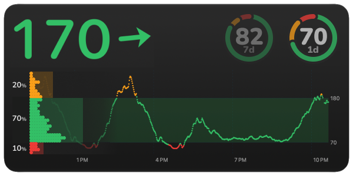

- **Distribution on the left of the chart.** It grows rightwards from the chart's left edge and shows how much time
  was spent at each glucose level over the chart's window. The lines underneath stop short of its dots (they faded
  out towards that edge until the [cut-out](#lines-very-good-band-and-the-cut-out-01112)).
- **Time in range as soft rectangles.** One per major band (high, in range, low), each as wide as its share of time,
  with the % next to it. A **"very good" band (70–140)** sits inside "in range" in a second green; **very high
  (> 250)** and **very low (< 54)**, the levels of the LibreView report, sit inside high and low.
- **No "x min ago", no "+0.1/min".** A value is assumed current. The older it gets, the less is shown: the reading's
  time, then struck through, then no value, then no graph.
- **Time-in-range rings.** A segmented ring per window (1 day, 7 days…) with the % in the middle, up to three, fading
  from the main one, hidden when they don't fit. Window and counted range ("in range" / "very good") are settings.
- **12 h by default**, a default the user can change, an optional window per place, and **per-widget settings**, so
  the same widget can be added twice and look different.
- **Configurable major ranges.**

## Result

**It works.** One renderer draws the whole card on a plain Android `Canvas`. The app (Compose's native canvas), the
three widgets and the notification (bitmaps) all use it, and the Mac has a line-for-line Swift port. The same code
renders the picture sheets below on the JVM, so the report pictures are the real thing.

| | |
|---|---|
| 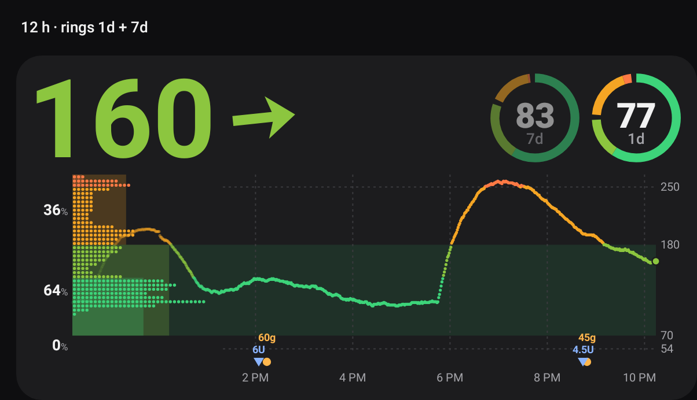 | 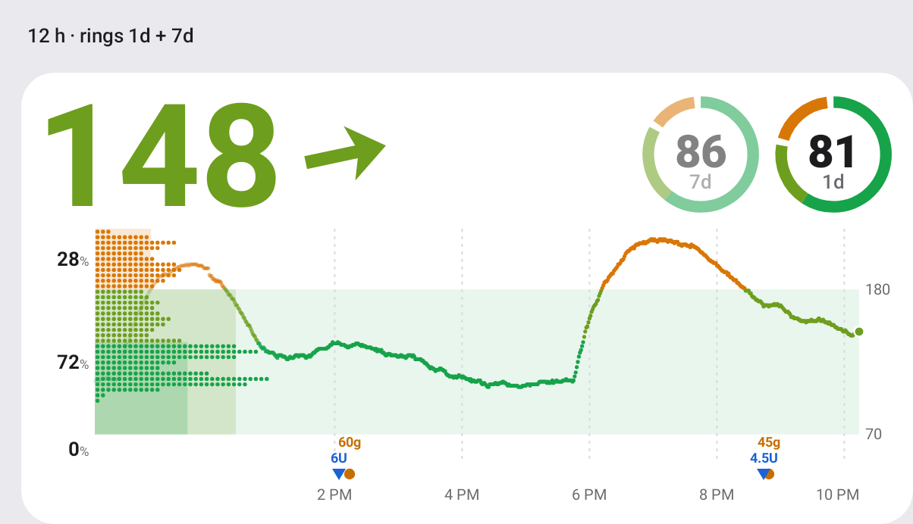 |

*12 h chart, distribution as rows of dots (like the line), % of time below / in / above range, rings for today and the
last 7 days (the main ring on the right, the second faded). Synthetic two-week history with meals, a dawn rise and
afternoon dips.*

| What | How it was checked | Result |
|---|---|---|
| Renderer on Android | `GraphGallery` (Robolectric native graphics) draws all sheets; emulator (release build): app, settings, widget Reconfigure screen, combined widget on the launcher | same picture on the JVM and on the device |
| Statistics | `GlucoseStatsTest`: six bands, time weights with 1- and 5-minute data, gaps, band-exact areas = time in range, % add up to 100, freshness steps | 6/6 pass (one real bug found and fixed: the last reading of 5-minute history was under-counted) |
| Freshness steps | sheet with readings 30 s, 3 min, 12 min, 75 min, 5 h old; emulator (a late reading showed its time) | as designed, see [Freshness](#freshness) |
| Rings over days | wearer keeps 15 days in `owner.db` now; rings computed from the store, cached 5 min | 1d ring on the emulator (24 h of synthetic data; the 7d ring stays hidden until a quarter of its window has data) |
| Per-widget settings | `widgetFeatures="reconfigurable\|configuration_optional"` + `WidgetConfigActivity` | a new widget follows the app settings; touch & hold → Reconfigure changes only that one |
| Mac | see [Mac](#mac) | |

## The distribution: which algorithm?

There's no single right way to turn readings into "time at each level", so six options were built and shown to the
user side by side. All of them weigh every reading by the time it stands for (until the next reading, at most
15 min), so 1-minute live readings and 5/15-minute backfilled history count the same per hour, and a gap counts as
nothing.

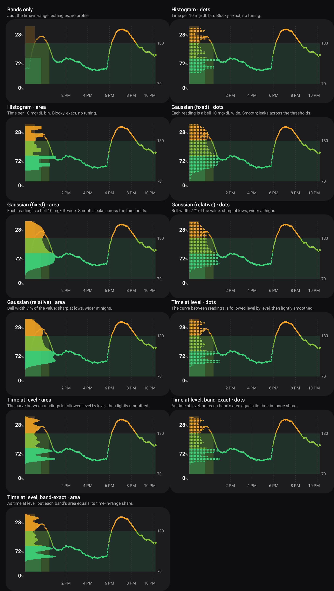

| Option | How | Good | Bad |
|---|---|---|---|
| Bands only | just the rectangles | calm, nothing to explain | no shape inside a band |
| Histogram | time per 10 mg/dL bin (the user's "count per band", finer) | exact, no tuning | blocky; a 10 mg/dL step is coarse at lows |
| Gaussian (fixed) | each reading is a bell 10 mg/dL wide (the user's "gaussian" idea) | smooth | leaks across thresholds: a band's area ≠ its % |
| Gaussian (relative) | bell 7 % of the value (5 mg/dL at 70, 13 at 180), i.e. a kernel in log-glucose | sharper at lows, smooth at highs | same leak |
| Time at level | the curve between two readings is followed level by level (each mg/dL it passes gets its share of the time), then smoothed 4 mg/dL | the most literal answer to "how long was I at 150?" | a long flat stretch makes a tall spike |
| **Time at level, band-exact** | as above, then each band is rescaled so its area equals its time-in-range share | the shape and the % labels can never disagree | small steps at the thresholds |

Each could be drawn as rows of dots (like the draft and the line) or as a filled area.

**Decision (the user, 2026-10-17): time at level, band-exact, as dots.** The other five and the area style were
removed from the code; the only switch left is the distribution + % on or off (app-wide and per widget).

**Rectangles removed (the user, 0.11.9):** the time-in-range rectangles behind the dots (as wide as each range's
share) cluttered the chart. The % labels and the dots carry the same information; the rectangles are gone from every
surface. The pictures in this report show the current design, except the options comparison above and the menubar dropdown.

## Freshness

| | age of the latest reading | value | reading's time | graph |
|---|---|---|---|---|
| fresh | ≤ 90 s | ✓ | – | ✓ |
| late | ≤ 5 min | ✓ | ✓ ("10:11 PM") | ✓ |
| stale | ≤ 20 min | struck through, grey, no arrow | ✓ | ✓ |
| old | ≤ 3 h | – ("No reading since 8:59 PM") | ✓ | ✓ |
| gone | older / none | – | ✓ | – (rings stay) |

90 s, not 60: readings come every minute, so one a few seconds past a minute is still on time. 20 min is when the
"no data" alert fires. A clock time instead of "3 min ago" also means a fresh widget never redraws just to tick.

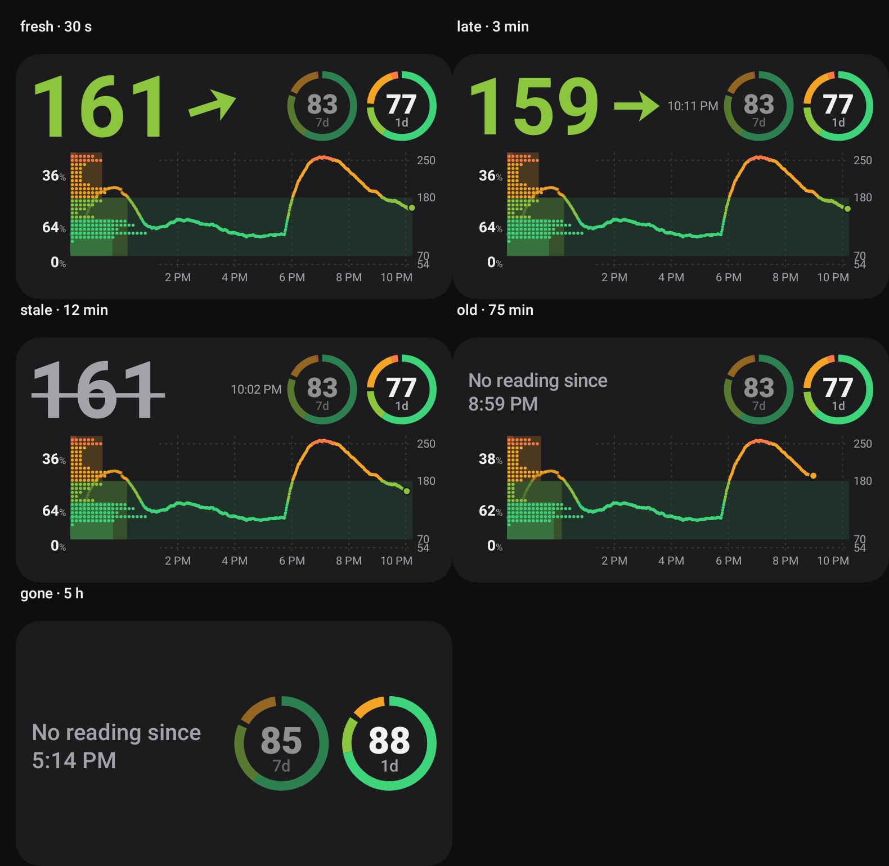

Applied everywhere: app panel, widgets, notification (title "No reading since …" when old; no rate, no age while
fresh; the Live Update card's metrics are value + arrow, plus the reading's time when late), Mac menubar.

## Rings

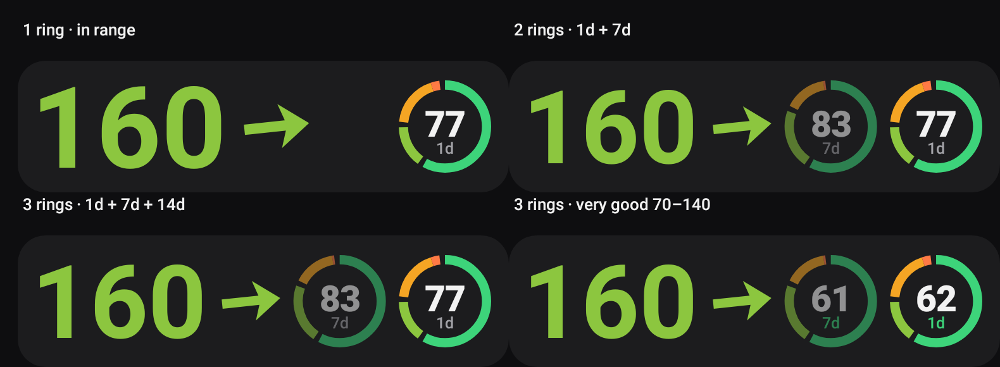

- Segments clockwise from 12 o'clock, by default (the user, 0.11.9): very good, in range, low, very low, high,
  very high. In range starts at the top, the lows follow, then the highs, very high last. The order is a setting (Android:
  Settings → Graph → *Ring order*, ↑/↓ per segment; Mac: Graph → Ring order). Gaps between below, very good, in range
  and above; the two lows and the two highs touch.
- The middle shows the chosen range (default **in range**; "very good" puts the window label in the very-good green).
- 0–3 rings, each with its own window (12 h, 1d, 3d, 7d, 14d); defaults 1d + 7d (+14d as the third). Main ring on
  the right at full strength, then 55 %, then 35 %.
- A ring needs data for at least a quarter of its window; otherwise it's not drawn. The wearer now keeps 15 days of
  readings (was 8) so 14d works; a follower keeps what it received (relays hold a week).

## Sizes and per-widget settings

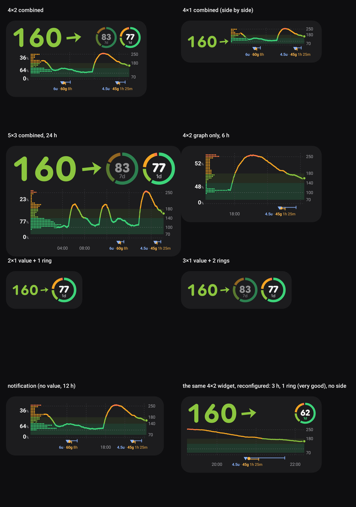

- The three widgets now draw the same card at the real pixel size of each placement (value: number + rings; graph:
  chart; combined: all). Short wide placements put the value beside the chart; rings that don't fit go.
- **Per widget:** Android widgets are configured per placement (`android:configure` +
  `widgetFeatures="reconfigurable|configuration_optional"`, per the
  [Glance configuration guide](https://developer.android.com/develop/ui/compose/glance/configuration)). A new widget
  needs no setup and follows the app; *touch & hold → Reconfigure* opens a screen with a live preview at that
  widget's size: window, number of rings, counted range, distribution on/off. The last tile above is the same 4×2
  widget reconfigured to 3 h, one "very good" ring, no distribution.
- **Windows:** one default (12 h), optionally one per place (app, notification, widgets), and per widget.

## Ranges

Very low below **54**, low below **70**, very good up to **140**, high above **180**, very high above **250**
(Settings → Graph & time in range, 5 mg/dL steps), the same levels as LibreView's report for the doctor. They replace
the old colour thresholds 65 / 145 / 185 everywhere: the number, the line, the rings, the status-bar colours (the
LSPosed hook gets them in its state broadcast) and the notification's semantic style (below = danger, above =
caution). Above range is now **orange** (very high a deeper red-orange), as in the draft; it was red above 185.
Alert thresholds are separate (investigation 15) and unchanged.

- **Extremely high** (300 by default, the extremely high alert's level; the alert keeps its own setting) turns the
  line, the distribution and the number magenta. Time in range still has LibreView's five ranges.
- In the chart, very high / very low get a faint dashed line, and so do the user's own lines (100 by default,
  drawn a little stronger). The y axis always reaches 54 and 250, even on a day that stays between 70 and 220; the user's lines don't
  change the zoom (a line outside the range isn't drawn). The very good part of the in-range band has its own colour. The values on the right:
  70 and 180 always, then 140, 54 / 250 and the extra lines, each only where it doesn't touch one already written.
- The three % labels are above / in range / below (the rectangles described in the goal were removed in 0.11.9). Labels too close for their bands are pushed apart.
- The ring has six segments; gaps only between below, in range and above.

## On the device

| | | |
|---|---|---|
| 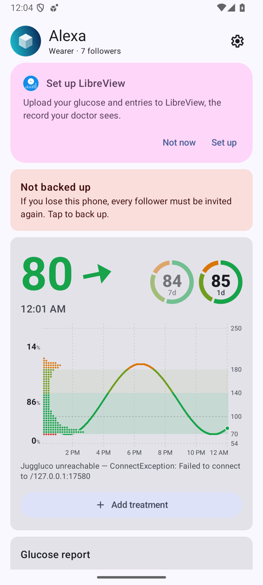 | 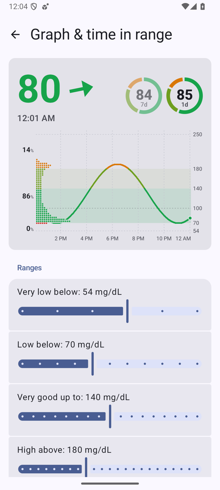 | 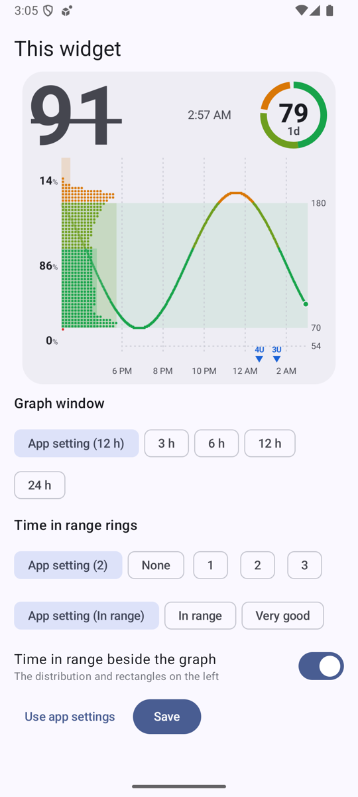 |
| App home (0.11.13, synthetic source on the emulator) | Settings → Graph & time in range: live preview, the ranges as sliders | A widget's own settings (touch & hold → Reconfigure), preview at that widget's size |

The emulator ran under very heavy host load (load average 30–46 from parallel sessions); its "isn't responding"
dialogs came from Android's render thread and system server, not from Sukrara (main-thread stack checked).

## Mac

The same renderer, ported line for line to Swift + CoreGraphics in one shared file
([`spikes/widgets-macos/Shared/SukraraGraph.swift`](../spikes/widgets-macos/Shared/SukraraGraph.swift)) that both the
menubar app (a symlink in its SwiftPM target) and the widget extension compile. Same ranges, weights, six
algorithms, freshness steps, colours and layout.

| | |
|---|---|
| 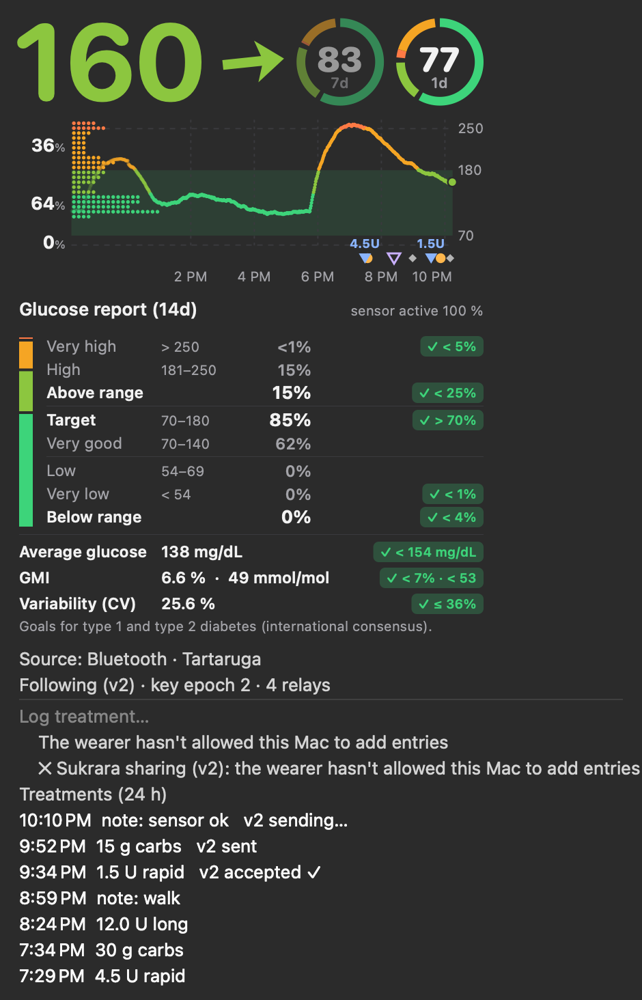 | 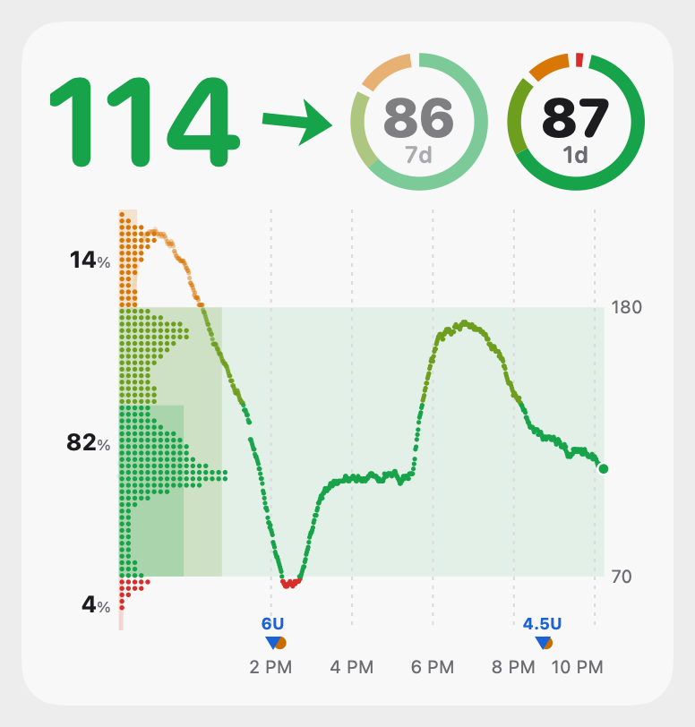 |
| Menubar dropdown: the card (12 h) replaces the 3 h sparkline and the "x min ago / rate" lines; treatments as before | Large widget, light |

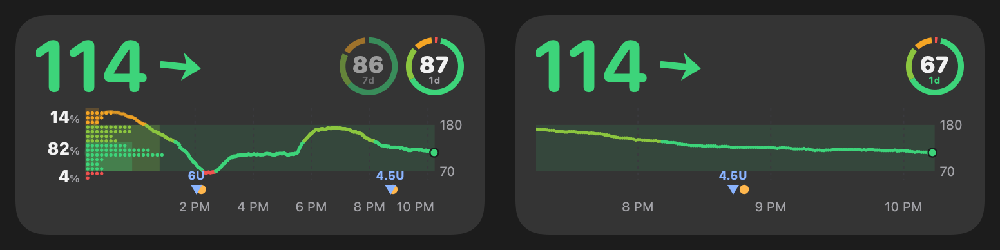

*The per-widget settings render (left: app settings, right: its own) from 0.11.7; on the real desktop they never
worked and were removed in 0.11.8, see below.*

- **Menubar number:** red below range, orange above, normal ink in range (the fixed 65/145/185 are gone); struck
  through when stale, "–" from 20 min. A **Graph** submenu sets window, rings, the ring's range and the distribution on/off.
  Settings are `UserDefaults` (`graphHours`, `menubarHours`, `widgetHours`, `ringCount`, `ringWindows`, `ringRange`,
  `bandVeryLow`/`bandLow`/`bandTight`/`bandHigh`/`bandVeryHigh`, `side`).
- **History for the rings:** the Mac kept 3 h (menu) / 12 h (widget feed). A small store
  (`~/Library/Application Support/Sukrara/readings.csv`, every reading merged ±20 s, 15 days) now feeds the rings.
- **Widgets:** the widget file (v2, replaces v1) carries the graph settings, 24 h of readings and the ring numbers
  precomputed from the store, so the sandboxed extension needs no database. The timeline adds an entry at each
  freshness step.
- **Per widget on macOS: tried and removed (0.11.8).** 0.11.7 gave the widgets App Intents settings ("Edit
  Widget"), with the intent metadata generated by Xcode's `appintentsmetadataprocessor` because the widget is built
  without an Xcode project. chronod never registered the intent: it asked for every timeline with `intent = nil`, and
  WidgetKit rejected each one (`CHSErrorDomain 1103 "Intent configuration is required but was not provided"`), so
  the user's widgets froze on their last picture. The widgets are a static configuration again; the window comes from
  the Graph submenu (`widgetHours`).

| small | medium | xl |
|---|---|---|
| 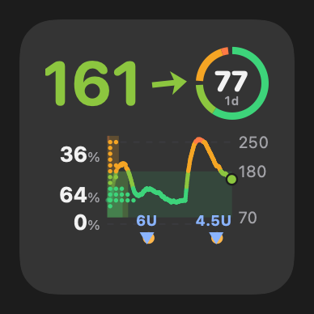 | 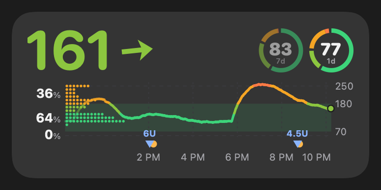 | 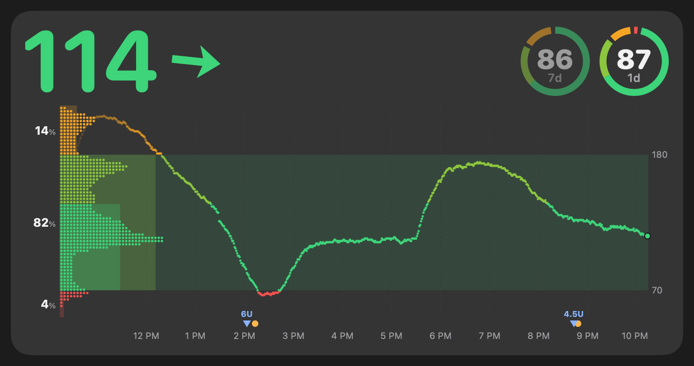 |

## Code

| File | What |
|---|---|
| `graph/GlucoseStats.kt` | bands, time weights, time in range, the six distribution algorithms |
| `graph/Freshness.kt` | the five freshness steps, the reading's time text |
| `graph/GlucoseGraph.kt` | the chart: bands, level lines, line, distribution (cut out of the lines), labels, treatments |
| `graph/GlucoseCard.kt` | ring + whole card layout (value, arrow, badge, slots, chart) |
| `treatments/TreatmentMarks.kt`, `graph/TextModel.kt` | treatment markers, mute lines, the label layout ([below](#treatment-labels-under-the-markers-2026-10-18)) and its width model |
| `graph/RoundedFont.kt`, `assets/fonts/` | the rounded face of the card's numbers (Google Sans Flex, ROND 100) + its OFL licence |
| `graph/CardStatus.kt`, `treatments/LastTreatment.kt` | status badge, last-treatment slot, slot priority ([2026-10-18](#treatments-on-the-card-times-mute-lines-badge-last-treatment-2026-10-18)) |
| `graph/GraphSettings.kt`, `graph/GraphData.kt` | settings (app-wide + per widget), multi-day time in range from the role's store |
| `ui/GraphScreen.kt`, `ui/Widgets.kt` (`GlucosePanel`), `widgets/Widgets.kt`, `widgets/WidgetConfigActivity.kt`, `status/GlucoseNotification.kt` | the surfaces |
| `app/src/test/…/graph/GraphGallery.kt` | the picture sheets (`GALLERY_JAVA_HOME=<JDK 21+> ./gradlew testDebugUnitTest --tests '*GraphGallery*' -Dgallery.out=…`) |

Robolectric's Android 16 sandbox needs Java 21+; the build keeps JDK 17 and runs the unit tests on
`GALLERY_JAVA_HOME` when it's set (tested with JDK 27 + Robolectric 4.17 + ASM 9.11).

DebugReceiver: `--es graph '{"profile":"KDE_LOG","defaultHours":6,"ringCount":3}'` (any `GraphConfig` field),
`--es widgetGraph '<id>:{"hours":3,"rings":1,"side":false}'`, `--es cmd pinWidget --es kind value|graph|combined`
(asks the launcher to add a widget; the app must be in the foreground).

## In Sukrara (0.11.5)

| Added | Discarded (why) |
|---|---|
| One renderer (Android Canvas + a Swift port) for app, widgets, notification, Mac menubar and Mac widgets | the old per-surface charts: `GraphRenderer`, `GlucoseChart`, `BigGlucose`, the Mac sparkline (replaced outright) |
| Distribution beside the chart: time at level, band-exact, dots | histogram, two Gaussians, plain time at level, the area style (the user picked one) |
| % for below / in range / above | the time-in-range rectangles behind the distribution (0.11.9: the user found they cluttered the chart) |
| Six configurable ranges (54 / 70 / 140 / 180 / 250) | the fixed colour thresholds 65 / 145 / 185, red above range |
| Freshness steps everywhere | "x min ago", "+0.1 mg/dL/min" (the user: not useful) |
| 0–3 time-in-range rings, windows 12 h – 14 d; wearer keeps 15 days (was 8); a reading store on the Mac | — |
| Windows: default + per place + per widget; per-widget settings on Android (Reconfigure) | the size-based widget windows (2–6 h by width); per-widget settings on macOS (App Intents: chronod never got the intent without an Xcode project and the widgets froze, removed in 0.11.8) |
| `--es graph`, `--es widgetGraph`, `cmd pinWidget` in the DebugReceiver | — |

## Mac widget fixes after the release (0.11.9)

- **Gallery previews blank / old:** the card is one image, and macOS redacts placeholder content, so the image came
  out blank (now `.unredacted()`). macOS also kept its cached previews because the extension's build number was always
  "1"; `bundle.sh` now stamps a new `CFBundleVersion` on every build, and chronod regenerates them.
- **Monochrome / tinted widgets:** the grid, the dashed 54/250 lines and the in-range band are drawn much fainter
  there (macOS turns the bitmap's brightness into opacity).

- **Resets (0.11.9):** each section of the graph settings has a reset that shows while it differs from the defaults
  (ranges, windows, slots and rings), plus *Reset all graph settings*; the Mac's Graph submenu has *Reset ranges* and
  *Reset all graph settings*.

## Lines, very good band and the cut-out (0.11.12)

The user, after using 0.11.11: a line at **100** and lines of their own, the **very good** range in a different colour
from the rest of in range, and the distribution should **cut the line under it** instead of fading it: "if the
distribution is close to 0 in a point, the line doesn't get cut, but if it's high it cuts the line earlier".

- **Lines:** `GraphConfig.lines`, default `[100]`, up to 6 values in 40–400 mg/dL, drawn like the 54 / 250 lines.
  Android: Settings → Graph & time in range → *Lines*, as Material input chips (tap one to remove it, per the
  [chip guidance](https://developer.android.com/develop/ui/compose/components/chip): "Input: represents
  user-provided information … provide an X for removal") plus a number field. Mac: Graph submenu → *Lines* (each
  line checked, pick it to remove it; *Add line…*), or `defaults write … lines "100,120"`.
- **Very good band:** low…tight in the very good green (a little stronger), tight…high in the in-range colour
  (fainter). With *very good up to* = *high* the band is one colour, as before.
- **The cut-out:** a background-coloured stroke around the dots would show on transparent widgets and the lock
  screen, so the lines don't get one. The dashed level lines and the glucose line are drawn into their own layer
  (`Canvas.saveLayer` / `CGContext.beginTransparencyLayer`). Each row of dots is then erased from that layer as a pill
  1.6 dp bigger than the row (`BlendMode.DST_OUT` / `.destinationOut`), and the layer is put down. Only after that are
  the dots drawn. The range bands stay underneath, uncut. A row with one dot cuts ~5 dp in, the longest rows ~25 % of
  the chart.

| Added | Discarded (why) |
|---|---|
| Line at 100 + up to 6 custom lines (Android settings, Mac submenu, `lines` key) | — |
| Very good part of the in-range band in its own colour | the single in-range band colour |
| Extremely high (default 300, ≥ like the alert; Android slider, Mac `bandExtremelyHigh`): its own colour (magenta) for the line, the distribution and the number, and a dashed line with its value when the graph reaches it | counting it as a sixth range in time in range, rings and the report (they keep LibreView's five ranges; ≥ 300 counts as very high); a colour of its own in the status bar / menubar title (they only tell below / in / above) |
| Vertical lines: off or every 1 / 2 / 3 / 4 / 6 / 12 h at least (Android slider, left end = off; Mac submenu; `gridHours`); small charts still space them further apart; the time labels stay | the fixed automatic step only |
| The y axis always reaches very low / very high (the 250 line used to show only above ~220) | — |
| Distribution cut out of the lines below it (on any background) | the line fading towards the distribution (the user: looked bad where it overlapped) |
| The 54 / 250 lines run under the distribution too (cut like the rest) on Android | starting them after the distribution |

## Treatments on the card: times, mute lines, badge, last treatment (2026-10-18)

The user's feedback round: treatment units as `5g` / `8u`, how long ago each treatment was, how long its alert mute
still runs, what to do when out of range, and the last treatment beside the number. All of it follows the alert
rules through one shared, pure function (`alerts/AlertStatus.kt`: `of()` → None / Needed / Taken, `muteUntil()`), so
the chart, the badge, the slot and the alerts can't disagree.

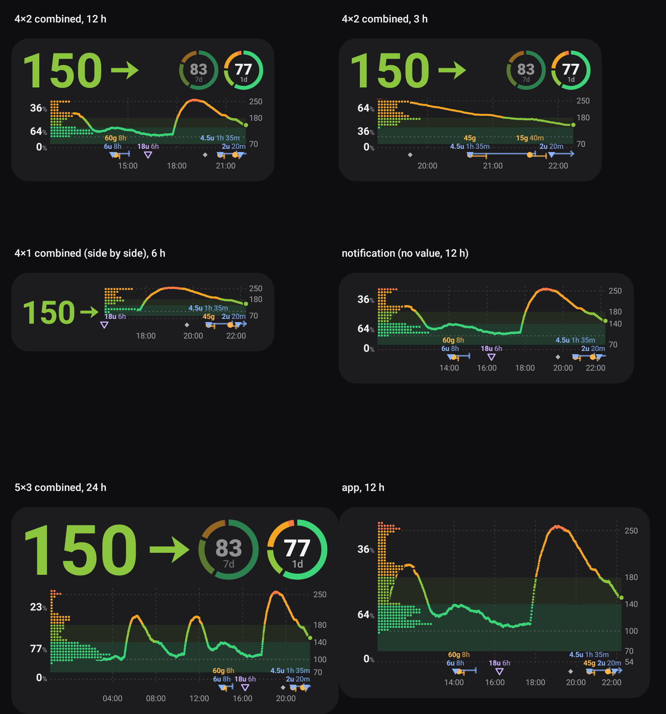

*Marks: amount + time since (`4.5u · 45g 1h 35m` for a meal; labels under the markers since the
[label layout](#treatment-labels-under-the-markers-2026-10-18)), and a line from each rapid / carbs mark to the end of its
mute (60 / 15 min by default): a tick when over, a chevron at the edge while it lasts. At 12 h a 60-minute line is
short (~25 dp on a 4×2 widget); at 3 h it reads at a glance.*

| | |
|---|---|
| 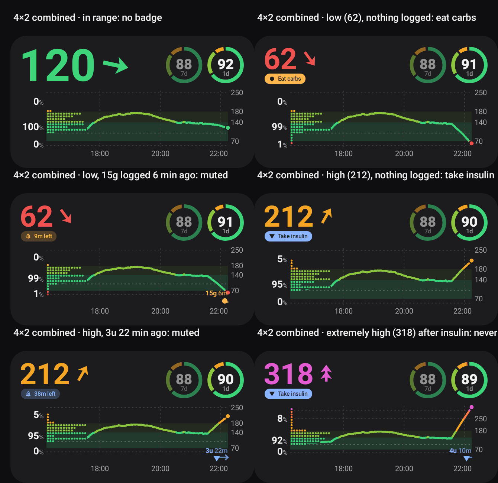 | 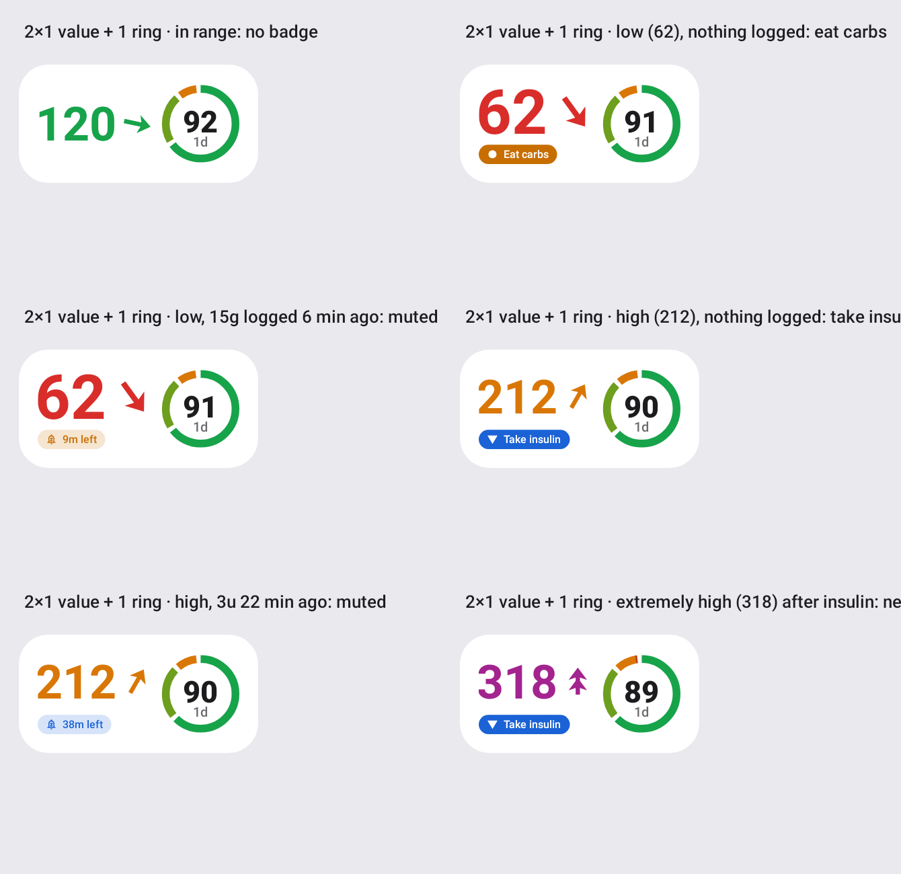 |
| Badge on a 4×2 widget: none in range; *Eat carbs* / *Take insulin* (filled); muted after a logged treatment (tonal, paused bell, time left); extremely high is never muted | 2×1 value widget, light |

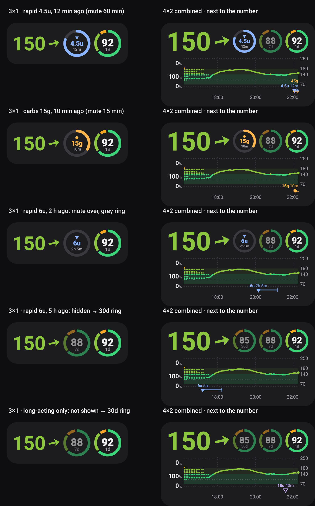

*The last-treatment slot: rapid 12 min ago (ring 80 % of the 60-min mute left), carbs 10 min ago, rapid 2 h ago
(grey: mute over), 5 h ago (hidden → the 30-day ring), long-acting only (never shown).*

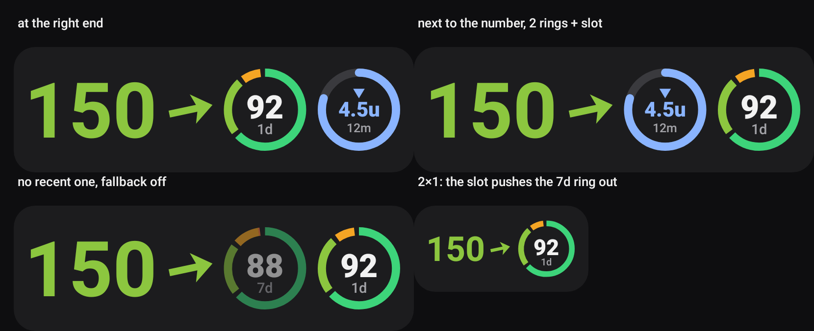

- **Badge**, not a Material badge (those are counts on icons) and not an assist chip (it isn't an action): a status
  pill with the chip shape. Needed is filled (highest emphasis: act now); Taken is tonal, the Material 3 way to lower
  emphasis with colour instead of size ([Material 3 in Compose](https://developer.android.com/develop/ui/compose/designsystems/material3):
  "Emphasis in M3 is provided using variations of color and its on-color combinations"). The bell is Material Symbols
  *notifications_paused*. Colours are the treatment kinds' (carbs amber, insulin blue), so the badge, the mark and the
  slot of the same treatment match.
- **Slot ring** = a determinate circular progress indicator ("displays exactly how much progress has been made",
  [progress indicators](https://developer.android.com/develop/ui/compose/components/progress)) counting down the mute.
- **How long the slot keeps a treatment:** rapid insulin 4 h (rapid analogues act for ~3–5 h: the slot answers "is
  insulin still working?" and guards against stacking a correction); carbs 3 h (a meal is mostly absorbed in 2–3 h).
- **Long-acting insulin is left out.** It mutes nothing, and at one dose a day it would hold the slot all day,
  hiding every bolus and snack. A "basal taken today" check (a 24 h ring) is a different question; if wanted, it
  belongs in its own small indicator (e.g. a dot on the slot or a line in the notification), not in this slot.
- **A setting with a place, not a slot kind.** The user's rings stay as they are; the treatment is one more slot that
  comes and goes. Priority when room is short: main ring → recent treatment → second ring → fallback → third ring, so
  where two slots fit a fresh treatment pushes the second ring out, the fallback only fills spare room, and a widget
  with room for one keeps the main ring.

### Other places considered for the last-treatment info

| Place | Verdict |
|---|---|
| Its own slot (built) | the right default: same size and language as the rings, its own ring counts down |
| Replacing the main slot | hides the user's main ring exactly when glucose is moving; rejected |
| Under the value | taken by the badge, which already says "muted, 45m left" while a mute runs; the amount + time since would make it two lines |
| Notification | recommended next (owned by the notification work): the Taken badge's words ("Alerts paused · 45m left") fit the collapsed text; the expanded chart already has the marks and lines |
| Lock screen widget | gets the badge already (it draws the value through `GlucoseCard`); its slots are drawn by its own loop, so the slot needs `Slots.arrange` there (one call) |
| Mac menubar / widgets | ported in the same round (below) |

| Added | Discarded (why) |
|---|---|
| Lowercase units without a space everywhere (`4.5u`, `30g`) | `4.5 U`, `30 g`, `4.5U` (the user) |
| Time since each treatment on the marks, the home list and the follower list | — (the "no x min ago" rule stays for glucose only) |
| Mute lines from rapid / carbs marks | lines for long-acting and notes (they mute nothing) |
| Status badge under the value (None / Needed / Taken) | a badge for no data (out of scope this round); a clickable chip (it's a status) |
| Last-treatment slot with a fallback (default 30-day ring), placement setting | a new `SlotKind` (it would replace one of the user's rings); long-acting in the slot |
| Carbs focused in the treatment dialog when low | — |

### On the Mac (same round)

`SukraraGraph.swift` ports the marks (times, mute lines), `StatusBadge`, `Slots.arrange`, `LastSlot` and `LastPlace`
line by line; `AlertStatus` and `LastTreatment` sit in `spikes/widgets-macos/Shared/AlertRules.swift` with the
alert settings themselves, shared by the menubar app (its `AlertEngine` uses the same `level`, `mutedBy` and `muteS`)
and the widgets (the host writes its alert settings and the fallback ring's numbers into the widget snapshot).
`-alerts-selftest` runs the `CardStatusTest` cases. `render treatments <dir>` (Render CLI) draws the gallery's
`marks`, `badge`, `last` and `last-places` sheets with the same states, sizes and clock. (Here SF Pro being wider
than Roboto used to drop labels on the Mac that fit on Android; the label layout below decides on a width model
instead, so both platforms now place the same labels.)

## Treatment labels: under the markers (2026-10-18)

The user, after using the marks: "the treatment labels cover the chart data. I prefer they show under the icon, and
that they cover the axis labels, which are less important"; they need an outline "otherwise when they overlap the
content under them they can't be read well"; close treatments should be handled (the Mac showed two `5g 11h` on top of
each other at the left edge); for every graph, Android and Mac.

| | |
|---|---|
| 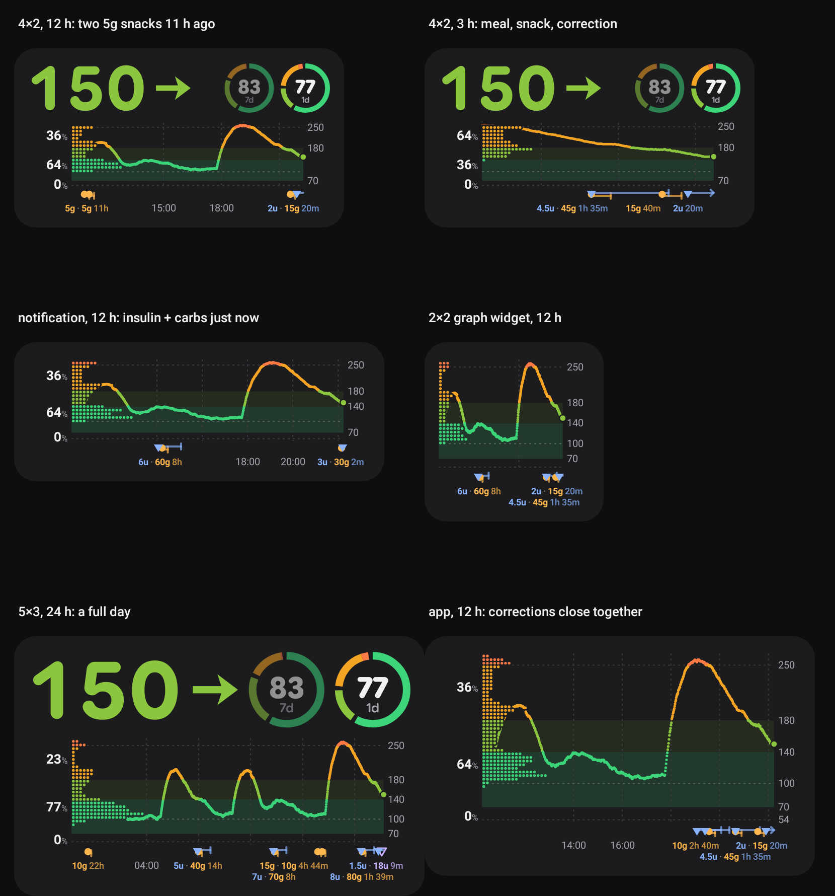 | 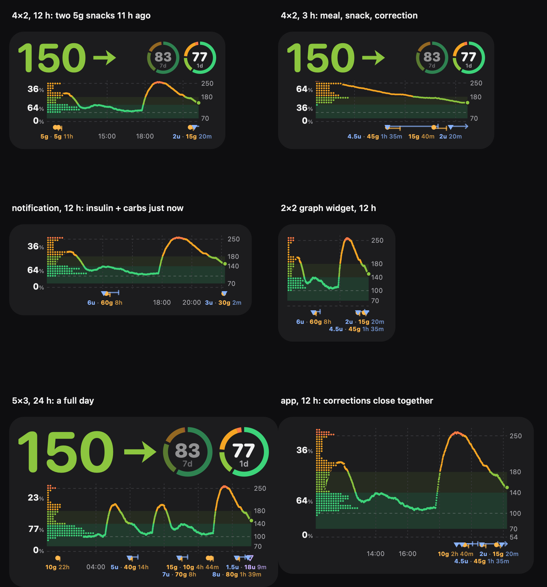 |
| Android (`GraphGallery.marksClose`) | Mac (`render treatments`, `mac-marks-close`): the same labels in the same places |

### Spec (Android `TreatmentMarks.layout` / `place`, Mac `TreatmentMarks.layout` / `place`)

Units are dp, times seconds; the chart's area is `minX`…`maxX`, the plot `left`…`right` inside it.

1. **Rows.** Row 1 is the time axis' row under the marker lane. Row 2 (11 dp, under row 1) exists only when the
   chart is at least 90 dp tall, and takes space (the plot shrinks by 11 dp) only when a label is put there. Nothing
   is ever placed over the plot.
2. **Groups.** Entries with an amount (rapid, long-acting, carbs; notes keep only their marker), oldest first. One
   joins the previous group when it is ≤ 180 s after the group's last entry (a meal: chained) or its marker is < 9 dp
   (a marker's width) from the group's *first* marker (not chained, so a run of snacks doesn't become one label).
3. **Text.** The group's amounts in kind order (insulin, long-acting, carbs; then time), joined by ` · `, then the
   time since its newest entry: `4.5u · 45g 1h 35m`. Its anchor is the middle of its first and last marker.
4. **Width.** `TextModel.width(text, 9 dp)`: a per-character table in em (digits 0.72, `.`/`·` 0.38, space 0.3,
   `m` 0.96, other lowercase 0.68, …), at or just above SF Pro Text Bold at 9 pt, the wider of the two fonts (Roboto's
   digits are 0.56 em). Decisions never measure the font; the drawing centres the real text in the modelled box.
5. **Order.** Groups newest first. Each takes the first of these that has a free place: row 1 with its time, row 2
   with its time, row 1 without it, row 2 without it. None: no label (its markers stay).
6. **Free place** (`place`). Preferred: centred on the anchor, kept inside `minX`…`maxX` (labels may run under the
   % column and the values on the right). The label may slide as long as the anchor stays ≥ 3 dp inside it (when that
   and the chart's edge can't both hold, only the preferred place counts; a label wider than the chart has none).
   Candidates in this order: preferred, the slide's two ends, then for each label already in the row (in placing
   order) just right of it and just left of it; a candidate is free when, with 2 dp on each side, it overlaps no
   label in the row (4 dp apart; overlaps under 0.01 dp ignored). The free candidate nearest the preferred place
   wins, the first one on a tie.
7. **Axis labels give way.** An hour label whose box ± 3 dp touches a row-1 treatment label is not drawn.
8. **Halo.** The whole chart is drawn in one layer (Android `saveLayer`, Mac `beginTransparencyLayer`, 6 dp wider
   than the area so a marker at the edge isn't clipped). Each label's outline, 3 dp wide with round joins, is erased
   from it (`DST_OUT` / `.destinationOut`) before the text is drawn. Unlike a stroke in the background colour this
   is right on every surface: the card, transparent Android widgets, the lock screen, the colorized notification,
   the Mac's material panel and tinted Mac widgets — so it is used everywhere, not only on the transparent ones.
9. **Side columns** (`plotX`): the values on the right (`180` at 10 dp + 5 dp) are sized by the model. The % column is
   the widest % label actually drawn (13 dp bold number + 8.5 dp `%`, measured with the drawing font) plus 3 dp on
   each side (`PCT_GAP_DP` / `pctGap`; 2026-10-21: sizing it by the model left 9–11 dp on its left on Android, whose
   digits are much narrower than the model's 0.72 em). So the plot's left edge differs by a few dp between Roboto and
   SF Pro; the label fixtures use the file's `pctLabel` (37 dp) for the column's label.

**Why not more rows or leader lines:** two rows already take 25 dp of a 4×2 widget's 93 dp chart; a third would
take the plot's room, and a leader line would cross the marker lane's mute lines.

### Fixtures (the layout dump)

`spikes/graph-fixtures/labels/labels.json`: 10 cases (two 5g snacks 11 h ago at the left edge, a meal with insulin
and carbs in the same minute, insulin + carbs 2 and 5 min ago at the right edge, a 2×2 graph widget without the %
column, a full 24 h day, a one-row 4×1 side-by-side chart, corrections close together with a note, a snack every
40 min, a label squeezed between the left edge and a newer one (drops its time), a lone bolus with no time in range
yet). Each expects the plot's edges, the number of rows, every label (entries, text, row, centre in dp from the
chart's left, ± 0.5) and the groups left without one. Android `GraphFixtureTest.labels` and the Mac's
`-graphselftest` read the same file: **10/10 on both**. The Mac also checks that SF Pro's real width of every fixture
label fits its modelled box (the font that could break it).

## Rounded numbers (2026-10-18)

The user: "On Mac I like the round font on the graph's big numbers, can't we have a similar one on Android?" The
Mac draws them in SF Pro Rounded (value bold; the ring and slot numbers heavy, their window labels semibold).

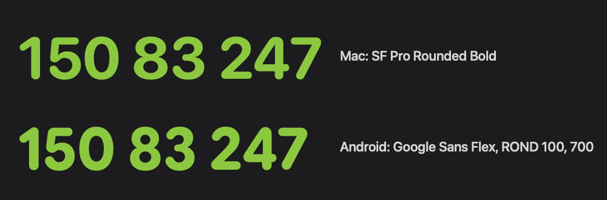

| Option | Verdict |
|---|---|
| **Google Sans Flex, roundness axis at 100** | chosen. Google's own variable face ([google/fonts `ofl/googlesansflex`](https://github.com/google/fonts/tree/main/ofl/googlesansflex), SIL OFL 1.1, no Reserved Font Name) has a `ROND` axis (0–100); at 100 its digits are the closest to SF Pro Rounded (same rounded terminals, similar proportions, a touch heavier) |
| Nunito, M PLUS Rounded 1c | rounded too, but rounder / softer digits than SF Pro Rounded; not needed once Google Sans Flex was available |
| a downloadable font (Google Play services) | widgets, the notification and the lock screen are drawn on a plain `Canvas` in the background; a bundled file is simpler and always there |

The 3.9 MB variable font is instanced with fontTools at `ROND` 100, `opsz` 18, `wdth` 100, `slnt` 0 and weights
600 / 700 / 800, each subset to Basic Latin, a few accented letters and `–`, `−`, `·`, `…` (~33 KB each, ~100 KB in
all), in `assets/fonts/` next to `OFL.txt`. Used for the same texts as on the Mac: the value (700, proportional figures like SF Pro Rounded)
in the widgets, the lock screen and the app panel's rolling digits (Compose `FontFamily(Typeface)`), the ring and
slot numbers (800) and their labels (600). The notification's value is a `TextView` in `RemoteViews`, which
can't use an app font (the system inflates it with a restricted context), so it is now drawn as a picture in the
same face (with the number as its content description). The last-treatment slot keeps the system face, as on the
Mac.

| Added | Discarded (why) |
|---|---|
| Treatment labels under the markers, in the time axis' row (hour labels give way) and a second row when needed | labels above the markers inside the plot (they covered the line); a stroke in the background colour (wrong on transparent / tinted surfaces) |
| Close entries share a label (meal ≤ 3 min, or markers < 9 dp apart), labels slide to keep their marker inside, newest first, time dropped before the label | chained pixel merging (a run of snacks became one label wider than the chart) |
| A width model shared by both platforms + label fixtures with a layout dump on both | measuring each platform's font (SF Pro dropped labels that fit with Roboto) |
| A halo on every label, cut out of the chart | — |
| Rounded numbers on Android (Google Sans Flex, ROND 100), notification value as a picture | Nunito / M PLUS Rounded (further from SF Pro Rounded) |

## Value and rings: the number shrinks, never the ring (2026-10-18)

The user, after the rounded numbers: "the main time-in-range ring is smaller than it should be … the number should
be the one shrinking", and "the letter spacing on the big glucose numbers is too much" (Android only). Both came from
the value's **tabular figures**: in Google Sans Flex every digit is 0.66 em wide with `tnum` (proportional: "1"
0.42, "8" 0.59), so "188" grew from ~121 dp (Roboto) to 143 dp at 72 sp. The app panel guessed the value at 188 dp
and laid the row out as value → spacer → 68 dp slots; Compose measures the row's children in order, so the last one,
the main ring, got what was left (56 dp on a 1080 px / 420 dpi phone).

- Android's value is in proportional figures again (app panel, widgets, lock screen, notification), as on the Mac.
- App panel (`ValueAndSlots`, `graph/ValueFit.kt`): the slots are fixed (`requiredSize` 68 dp) and the value is the
  row's only flexible child. The value is measured in the real face (the wider of the reading and "388", so it
  doesn't change size between 99 and 188), shrinks down to 75 % (54 sp) and only then the lowest-priority slot
  goes ([`Slots.arrange`](#rings)); the main ring always stays.
- Notification: the slot count comes from the measured value instead of a 110 dp guess.
- Widgets, lock screen and the Mac (menubar + widgets) already worked this way: their rings are sized from the
  card's height and the number fits the rest, so nothing changes there.

Guards: `ValueFitTest` (plain JVM, the bundled font's digit widths: "388" ↗ at 296 / 347 / 411 dp, font ×1 / 1.3 / 2)
and `ValueRowTest` (Robolectric: the panel's slots measure 68 dp at 347 and 296 dp with "188" / "388" ↗; the canvas
card's main ring is pixel-identical with "388" ↗ and "68" → at 2×1, 3×1 and 4×2; writes the `value-row` sheet).

| Added | Discarded (why) |
|---|---|
| proportional figures for the value on Android | tabular figures (wide gaps around "1", and the value outgrew the row) |
| a measured value width in the app panel and notification, value shrinks before a slot goes | the fixed 188 dp / 110 dp guesses (wrong as soon as the face changed) |

## One sensor-badge placement for every surface (2026-10-21)

The 0.11.33 move of the sensor's time left under the % column reached only the cards that draw value and chart in
one `GlucoseCard.draw` with a % column: the app panel (Compose value + its own `GlucoseGraph.draw`), the lock screen
(two `GlucoseCard.draw` calls with different styles), graph-only widgets and the notification kept the old place or
none. Now the placement is one decision, `GlucoseCard.sensorSpot`, over the whole card's style:

- a card with a labelled chart puts the badge at the start of the hour labels' row (left edge, under the % column and
  the distribution; with no % column the same corner), hour labels start after it, treatment labels keep its box free;
- a card without one (value widgets, time labels off) puts it beside the arrow, and the number shrinks to make room;
- surfaces that draw a card in boxes of their own pass the same whole-card `CardStyle` with `part` (`CardPart`);
- the place's setting (*Sensor time left*, per place and per Android widget) is part of the style.

Guards: `spikes/graph-fixtures/place` (both platforms decide the same; the box and the label room in the `TextModel`),
two label cases with the badge's room, and `tools/check` `graph-surface` (whole tree): only `GlucoseCard` draws the chart
and the badge, every surface `CardStyle` carries `sensorTime`, a file drawing a card in parts passes `part` each time,
the Compose badge only next to `GlucoseCard.sensorSpot`. The gallery's `surfaces` sheet (Android) and `render treatments`
`mac-surfaces` (Mac) draw every surface with the same data.

The last-treatment slot in the same round: carbs logged while rapid insulin's mute runs share the slot as an inner ring
(`8u` over `5g`), on slots ≥ 40 dp across; smaller ones keep the insulin alone.

| Added | Discarded (why) |
|---|---|
| One placement rule for every surface, the badge in the chart wherever a labelled chart is shown | a % column condition and a fallback beside the arrow when a treatment label sat there (the place depended on the data, and split surfaces couldn't know it) |
| Treatment labels keep the badge's box free | the badge giving way to a label (it would jump between places) |
| *Sensor time left* per place / per Android widget | one global switch (every other graph setting is per place) |
| Concentric insulin + carbs slot (two values inside) | both values in one ring segment (unreadable); the time since in the pair (no room; the single slot keeps it); the pair on slots under 40 dp (text under ~7 dp) |

## Open

- macOS per-widget settings would need an Xcode project (so the App Intents metadata is registered properly).
- The old in-app chart animations (new points growing in) are gone; the number still rolls and the arrow still turns.
- The doctor-report metrics (average glucose, GMI, CV, goals): [18](18-metrics.md).
