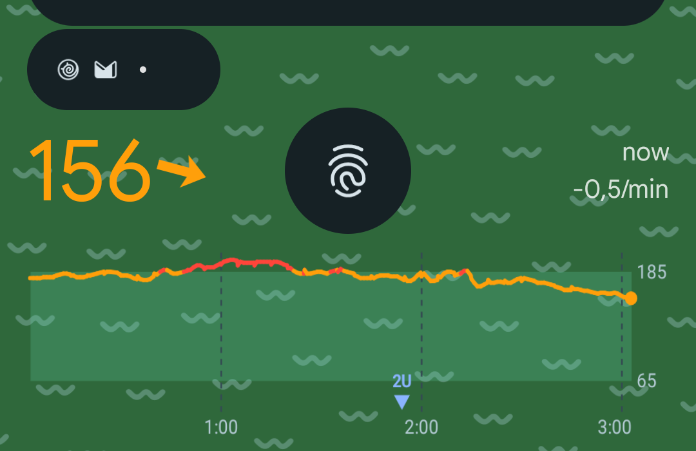
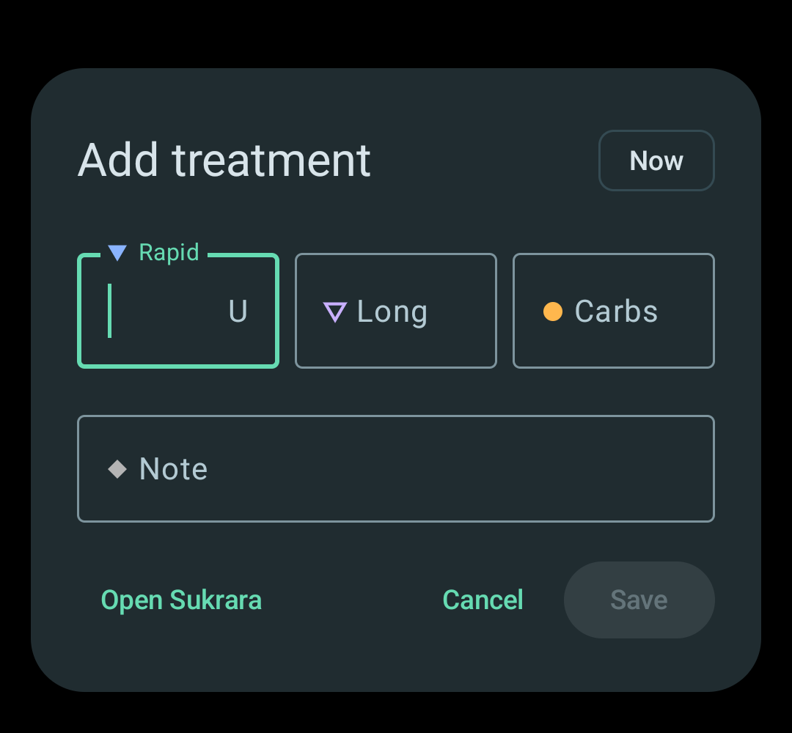
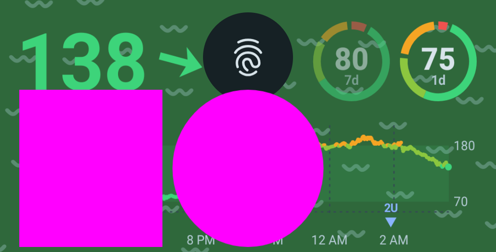
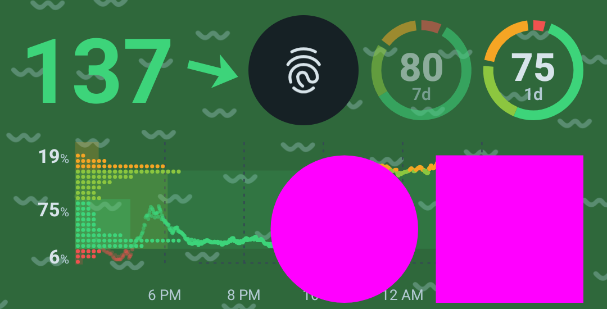
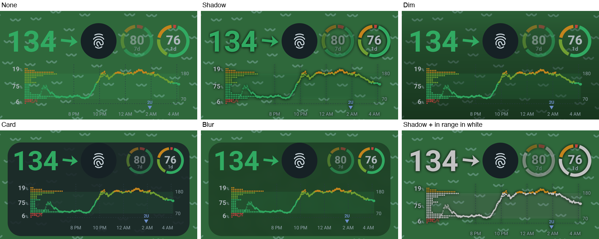

# 17 — Glucose and quick treatments on the lock screen

*2026-10-17 · investigation report · Pixel 10 Pro (Android 17, KernelSU Next + LSPosed/Vector, libxposed API 102)*

## Goal

The lower part of the Pixel's lock screen is empty: below the notifications, around the fingerprint icon, above the
flashlight/camera shortcuts. The user marked it in red. Put Sukrara's **glucose value and graph** there, and let a tap
**add a treatment without unlocking**. Root is available (Sukrara already ships an LSPosed module for SystemUI). For
phones without root, find the next best thing.

## Result

**It works with root.** SystemUI itself hosts a real Sukrara app widget in that space, laid out around the
fingerprint icon. A tap opens the treatment dialog **over the lock screen; the phone stays locked**. Shipped in
Sukrara as *Settings → Lock screen → Glucose on the lock screen* (on by default; does nothing without the module),
with five backgrounds for busy wallpapers ([Contrast](#contrast-on-busy-wallpapers)), light or dark
([Light and dark](#light-and-dark-2026-10-18)).

*Investigation 16's card, arranged around the fingerprint icon: the value and trend arrow on the left, the
time-in-range rings (7 d, 1 d) on the right, and the chart with the distribution and treatments below. It has no
background, so it floats on the wallpaper like the clock.*

| What | How it was checked | Result |
|---|---|---|
| SystemUI can host our widget | `AppWidgetHost` in SystemUI's process; `bindAppWidgetIdIfAllowed` (SystemUI holds `BIND_APPWIDGET`) | `bound id 22`, `view added (id 22)`; the same id is reused after every SystemUI restart |
| Placement from SystemUI's geometry | `AuthController.mUdfpsBounds` vs `dumpsys … AuthController` | `lock icon at Rect(441, 1666 - 639, 1864)` = `udfpsBounds=Rect(441, 1666 - 639, 1864)` |
| Follows the lock screen | screenshots: lock screen / shade pulled down / bouncer / AOD | shown / hidden / dimmed with the lock screen / hidden |
| Notifications don't cover it | `computeMaxKeyguardNotifications` args logged: `space=1131 shelfSpace=126` (stack top ≈ 538 → space ends at the icon's top 1666, the shelf may use 126 px more beside the icon) | before: the shelf covered the value; after (shelf must fit in `space`): 3 notifications + shelf, all above the widget |
| Live data | Glance widget in Sukrara's normal widget pipeline | updates with every reading while the screen is on; one catch-up render on screen on |
| Tap → treatment dialog over the lock screen | `input tap` on the value; `dumpsys activity activities` | dialog + keyboard shown; `KeyguardShowing=true … Occluded=true` (still locked); Cancel returns to the lock screen |
| Fingerprint still unlocks | the user, then `input tap` on/next to the sensor and a 700 ms press | first build: **a finger on the sensor opened the dialog** (see below); fixed build: sensor, its column and long presses never open it |
| Swipe up / long press still reach SystemUI | the widget sits *under* the Compose lock screen and only gets copies of taps | lock screen gestures unchanged |
| Accessibility | `uiautomator dump` | content description "Glucose 145 mg/dL, steady. Add treatment" |
| No distortion (the user saw oval rings) | a 100 dp magenta square and circle drawn by the widget (DebugReceiver `cmd locktest`), measured on a screenshot | before: square **311 × 343 px** (9 % taller); after: **262 × 262 px**, circle 262 × 262 (100 dp × 2.625 = 262.5) |
| Keeps updating | DebugReceiver style switches 100 s after the last redraw | before: no redraw (`LockscreenWidget ids=0`); after: every switch redraws within 3 s |
| Contrast options | each background + white on the user's green wallpaper | all five drawn as intended; the fingerprint icon, shortcuts and indication text stay on top |

## How it works (root)

Android 17's lock screen on Pixel is **one Compose tree** (SystemUI's "scene container", Flexiglass):
`SceneWindowRootView` → a few `ComposeView`s. There is no lock-screen layout to add a view to anymore, and the
lower region (`LockscreenLowerRegionElementProvider`: shortcuts, indication text) is a Compose element. So the module
works on the window root instead, in `hook/LockscreenWidgetHost.kt`:

1. **Host the widget in SystemUI.** `AppWidgetHost(context, 0x53554B)` in SystemUI's process, plus
   `AppWidgetManager.bindAppWidgetIdIfAllowed`. SystemUI holds `BIND_APPWIDGET` for its own glanceable hub, so no
   user prompt appears. The widget is a normal Glance widget in Sukrara (`widgets/LockscreenWidget.kt`, category
   `keyguard` only, so launchers don't offer it), and every reading updates it like the home-screen widgets.
2. **Put it under every lock screen layer.** The `AppWidgetHostView` is added as the *first* child of
   `SceneWindowRootView`. The lock icon, shortcuts and notifications draw *over* it, so it can span the whole free
   area while the fingerprint icon stays visible in its gap. (First it went just below
   `shared_notification_container`, under the scene container. That looked right while the widget was transparent,
   but a card or blur covered the fingerprint icon, and the dim darkened the shortcuts: on this Pixel those are in
   the lower Compose layers.)
3. **Lay it out around the lock icon.** Top = top of the fingerprint icon (`AuthController.mUdfpsBounds`; without an
   under-display sensor, SystemUI's `lock_icon_margin_bottom`). Bottom = top of the shortcuts
   (`keyguard_affordance_vertical_offset + keyguard_affordance_fixed_height`) − 8 dp. Sides = 16 dp, like the
   notifications. The icon's position is sent to the widget as **extra widget options**
   (`sukrara.lockHoleLeft/Right/Bottom`, through `AppWidgetHostView.updateAppWidgetSize(extras, sizes)`). The widget
   draws one bitmap with investigation 16's pieces: `GlucoseCard` (value only) left of the icon, `TirRing`s right of
   it, `GlucoseCard` (chart only) below, in the dark palette with a transparent background.
4. **Follow the scene.** On every frame the window draws (`OnPreDrawListener`, so no cost while nothing moves) the
   module reads the scene interactor's transition state (`LegacySceneInteractorImpl.getTransitionState()`: `Idle` on
   `Scenes.Lockscreen` with no overlay = 1, a `Transition` from/to it = 1 − progress / progress) and sets the
   widget's alpha. The widget is hidden while the screen is off (AOD) and when the app turns the switch off.
5. **Make room.** SystemUI sizes the lock screen stack in
   `NotificationStackSizeCalculator.computeMaxKeyguardNotifications(stack, spaceForNotifications, spaceForShelf,
   shelfHeight)`. The notifications' space ends at the lock icon's top, but the shelf (the pill with the overflow
   icons) may hang *below* it, beside the icon, which is where our value is. While the widget is on, the hook passes
   `spaceForNotifications − spaceForShelf`, so the shelf fits above the icon too. At worst, one more notification
   goes into the shelf.
6. **Touches.** The lock screen keeps every gesture (swipe up to unlock, pull down the shade, long press to
   customise). The hook on `SceneWindowRootView.dispatchTouchEvent` gives the widget a *copy* of a touch that starts
   on it. That copy is cancelled when the finger moves beyond the touch slop or stays down longer than the long-press
   timeout. Touches in the fingerprint icon's column (± 24 dp) never reach the widget.

### The fingerprint bug (fixed before the user's second test)

The first build opened the treatment dialog when the user put a finger on the sensor. The filter in step 6 was
there, but the window *also* delivered touches to the widget the normal way: `SceneWindowRootView` is a
`FrameLayout`, and when the Compose layer on top doesn't consume a touch (empty space, the sensor), the event falls
through to the next child, which is our view. The fix is a `GuardedView` (an `AppWidgetHostView` subclass created by
`AppWidgetHost.onCreateView`) that refuses all regular dispatch and only accepts the filtered copies. The fix also
excludes the full column above and below the sensor, not just the icon's circle, and rejects long presses (a finger
resting on the sensor).

### Two more bugs, found by measuring

**Stretched (oval rings).** The user felt the rings were ovals. A test pattern confirmed it: a 100 dp square came out
311 × 343 px. `AppWidgetHostView.updateAppWidgetSize(extras, sizes)` reports each size *minus* the default widget
padding (8 dp per side here). The module had removed that padding from the view so the widget could draw edge to
edge, so Glance drew a bitmap 42 px smaller in each direction than the view and `FillBounds` stretched it. The module
now adds `getDefaultPaddingForWidget` back to the size it reports: 262 × 262 px, exact.

 

**Stale after a while.** `AppWidgetManager.getAppWidgetIds(provider)`, which Glance's `updateAll` uses, does not list
a widget bound by SystemUI's host (`dumpsys appwidget` shows it bound to our provider all the same). So the lock
screen widget only redrew while a Glance session happened to be alive; the many test installs had hidden this. Sukrara
now remembers the id itself (from the module, which announces it on every SystemUI start, and from the widget
callbacks) and updates it directly with `GlanceAppWidgetManager.getGlanceIdBy(id)`.

### The dialog over the lock screen

`QuickTreatmentActivity` declares `android:showWhenLocked="true"` **in the manifest**. SystemUI checks the manifest
(`ActivityIntentHelper`) to decide whether a PendingIntent can open without unlocking, so `setShowWhenLocked()` at
runtime isn't enough. Google's lock screen widgets FAQ says the same: "users must authenticate to launch the activity"
unless the activity declares `showWhenLocked`
([android-developers.googleblog.com, 2025-03](https://android-developers.googleblog.com/2025/03/widgets-on-lock-screen-faq.html)).
"Open Sukrara" in the dialog asks to unlock first (`KeyguardManager.requestDismissKeyguard`).

Trade-off, on purpose: anyone holding the locked phone can add an entry, and with LibreView on it is uploaded. The
dialog shows nothing beyond what the lock screen already shows. The switch turns the widget off.

## Contrast on busy wallpapers

On the user's green wallpaper the in-range green almost disappeared. Material's answer for text over imagery is
**text protection**: a scrim, either a gradient (dark end around 60 %, its middle 3/10 towards the dark end, fading
to 0) or a flat dark scrim of 20–40 %, applied where the text is
([Material: imagery](https://m1.material.io/style/imagery.html)). WCAG asks 4.5:1 against the lightest pixel behind
every glyph ([Smashing Magazine](https://www.smashingmagazine.com/2023/08/designing-accessible-text-over-images-part1/)).
*Settings → Lock screen → Background* offers:

| Option | What | Drawn by |
|---|---|---|
| None | on the wallpaper, like the clock | — |
| Shadow | a soft dark shadow around every number, ring and line: the content's alpha, blurred (`extractAlpha` + `BlurMaskFilter`) | the widget |
| Dim | Material's gradient scrim over the bottom of the screen, full width | the module (a view under the widget) |
| Card | a dark rounded card like the notifications (surface container, 88 %) | the module (view background) |
| **Frosted glass** (default, the user's pick; was "Blur") | SystemUI's own `BackgroundBlurDrawable` (`ViewRootImpl.createBackgroundBlurDrawable`, what the shade uses) blurs the wallpaper behind the widget *and tints it* (black 35 % dark, the home widgets' background 60 % light), hence the new name; falls back to the card when cross-window blur is off | the module |

Card and frosted glass keep the content 12 dp off their edge. (*In range in white* was dropped in the light/dark
round below.)

## Light and dark (2026-10-18)

The user: the black tint is fine in dark mode but looks bad on the light lock screen (light notification cards,
light wallpaper). The widget now has an **Appearance**: *Automatic* (default, follows the system's dark theme, like
the lock screen's notifications), *Light* or *Dark*. Light copies the home-screen widgets: their background colour
(Glance's `widgetBackground`, which is Material You's `system_accent2_50`, near white with the wallpaper's tint) and
their light palette. Every background follows it: frosted tint black 35 % / accent2_50 60 %, card dark surface /
accent2_50 at 88 %, dim black / white gradient, shadow dark / white glow. Android's widget guidance: "if your widget
doesn't adapt to dark theme, it will appear out of place", use the colour tokens for dynamic colour
([widget style](https://developer.android.com/design/ui/mobile/guides/widgets/style)), and the widget quality tiers
ask for light and dark palettes (WC-2, [widget quality](https://developer.android.com/docs/quality-guidelines/widget-quality)).

When the dark theme flips (the user's phone runs `night mode: auto`), the module re-tints at once (its host view's
`onConfigurationChanged`) and Sukrara redraws the widget from a night-mode `ComponentCallbacks`, without waiting for
the next reading. The "Blur" background was renamed **Frosted glass** (`frosted`): it is blurred *and* tinted, not
just a blur. No backwards compatibility: an old `blur` value falls back to the default, which is frosted glass.

The slots right of the lock icon now come from the same helper as the notification (`appSlots` → `Slots.arrange`),
so the last-treatment slot shows there too.

## Without root

| Option | Graph on the lock screen | Quick treatment without unlocking | Notes |
|---|---|---|---|
| **Lock screen widgets ("glanceable hub")** | yes, on a separate page (swipe in from the right edge) | **yes**, with `showWhenLocked` | Android 16 QPR2+ on phones; on Pixel it is tied to charging/docking ("hub mode"). This phone has the flag (`glanceable_hub_v2=true`) but the setting is off (`glanceable_hub_enabled=0`). Sukrara's widgets already declare `keyguard`, so they are listed there. Not the empty area the user marked, and not always available. |
| **Glucose notification** (Sukrara's existing custom card with the graph) | yes, in the notification list | **yes**: a tap opens the dialog over the lock screen now that the activity declares `showWhenLocked` (SystemUI skips the unlock for such activities) | Always works. The card is a silent ongoing notification, so whether it shows on the lock screen depends on the user's "silent notifications on lock screen" setting |
| **Quick Settings tile "Add treatment"** (added to Sukrara) | value as the tile subtitle | **no**: on a secure lock screen SystemUI asks for the fingerprint before any third-party tile's `onClick` | Measured on the phone (the alternate bouncer came up). Still the fastest way in once unlocked |
| **Lock screen wallpaper** (what GlucoDataHandler's "lock screen" option does) | yes, as an image | no (not interactive) | GDH was enabled on the user's phone during the test (`lockscreen_enabled=true`, `lockscreen_y_pos=85`): it rewrites the lock wallpaper (`WallpaperManager`, `FLAG_LOCK`) on each update. Static image, a disk write per update, and it replaces the user's wallpaper |
| Lock screen shortcut (the corner buttons) | — | — | Only system-defined actions (flashlight, camera, QR, wallet, DND, note-taking…); an app can't add its own. "Note-taking" opens the holder of the *Notes* role, which Sukrara would have to take from the user's notes app. Not pursued |

## In Sukrara

| Added | Where |
|---|---|
| Lock screen widget hosted by the LSPosed module, around the fingerprint icon | `hook/LockscreenWidgetHost.kt`, hooks in `hook/SystemUiHook.kt` (`hookLockscreenWidget`) |
| Keyguard-only Glance widget with the lock icon gap (investigation 16's value, rings and chart) | `widgets/LockscreenWidget.kt`, `res/xml/widget_lockscreen.xml` |
| Notification shelf kept above the lock icon while the widget is on | `hook/SystemUiHook.kt` (`computeMaxKeyguardNotifications`) |
| Switch *Settings → Lock screen → Glucose on the lock screen* (`lockWidget`, default on; DebugReceiver `--ez lockWidget`) | `features/Features.kt`, `ui/WearerScreens.kt`, sent to SystemUI with the status-bar broadcast (`status/RootStatusBar.kt`) |
| Treatment dialog over the lock screen (manifest `showWhenLocked`; "Open Sukrara" asks to unlock) | `AndroidManifest.xml`, `ui/QuickTreatmentActivity.kt` |
| Quick Settings tile "Add treatment" with the current value | `ui/TreatmentTile.kt` |
| *Background* (none, shadow, dim, card, frosted glass; `lockBg`, default `frosted`) and *Appearance* (automatic, light, dark; `lockLook`, default `auto`) | `features/Features.kt` (`LockBackground`), `ui/WearerScreens.kt`, `widgets/LockscreenWidget.kt`, `hook/LockscreenWidgetHost.kt` |
| Exact widget size (default padding added back) and direct updates of the SystemUI-hosted widget id | `hook/LockscreenWidgetHost.kt`, `LockscreenWidget.ids/updateAll`, `RootStatusBar.HelloReceiver` |
| DebugReceiver `cmd locktest` (square + circle to measure distortion), `--es lockBg`, `--es lockLook` | `features/DebugReceiver.kt` |
| 0.11.52: the lock-screen countdown: over the keyguard the dialog closes unsaved after *Time to save* (`lockTreatmentTime`, 10–120 s, default 20 s; Android's *Time to take action* and ≥ 60 s with TalkBack win), counted from the first frame; a ring with the seconds left on *Cancel* (and on the *When?* / *Already logged by your pen?* Cancel), pulse + one haptic tick at 5 s with input, *Treatment not saved* toast with input, screen off closes; *Unlock* in *Open Sukrara*'s place pauses it for the bouncer and keeps every input on success (≥ 5 s left after a cancel); touches never add time | `treatments/LockCountdown.kt` (`LockCountdownTest`), `ui/LockCountdownUi.kt`, `ui/QuickTreatmentActivity.kt`, `ui/TreatmentDialog.kt`, Settings → Lock screen group *Add treatment on the lock screen* (enabled without the module) |
| DebugReceiver `cmd quickDialog` (opens the quick dialog; needs a background-activity-start exemption, so on the emulator the glucose notification on the lock screen is the way in) and `--ei lockTreatmentTime` | `features/DebugReceiver.kt` |

| Discarded | Why |
|---|---|
| Drawing our own view in SystemUI (like the status-bar hook) | Hosting the real widget reuses the widget pipeline, Glance layout and tap handling, and stays in sync with the home-screen widgets |
| Putting the widget *above* the Compose lock screen | It would cover the fingerprint icon and take swipe gestures |
| Delivering touches through the normal view tree | Taps on the fingerprint sensor reached the widget (the bug above) |
| Moving the widget down when the notification shelf hangs beside the lock icon | No room below (shortcuts); making the shelf fit above the icon is cleaner (step 5) |
| Lock screen wallpaper, Notes-role shortcut | Not interactive / takes over the user's wallpaper or notes app (table above) |
| *In range in white* (`lockWhite`, 2026-10-18) | a dark-only contrast trick (white is invisible on the light look); the appearance option and the frosted tint replace it |
| Glance `updateAll` for the lock screen widget | it never reaches a SystemUI-hosted id (see above) |
| An *Off* for the countdown, and touches that add time | pocket logs would come back; in a pocket touches type too and could keep the dialog open until Save; *Unlock* is the way to take longer |
| No digits in the countdown ring (the spec: a ticking number may stress someone who is low) | the user asked to see the seconds count (2026-10-25); the digits are hidden from TalkBack, which hears 5 s steps |
| Starting the countdown in `onResume` | a slow first frame (18 s on a loaded emulator) ate the time; it counts from the first frame |
| Closing on the `ACTION_SCREEN_OFF` broadcast alone | a late broadcast after the screen came back on closed a fresh dialog; `onStop` with `!isInteractive` closes it, the broadcast is ignored while the screen is on |

## Code

- `poc/spikes/showcase-android/app/src/main/kotlin/app/mauri/sukrara/hook/LockscreenWidgetHost.kt` — host, placement,
  scene alpha, filtered touches.
- `…/hook/SystemUiHook.kt` — captures `LegacySceneInteractorImpl` and `AuthController` when Dagger creates them,
  hooks `WindowRootView.onAttachedToWindow`, `SceneWindowRootView.dispatchTouchEvent` and
  `NotificationStackSizeCalculator.computeMaxKeyguardNotifications`.
- `…/widgets/LockscreenWidget.kt` — the drawing (the appearance's palette, `LocalAppWidgetOptions` for the gap).

Safety: as with investigation 05, every hook body is wrapped, the kill switch `sukrara_hook_disabled` disables this
too, and SystemUI was only restarted by killing it (`hook-safety.sh arm` during the session).

## Open

- Followers: the widget shows whatever the phone's role feeds the widgets (wearer or followed person), but the switch
  is only in the wearer's settings (followers keep the default, on).
- Other OEM lock screens (Samsung One UI etc.) have different SystemUI classes: the hooks log and do nothing there.
