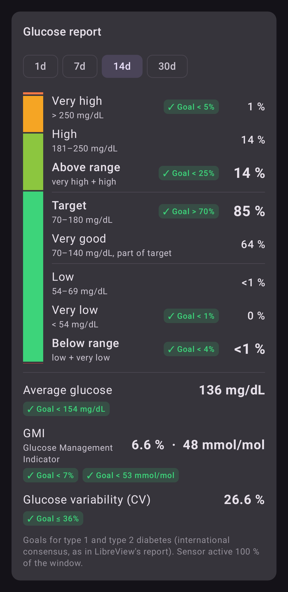
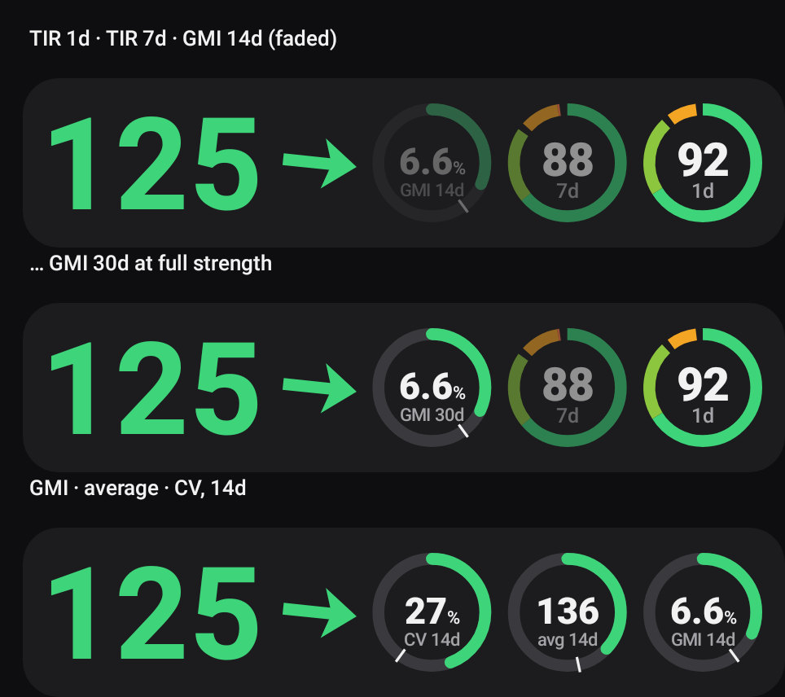
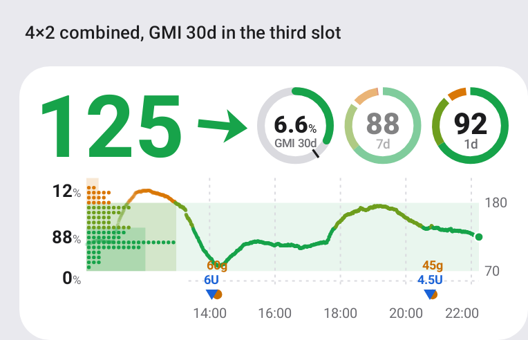

# 18 — The doctor's report in the app: time in ranges, average, GMI, variability

*2026-10-17 · investigation report · JVM renders of the real code (Robolectric native graphics), Sukrara for Mac
renders, unit tests*

## Goal

LibreView's report for the doctor (the AGP page) sums up a period in a few numbers with goals next to them. The
user wants the same numbers in Sukrara, in the app and in the widgets: for example **GMI in the third slot** of a
widget, where a 30-day time-in-range ring would otherwise go, faded or at full strength.

LibreView's page has two panels: **Time in Ranges** (a stacked bar from very low to very high with the share and
goal of each range, very high + high and low + very low summed against their goals) and **Glucose Metrics** (average
glucose, GMI in % and mmol/mol, glucose variability as % CV, each with its goal). The user's own page isn't
reproduced here (it's their health data).

## Result

| | |
|---|---|
|  |  |

*The **Glucose report** card on the home screen (wearer and follower), 14 days by default (1, 7, 14, 30). Synthetic
data.*

*The slots beside the number: a time-in-range ring or a report number (GMI, average glucose, CV) over its own window,
faded by position or at full strength. Last row: GMI, average and CV for 14 days.*

*A 4×2 widget with GMI for 30 days in the third slot, at full strength.*

| What | How it was checked | Result |
|---|---|---|
| GMI and its units | `GlucoseStatsTest.gmi`: a steady 141 mg/dL (the report's average) | GMI 6.68 % → **6.7 %**, 49.5 → **49 mmol/mol**, as on the report |
| Mean, SD, CV are time-weighted | `GlucoseStatsTest.cvTimeWeighted`: one hour at 100 in 1-minute readings, one at 200 in 5-minute history | mean 150, SD 50, CV 33 % (counting readings would give mean 117) |
| Goals | the consensus targets (below) applied to each number | met = green with ✓, not met = orange |
| Mac | see [Mac](#mac) | |

## The numbers

| Number | How | Goal (type 1 and type 2 diabetes) |
|---|---|---|
| Time in ranges | the six bands of [16](16-graph.md), every reading weighted by the time it stands for | very high < 5 %, above range (high + very high) < 25 %, target > 70 %, below range < 4 %, very low < 1 % |
| Average glucose | time-weighted mean | < 154 mg/dL |
| GMI | 3.31 + 0.02392 × average (Bergenstal et al. 2018); in mmol/mol: (GMI − 2.152) × 10.929 | < 7 % / < 53 mmol/mol |
| Glucose variability | coefficient of variation: SD / average, time-weighted | ≤ 36 % |

The goals are the international consensus (Battelino et al., *Diabetes Care* 2019) that LibreView prints as
"Goals for type 1 and type 2 diabetes". The consensus asks for 14 days with the sensor active ≥ 70 % of the time; the
card says so when a window has less.

Time-weighting matters here as in 16: the wearer's history mixes 1-minute live readings and 5/15-minute backfill, and
counting readings would let the live minutes outweigh the backfilled hours.

## Slots

The rings of [16](16-graph.md) become **slots**. Each of the three has:

- a **kind**: time-in-range ring, GMI, average glucose or CV;
- a **window**: 12 h, 1, 3, 7, 14 or **30 days** (new);
- **fainter than the main one**: on by default for the second and third; off draws it at full strength.

A report number is drawn as a gauge in the same circle: the value in the middle ("6.6 %", "136", "27 %"), the kind and
window under it, and an arc on the number's scale (GMI 5–10 %, average 70–250 mg/dL, CV 0–60 %) with a tick at the
goal, green when it's met. Defaults: 1-day ring, 7-day ring, 14-day GMI as the third (shown when the slot count is 3).
Settings → Graph & time in range → *Beside the number*. The wearer now keeps **31 days** of readings (was 15).

## Mac

*(filled in from the Mac port)*

## Code

| File | What |
|---|---|
| `graph/GlucoseMetrics.kt` | mean, SD, CV, GMI, the goals |
| `graph/GlucoseCard.kt` | `SlotKind`, `RingSpec.kind/faded`, `MetricGauge` |
| `graph/GraphSettings.kt`, `graph/GraphData.kt` | slots setting, cached metrics per window from the role's store |
| `ui/ReportCard.kt` | the report card (`GlucoseReportContent` is pure, so the gallery renders it) |
| `app/src/test/…/graph/ReportGallery.kt`, `GraphGallery.slots` | the pictures above |

## In Sukrara (0.11.7)

| Added | Discarded (why) |
|---|---|
| Glucose report card on both home screens (time in ranges with goals, average, GMI % and mmol/mol, CV, coverage note) | the report's AGP percentile curve and daily profiles (the chart and the time-at-level distribution already show the shape) |
| Slots: ring, GMI, average or CV, each with its window and fade | — |
| 30-day windows; 31 days kept on the wearer | — |
