# 19 — Notification templates: can the glucose card use the space under the icon?

*2026-10-18 · investigation report · standalone spike app `poc/spikes/notification-android` (NotifLab) on two emulators
(Android 16, API 36.0; Android 16 QPR, API 36.1) and on the user's Pixel 10 Pro (Android 17, API 37.1)*

## Goal

The user showed Google Maps' navigation notification on their Android 17 phone: title and text beside the app icon,
then a progress bar and an *Exit navigation* button that span the **whole card, under the icon**. Sukrara's glucose
card (custom `RemoteViews` in `DecoratedCustomViewStyle`) leaves that area empty, because Android 12+ keeps custom
content in the column right of the icon ([custom notification guide](https://developer.android.com/develop/ui/views/notifications/custom-notification):
"the system applies a standard template"). Question: which **standard** templates draw full-width content, what do
they keep of Sukrara's card (value, arrow, slots, graph, colours), and which of them can be a Live Update (the chip)?

## Method

NotifLab posts the same synthetic reading (138 mg/dL, rising, 24 h of 5-min history) as one notification per
variant, each in its own group and with the variant's name as the header's sub text:

| Variant | What it is |
|---|---|
| `baseline` | Sukrara's current chip-off card: colorized foreground service, custom collapsed + expanded layouts (copied), value, arrow, a time-in-range ring as the slot, the 12 h graph |
| `bands` | `ProgressStyle`: the sensor's span 40–400 mg/dL as one segment per range (very low … extremely high), the **tracker** (a disc of the range colour with the trend arrow) at the current value, the ring as large icon, a *Log treatment* action |
| `tir` | `ProgressStyle`: segments = today's time in each range (per mille), no tracker |
| `timeline` | `ProgressStyle` along time: one segment per run of readings in the same range over the last 3 h (`--ei hours`), treatments as points, tracker = now |
| `live` | `bands` + `setRequestPromotedOngoing(true)` + `setShortCriticalText("138")`, small icon = arrow (a Live Update) |
| `picture` | `BigPictureStyle` with the graph bitmap, ring as large icon |
| `*_c` | the same, colorized from a foreground service |
| `metric` | Android 17 `MetricStyle` (compiles; only renders on API 37) |

Each was captured expanded and collapsed, light and dark, with the shade, status bar and lock screen. Promotion
eligibility comes from `NotificationManager.canPostPromotedNotifications()` and
`Notification.hasPromotableCharacteristics()` (logged per post). The SDK has no Android 17 emulator image (`android sdk list`: newest is 36.1), so
`live`, `bands` and `picture` were then posted once each on the user's phone (Android 17), from a no-sound
DEFAULT-importance channel (`--ez visible true`; the phone hides silent notifications on the lock screen), and NotifLab
was uninstalled again. MetricStyle on Android 17: Sukrara's own Live Update
([n3-card-chipon](../poc/spikes/showcase-android/evidence/n3-card-chipon.png)). Docs read:
[Live Updates](https://developer.android.com/develop/ui/views/notifications/live-update),
[progress-centric notifications](https://developer.android.com/develop/ui/compose/notifications/progress-centric),
the [Live Update design guide](https://developer.android.com/design/ui/mobile/guides/home-screen/live-updates),
[Android 17 features](https://developer.android.com/about/versions/17/features) (semantic colours).

## Results

### Android 17 (the user's phone)

| | | |
|---|---|---|
| 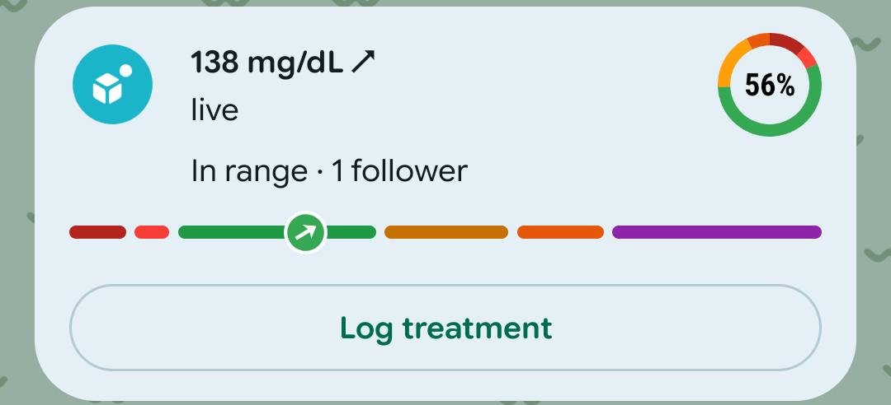 | 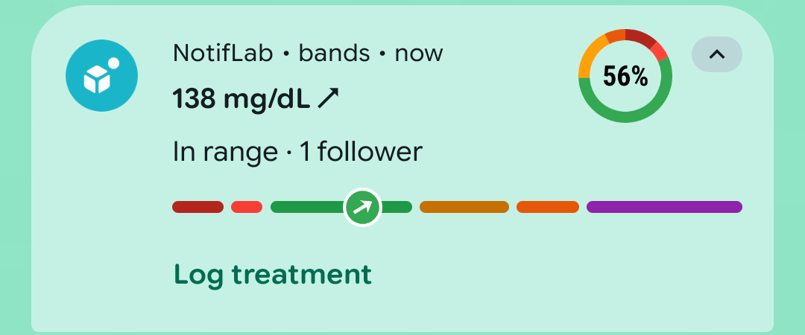 | 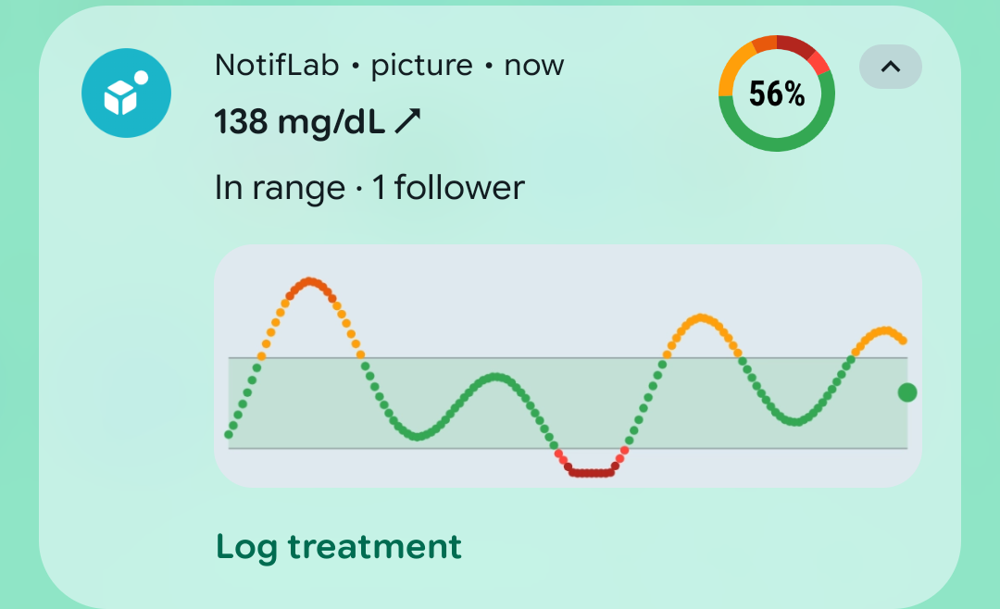 |
| `live` (promoted, on the lock screen) | `bands` (not promoted, shade) | `picture` (BigPictureStyle, shade) |

**Only the promoted card uses the space under the icon.** In the Live Update (`live`), the range bar and the
*Log treatment* button span the card from its left edge, under the icon, exactly like Maps. The title, text and large
icon stay beside the icon. The same ProgressStyle **without promotion** (`bands`) keeps the bar in the text column
and the action as a plain text button. BigPictureStyle (`picture`) keeps the graph in the text column. Segment
colours and the tracker bitmap are drawn as sent, in both cards. In the promoted card the header line (app name ·
sub text · time) is gone: the sub text becomes a line under the title.

### Android 16 (emulators)

| | |
|---|---|
| 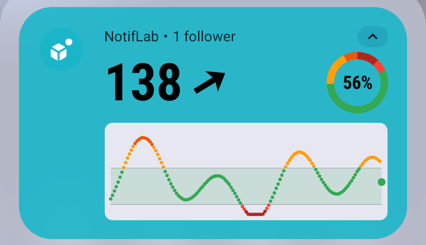 | 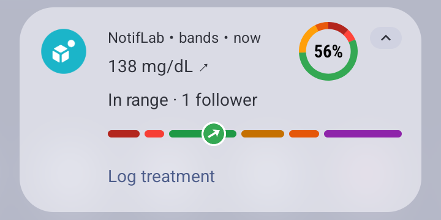 |
| `baseline` (Sukrara today, API 36.1) | `bands`: ProgressStyle, range segments, tracker at the value |
| 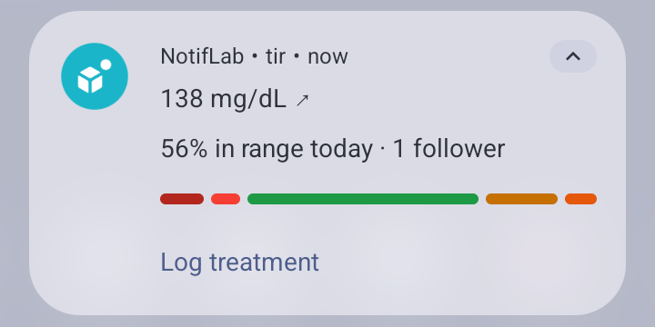 | 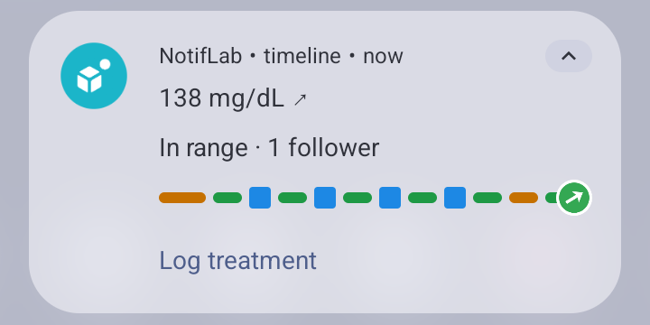 |
| `tir`: time in ranges as segments | `timeline`: last 3 h; 6 points were sent, 4 drawn |
| 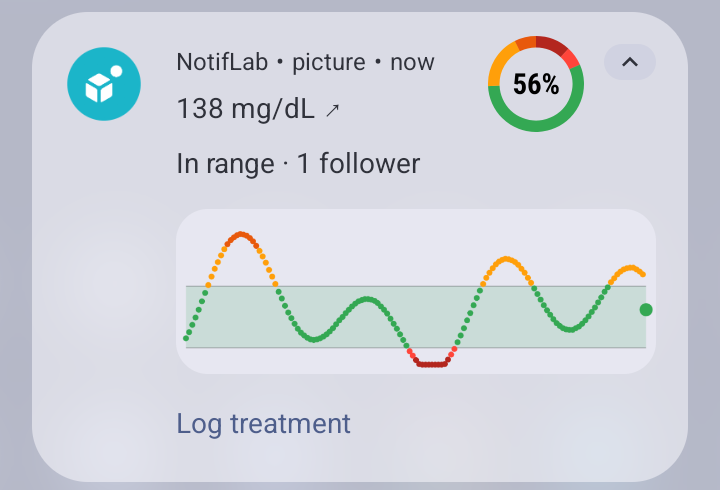 | 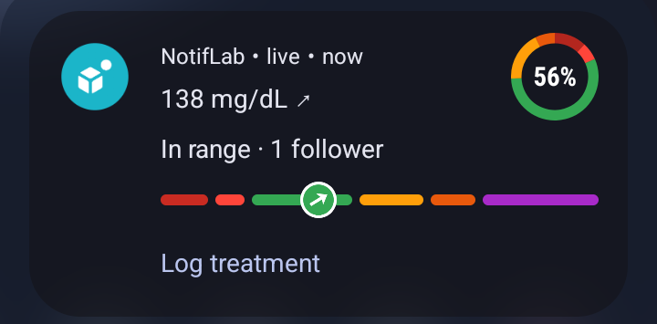 |
| `picture`: BigPictureStyle with the graph | `live` (promoted) in dark mode |
| 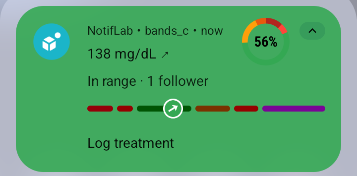 | 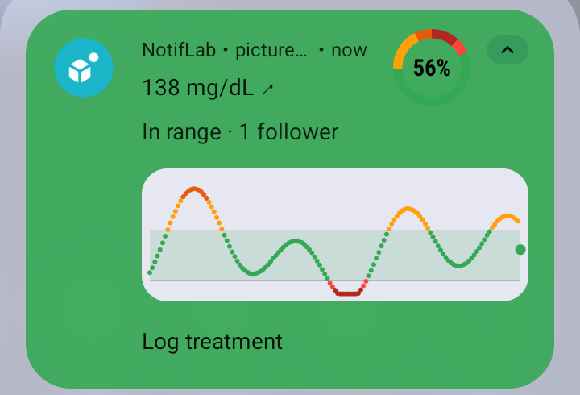 |
| `bands_c`: colorized, segment colours darkened | `picture_c`: colorized |
| 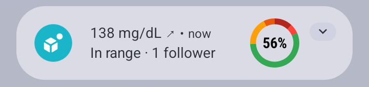 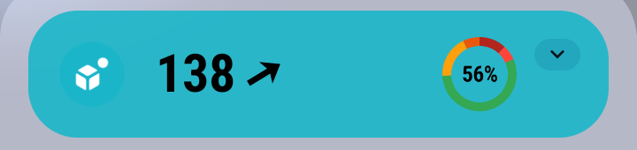 |  |
| collapsed: ProgressStyle (no bar) / baseline | the `live` variant's chip |

**Full width.** On Android 16 and 16 QPR **no template uses the space under the icon**, promoted or not: the
ProgressStyle bar, the big picture, the action row and the custom layout all start at the text column (API 36.0:
[same bar](img/19/api36-progress-bands.png)). The full-width bar and button are Android 17's **promoted** layout
(above; also the design guide's Rideshare / Delivery / Navigation figures). On Android 17, Sukrara's MetricStyle Live
Update keeps its metrics in the text column.

**ProgressStyle.**
- Segment colours are honoured on a normal card, light and dark. On a **colorized** card the system darkens them for
  contrast (green → dark green, orange → brown), so the range colours are no longer exact.
- The tracker icon is drawn as given (our coloured disc + arrow), centred on the progress position.
- **Limits** (logcat): *"Progress segments limit (10) is reached. All segments will be merged into one segment"*:
  24 h of runs (30 segments) became one plain bar. *"Progress points limit is reached. First 4 points will be
  rendered."* So a 3 h band timeline fits (4 runs here), a 12–24 h one usually doesn't; treatments: at most 4.
- **Collapsed**, the bar is not drawn (title, text, large icon). A promoted card is expanded by default and can't be
  collapsed, so as a Live Update the bar is always visible.
- The large icon (our ring) stays at the top end; ProgressStyle keeps it, MetricStyle hides it.

**Promotion (Live Update, API 36.1).** `live` was promotable (`canPostPromoted=true promotable=true`) and gave the
chip "↗ 138" (arrow small icon + short critical text), sorted first in the shade. Every other variant was
`promotable=false`: custom views and colorized are forbidden, BigPictureStyle isn't an allowed style (allowed:
standard, BigText, Call, Progress, Metric). API 36.0 has no promotion (`canPostPromoted=false`, no app-op).
The design guide also says *"Don't use live updates if there is not a clear end time"*: a permanent glucose Live
Update stays outside the guidance (Sukrara already does this; the user can revoke it).

**BigPictureStyle.** The graph is shown at the text column's width (the same width as the baseline's graph), below
the title and text, not under the icon, on Android 16 and 17. Compared to the baseline it loses the big coloured value and arrow, can't be
promoted, and gains nothing in width.

**MetricStyle (Android 17).** Value + label pairs in the text column (the phone screenshot); no bar, no picture, no
large icon. Android 17 adds semantic colours (safe / caution / danger / info) to `Metric`,
`ProgressStyle.Segment` and `ProgressStyle.Point` (`setSemanticStyle`).

**Lock screen.** With silent notifications allowed on the lock screen, the 36.1 lock screen showed only the
notification icon shelf (the arrow), no card. On Android 17 the promoted card is shown in full on the lock screen
(above), with the full-width bar and button; a LOW-importance channel is hidden there when the user hides silent
notifications (the user's phone does).

**Update rate.** Not measured. Android drops posts above a per-package enqueue rate of a few per second; one reading
per minute is far below it. `setOnlyAlertOnce` keeps updates silent.

## Recommendation

The space under the icon is only reachable through **system-drawn** parts of a **promoted** ProgressStyle card on
Android 17: the bar and the action buttons. Custom views, BigPictureStyle and non-promoted ProgressStyle don't reach
it.

- **Chip on (Live Update):** ProgressStyle can replace MetricStyle: title `138 mg/dL ↗`, text = the slots as text,
  large icon = the first slot's ring, the range bar 40–400 with the tracker at the value (or a 3 h timeline when it
  fits in 10 segments), *Log treatment* as a full-width button. It loses MetricStyle's big value coloured by range
  (the colour moves to the tracker and the bar).
- **Chip off:** keep the custom card; nothing standard draws the graph wider. A ProgressStyle card without promotion
  shows no bar when collapsed and stays in the column on Android 16.
- **Not possible:** a graph and a ProgressStyle bar in one notification (custom views force the decorated custom
  template), or exact range colours on a colorized card.

## In Sukrara

Not integrated yet. Proposal: the Live Update (chip on) becomes ProgressStyle as above (verified on the phone: full
width bar and button, colours as sent); the chip-off card stays the custom layout with the graph.

## Run it

```sh
cd poc/spikes/notification-android
export JAVA_HOME=$(brew --prefix openjdk@17)/libexec/openjdk.jdk/Contents/Home
./gradlew :app:assembleDebug && adb install -r app/build/outputs/apk/debug/app-debug.apk
adb shell pm grant dev.spike.notiflab android.permission.POST_NOTIFICATIONS
adb shell am start -S -n dev.spike.notiflab/.MainActivity --es v live,bands,tir --ei sgv 138 --ef rate 0.7 --ez clear true
adb logcat -s NotifLab      # promotable / style / colorized per post, segment counts
```
