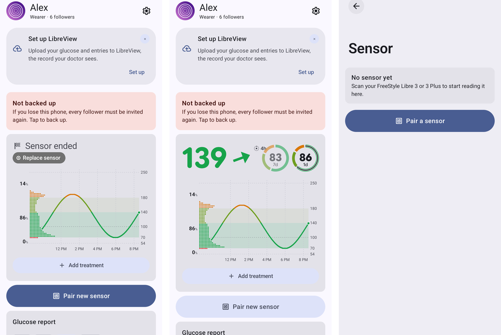
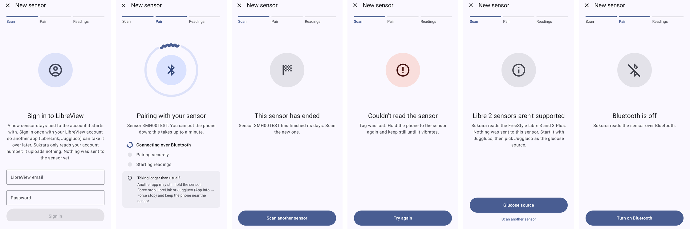
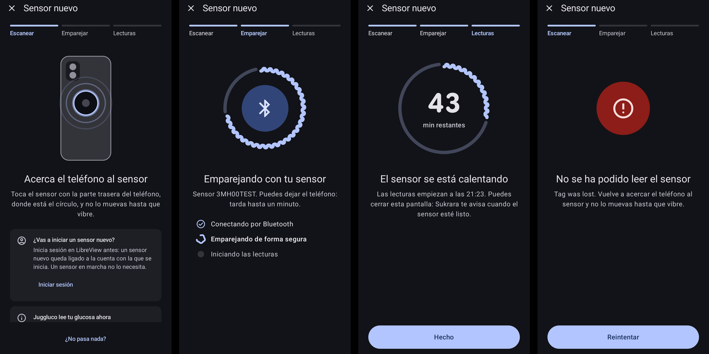

# 21 — Starting a new sensor: one guided flow from home to the first reading

*2026-10-18 · UX investigation, built straight into Sukrara (Android) · emulator screenshots with synthetic data*

## Goal

The user: *"Make a better UI and UX for starting a new sensor. The current settings page doesn't look like it is
waiting for it to be scanned with NFC. And from the app homepage there should be a clear button to pair the new one
that goes to the pairing page. Think well all the steps of the flow."*

## What was wrong (0.11.15)

| Problem | Where |
|---|---|
| The scan lived on a settings page (Settings → Glucose source → Sensor). A bold line, "Hold the top back of your phone against the sensor", sat between a status card and a long note. Nothing on it looked like it was waiting for a tap. | `ui/SensorScreen.kt` |
| Home had a *Scan your sensor* button only while the direct source said `no sensor`. When a sensor ended, the only way in was the *Replace sensor* pill on the card. Nothing showed during the sensor's last day. | `ui/OwnerScreens.kt` |
| After the tap, a small card said "Pairing over Bluetooth" and the screen showed nothing more. The Bluetooth pairing, warm-up and first reading could only be followed in the source's status words ("authorized, subscribing"). | `SensorScreen` |
| A new sensor without a known LibreView account first had to be tapped. Then a sign-in card appeared, and then the user had to tap again. | `SensorScreen` |
| Tapping a sensor with Sukrara closed opened the app (the `NfcLaunch` alias) and then dropped the tap. The user had to find the Sensor screen and tap again. | `MainActivity` |
| Turning NFC or Bluetooth on had no guidance. A Bluetooth that was off only showed up later, as a source error. | |

## Guidelines read

- **Abbott's own flow** (FreeStyle Libre 3 Getting Started guides, US and UK, and freestyle.abbott "How to set up"):
  *Start New Sensor* on the main menu. Then *"hold the back of your smartphone near the sensor"* on Android (the top
  on an iPhone). *"You'll receive a tone and vibration when you've successfully started it"*, then a **60-minute
  warm-up countdown**, and a notification when the sensor is ready. Sukrara uses the same words and order.
- **Material 3 progress indicators** (material-components-android `ProgressIndicator.md`): *determinate "when
  progress and wait time is known"*, *indeterminate "when progress and wait time is unknown"*. *"Show overall progress
  when a sequence of processes runs."* Set a content description. In Sukrara the warm-up uses a determinate indicator
  (60 min is known). Reading and pairing use indeterminate ones. A three-step bar shows the whole sequence.
- **Android NFC** (developer.android.com, NFC basics): *"devices scan NFC tags at a very short range"*, so the app must
  handle the tag it cares about without making the user pick an app. Android 16: *users can block an app from
  receiving tag intents*. The app checks `NfcAdapter.isTagIntentAllowed()` and links to
  `ACTION_CHANGE_TAG_INTENT_PREFERENCE`.
- **`NfcAntennaInfo` / `AvailableNfcAntenna`** (API 34): where this phone's NFC antenna is, in mm. Sukrara puts the
  sensor on that spot in its drawing. The per-antenna getters say the origin is the front's top left in portrait;
  `NfcAntennaInfo`'s class doc says bottom left. Sukrara follows the getters and mirrors x for the back view. This
  still needs checking against the Pixel's real values (see [Next](#next)).
- Sukrara's own rules: action buttons look like the existing ones; red only for errors (a failed scan); the sensor's
  states (ended, Libre 2, NFC or Bluetooth off) use neutral colours; Material Symbols only.

## The flow

```
Home ──"Pair new sensor"──┐   (filled: no sensor / ended · tonal: last 24 h)
Card pill "Replace sensor"┤
Notification actions ─────┤
Settings → Sensor ────────┼──▶ New sensor screen
Source → "Read directly" ─┤     1 Scan ─ waiting (reader mode, rings on the antenna spot)
Tapping a sensor ─────────┘       │  tips after 10 s · NFC off → Turn on NFC · BT off → Turn on Bluetooth
   (the tap that opened              │  no LibreView account → "Starting a new sensor? Sign in" (optional)
    Sukrara is read at once)         ▼
                                 reading (keep still) ──▶ ended / Libre 2 / not supported / failed → try again
                                     │                └─▶ sign in to LibreView (nothing sent) → tap again
                                     ▼  vibrates (CONFIRM)
                                 2 Pair ─ connecting → pairing securely → starting readings
                                     │   > 45 s: "another app may still hold the sensor: force-stop it"
                                     ▼
                                 3 Readings ─ new sensor: warm-up countdown (min left, ready at 21:08) → Done
                                             taken over: the first reading on screen → Done
```

Screenshots, emulator, synthetic data:

**Ways in.** Home with an ended sensor (filled button under the card, next to the card's *Replace sensor* pill).
Home in the sensor's last day (tonal button). Settings → Sensor, which now holds the sensor's details and its
options.



**The main path.** Waiting for the tap, reading, Bluetooth pairing, warm-up countdown, sensor ready with the first
reading.


**Detours.** LibreView sign-in, pairing that takes long, a sensor that has ended, a failed scan, a Libre 2,
Bluetooth off.



**Dark theme, Spanish.**



(On the emulator the waiting screen also shows the *Starting a new sensor?* card and the *Juggluco reads your glucose
now* card, because that emulator has no LibreView account and Juggluco is its source. On the user's phone, with the
direct source and a known account, only the drawing, the text and the scan note show.)

### Decisions

- **One full screen, not a settings page.** The task has a beginning and an end. It uses Material's full-screen task
  pattern: a close button, a step bar, one illustration, one title and one line of text, and the stage's action at
  the bottom where the thumb is. While it waits there is no button, because the tap itself is the action.
  *Nothing happens?* opens the tips, and they also open by themselves after 10 s.
- **Reader mode only while waiting.** It is off during the sign-in and after a successful tap, so a second tap can't
  restart a pairing that's already running. A failed or refused tap leaves it on, so the user only has to tap again.
- **The screen stays on** (`keepScreenOn`) until the warm-up or the first reading. A phone held against the arm
  shouldn't lock in the middle of the pairing.
- **Haptics.** `CONFIRM` when the sensor answers, `REJECT` when the scan fails. Android's own NFC sound still plays.
- **The pairing is shown from the source's status.** `NewSensorFlow.afterTap` maps the direct source's status words
  to the three Bluetooth steps, the warm-up or *ready*. A started sensor counts as ready only with a reading after the
  tap: the old sensor's last value must not finish the flow. A sensor that was taken over counts with a reading from
  the tap's minute. This is unit-tested in `NewSensorFlowTest`.
- **Home shows the button only when it's due.** Filled when it's what to do now (no sensor, ended, unsupported).
  Tonal in the last 24 h, which matches the reminder "Sensor ends tomorrow · have a new sensor ready". At other times
  it stays hidden, because a big "pair a new sensor" button on every glance at a working sensor is noise. Settings →
  Sensor always has it, and so do the card pill and the notifications. The rules are in `NewSensorDue`, tested.
- **Signing in to LibreView ahead is optional.** A running sensor can be taken over without it. The waiting screen
  offers the sign-in when no account is known, and a new sensor that needs it is still caught at the tap (nothing is
  sent to it).
- **A tap that opens Sukrara is used.** `MainActivity` hands the `EXTRA_TAG` of `ACTION_TECH_DISCOVERED` to the
  screen (`NewSensorLaunch`), which reads it while the phone is still on the sensor.

## In Sukrara

| Added | Where |
|---|---|
| New sensor screen: step bar, phone-back drawing with the antenna spot (NfcAntennaInfo) and pulsing rings, reading, Bluetooth steps, "taking longer" hint after 45 s, warm-up countdown (determinate wavy ring), ready with the first reading | `ui/NewSensorScreen.kt` |
| The flow's rules as plain data + tests; debug `--es cmd newSensor --es stage …` previews every stage | `ui/NewSensorFlow.kt`, `NewSensorFlowTest`, `features/DebugReceiver.kt` |
| Home "Pair new sensor" (filled / tonal / hidden) | `ui/OwnerScreens.kt` `NewSensorButton`, `NewSensorDue` |
| Every way in leads to the screen: card pill, ended notification action, widget taps, end reminders, Source → "Read directly", Settings → Sensor | `MainActivity.sensorIntent` → `newsensor` |
| A tap that opens Sukrara is read at once | `MainActivity.takeSensorTag`, `NewSensorLaunch` |
| NFC off / Bluetooth off states with system turn-on actions (Bluetooth: the system's own request dialog, never a global toggle) | `NewSensorScreen` |
| Settings → Sensor: the sensor's end date, a *Pair new sensor* button; the open-on-scan switch says when Android 16 blocks Sukrara's tag intents and links to that setting | `ui/SensorScreen.kt`, `ui/NfcLaunch.kt` |

| Discarded | Why |
|---|---|
| The scan on the Settings → Sensor page (reader mode, outcome cards, sign-in card) | Replaced by the New sensor screen. The page now shows the sensor's details and its options. |
| Making the sign-in a required first step | It would block takeovers that don't need it. The sign-in is offered instead, and still caught at the tap. |
| A permanent "pair new sensor" button on home | It's noise on a working sensor. It shows when it's due and is always one tap away in Settings → Sensor. |
| Drawing a specific phone model (Pixel camera bar) | The drawing has to fit every phone. The antenna spot is this phone's own. |
| A Mac version | The Mac has no NFC. It follows the phone's sensor through the live events. |

## Next

- On the phone: read `NfcAdapter.nfcAntennaInfo` on the Pixel 10 Pro, check that the circle sits where the antenna
  really is (otherwise flip the y origin), and walk the real flow with the next sensor change.
