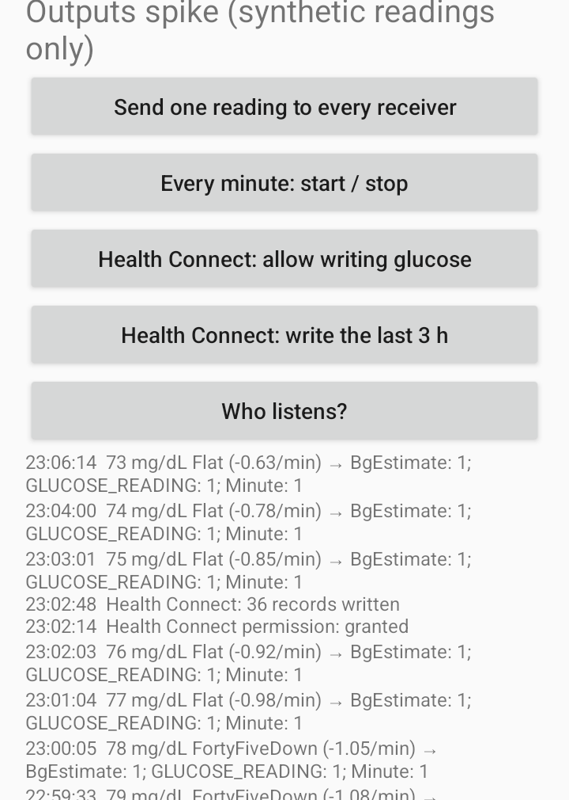
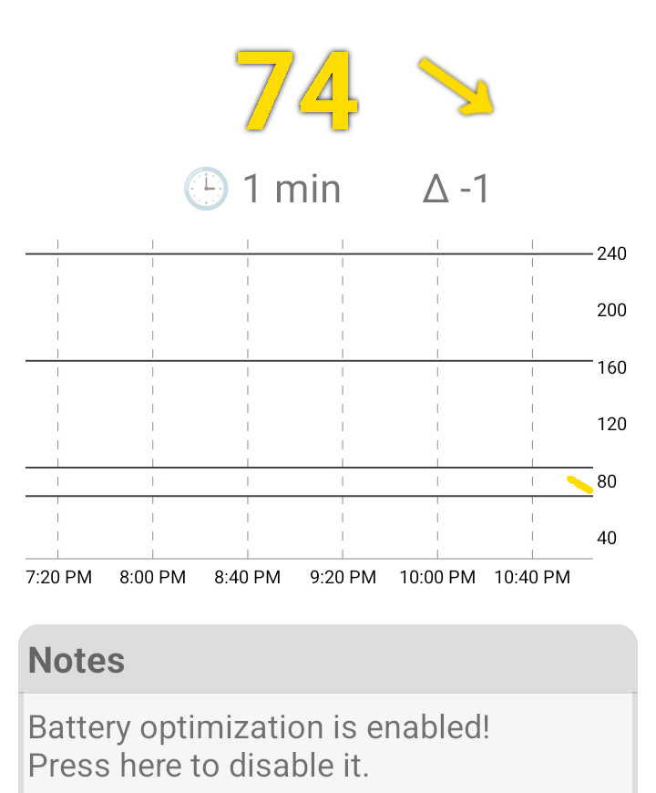
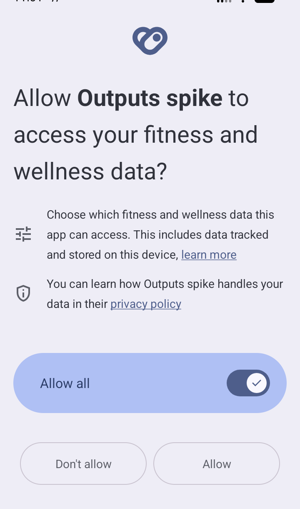
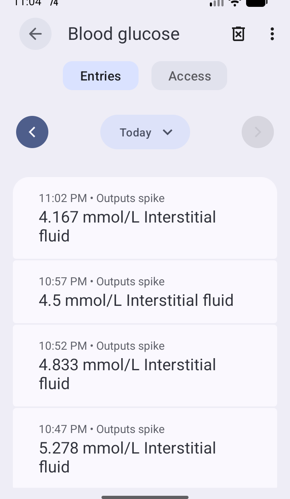

# 22 — Sukrara in the diabetes-tech ecosystem: outputs and gaps

*2026-10-18 · investigation report · standalone spike app `spikes/outputs-android` (`dev.spike.outputs`) on a
dedicated Android 16 emulator, synthetic readings only · source read from the local checkouts in `third_party/`:
Juggluco `a983788a` (2026-10-09), AndroidAPS `aa16db6419` (2026-10-16), xDrip+ `8532095` (2026-10-16),
GlucoDataHandler `215b2f0` (2.5, 2026-10-02), cgm-remote-monitor `92d0834`, LoopFollow `4a74b78`, Trio `0b29cd5`,
nightguard, Tidepool uploader*

## Goal

The user wants Sukrara to be "more connectable to the diabetes techie scene" and to be able to replace Juggluco.
Questions:

1. Which outputs does Juggluco offer to other apps, exactly (actions, extras, who receives them)? Which does Sukrara
   already cover?
2. Can a small app emit the missing ones so that AndroidAPS (AAPS), GlucoDataHandler (GDH) and xDrip+ accept them?
3. What about the Dexcom "BYODA" broadcast, which unlocks more in AAPS?
4. Beyond Juggluco: what else does the scene expect of a CGM app, and where does Sukrara stand?

## Short answer

- **Three local broadcasts are missing and they are cheap**: xDrip+'s `BgEstimate`, the patched-LibreLink
  `GLUCOSE_READING`, and Juggluco's own `glucodata.Minute`. The spike sends all three; **GlucoDataHandler 2.5 accepted
  each one** on the emulator, and **AAPS's own unit-test harness** (AAPS's own test classes, run in its checkout) maps the
  spike's xDrip+ payload to `SourceSensor.LIBRE_3` with **advanced filtering on**.
- Through GDH, those broadcasts also reach **Wear OS complications, Android Auto, WatchDrip+ bands, Fitbit, Tasker,
  widgets and AOD** without Sukrara building any of them.
- **Health Connect works with the platform API alone** (no Jetpack library on minSdk 36): 36 blood-glucose records
  (interstitial fluid) written and shown in Health Connect.
- **Dexcom BYODA: discarded** for Libre data. And the reason in the brief needs a correction: since AAPS commit
  `0771b6d8fa` (2024-12-02, "make libre working with SMB always") a correctly labelled **Libre 3 reading already gets
  advanced filtering** through the xDrip+ source. A Dexcom label would only add a false origin.
- The **biggest remaining gap is Nightscout *upload***. Sukrara only serves a local read API, so iPhone followers
  (LoopFollow, Nightguard, Trio's "Nightscout as CGM"), Nightscout reports and anything cloud-based can't see it
  away from home.

## 1. Juggluco's outputs, from source

Paths are relative to `third_party/Juggluco/Common/src/`. All local broadcasts are sent **explicitly, one copy per
selected package** (`setPackage` + `FLAG_INCLUDE_STOPPED_PACKAGES`). The user picks the packages from those that declare
a receiver for the action (`main/java/tk/glucodata/settings/Broadcasts.java:67-80` uses `queryBroadcastReceivers`;
`mobile/AndroidManifest.xml:19-28` declares `<queries>` for the LibreLink actions). The dispatch for each new reading is
in `main/java/tk/glucodata/SuperGattCallback.java:455-476`. `glucodata.Minute` goes out on every reading. The others are
throttled to one per `mininterval = 55` s (`:266`, `:461`).

| # | Output | Action / endpoint | Payload (exact keys and types) | Source | Sukrara |
|---|---|---|---|---|---|
| 1 | **xDrip+ broadcast** ("Broadcast like xDrip") | `com.eveningoutpost.dexdrip.BgEstimate` | `…Extras.BgEstimate` double mg/dL, `…Extras.BgSlopeName` String (`DoubleUp`…`DoubleDown`, `""` unknown), `…Extras.BgSlope` double = rate/60000 (mg/dL per ms), `…Extras.Time` long ms, `…Extras.SensorStartedAt` long ms, `…Extras.SourceInfo` String = `Libre3` / `Libre2` / `G7` / `GS1Sb` / … by sensor generation. No battery extra (commented out) | `main/java/tk/glucodata/SendLikexDrip.java:34-41, 63-86, 92-108` | **No** → spike |
| 2 | **Patched-LibreLink broadcast** ("Librelink broadcast" / "xInfuus") | `com.librelink.app.ThirdPartyIntegration.GLUCOSE_READING` | `glucose` double mg/dL, `timestamp` long ms, `bleManager` Bundle{`sensorSerial` String} | `mobile/java/tk/glucodata/XInfuus.java:65-72` | **No** → spike |
| 3 | Patched-LibreLink sensor start | `com.librelink.app.ThirdPartyIntegration.SENSOR_ACTIVATE` | `sensor` Bundle{`sensorStartTime` long ms}, `bleManager` Bundle{`sensorSerial`} | `XInfuus.java:80-85` | **No** → spike |
| 4 | **Glucodata broadcast** (Juggluco's own) | `glucodata.Minute` | `glucodata.Minute.SerialNumber` String, `.mgdl` int, `.glucose` float (user unit), `.Rate` float mg/dL/min, `.Alarm` int, `.Time` long ms | `main/java/tk/glucodata/JugglucoSend.java:32-38, 41-50, 56-70` | **No** → spike |
| 5 | "Eversense" broadcast (xDrip+'s NS emulator) | `com.eveningoutpost.dexdrip.NS_EMULATOR` | `collection`=`entries`, `data`=JSON `[{"type":"sgv","date":ms,"sgv":mg/dL,"direction":"Flat"}]` | `mobile/java/tk/glucodata/EverSense.java:53-73` | No → **discarded** (§5) |
| 6 | xDrip+ watch integration (WatchDrip+, Mi Band / Amazfit) | `com.eveningoutpost.dexdrip.watch.wearintegration.BROADCAST_SERVICE_SENDER`, listens on `…BROADCAST_SERVICE_RECEIVER` | xDrip+'s Broadcast Service API | `mobile/java/tk/glucodata/WearInt.java:44, 71-110`; `watchdrip.java:94` | No → via GDH (GDH lists WatchDrip+ support) |
| 7 | Gadgetbridge (Pebble, Bangle…) | `de.kaffeemitkoffein.broadcast.WEATHERDATA` to `nodomain.freeyourgadget.gadgetbridge` | glucose encoded as a fake **weather** report (temperatures in kelvin) | `mobile/java/tk/glucodata/Gadgetbridge.java:36, 60-83` | No → deferred |
| 8 | **Web server** (xDrip+ web service + Nightscout-style) | `127.0.0.1:17580`: `/sgv.json`, `/pebble`, `/api/v1/entries…`, `/x/…` | xDrip+/Nightscout JSON | `main/cpp/net/watchserver/watchserver.cpp:1387, 3032-3034` | **Yes**: `bridge/XdripServer.kt` on 17580 (Garmin, [08](08-garmin.md)) + `bridge/NightscoutApi.kt` on 17581, LAN optional ([03](03-nostr.md)) |
| 9 | **Nightscout upload** | `POST <site>/api/v1/entries` + `/api/v1/treatments` (`api-secret` = SHA-1 of the secret), or `/api/v3/…` with a token | Nightscout entries / treatments | `main/cpp/net/watchserver/uploader.cpp:66-71`; `main/java/tk/glucodata/NightPost.java:228-235` | **No**: read API only. Top gap (§6) |
| 10 | **Health Connect** | `insertRecords(BloodGlucoseRecord)` | device `TYPE_UNKNOWN` "Libre", *unknown recording method* | `mobile/java/tk/glucodata/HealthConnection.kt:46, 75-79` | **No** → spike |
| 11 | LibreView upload | `<region>/api/measurements` | LibreView measurements | `mobile/java/tk/glucodata/Libreview.java:492` | **Yes** ([04](04-libreview.md)) |
| 12 | LibreLinkUp follower (receive) | `libreapi-c-nl.libreview.io` | — | `mobile/java/tk/glucodata/LibreReceiverApi.java:40-41` | Not an output; Sukrara's followers use Nostr / BLE ([06](06-sharing-and-keys.md), [07](07-bluetooth-followers.md)) |
| 13 | Dexcom Clarity upload (G7 sensors only) | Dexcom's G7 device API | — | `main/cpp/net/clarity/*`; `mobile/java/tk/glucodata/Clarity.java` | n/a (Dexcom-only) |
| 14 | Wear OS app, complications, phone widget, floating glucose, speech | Juggluco's own Wear OS app and UI | — | `mobile/java/tk/glucodata/Wearos.java`, `glucosecomplication/`, `GlucoseWidget.java`, `Floating.java`, `Talker.java` | Widgets, status bar, lock screen, Mac: **yes** ([12](12-android-widgets.md), [05](05-android-status-bar.md), [17](17-lockscreen-widget.md), [13](13-macos-widgets.md)). Wear OS: via GDH |
| 15 | Garmin: web server for watch faces; Libre 3 hand-off to a Garmin watch | — | — | `GarminLibre3*.java` | Web server **yes** ([08](08-garmin.md)); hand-off not studied |

**Glimp** (`it.ct.glicemia.ACTION_GLUCOSE_MEASURED`) is **not** sent by Juggluco. Only AAPS still receives it
(`AndroidAPS/app/src/main/AndroidManifest.xml:86`, `DataReceiver.kt:57-63`). It is a Libre 1 app's format and is not
worth emitting.

## 2. What the receivers parse

The spike's payloads were built from the **receivers**, not from Juggluco. Refs are relative to each checkout.

### AndroidAPS

- One exported receiver, **no sender permission**: `app/src/main/AndroidManifest.xml:76-95`, `app.aaps.receivers.DataReceiver`.
  `BgEstimate` → `XdripSourceWorker`, `NS_EMULATOR` → `MM640gWorker`, Dexcom → `DexcomWorker` (`DataReceiver.kt:47-49,
  72-77, 105-107`). **AAPS does not read the patched-LibreLink broadcast at all.**
- xDrip+ source (`plugins/source/…/XdripSourcePlugin.kt:108-115`) reads `Time` (long), `BgEstimate` (double), `Raw`,
  `BgSlopeName` → `TrendArrow.fromString`, `SourceInfo` → `SourceSensor.fromString`. It needs `timestamp > 0 && value > 0`
  (`:135`). `SensorStartedAt` is used only with *Create sensor change events* on (`:84-96`).
- **Advanced filtering** (`XdripSourcePlugin.kt:58-70`) is on when the stored reading's `sourceSensor` is a Dexcom
  native/xDrip+ G6/G7, `LIBRE_2`, `LIBRE_2_NATIVE` or **`LIBRE_3`**. `SourceSensor.LIBRE_3.text == "Libre3"`
  (`core/data/…/SourceSensor.kt:24`, exact-match `fromString`, `UNKNOWN` otherwise). Without it, `SafetyPlugin` blocks
  *SMB always* (`plugins/constraints/…/SafetyPlugin.kt:96-99`) and `OpenAPSSMBPlugin` hides *SMB always* and *SMB after
  carbs* (`plugins/aps/…/OpenAPSSMBPlugin.kt:198-205`).
- So **the `SourceInfo` label is safety-relevant**: `"Libre3"` → advanced filtering on; anything unknown (e.g.
  `"Sukrara"`) → off. The spike sends `Libre3` because the sensor *is* a Libre 3 Plus, same as Juggluco
  (`SendLikexDrip.java:63-66`).
- 1-minute data is fine: AAPS re-buckets non-5-minute data itself (`AutosensDataStoreObject.kt:168, 193`).

### GlucoDataHandler

- Manifest receivers (`mobile/src/main/AndroidManifest.xml:315, 324, 361, 370`): `glucodata.Minute`,
  `BgEstimate`, Diabox, `GLUCOSE_READING` + `SENSOR_ACTIVATE`. They only act while the matching source is on in GDH
  (`NamedBroadcastReceiver.kt`, `ReceiverManager.isRegistered`). On 2.5 they were on by default.
- xDrip+: needs `BgEstimate` (or `Raw`) + `Time`. The slope is `BgSlope × 60000`, else derived from the name. The serial
  is `SourceInfo` (`common/…/receiver/XDripBroadcastReceiver.kt:61-104`).
- LibreLink: `glucose` (double) + `timestamp`. Serial from `bleManager.sensorSerial`, sensor start from
  `sas.currentSensor.sensorStartTime` (`LibrePatchedReceiver.kt:36-57`); `SENSOR_ACTIVATE` sets the start (`:62-73`).
- glucodata: the bundle is passed as-is to `ReceiveData.handleIntent` (`GlucoseDataReceiver.kt:38-63`).

### xDrip+ (as a follower of Sukrara)

- `LibreReceiver` takes the LibreLink actions (`app/src/main/AndroidManifest.xml:685-693`), but only when the collector is
  **"Libre2 (patched App)"** (`LibreReceiver.java:51`). It requires `glucose`, `timestamp` and `bleManager.sensorSerial`
  (`:186-200`) and reads the sensor start from `sas.currentSensor` (`:176-181`).
- xDrip+ **smooths** this source (weighted average, default 25 min, `:140-147`), so its numbers lag Sukrara's a little.
- xDrip+ does not read its own `BgEstimate` from other apps.

## 3. The spike

`spikes/outputs-android` (Kotlin, minSdk 36, no dependencies). Synthetic readings only: a 3 h sine around 130 mg/dL,
serial `SPIKE0000022`.

| File | What |
|---|---|
| `Payloads.kt` | the four payloads as plain maps (unit-testable), xDrip+ trend names with Juggluco's thresholds, the synthetic generator |
| `Emitter.kt` | finds receivers per action with `queryBroadcastReceivers` (manifest `<queries>`), sends one explicit copy per package, like Juggluco |
| `HealthWriter.kt` | Health Connect through the **platform** `android.health.connect` API: `BloodGlucoseRecord`, interstitial fluid, `clientRecordId` = serial + minute |
| `MainActivity.kt` | buttons + adb extras: `send` (all, or `--es only xdrip\|libre\|glucodata`), `loop` (every minute), `hc` (last 3 h → Health Connect) |
| `PayloadsTest.kt` | 5 tests: keys and **types** against the receivers above (a wrong type is silent on Android: `getDouble` on a Long returns 0) |
| `evidence/` | the AAPS scratch test and its result, GDH logcat excerpts |



## 4. Verification

Everything ran on a **dedicated emulator** (`outputs_phone`, Android 16, port 5580), created for this run and deleted
afterwards. Not on the user's phone or the shared emulators. No real sensor.

| Receiver | How | Result |
|---|---|---|
| **GlucoDataHandler 2.5** (official GitHub release APK, sha256 `4dd85e81…97ab`) | spike → one broadcast type per run; GDH logcat | xDrip+: `Glucodata received from XDRIP … mgdl=82, Rate=-1.24, SerialNumber=Libre3`. LibreLink: `setSensorStartTime for SPIKE0000022`, `received from LIBRE_PATCHED … mgdl=81 … gdh.sensor_start_time=…`. glucodata: `received from JUGGLUCO … mgdl=79, Rate=-1.10`. Excerpts: [`gdh-emulator.txt`](../spikes/outputs-android/evidence/gdh-emulator.txt) |
| GDH UI | 1/min loop for ~8 min | value, trend arrow, delta, graph and status-bar number all from the spike (below) |
| **AndroidAPS** (`aa16db6419`) | scratch JUnit test inside AAPS's `plugins/source` with AAPS's own `TestBaseWithProfile`, JDK 21 | 3/3 + AAPS's `XdripSourcePluginTest` 3/3. `"Libre3" → LIBRE_3, advancedFiltering=true`; `"Sukrara" → UNKNOWN, advancedFiltering=false`; all 7 trend names parse. [test](../spikes/outputs-android/evidence/SukraraPayloadScratchTest.kt), [result](../spikes/outputs-android/evidence/aaps-unit-test.txt) |
| AAPS `DataReceiver` routing | source walkthrough + AAPS's own `DataReceiverTest` (`BgEstimate` → `XdripSourceWorker`) | the action is routed; the worker reads exactly the keys and types `PayloadsTest` pins |
| xDrip+ | source walkthrough only (`LibreReceiver.java`) | payload matches the required extras; not installed (its collector setup is long and it smooths anyway) |
| **Health Connect** (platform, Android 16) | `requestPermissions(WRITE_BLOOD_GLUCOSE)` → Health Connect's own sheet; *write the last 3 h* | `36 records written`; Health Connect → Blood glucose lists them as "Outputs spike", *Interstitial fluid* (shown in mmol/L by the emulator locale: 75 mg/dL → 4.167) |
| Spike unit tests | `./gradlew testDebugUnitTest` | 5/5 |

  

Notes from the run:
- GDH logged each broadcast **up to four times**: one explicit broadcast reaches every matching receiver inside the
  package, both the manifest one and those registered at runtime. GDH stores it once ("Handle first value"). Juggluco has
  the same fan-out.
- A broadcast whose `Time` equals the last one is dropped silently by GDH. Send once per new reading, not per source.
- On Android 14+ the platform `requestPermissions` with a health permission opens Health Connect's sheet. The app must
  have the `VIEW_PERMISSION_USAGE` + `HEALTH_PERMISSIONS` activity alias (in the spike's manifest). No Jetpack client is
  needed.
- **Not verified:** that rewriting the same minute replaces the record instead of duplicating it (`clientRecordId`).
  That needs a read permission. Check it when integrating.

## 5. Dexcom BYODA, and other things we won't emit

**The BYODA intent** (AAPS `core/interfaces/…/receivers/Intents.kt:40-41`, manifest `:88-89`):
`com.dexcom.cgm.EXTERNAL_BROADCAST` (G6) / `com.dexcom.g7.EXTERNAL_BROADCAST` (G7). The payload is parsed in
`plugins/source/…/DexcomPlugin.kt:89-137`:
- `sensorType` `"G6"`/`"G7"` → `DEXCOM_G6_NATIVE` / `DEXCOM_G7_NATIVE`, anything else `DEXCOM_NATIVE_UNKNOWN`;
- `glucoseValues` Bundle of Bundles `"0"`, `"1"`, … each with `timestamp` (**seconds**), `glucoseValue` int,
  `trendArrow` String;
- optional `meters` (fingersticks, `meterValue` int) and `sensorInsertionTime` (seconds).

The real Dexcom apps send it with `com.dexcom.cgm.EXTERNAL_PERMISSION` (`DexcomPlugin.kt:171-189`). AAPS's receiver
requires **no** sender permission, so any app could send it.

**What it unlocks:** `DexcomPlugin.advancedFilteringSupported() = true` always (`:61`), so *SMB always* and *SMB
after carbs* become available (§2). **But that is no longer a Libre-vs-Dexcom difference.** Since AAPS commit
`0771b6d8fa` (2024-12-02, "make libre working with SMB always", `XdripSourcePlugin.kt:66-68`) an xDrip+ broadcast
labelled `Libre3` gets the same, and the spike proved it with AAPS's own classes. What a Dexcom label would *add*:
- a **false origin** in AAPS's database, Nightscout uploads and statistics (`Sources.Dexcom`, sensor type G6/G7);
- Dexcom-specific handling applied to Libre data, e.g. G6 values older than 20 h dropped and the G6 "calibration
  doubles" removal (`:123-124, 147-160`);
- Dexcom's meter-calibration path, which a Libre 3 doesn't have.

**Position: never emit Dexcom-labelled data from a Libre sensor.** Emit BYODA only if Sukrara ever reads a real Dexcom
sensor, with that sensor's type. AAPS's safety gates key on the declared sensor, so the label must always be the truth.
The same rule applies to the xDrip+ label: `Libre3` only for a Libre 3 / 3 Plus read directly. A **follower's** copy
must not carry a sensor label that turns on AAPS features (see "To bring into Sukrara").

Also discarded:
- **`NS_EMULATOR`** (Juggluco's "Eversense" broadcast): AAPS files it under the Medtronic 640G source as
  `SourceSensor.MM_600_SERIES` (`MM640gPlugin.kt:60-78`), a wrong label. xDrip+ and GDH are covered by the LibreLink
  broadcast.
- **Glimp**: Libre 1-era app, AAPS only; nothing gains from it.
- **Gadgetbridge weather hack**: it works, but it encodes glucose as kelvin temperatures. It reaches few users and is
  odd. Deferred.

## 6. Gap analysis: what the techie scene expects

Ranked by impact for techie users ÷ effort. Impact: who gets something that doesn't work today. Effort: S = days,
M = 1–2 weeks, L = more.

| # | Gap | Who expects it (source) | Sukrara today | Impact | Effort | Recommendation |
|---|---|---|---|---|---|---|
| 1 | **Local broadcasts**: xDrip+ `BgEstimate`, LibreLink `GLUCOSE_READING`, `glucodata.Minute` | AAPS xDrip+ source; **GDH** → Wear OS complications, Android Auto (GlucoDataAuto), WatchDrip+ bands, Fitbit, Tasker, widgets, AOD (`GlucoDataHandler/README.md:12-53`); xDrip+ "Libre2 patched" collector | none | **High**: unlocks AAPS (closed loop) and GDH's whole ecosystem | **S** (spike done) | **Do first** |
| 2 | **Nightscout upload** (`/api/v1/entries`, `/api/v1/treatments`, `api-secret` SHA-1; v3 later) | LoopFollow (`LoopFollow/Helpers/NightscoutUtils.swift:55`), Nightguard (`NightscoutServiceTest.swift:301`), Trio "Nightscout as CGM" (`Trio/Sources/APS/CGM/CGMType.swift:6, 15-16`), AAPS NSClient, Nightscout reports, HA cloud, Sugarmate-style services; endpoints `cgm-remote-monitor/lib/api/entries/index.js:796`, auth `lib/authorization/index.js:80` | local read API on 17581 (LAN optional) | **High**: iPhone followers, clinicians' and community tooling, anything off-LAN | **M** (a queue + backfill + treatments; Juggluco's `uploader.cpp` shows the shape) | **Do second** (own investigation: own Nightscout vs. hosted, secret storage, backfill limits) |
| 3 | **Health Connect** write | Google Fit/Health apps, Samsung Health import, general wellness apps; GDH and Juggluco both write it | none | Medium | **S** (spike done) | Do with #1 |
| 4 | **Readings export** (CSV/JSON) | data ownership, spreadsheets, Tidepool/Nightscout imports; Juggluco: menu Export (`Menus.java:358`); xDrip+: CSV (`utils/DatabaseUtil.java`) | settings export only; readings stay internal | Medium | S | Do (a share sheet with CSV) |
| 5 | **AGP report** (percentile chart, 14 days) | clinicians; standard AGP layout | metrics card (TIR, GMI, CV) ([18](18-metrics.md)) | Medium | M | Later, after export |
| 6 | **Wear OS** native app / tiles | Wear OS users | via GDH once #1 lands | Medium | L (own app) | Rely on GDH; revisit if users ask |
| 7 | **Tidepool** upload | clinics using Tidepool; xDrip+ has an uploader (`xDrip/…/tidepool/TidepoolUploader.java:63-78`); AAPS has one; the Tidepool *uploader* repo is desktop/USB only (`uploader/lib/drivers/abbott`) | none | Medium-low (Libre users' clinics mostly use LibreView, which Sukrara already uploads to) | M | Defer |
| 8 | **Home Assistant** | HA's built-in Nightscout integration | **works** on LAN ([03](03-nostr.md): stock HA 2026.10) | — | — | Done. Gets better with #2 (no LAN needed) |
| 9 | **Garmin** | watch faces / CGM+ | **works** ([08](08-garmin.md)) | — | — | Done; own watch app is a separate track |
| 10 | Pebble / Gadgetbridge / Bangle.js | Gadgetbridge users | none | Low | S | Defer (weather-hack format) |
| 11 | xDrip+ as follower | xDrip+ users wanting its alarms/stats | not possible today | Low-medium | S (comes with #1) | Comes free with #1 (LibreLink broadcast) |
| 12 | Tasker / IFTTT / automation intents | power users | none | Low-medium | S via GDH; M for own intents | Via GDH's Tasker plugin (`GlucoDataHandler/TASKER.md`); no own intents yet |
| 13 | iOS apps (Loop, Trio, LoopFollow, Nightguard) | iPhone loopers and parents | Nightguard/LoopFollow on the same LAN via the adapter | High for mixed-OS families | via #2 | Covered by #2. A loop on iOS needs its own CGM source; out of scope |
| 14 | Calibration | xDrip+ users with noisy sensors | none (Libre 3 is factory-calibrated) | Low | M + safety review | **Discard** for now. Feeding calibrated values to AAPS needs care. Separate investigation if asked |
| 15 | Dexcom BYODA output | AAPS users with Dexcom | — | — | — | **Discard** for Libre (§5) |
| 16 | Diabox | a competing Libre reader that *emits* xDrip+-style broadcasts (GDH `DIABOX_BROADCAST_ACTION`) | — | — | — | Nothing to emit. Sukrara is in the same role and #1 covers it |

Sugarmate-style services (phone-call alerts, Siri glance) read Dexcom Share or Nightscout. For Sukrara users they become
possible with #2. I did not check the current state of Sugarmate itself.

## 7. Recommendation (top 5)

1. **Local broadcasts** (xDrip+, LibreLink, glucodata), with an explicit per-app allow list.
2. **Nightscout upload** as its own investigation (entries + treatments, API secret, backfill, offline queue).
3. **Health Connect** write, together with 1 (same fan-out hook, platform API).
4. **CSV export** of readings and treatments.
5. **AGP-style report**, built on the metrics from [18](18-metrics.md).

## To bring into Sukrara

Draft for the integration step. Nothing below is in the app yet.

**Files** (Android, `spikes/showcase-android/app/src/main/kotlin/app/mauri/sukrara/`):
- `bridge/Broadcasts.kt`: port `Payloads.kt` + `Emitter.kt`. One `send(reading)` that emits `BgEstimate`, `GLUCOSE_READING`
  (+ `SENSOR_ACTIVATE` on a new sensor serial) and `glucodata.Minute` to the **allowed packages only**.
- `bridge/HealthConnect.kt`: port `HealthWriter.kt`. On enable, backfill the stored history in batches; then one record
  per reading. Device manufacturer "Abbott", model "FreeStyle Libre 3 Plus", `RECORDING_METHOD_AUTOMATICALLY_RECORDED`,
  `clientRecordId` = serial + minute (check the dedupe, §4).
- Hook both into the existing fan-out in `wearer/WearerExtras` (where Garmin / Nightscout / LibreView already hang),
  **wearer role only**.
- `AndroidManifest.xml`: `<queries>` for the three actions, `android.permission.health.WRITE_BLOOD_GLUCOSE`, the
  `VIEW_PERMISSION_USAGE` / `HEALTH_PERMISSIONS` activity alias (the privacy page).

**Settings** (Settings → Share with apps):
- *Apps on this phone*: the list of installed apps that declare a receiver for any of the three actions, each with a
  switch (Juggluco's model). Glucose is health data and any installed app can declare a receiver, so **default: none
  selected**. Show "AAPS / GDH / xDrip+" by name when installed.
- *Health Connect*: one switch, default **off**. It opens Health Connect's permission sheet.
- No separate switch per broadcast format. Each allowed app gets every action it declares.

**Defaults and rules:**
- Send on every new reading (1/min). Juggluco throttles to ≥ 55 s; same here.
- `SourceInfo` = `Libre3` only for a Libre 3 / 3 Plus read directly by this phone. A follower must not broadcast with a
  sensor label that turns on AAPS's advanced filtering. First step: followers don't broadcast at all.
- Strings in `values/` + `values-es/`. README (*Share with apps*), `docs/FEATURES.md` and `docs/10-showcase.md` updated
  in the same change. Tests: port `PayloadsTest` into the app's unit tests.

**Added / discarded (draft for the report and docs/10):**

| Item | Decision | Why |
|---|---|---|
| xDrip+ `BgEstimate` broadcast, `SourceInfo=Libre3` | **Add** | AAPS + GDH (Wear OS, Auto, WatchDrip+, Tasker) accept it; AAPS gives advanced filtering to a true Libre 3 label |
| Patched-LibreLink `GLUCOSE_READING` + `SENSOR_ACTIVATE` | **Add** | xDrip+ follower ("Libre2 patched" collector) and GDH; sensor start included |
| `glucodata.Minute` | **Add** | GDH / GlucoDataAuto's native format; trivial once the others exist |
| Health Connect blood glucose (platform API) | **Add** | cheap, no library; general health apps |
| Per-app allow list, default none | **Add** | health data to arbitrary installed apps must be opt-in per app |
| Dexcom BYODA (`com.dexcom.cgm/g7.EXTERNAL_BROADCAST`) from a Libre | **Discard** | false origin; AAPS's safety gates key on the sensor label; a true `Libre3` label already gets advanced filtering. Only for a real Dexcom sensor |
| `NS_EMULATOR` broadcast | **Discard** | AAPS labels it Medtronic 600-series; LibreLink broadcast covers xDrip+/GDH |
| Glimp broadcast | **Discard** | Libre 1-era, AAPS-only; no user gains |
| Gadgetbridge weather hack | **Discard (for now)** | glucose as fake weather; small audience |
| Broadcasts from the follower role | **Discard (for now)** | a follower's copy must not reach AAPS as if it were a local sensor |
| Nightscout upload, CSV export, AGP | **Next investigations** | §6 #2, #4, #5 |

## Run it

```sh
cd spikes/outputs-android
export JAVA_HOME=$(brew --prefix openjdk@17)/libexec/openjdk.jdk/Contents/Home ANDROID_HOME=$HOME/Library/Android/sdk
./gradlew testDebugUnitTest assembleDebug
adb -s <emulator> install -r app/build/outputs/apk/debug/app-debug.apk
adb -s <emulator> shell am start -n dev.spike.outputs/.MainActivity --ez send true --es only xdrip   # or libre, glucodata
adb -s <emulator> shell am start -n dev.spike.outputs/.MainActivity --ez loop true                   # every minute
adb logcat -s Outputs 'GDH.ReceiveData'
```
AAPS check: copy `evidence/SukraraPayloadScratchTest.kt` into AndroidAPS's
`plugins/source/src/test/kotlin/app/aaps/plugins/source/` and run
`./gradlew :plugins:source:testFullDebugUnitTest --tests '*SukraraPayloadScratchTest*'` with JDK 21.
