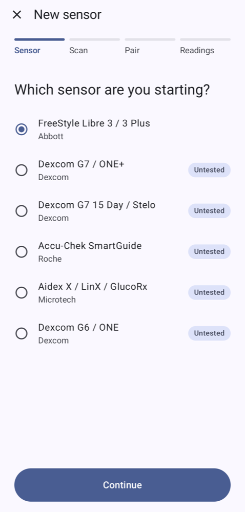
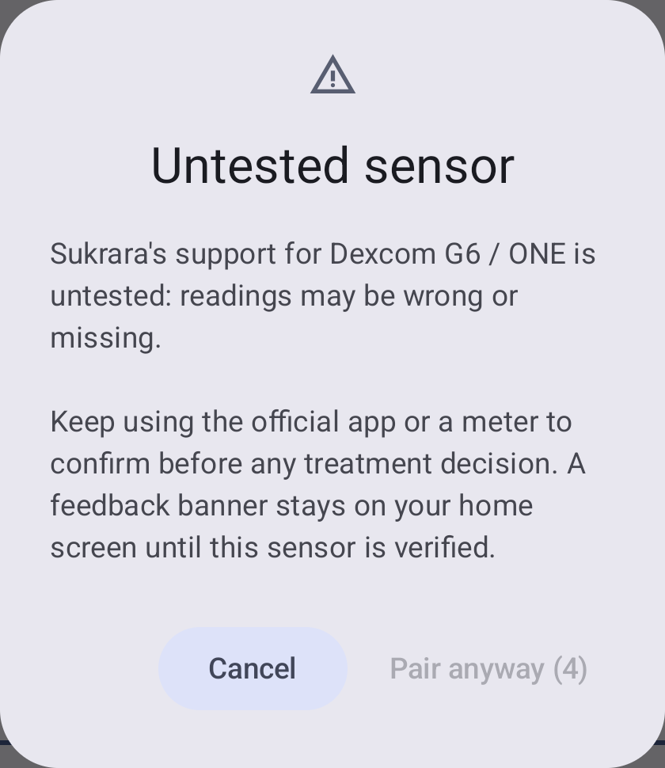
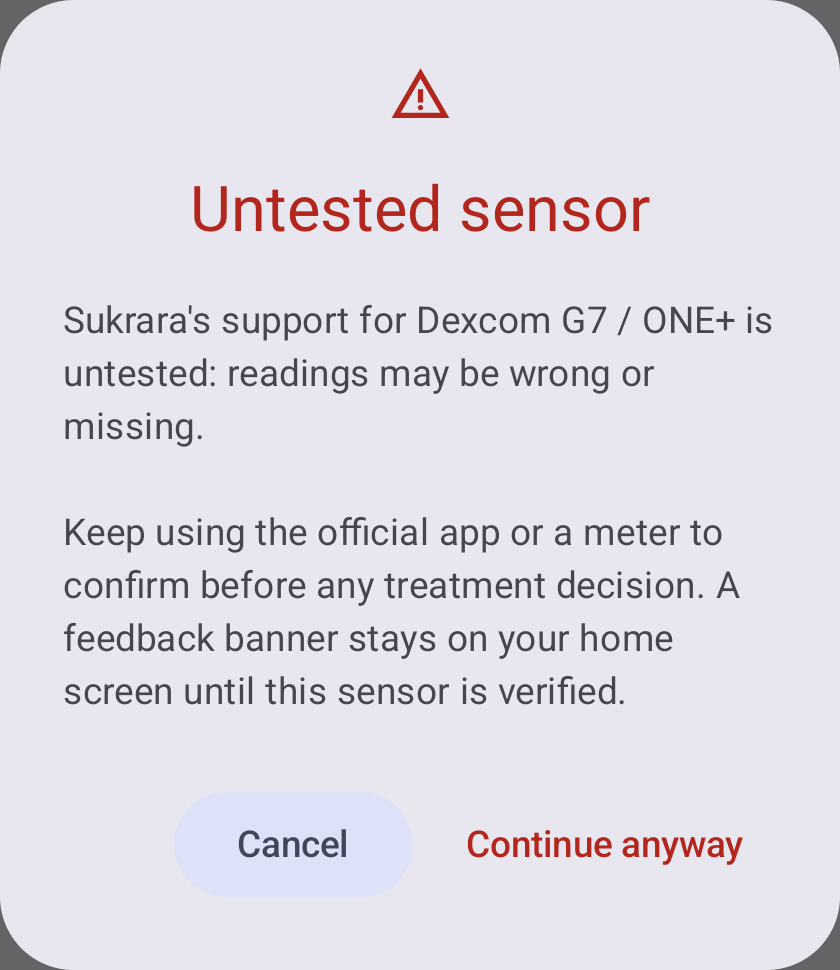
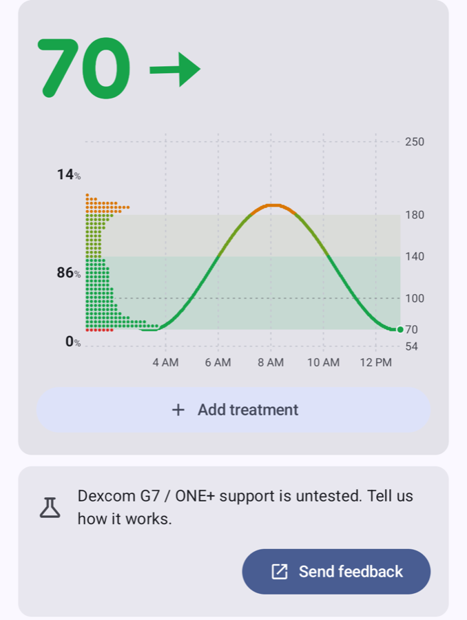
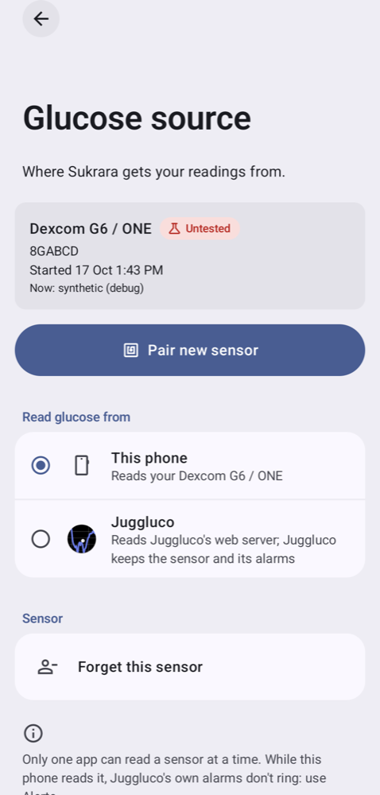
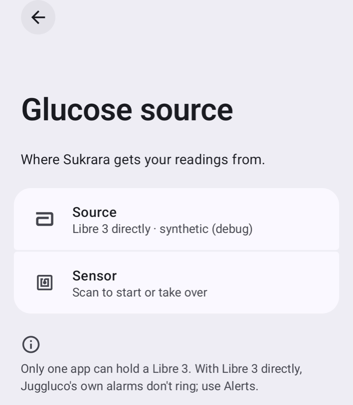
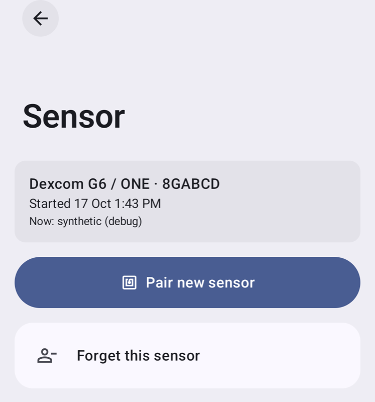

# 23 — More sensors, more brands: what Sukrara can read besides the Libre 3

*2026-10-18 · standalone PoC in [`poc/spikes/sensors-android`](../poc/spikes/sensors-android) · no sensor was touched:
every driver is tested against packet traces and test vectors taken from open-source projects*

## Goal

The user: *"Eventually I want to support as many sensors as possible from any brand, starting with Dexcom. If some of
the sensors Juggluco supports are trivial to port, do it."*

Sukrara reads a FreeStyle Libre 3 / 3 Plus today ([02](02-direct-sensor.md)). This investigation answers three
questions: **which sensors can be read at all without borrowing a vendor's code or identity**, **which of those are
cheap enough to port now**, and **what Sukrara's architecture has to grow** to hold more than one brand.

The yardstick is the one the Libre 2 decision set ([02 "Libre 2 / 2 Plus"](02-direct-sensor.md#libre-2--2-plus-investigated-discarded-2026-10-18)):

1. **No vendor algorithm.** If the sensor sends raw counts and the mg/dL only exists inside the vendor's library, the
   sensor is out. Running their `.so`, or an unvalidated reimplementation of it, is not something to dose from.
2. **No vendor identity.** If the phone has to present the vendor's certificate or sign with the vendor's private
   key to be let in, the sensor is out. Lifting that out of their app is impersonation, not interoperability.
3. **The user's own secrets are fine.** A code printed on the applicator, a serial on the box, a PIN on the cap, a
   pairing record our own app made — all of that belongs to the person wearing the sensor.

Everything was read from source in `third_party/` (Juggluco, xDrip+, AndroidAPS, DiaBLE, LibreTransmitter,
LibreTools, LoopKit's G7SensorKit and CGMBLEKit, xdripswift, Trio). Nothing was fetched from a vendor app.

## The matrix

**Values** = what arrives over the air: *calibrated* (the sensor sends mg/dL or mmol/L), *raw* (needs an algorithm).
**Verdict** uses the three rules above.

| Sensor | Transport | Pairing secret | Auth / crypto | Values | Open implementation | Licence | Verdict |
|---|---|---|---|---|---|---|---|
| **Abbott Libre 3 / 3 Plus** | NFC tap → BLE | NFC gives address + PIN; our own authorization record | ECC + AES-CCM session, Juggluco's portable core | calibrated | Juggluco `cpp/libre3/`, Sukrara `direct/` | GPL-3 | **done** (Sukrara, inv. 02) |
| **Dexcom G7 / ONE+ / Stelo**, observer | BLE | none | none: the official app authenticates, the sensor notifies every subscriber | calibrated | LoopKit `G7SensorKit` (`G7Sensor.swift:323-339`) | MIT | **acceptable · ported** — needs the Dexcom app installed |
| **Dexcom G7 / ONE+ / Stelo**, own pairing | BLE | 4-digit applicator code | EC-J-PAKE (code) **+ a Dexcom-issued app certificate chain and ECDSA key** | calibrated | Juggluco `cpp/dexcom/`, xDrip+ `libkeks/` | GPL-3 | **blocked by rule 2** — J-PAKE ported, certificate step refused |
| **Dexcom G6 / ONE / G5** | BLE | 6-character transmitter id | AES-128 challenge keyed by the id alone | calibrated ("native mode") | xDrip+ `g5model/`, LoopKit `CGMBLEKit`, DiaBLE | GPL-3 / MIT | **acceptable · ported** |
| **Roche Accu-Chek SmartGuide** | BLE | 6-digit PIN from the cap (Android's pairing dialog) | none at app level: plain BLE bonding; control point writes carry an E2E-CRC | calibrated | Juggluco `cpp/accu/`, xDrip+ `libglupro` | GPL-3 | **acceptable · ported** (public Bluetooth CGM Service) |
| **Microtech Aidex X** (LinX, LumiFlex, GlucoRx, Wellion) | BLE (+ readings in the advertisement) | sensor serial from the box code | MD5-from-serial keys → AES-128-CFB session key from the sensor | calibrated | Juggluco `cpp/aidexx/` | GPL-3 | **acceptable · ported** |
| **i-SENS CareSens Air** | BLE | 6-digit PIN + serial from the inner package | AES-256-CBC with a **key hardcoded from the vendor app** | **raw** (needs `libCALCULATION.so`) | Juggluco `cpp/air/` | GPL-3 | **discarded** (rules 1 and 2) |
| **Sibionics GS1 / GS1Sb** | BLE | package data-matrix code | RC4 with a **key and per-app registration keys recovered from the vendor `.so`** | **raw** (needs `libnative-algorithm-v1_1_6A.so`) | Juggluco `cpp/sibionics/` | GPL-3 | **discarded** (rules 1 and 2) |
| **Sibionics GS3** | BLE | package code **+ the user's Sibionics cloud account id** | AES-128-OFB, vendor keys from the same `.so`; auth frame carries the account id | calibrated (mmol/L × 10) | Juggluco `cpp/sibionics3/`, `GetGS3ID.java` | GPL-3 | **parked** — no vendor algorithm, but vendor keys + a login to `cgm.sibionics.io` |
| **Abbott Libre 2 / 2 Plus (EU)** | NFC + BLE | NFC | open gen-1 scheme (DiaBLE, LibreTransmitter) | **raw** (needs Abbott's `libDataProcessing.so`) | DiaBLE, LibreTransmitter, Juggluco `libre2.cpp` | MIT / GPL-3 | **discarded** (inv. 02, rule 1) |
| **Abbott Libre 2 US/CA ("Gen2")** | NFC + BLE | — | not reverse engineered: `Libre2Gen2` is an empty class, NFC auth a TODO | raw | DiaBLE `Libre2.swift:337` | MIT | **not possible** |
| **Abbott Libre 1 via bridge** (MiaoMiao, Bubble, Atom, Blucon) | BLE bridge reads NFC | — | bridge-specific, open | **raw** | xDrip+ `models/Tomato.java` etc., LibreTransmitter | GPL-3 / MIT | **discarded** (rule 1; also extra hardware) |
| **Abbott Lingo** | NFC + BLE | NFC | Libre 3 family | calibrated | DiaBLE `Libre3.swift:1364` (`class Lingo: Libre3`) | MIT | **candidate later** — same core as Sukrara's Libre 3 driver |
| **Medtrum A6 / TouchCare Nano** | BLE | serial | own `Crypt.java` | **raw + finger-stick calibrations** (the sensor holds slope/intercept) | xDrip+ `cgm/medtrum/` | GPL-3 | **discarded** (rule 1: the user must calibrate) |
| **Senseonics Eversense E3 / 365** | — | — | — | — | **none**: every project takes a broadcast from the vendor/patched app | — | **not possible** |
| **Sinocare iCan, Ottai, Syai, GlucoMen iCan** | — | — | — | — | **none**: AndroidAPS takes broadcasts from patched vendor apps, xDrip+ scrapes their notifications | — | **not possible** |
| **Medtronic Guardian / Simplera** | — | — | — | — | cloud only: xDrip+'s CareLink follower | GPL-3 | **cloud source, not a sensor driver** |
| **Any standard Bluetooth CGM Service device** (0x181F) | BLE | device-specific PIN | plain bonding | calibrated | this spike; xDrip+ `libglupro` | — | **acceptable · ported** (the SmartGuide driver is this) |

Also in the field but out of scope here: follower clouds (Dexcom Share, LibreLinkUp, CareLink, Nightscout) —
Sukrara already has its own sharing ([03](03-nostr.md), [07](07-bluetooth-followers.md)) — and Dexcom's
`com.dexcom.cgm.EXTERNAL_BROADCAST` / `com.dexcom.g7.EXTERNAL_BROADCAST` intents, which AndroidAPS uses and which
would give G7 values with no BLE work at all, at the price of depending on the vendor app's broadcast setting.

### Why the Dexcom G7's own pairing is refused

The G7 handshake has two halves. The first is **EC-J-PAKE on P-256** with the **4-digit code printed on the
applicator** as the password: the user's own secret, perfectly legitimate, and ported here
(`core/.../dexcom/G7Jpake.kt`). The second is a **proof that the phone is a Dexcom app**: the sensor asks for two
X.509 certificates (`0x0B` offers) and then challenges the phone to sign 16 bytes it chooses (`0x0C`), which only
Dexcom's app private key can answer.

Both open implementations solve that half by carrying Dexcom's identity:

- **Juggluco** embeds the chain in `Common/src/dex/java/tk/glucodata/DexGattCallback.java:945` (decoded with
  `openssl x509`: `CN=DEX03PG1` issued by `CN=DEX00PG1`, then a leaf `CN=01,0000,0300LQ…` whose validity **ended on
  2025-04-13**) and signs with a private key hardcoded in `cpp/dexcom/ecJPake.cpp:612-615`.
- **xDrip+** does not ship them: its `keks` plugin wants them pasted in by the user
  (`Ob1G5CollectionService.java:1668`, prefs `keks_p1…p3` = two certificates and a PKCS#8 EC private key), and only
  for short / letter transmitter ids — `txIdMatch` in `plugin/Dialog.java:45-47`. The same values sit in a comment
  block in DiaBLE's `DexcomG7.swift:817-821`.

Either way the phone presents credentials it was not issued, to a sensor whose firmware is checking for exactly
that. That is rule 2, and it is also the practical dead end: the leaf above has already expired, so the borrowed
identity rots. **So the spike's G7 driver runs the J-PAKE and then stops**, with a status the UI can show:
*"this sensor asks for a Dexcom app certificate, which Sukrara does not have"*.

### What makes the G7 readable anyway

LoopKit ships a G7 plugin whose README is one line: *"Requires use of official G7 app"*. The reason is in
`G7Sensor.swift:323-339`: the G7 accepts several simultaneous BLE clients and **indicates its authentication status
to all of them**. So a second app can connect, subscribe to the authentication characteristic, wait for
`authenticated=1, bonded=1` — the official app's session — and then subscribe to the control characteristic and
receive the same `0x4E` glucose messages, **writing nothing to the sensor at all**.

That is the spike's default G7 mode. It is legitimate (no impersonation, no vendor code, the user's own sensor and
the vendor's own app doing the pairing it was designed for), it needs no code from the user, and it is what a
shipping product (Loop) already relies on. Its cost: the Dexcom app must stay installed and running, and backfill
has to be collected passively instead of requested.

### Not every source is right

Two things to know before trusting the references:

- **Juggluco's zero-knowledge-proof check never rejects anything.** It hashes the sensor's party id as
  `37 56 27 67 56 27` (`cpp/dexcom/ecJPake.cpp:334`), the nibble-swapped form of ASCII `"server"`, and
  `validateZeroKnowledgeProof` then returns `EC_POINT_cmp(...)==1` (`:564`), but `EC_POINT_cmp` returns **0** for
  equal points. The two mistakes cancel: a genuine sensor packet gives "not equal" under the wrong id, which the
  inverted test reports as valid, so pairing works while nothing is checked. Juggluco's two embedded sensor packets
  (`packby1`, `packby2`) verify under `"server"` and under nothing else tried, so they pin the right id; this spike
  first copied Juggluco's bytes and now uses `"server"`, with those packets as a test.
- **Juggluco's round-3 proof uses a constant nonce** (`ecJPake.cpp:489`). The nonce is published in the source, so the
  round-3 packet gives away the secret its proof is meant to hide. This port draws a fresh random nonce, and pads
  coordinates to 32 bytes (Juggluco's `BN_bn2bin` drops leading zeros, which shifts the 160-byte packet whenever a
  coordinate starts with a zero byte).
- Both are written up for the Juggluco maintainer, as a private report and a public issue, not sent:
  [`poc/spikes/sensors-android/upstream/juggluco-g7-jpake-issue.md`](../poc/spikes/sensors-android/upstream/juggluco-g7-jpake-issue.md).

Where implementations disagree on decoding, this spike follows the one with tests: LoopKit's G7SensorKit reads the
display-only flag from the message's last byte and treats `0xFFFF` as "no value", while Juggluco and xDrip+ read the
flag out of the glucose field's top nibble; G7SensorKit's unit tests pin its reading down, so it wins.

## The PoC

`poc/spikes/sensors-android` is a two-module Gradle build with **no app**: a plain-JVM `core` (drivers, decoders,
crypto, traces, harness) and an `android` library with the one Android-specific class.

```
core/src/main/kotlin/dev/spike/sensors/
  SensorDriver.kt     SensorDriver / BleLink / SensorEvents / Reading / Session — the abstraction
  SensorProfile.kt    per-family facts: pairing kind, warm-up, lifetime, grace, calibration, needsScan
  Crc.kt              CRC-16/XMODEM · CRC-16/MCRF4XX · CRC-16/CCITT-FALSE · CRC-8/MAXIM · seeded CRC-32
  Drivers.kt          the registry: what we can drive and what each one needs from the user
  dexcom/             Dexcom.kt (shared service + AES challenge + algorithm states)
                      G7Jpake.kt, G7Messages.kt, G7Driver.kt (observer / pair)
                      G6Messages.kt, G6Driver.kt
  cgms/               CgmService.kt (Bluetooth SIG CGM Service), SmartGuideDriver.kt
  aidex/              AidexX.kt (keys from the serial, AES-CFB, frames, advertisement), AidexXDriver.kt
  harness/            Trace.kt, Harness.kt — replay a trace through a driver, print what it decodes
core/src/main/resources/traces/   the recorded fixtures, with their origin in README.md
android/src/main/kotlin/…/GattTransport.kt   BleLink → BluetoothGatt, one operation at a time
```

A driver never touches Bluetooth: it asks a `BleLink` for subscribes and writes and is fed notifications, so every
one of them runs on the JVM against a trace. Sukrara's existing `Libre3Client` fits the same shape (it already has
exactly these moves), and `SensorProfiles.LIBRE_3` describes it as one more profile.

```kotlin
interface SensorDriver {
    val profile: SensorProfile
    fun matches(advert: Advert): Boolean
    fun onConnected(link: BleLink)
    fun onNotification(characteristic: UUID, value: ByteArray)
    fun onBondChanged(bonded: Boolean) {}
    fun onDisconnected() {}
}
```

### Build and run

```sh
cd poc/spikes/sensors-android
export JAVA_HOME=$(brew --prefix openjdk@17)/libexec/openjdk.jdk/Contents/Home
./gradlew :core:test            # 36 tests, all the decoding and crypto below
./gradlew :core:run             # the harness: replay every bundled trace through its driver
./gradlew :core:run --args="g7 core/src/main/resources/traces/g7-session.txt"
./gradlew :android:assembleRelease   # the GATT transport compiles against the Android SDK
```

### How each driver is tested, with no hardware

Every driver is marked **untested on hardware** in its own source. The user owns no Dexcom, Roche or Microtech
sensor, and the running Libre 3 Plus was not touched. What is checked instead:

| Driver | Fixtures | What the tests assert |
|---|---|---|
| Dexcom G7 / ONE+ | LoopKit `G7GlucoseMessageTests.swift` (MIT): a 9-message sensor lifecycle plus two documented readings; DiaBLE `DexcomG7.swift` comments (MIT) | the same glucose, timestamps, sequences, states and display-only flags LoopKit's own tests expect; backfill records; the `0x59` request bytes; observer mode starts on the vendor app's `05 01 01` and **writes nothing**; a certificate demand ends in a `Failed` status |
| Dexcom G7 J-PAKE | two sensor round packets embedded in Juggluco `ecJPake.cpp` | the sensor's packets verify under the party id `"server"` and not under Juggluco's bytes; both halves of the exchange derive the same 16-byte key; a wrong code yields a different key (and the sensor's AES challenge is where that is caught); 160-byte packets round-trip |
| Dexcom G6 / ONE | DiaBLE `Dexcom.swift` comments (MIT) | every recorded frame passes CRC-16/XMODEM; the backfill reply decodes; the key is the transmitter id twice; the handshake verifies the transmitter's hash before answering and drops a wrong one; an unauthenticated status is a `Failed` |
| Accu-Chek SmartGuide | real frames quoted in Juggluco `cpp/accu/java.cpp` | SFLOAT including its "no number" patterns; a sensor-error frame; a below-range frame → 39 mg/dL, as Juggluco posts; the status read → session start; the E2E-CRC on control-point writes (`02 95 2c`, byte for byte what Juggluco sends); a bad CRC is dropped; a stopped session ends the driver |
| Aidex X | the GATT trace in Juggluco `cpp/aidexx/decrypt.cpp`, a vendor-app log line in `glucose.h`, checksum vectors in `crc.cpp` | the IV and ask-key derived from the serial equal the bytes that went over the air (two different serials); the session key decrypts to the recorded one and its CRC-8 matches; our encryption of each command equals the recorded ciphertext; the replies decrypt to the recorded plaintexts (device info "GX-01S", start time); the glucose reply is the 119 mg/dL the vendor app logged; a 62-byte advertisement gives 92/84/78 mg/dL and passes its seeded CRC-32; a tampered advertisement fails it; a wrong serial ends in a `Failed` |
| CRC suite | all of the above | each checksum variant is pinned by real packets, so a wrong variant cannot pass |

The harness output for the bundled traces (abridged):

```
=== Dexcom G7 / ONE+ (observer mode) ===
[g7] status Progress(step=waiting for the Dexcom app's session)
[g7] phase after the app's session went live: STREAMING
[g7] egv-97 4e00d507000009000001050061000601ffff0e
[g7]   t=2005s seq=9 age=5s glucose=97 state=ok trend=0.1 predicted=none displayOnly=false
[g7] reading 97 mg/dL +0.1 mg/dL/min [ok] index=6
=== Accu-Chek SmartGuide (standard CGM Service) ===
[accu] low-1 0fe30208e515080240f0ff38006427
[accu]   offset=5605 glucose=none trend=-1.6 quality=56.0 belowRange=true crc=true
[accu]   → 39 mg/dL at 1760050580000
=== Aidex X ===
[aidex] serial 22222A2WC8 iv=72b718f8…8db8 askKey=d62913ab…5391
[aidex] session key 1c152cd42daa9e503300fe6baf908046
[aidex] advertisement from AiDEX X-22222A2WC8: 92 mg/dL (then [84, 78]), crc=true
```

## What each sensor would need from the user, and from us

| Sensor | Warm-up | Lifetime | Grace | Calibration | User has to | Phone has to |
|---|---|---|---|---|---|---|
| Libre 3 / 3 Plus | 60 min | 15 d | 12 h | none | tap it with NFC | nothing extra (NFC gives the address) |
| Dexcom G7 / ONE+ | 30 min | 10 d (15 d / Stelo variant) | 12 h | optional, on the sensor | keep the Dexcom app installed (observer mode) | scan for `DXCM…` / `DX02…`, no writes |
| Dexcom G6 / ONE | 2 h | 10 d | — | optional, on the sensor | type the 6-character transmitter id | scan, bond on the first session |
| Accu-Chek SmartGuide | 60 min | 14 d | — | optional, on the sensor | scan the cap's code, then type the PIN in Android's dialog | scan, bond, RACP for history |
| Aidex X / LinX | 60 min | 15 d (16 d LumiFlex) | — | none | scan the box's code | scan; readings also arrive in advertisements |

The per-brand numbers live in `SensorProfile`, which is exactly the data Sukrara's warm-up countdown, end badge and
reminders already need ([new sensor flow](21-new-sensor-flow.md), [sensor life](../README.md)).

## Hardware to buy, if the user wants these verified

Nothing below can be finished without a sensor on an arm. In the order that gets the most value per euro:

1. **Dexcom G7 (or ONE+) 10-day sensor + the official Dexcom app** — the observer driver, end to end. A single
   sensor is enough to see pairing, warm-up, live values, a session end and the no-vendor-app failure mode.
   (A Stelo, where sold without prescription, is the cheapest G7-family sensor and uses the same driver.)
2. **Accu-Chek SmartGuide starter kit** (EU pharmacies, no prescription) — the standard-CGM-Service driver, which
   also covers any future sensor that speaks 0x181F properly.
3. **Aidex X / LinX / GlucoRx sensor** — the advertisement path means readings without a connection, which is the
   most interesting power story of the lot.
4. **A Dexcom ONE or G6 transmitter + sensor**, only if G6 still matters in the user's market: the driver is written,
   but Dexcom is winding the platform down, so this is the one to buy last.

A **second phone** (or the emulator with a BLE bridge) is worth having for the G7: the Dexcom app and Sukrara on the
same phone is the normal case, but "what happens when the vendor app is force-stopped" needs watching.

## Architecture: what Sukrara has to grow

Today `DirectSource` is the Libre 3 and nothing else: it loads one `SensorPairing`, builds one `Libre3Client`, and
`SensorLife` hard-codes 60 minutes and 15 days. Four changes carry the rest:

1. **A source that owns drivers, not one client.** `DirectSource` keeps a `SensorDriver` chosen by the saved
   sensor's `profile.id`, and a transport that connects by address (Libre 3, from NFC) or scans for a name /
   service (Dexcom, Roche, Microtech). The `GlucoseSource.Sink` already matches `SensorEvents` field for field, so
   the app above it does not change.
2. **Pairing per brand, one screen.** The new-sensor screen ([21](21-new-sensor-flow.md)) grows a first step: *which
   sensor are you starting?* Then one of four inputs — NFC tap (Libre 3), 4-digit applicator code or "I use the
   Dexcom app" (G7), transmitter id (G6), camera-scanned data-matrix code (SmartGuide, Aidex X; the spike's
   `Pairing` type says which, and the brand's code format says where it is printed). The PIN dialog for the
   SmartGuide is Android's own, triggered by `createBond`.
3. **Lifetime, warm-up and calibration from the profile**, not from constants: the countdown, the end badge, the
   reminders and the report all read `SensorProfile`. Sensors with `Calibration.OPTIONAL_ON_SENSOR` may later get an
   "enter a finger-stick value" action; none of the ported sensors *requires* one.
4. **Scanning, which the Libre 3 never needed.** Three of the four new drivers must find the sensor by
   advertisement, so the service gains a short, filtered scan (`ScanFilter` on the service UUID or name, no
   location permission) and keeps the address it found. Investigation 11's battery harness should re-run with a
   scanning source before this ships, and the Aidex X advertisement path (read without connecting) is worth
   measuring against a connection.

A fifth, smaller one: **more than one sensor at a time** (a Libre 3 and a G7 overlapping during a changeover) is
where the current single-`SensorInfo` model would hurt. Not needed for the first brand; worth keeping in mind.

## To bring into Sukrara

Steps 1–5 are in Sukrara (see "In Sukrara" below); step 6 (Lingo) is not. The order below was the recommendation,
each step shippable alone.

| Step | What | Why first / why later |
|---|---|---|
| 1 | The **`SensorDriver` abstraction + profiles**, with the Libre 3 moved behind it and no behaviour change | Pure refactor, testable with the existing Libre 3; everything else depends on it |
| 2 | **Dexcom G7 / ONE+ / Stelo, observer mode** + the brand step in the pairing screen | The user's first ask, the largest install base, no vendor secret, no writes; needs a G7 sensor to verify |
| 3 | **Accu-Chek SmartGuide** (standard CGM Service) | Second-cheapest win; the driver also covers future 0x181F sensors |
| 4 | **Aidex X** family | Keys from the printed serial; adds the "reading from an advertisement" power path |
| 5 | **Dexcom G6 / ONE** | Written and tested, but a platform on its way out: only if the market still wants it |
| 6 | **Abbott Lingo** | Same core as the Libre 3 driver; cheap once step 1 exists, mostly a matter of patch-info gating |

### In Sukrara

**Step 1 (2026-10-19, branch `w-sensors`)** — the abstraction and the profiles, the Libre 3 behind them, no behaviour
change. Details and the discarded list in [docs/10 "Sensor drivers"](10-showcase.md#sensor-drivers-investigation-23-step-1).

| Added | Where |
|---|---|
| `SensorProfile` / `Pairing` / `Calibration` and `SensorProfiles.LIBRE_3`, the single source for the Libre 3's warm-up (60 min), lifetime (15 d), grace, pairing kind and connection kind; `SensorLife`'s defaults and the New sensor flow read it | `core/SensorProfile.kt` |
| `SensorDriver` / `BleLink` / `SensorEvents` / `Advert`, adapted to the real client: `onConnected` gets the discovered characteristics, `onLinkFailed` / `onDisconnected` / `onClosed` carry the reconnect rules, the link has `requestConnectionPriority`, `close` and timers, events are the app's own `Bridge.Reading` / `LibreViewPayload.Glucose` plus the status words; `Drivers` registry; `profile` in `sensor.json` | `direct/SensorDriver.kt`, `direct/Drivers.kt`, `direct/SensorPairing.kt` |
| `Libre3Driver` (the protocol) over `GattLink` (the connection), from `Libre3Client`; `Libre3Crypto` behind `Libre3Security` so the driver replays on the JVM | `direct/Libre3Driver.kt`, `direct/GattLink.kt`, `direct/Libre3Crypto.kt` |
| `Libre3DriverTest` (bytes out, readings in, timers, status words, for every session kind), `SensorProfileTest`, `DriversTest` | `app/src/test/…/direct`, `…/core` |

Discarded in this step: the spike's own event types (the app's fit 1:1), the scanning transport and brand step
(steps 2+), running the JNI core in the tests (unchanged by the move). The spike stays as it is; the app has its own
copy of what it needs.

**Steps 2–5 (2026-10-19, branch `w-brands`)** — the Dexcom G7 / ONE+ / Stelo observer, the Accu-Chek SmartGuide,
the Aidex X family and the Dexcom G6 / ONE, all **untested** by the user's decision: *"I want them anyway with
untested, and when users use one of it they get a permanent banner under the graph in the app that tells them to
submit feedback as a GitHub issue."* Only the Libre 3 is tested on hardware; the Libre 3's path is unchanged (same
driver, same bytes, transport by address, never a scan; `Libre3DriverTest` untouched). Also in
[docs/10](10-showcase.md#other-sensor-brands-untested-investigation-23-steps-25).

 
 


**0.11.28, after the user tried 0.11.27** ("glucose source settings page doesn't make sense … the confirm dialog
should be a bit more time, and should be in red … untested should show a lab-flask icon and be in red … it should show
when you tap Continue in the new sensor step"): the confirmation moved to *Continue* on the brand step, waits 10 s and
is red; the *Untested* tag is red with the `science` flask; Settings → Glucose source is one page (the current sensor
with *Pair new sensor*, *Read glucose from* *This phone* / *Juggluco*, the sensor's options) instead of a two-way
"Libre 3 directly / Juggluco" choice plus a nested *Sensor* page. Before:

 
 

*Synthetic emulator data.*

| Added | Where |
|---|---|
| `SensorProfile.verified` (Libre 3 true, every new profile false) — the single switch for the *Untested* tag, the confirmation and the banner; profiles `dexcom-g7`, `dexcom-g7-15`, `accu-chek-smartguide`, `aidex-x`, `dexcom-g6` with their warm-up / lifetime / calibration | `core/SensorProfile.kt` |
| Dexcom G7 / ONE+ / Stelo observer: only a G7 **bonded to this phone** (the Dexcom app's), waits for the app's `05 01 01`, then reads `0x4E` and passive backfill; **writes nothing** | `direct/dexcom/G7Driver.kt`, `G7Messages.kt`, `Dexcom.kt` |
| Dexcom G6 / ONE: transmitter-id key, transmitter verified before answering, bond, `0x24` session start, `0x4E`, `0x50` backfill | `direct/dexcom/G6Driver.kt`, `G6Messages.kt` |
| Accu-Chek SmartGuide (standard CGMS 0x181F): Android's PIN dialog → `onBondChanged`, SOCP with the E2E-CRC, CGM Status read, RACP | `direct/cgms/` |
| Aidex X / LinX / GlucoRx: serial-derived keys, session key read, AES-CFB commands, a poll a minute, readings from the advertisement | `direct/aidex/` |
| Scanning transport: short (30 s on, 60 s off), always filtered (service UUID or exact name), `onAdvertisement` first, then `matches` → the address is saved and `GattLink` connects by it from then on | `direct/SensorScanner.kt`, `direct/DirectSource.kt` |
| `BleLink.read`, a bond-state receiver, `SensorEvents.onSessionStart` (→ `SensorInfo` with the profile's warm-up and lifetime), one `sensor.json` record keyed by `profile`, readings tagged with `profile.id` | `direct/GattLink.kt`, `direct/SensorDriver.kt`, `direct/SensorPairing.kt`, `owner/DirectAdapter.kt` |
| Brand step (*Which sensor are you starting?*, the Libre 3 first and preselected, NFC already listening), per-family setup, red *Untested* tags with the `science` flask, the red warning dialog on *Continue* with *Continue anyway (10)* disabled for 10 s and *Cancel* as the default (0.11.28; 0.11.27 asked at *Pair* and waited 5 s) | `ui/NewSensorScreen.kt`, `ui/NewSensorFlow.kt` |
| Settings → Glucose source on one level: current sensor + *Pair new sensor*, *This phone* / *Juggluco*, the sensor's options (0.11.28) | `ui/SourceScreen.kt` |
| The permanent banner under the graph (wearer only, not red, not dismissible) with *Send feedback* → a pre-filled issue (sensor, Sukrara version, Android version, phone model; nothing personal) | `ui/SensorFeedback.kt`, `.github/ISSUE_TEMPLATE/sensor-feedback.yml` |
| Tests against the spike's traces (copied to `app/src/test/resources/traces`), the Libre 3 never scans, brand step, countdown, banner, issue URL | `app/src/test/…/direct/**`, `BrandStepTest`, `SensorFeedbackTest`, `DirectSourceTest` |
| **Outputs name the real sensor** (`core/SensorOutputs`, by each reading's `dev` tag): no local broadcasts for an untested family (Settings says why); Health Connect brand + "<model> (untested)"; Tidepool `cbg` `payload.sensor`; Nightscout upload, the phone's Nightscout and xDrip+ APIs and the CSV's Device `Sukrara · <model> (untested)` (the Libre 3 keeps `Sukrara`: Nightscout dedupes on it; a family change still counts as this uploader); Nightscout sensor events' notes; LibreView only for the Libre 3; the Sensor page names the family | `core/SensorOutputs.kt`, `bridge/`, `tidepool/`, `nightscout/`, `export/`, `libreview/`, `SensorOutputsTest`, `BroadcastPayloadsTest`, `LibreViewUploaderTest` |

| Discarded | Why |
|---|---|
| **Dexcom G7 own pairing** (J-PAKE + app certificate) | The certificate half needs a Dexcom-issued identity; borrowing theirs is impersonation, and the chain Juggluco embeds expired in April 2025. The J-PAKE code stays in the spike so the decision is reviewable. Observer mode covers the sensor. |
| **Abbott Lingo** (step 6) | Out of scope for this round. |
| Camera scan of the box code (Aidex X) | The data-matrix layout isn't documented in the sources we read; typing 10 characters is reliable. |
| The spike's G6 session start from the transmitter clock, and "stopped" as a G7 end | Both would have shown a running sensor as ended (see docs/10). |
| LibreView for the new families | LibreView takes Libre life-count readings and a Libre sensor start: only `SensorProfile.libreView` (the Libre 3) reaches it; another family clears what was buffered and sends nothing (`LibreViewUploaderTest`). |
| **Local broadcasts for untested families** | AAPS turns on advanced filtering (SMB always / after carbs) for `SourceInfo=Libre3`: an untested Aidex or SmartGuide must never feed a closed loop. Unverified profiles send no xDrip+, LibreLink or glucodata broadcast at all; Settings → Apps on this phone says *Paused: <family> support is untested* (docs/22 "Untested sensor families"). A verified family also needs its own `broadcastLabel`. |
| Calibration entry | All ported families are factory calibrated; the optional on-sensor calibration isn't offered. |
| The banner for followers and on the Mac | It's about the wearer's own sensor. |
| **CareSens Air** | mg/dL only exists inside the vendor's `libCALCULATION.so`, and the BLE key is lifted from the vendor app. Both rules. |
| **Sibionics GS1 / GS1Sb** | Raw counts plus a vendor algorithm library; keys recovered from the vendor binary. |
| **Sibionics GS3** | No vendor algorithm, but vendor keys from the same binary **and** a login to `cgm.sibionics.io` for the account id baked into the auth frame. Parked, not refused: revisit if the account id can come from the user's own session. |
| **Libre 2 / 2 Plus, Libre 1 bridges, Medtrum** | Raw values: either Abbott's library or an unvalidated reimplementation (Libre), or finger-stick calibration (Medtrum). Same decision as inv. 02. |
| **Libre 2 US/CA "Gen2"** | Nobody has reverse engineered it; DiaBLE's class is empty. |
| **Eversense, Sinocare iCan, Ottai, Syai, GlucoMen iCan** | No open BLE implementation anywhere: every project reads a broadcast from the vendor's (sometimes patched) app. Nothing to port. |
| **Dexcom / Medtronic / Abbott follower clouds** | Sukrara's own sharing already does this, without an account. |
| **Vendor broadcast intents** (`com.dexcom.g7.EXTERNAL_BROADCAST`, Juggluco's, xDrip+'s) | Would be the cheapest G7 support of all, but it makes Sukrara a passenger of another app's settings. Observer mode needs the vendor app too, yet owns the decoding. Worth revisiting only as a fallback. |

**How to remove a banner**: when enough feedback issues confirm a family works, set its profile's `verified = true`
in `core/SensorProfile.kt` (and update `SensorProfileTest`'s list). The tag, the confirmation and the banner go with it.

## Next

- Buy one G7-family sensor and run step 2 end to end, including: vendor app force-stopped, sensor ended, a second
  sensor started while the first is in its grace period.
- Re-run investigation 11's battery harness with a **scanning** source; compare the Aidex X advertisement path.
- Check whether a Dexcom ONE (non-plus) transmitter id ever starts with a letter — if it does, it takes the
  certificate path and the G6 driver cannot pair with it (xDrip+'s `txIdMatch` is the only hint in the open code).
- If a Stelo is bought: confirm the 15-day lifetime and whether its codes are 4 or 6 digits (both are handled).
