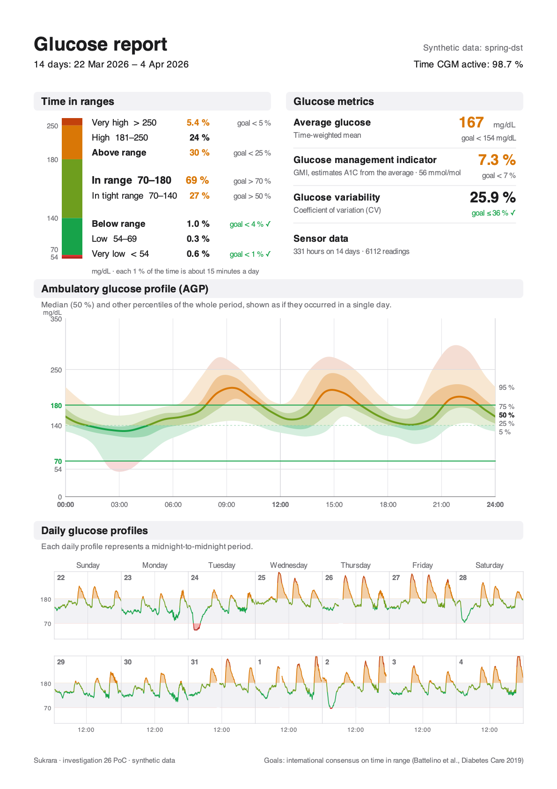
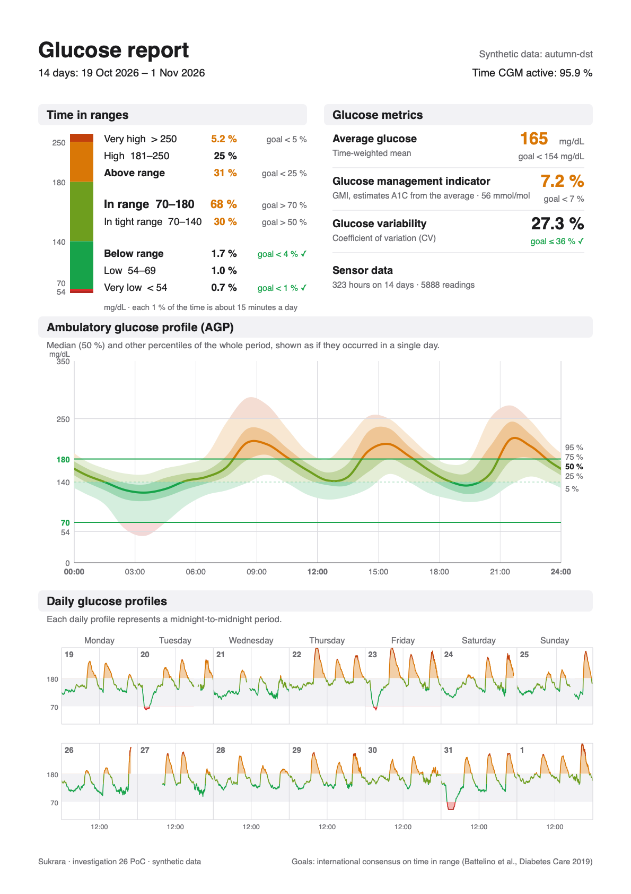
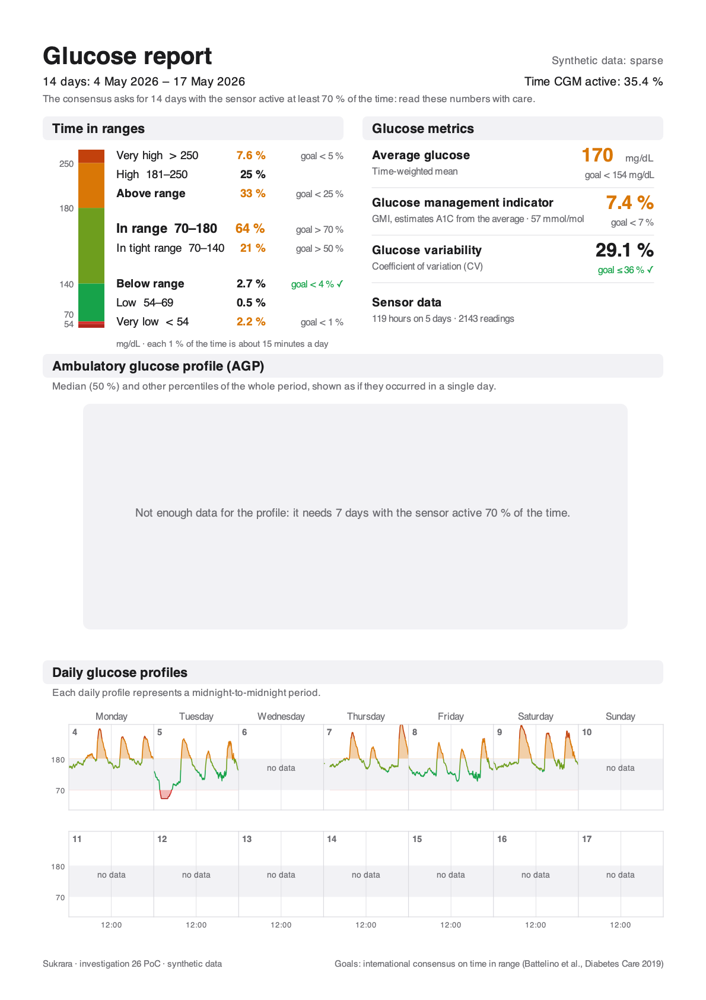

# 26 — The full AGP report: percentile profile, daily profiles, a page for the doctor

*2026-10-19 · investigation report · standalone PoC `spikes/agp-report` (Kotlin JVM engine + Java2D painter, Swift
port + CoreGraphics PDF painter), synthetic data only, no emulator · sources: IDC sample reports (2024, 2025),
the 2019 and 2023 consensus papers, Tidepool viz `c50b095` (2026-10-02, cloned to `third_party/tidepool-viz`),
Juggluco and xDrip+ checkouts in `third_party/`*

## Goal

[18](18-metrics.md) put the AGP report's *numbers* into Sukrara: time in ranges, average, GMI, CV, with the consensus
goals, on a home card and in the Mac's Glucose Report window. It left out the rest of the page a clinician expects:

- the **ambulatory glucose profile** itself: the 5/25/50/75/95 % percentiles of every reading, folded into one day;
- the **daily glucose profiles**: one small strip per day;
- **data sufficiency**: how much of the period the sensor was active, and whether that's enough;
- a **page to hand over**: a PDF to share or print.

Questions: what exactly is the standard (method, smoothing, bins, minimum data, colours)? What do LibreView, Tidepool,
Juggluco and xDrip+ draw? Can one engine give Android and Mac the same numbers, checked against an independent
implementation? Where does it go in Sukrara?

## Short answer

- **The standard is the International Diabetes Center's AGP report** (v5.0; the 2025 sample adds *time in tight
  range* 70–140 mg/dL). The layout, labels and goals are public. The percentile *method* is not: IDC licenses the
  report to device makers. The only open, IDC-licensed implementation is Tidepool's print view. It uses **1-hour bins of
  the modal day, linear-interpolated percentiles (Hyndman–Fan type 7, numpy's default) and a 1-4-1 moving average
  around the day**, drawn as a spline. Its code comment says it does this "according to AGP spec". The PoC uses the same
  method.
- **One thing is different, and it matters for Sukrara:** the PoC samples glucose on a **regular 5-minute grid**
  (the reading in effect at each instant) before binning, instead of counting readings. Sukrara's history mixes
  1-minute live readings with 5/15-minute backfill, the same reason 18 time-weights everything. Counting readings
  moves the synthetic evening percentiles by up to **17–21 mg/dL** (table in §4).
- **Verified three ways, with no difference left:** an independent pandas/numpy implementation written from the
  rules here, Tidepool's own quantile library (d3-array 3.2.4) with its published smoothing step, and the Swift port.
  All of them reproduce the Kotlin engine's numbers on three synthetic 14-day datasets (spring and autumn DST, a
  sensor change, gaps, a sparse period): **max |Δ| 0.0000 mg/dL** on 360 percentile values, and the metrics, daily
  profiles and sufficiency flags match.
- **The page is a display list** of six primitives (rect, line, polyline, text, clip, unclip), laid out once in Kotlin.
  The JVM painter (Java2D, the same calls as `android.graphics.Canvas` inside `PdfDocument`) and the Mac painter
  (CoreGraphics → vector PDF) draw identical pages. One A4 page is about 700 ops and 206 KB of vector PDF.
- **Recommendation:** the home *Glucose report* card gets a **Share report** pill. Settings → Export data (the CSV page
  being added on `w-export`) gets *Glucose report (PDF)* next to the CSV, with the same period choice (this sensor,
  7 / **14** / 30 days) and the same *Save file* / *Share* pills. On the Mac: *Export PDF…* and *Print…* in the Glucose
  Report window, which also draws the profile and the daily strips. Call the page "Glucose report", not IDC's "AGP
  Report" (see §5).

## Result

| JVM (Java2D) | Mac (CoreGraphics, from the same display list) |
|---|---|
|  |  |
| `spring-dst`: 14 days over the spring-forward night, 1 h sensor warm-up on 31 Mar, 4 signal gaps | `autumn-dst`: 14 days over the fall-back night (25 Oct is 25 h long), the sensor ended at 22:00 on 26 Oct and the next one started at 08:00, 6 signal gaps |



*`sparse`: a 14-day period with data on 5 days. The metrics and the daily strips are drawn, and the page says the
numbers need care. The percentile profile is withheld (it needs 7 days at 70 %). The vector PDF of the first page:
[`spikes/agp-report/evidence/glucose-report-spring-dst.pdf`](../spikes/agp-report/evidence/glucose-report-spring-dst.pdf).*

## 1. The standard

### The page

The IDC's current CGM page (2025 sample, "AGP Report: Continuous Glucose Monitoring"), top to bottom:

| Part | Content |
|---|---|
| Header | days in the period ("14 Days"), **Time CGM Active: 96.5 %**, therapy (e.g. MDI); name / DOB on clinical copies |
| Time in Ranges | a stacked bar from Very Low to Very High with the threshold at each edge; per range its share and goal; *Time Above Range* (> 180) and *Time Below Range* (< 70) summed with their goals; *Time in Range* 70–180 large; since 2025 *Time in Tight Range* 70–140 inside it; "Each 1 % time in range = ~15 minutes", "Each 5 % increase in TIR is clinically beneficial" |
| Glucose Metrics | Average Glucose (goal < 154 mg/dL), GMI (goal < 7 %), Glucose Variability "defined as percent coefficient of variation" (goal ≤ 36 %) |
| Ambulatory Glucose Profile | "AGP is a summary of glucose values from the report period, with median (50 %) and other percentiles shown as if they occurred in a single day." y 0–350 mg/dL with 54, 70, 180, 250 marked, 70 and 180 as green "Target Range" lines; x 12 am–12 am every 3 h; 5–95 % light band, 25–75 % darker band, median line; **every band and the line take the colour of the range they are in** |
| Daily Glucose Profiles | "Each daily profile represents a midnight-to-midnight period." Two rows of seven days (the last 14), weekday names over the columns, the day's number in the corner, a grey 70–180 band; the line green in range, highs filled yellow down to 180, lows filled red up to 70 |

The 2024 IDC guide adds the reading rules: "The colors of the AGP correspond with the TIR bar", "between the 25 %
and 75 % lines … is where 50 % of all glucose values fall", "the 5 % and 95 % lines indicate that 5 % of all glucose
values are below or above these lines". LibreView's AGP page is this report under licence ("a standardized report
developed by the International Diabetes Center"), with "the 5th, 25th, 50th (median), 75th and 95th percentiles"
and "single-day profiles … for up to the last two weeks".

### The percentile method

The IDC doesn't publish how it computes the curves. The report is "Patent pending — HealthPartners Institute dba
International Diabetes Center — All Rights Reserved". What is public:

- **Origin:** Mazze et al. (1987) folded the data into one day and drew hourly medians and quartiles, smoothed.
  Bergenstal et al. (2013) standardised the AGP with 10/25/50/75/90 %. The current report draws **5/25/50/75/95 %**.
- **Tidepool's print view** (IDC-licensed, BSD-2 source; `src/modules/print/utils/AGPUtils.js`,
  `src/utils/bloodglucose.js`):
  - **bins:** `mungeBGDataBins(…, ONE_HR, …)`, so 24 one-hour bins of local time of day;
  - **percentiles:** d3-array `quantile` / `median`, i.e. linear interpolation between order statistics (type 7);
    outer quantiles `AGP_LOWER_QUANTILE = 0.05`, `AGP_UPPER_QUANTILE = 0.95`;
  - **smoothing:** "Smooth all bin quantiles according to AGP spec": each bin = (previous + 4 × itself + next) / 6,
    wrapping midnight. With an empty neighbour the weights become 0-4-1 or 1-4-0 (÷ 5); an empty bin stays empty.
    (The published code has a quirk: an empty *middle* neighbour falls back to the last bin's value. It never shows
    once the sufficiency rule below holds.)
  - **drawing:** Plotly `shape: 'spline', smoothing: 0.5` through the 24 smoothed points; y clamped at 350 mg/dL
    (19.4 mmol/L);
  - **sufficiency:** under 24 h of CGM data, nothing. Exactly 24 h: no AGP curve. Otherwise the curve needs **7 days
    with ≥ 1 h of data each, the best 7 averaging ≥ 70 % sensor use**. "% Time CGM Active" = readings ÷ readings
    possible between the first and the last.
  - **rounding:** time in ranges rounded to whole percent and reconciled to 100 % by adjusting *High*. The v5 notes
    say the bar "rounds to a whole percentage point instead of to the nearest tenth". The 2025 IDC sample still shows
    one decimal for the small low ranges (4.9 %, 4.1 %).
- **The consensus** (Battelino et al. 2019) defines the metrics and goals, and asks for **14 days of data with the
  CGM active ≥ 70 % of the time** for the numbers to stand for three months. The 2023 consensus on CGM in clinical
  trials keeps the same metrics and adds time in tight range 70–140 as a trial endpoint, without a clinical goal.
  The **> 50 %** goal for tight range on the 2025 IDC page comes from ISPAD 2022 (preschool children) and from
  expert proposals, not from an adult consensus.

### Goals and colours

| Range | Goal (type 1 and 2) | IDC / Tidepool colour (bar, median line) | Sukrara light palette |
|---|---|---|---|
| Very high > 250 | < 5 % | `#FF6900` / `#FF7538` | `#C2410C` |
| High 181–250 (above range < 25 %) | — | `#FFBF00` / `#FFA600` | `#D97706` |
| In range 70–180 | > 70 % | `#0BAD5A` / `#00AA51` | tight `#17A34A`, rest of the range `#6E9E1E` |
| Tight 70–140 | > 50 % (IDC 2025; see above) | — (a darker green on the bar) | `#17A34A` |
| Low 54–69 (below range < 4 %) | — | `#FF0000` | `#D92D2A` |
| Very low < 54 | < 1 % | `#CC0019` / `#A30014` | `#B3261E` |

Tidepool also carries the goal sets for older / high-risk people (very high < 10 %, above < 50 %, in range > 50 %,
below < 1 %) and for pregnancy. They aren't needed until Sukrara offers other target sets.

## 2. What other apps produce

| | Percentiles | Bins / smoothing | Weighting | Daily profiles | Sufficiency | Output |
|---|---|---|---|---|---|---|
| **LibreView** (Abbott) | 5/25/50/75/95 | IDC's (licensed) | — | last 14 days | % time CGM active | PDF in the web portal |
| **Tidepool** (viz) | 5/25/50/75/95 | 1 h, type 7, 1-4-1, spline | readings counted, deduplicated and filtered to the default 5-minute sample interval (`filterCBGDataByDefaultSampleInterval`, so 1-minute data is dropped) | last 14 days | rules above | print / PDF (PDFKit + Plotly), also a text summary for the clinic record |
| **Juggluco** (`curve/percentile.cpp`, `watchserver.cpp`) | 0/5/25/50/75/95/100 | one bin per sensor interval of the day (1 min for live data), binomial filter `filter<8>` when the step is < 5 min | readings counted | `/x/report`: one curve per day | "% of the time active" | in-app summary graph; `/x/report` is a printable HTML page (statistics, summary graph, daily curves); the stats help says "statistics taken from AGP with some minor modifications" |
| **xDrip+** (`stats/PercentileView.java`) | **10/25/50/75/90** | 48 bins of 30 min, nearest rank (`list.get((int)(n × p))`), no smoothing | readings counted | — | — | a screen in Statistics |
| **Sukrara today** (18) | — | — | **time-weighted** (each reading stands for the time to the next, ≤ 15 min) | — | coverage note under 70 % | home card; Mac Glucose Report window |
| **This PoC** | 5/25/50/75/95 | 1 h, type 7, 1-4-1, Catmull-Rom drawn | **5-minute grid** (time-weighted) | the period's days, up to 14 | Tidepool's rules + the 14-day / 70 % note | A4 page: PNG (JVM), vector PDF (Mac) |

## 3. The PoC

`spikes/agp-report/` (plain Kotlin JVM, no Android; `mac/` is a Swift package):

| File | What |
|---|---|
| `src/main/kotlin/…/Agp.kt` | the engine: period, window, weights, metrics, grid, percentiles, smoothing, daily profiles, sufficiency |
| `…/Synthetic.kt` | the three made-up scenarios (meals on the local clock, dawn rise, night lows, 1-min evening stretches, gaps, sensor change) |
| `…/Fixtures.kt` | `fixtures/<name>.json`: readings + period + options + `expect` (what every implementation must compute), and a tolerant diff |
| `…/Page.kt` | the A4 layout → display list (`Op`), Sukrara's light palette, texts |
| `…/Paint.kt` | Java2D painter (PNG) and the display list as JSON for the Mac |
| `src/test/kotlin/…/AgpTest.kt` | 10 tests (below) |
| `check/independent.py` | the independent pandas/numpy implementation |
| `check/tidepool.mjs` | the same samples through d3-array + Tidepool's smoothing |
| `mac/Sources/AgpMac/Engine.swift`, `main.swift` | Swift port of the engine (`selftest`) and the CoreGraphics painter (`paint` → PDF + PNG) |

### The rules (what Android and Mac must both do)

1. **Period:** whole local days, midnight to midnight in the phone's time zone, DST-aware: a spring-forward day is
   23 h, a fall-back day 25 h. Default: the 14 days ending today.
2. **Readings:** those in [start, end), sorted; one within 30 s of the previous replaces it (Sukrara's `window`).
3. **Weights:** a reading stands for the time until the next one, at most 15 min. The last one gets the spacing before
   it, at most until the end. This is exactly `GlucoseStats.weights`, so time in ranges, mean, SD, CV, GMI and
   **time CGM active** (weight ÷ period length) are 18's numbers.
4. **Grid:** every 5 min from the period's start, the reading in effect (the newest at or before the instant that
   still stands for it). This makes the percentiles time-weighted too, and a gap is no data, not a straight line.
5. **Modal day:** each grid sample goes to the 1-hour bin of its **local wall-clock time**. On the fall-back night
   02:00–03:00 happens twice and that bin gets both hours. On the spring-forward night that bin gets nothing from that
   day. Both are what "as if they occurred in a single day" means. Tests cover both.
6. **Percentiles:** 5/25/50/75/95, type 7. **Smoothing:** 1-4-1 around the day, empty neighbours drop out.
7. **Sufficiency:** under 24 h of data → only "Not enough data". The profile needs ≥ 7 days with ≥ 1 h of data and
   the best 7 at ≥ 70 % on average; otherwise its box says so. Fewer than 14 days or under 70 % active → one grey
   line under the header ("read these numbers with care"), never red.
8. **Daily profiles:** each local day on its own strip. x = the elapsed share of *that* day (a 25 h day fits the same
   width, and the 12:00 tick sits where noon really is: 13/25 on 25 Oct). The line breaks at gaps > 15 min. The raw
   readings are drawn, not the grid.

### Drawing

- **Display list:** `Rect`, `Line` (dash), `Poly` (fill and/or stroke), `Text` (baseline, left/centre/right),
  `Clip` / `Unclip`. Each maps to one Canvas call (`drawRoundRect`, `drawLine` + `DashPathEffect`, `drawPath`,
  `drawText` + `Paint.Align`, `save` + `clipRect` / `restore`) and one CoreGraphics call, so `android.graphics.pdf.
  PdfDocument` gets the same page as the Mac's `CGContext(url:mediaBox:)`. The layout can be compared as data, like
  `graph-fixtures/labels`.
- **Profile:** the 24 smoothed points drawn as a uniform Catmull-Rom spline every 5 min, wrapped at midnight. The
  bands are clamped so a spline never crosses its neighbour (25 % ≤ 50 % at every sample). Then each band and the
  median line are drawn once per range, clipped to that range's strip: the IDC's "colours of the AGP correspond with
  the TIR bar". Bands are the range colour mixed with white (18 % outer, 42 % inner), opaque so PDF viewers can't
  blend them differently. y 0–350, x 00:00–24:00 every 3 h (24 h clock). Percentile labels at the right edge are
  pushed apart so they never overlap.
- **Time in ranges:** Sukrara's six bands on one bar (tight and the rest of the range in two greens). Every non-zero
  range is at least 2 pt tall, and the threshold labels are pushed apart (8 pt). A share shows one decimal under 10 %,
  and also whenever the whole number would land on the other side of its goal ("5 %" for 5.2 % against "< 5 %" would
  read as met; `sharesNeverReadAsTheWrongSideOfTheGoal`). The home card in 18 has this problem today: it rounds to
  whole numbers.
- **Visual language:** goals met → green "goal < 5 % ✓"; not met → the value in the high orange and a grey goal.
  **No red except the low range colour itself.** No logo, no patient fields (a name only if the person adds one
  in the share sheet; see §5), no explanatory paragraphs beyond IDC's one-line descriptions.

## 4. Verification

| What | How | Result |
|---|---|---|
| Engine rules | `./gradlew test`: type-7 quantile = numpy; 12 h of 5-min history + 12 h of 1-min live = 50/50 (mean 150, 12 grid samples per bin either way); a reading before a 1 h gap stands for 15 min; DST day lengths 23/25 h, fall-back bin 02 gets 24 samples and spring-forward bin 02 none, noon at 13/25 and 11/23; 1-4-1 wrap and empty neighbour; sufficiency at 20 h / 6 / 7 / 14 days; share rounding; fixtures = generator (nobody pasted real data in); every fixture lays out with balanced clips | **10/10** |
| Independent implementation | `check/independent.py`: pandas `merge_asof` for the grid, `tz_convert` for local time, `numpy.percentile` (linear), its own smoothing, per-day and sufficiency code; compared with every fixture's `expect` | **0 differences**; profile max \|Δ\| 0.0000 mg/dL (spring 3967, autumn 3875, sparse 1427 grid samples) |
| Tidepool's code path | `check/tidepool.mjs`: the independent grid samples through d3-array 3.2.4 `quantile`/`median` (Tidepool's pinned version) and the transcribed `smoothDatum` | **0.0000 mg/dL** on 3 × 24 × 5 values |
| Swift port | `swift run -c release AgpMac selftest ../fixtures` | **ok** ×3 (metrics, 48 bins × 5, 14 days, flags) |
| Painters | the same display list through Java2D and CoreGraphics | identical layout (pictures above); vector PDF 206 KB, 710 ops |

| Fixture | Readings | Active | Mean | In range | Profile |
|---|---|---|---|---|---|
| `spring-dst` (22 Mar – 4 Apr 2026, Europe/Madrid) | 6112 | 98.7 % | 167.2 | 69.2 % | yes |
| `autumn-dst` (19 Oct – 1 Nov 2026) | 5888 | 95.9 % | 164.6 | 67.8 % | yes |
| `sparse` (4–17 May 2026, 5 days of data) | 2143 | 35.4 % | 170.0 | 64.3 % | no (5 days) |

**Why the grid matters.** The same fixtures computed the way the other apps do, compared with the PoC (worst
hour, mg/dL):

| Variant | `spring-dst` median / any percentile | `autumn-dst` median / any percentile |
|---|---|---|
| readings counted, 1 h + 1-4-1 (Tidepool's method without its 5-minute filter; Juggluco also counts) | 5.7 / **17.3** (20:30) | 6.2 / **20.8** (20:30) |
| 15-min bins, readings counted, no smoothing | 16.6 / 26.1 | 21.9 / 36.9 |
| xDrip+: 30-min bins, nearest rank, 10/90 instead of 5/95 | 14.3 / 31.9 | 19.3 / 27.2 |

The 20:30 peaks are the evenings with 1-minute live readings: counted per reading, they get 5× the say of the
5-minute history around them. Tidepool avoids this by dropping samples off its 5-minute interval. The grid does the same
job without throwing the live readings away (a gap in the history filled by live data still counts). Short bins without smoothing follow single meals rather than the pattern, which is
why the AGP smooths.

## 5. Where it lives in Sukrara

- **Android, home → Glucose report card** (wearer and follower): a **Share report** pill under the card's numbers
  (an action, so a pill like *Eat carbs*). It opens a small sheet: period (*This sensor* when one is known, 7 /
  **14** / 30 days; default 14, as the consensus asks), then *Save file* / *Share* pills. *Share* writes
  `cache/export/sukrara-report-<first>-to-<last>.pdf` and opens the share sheet with a read grant. That is the CSV
  export's plumbing (`w-export`: `export/Export.kt`, `res/xml/export_paths.xml`), reused.
- **Settings → Export data:** the same page gets a format row, *Glucose report (PDF)* / *Readings and treatments
  (CSV)*, so both exports share period, file name pattern and buttons. No second settings page.
- **Mac, Glucose Report window, Report tab:** the profile and the daily strips under the existing numbers (the window
  is wide enough), and **Export PDF…** next to *Export CSV…*, plus **Print…** (⌘P) through `NSPrintOperation` on the
  same page. Same period control (`reportDays`).
- **Not a new screen:** the app doesn't need an on-screen AGP chart beyond the Mac window. On the phone, the card's
  numbers plus the existing graph and time-at-level distribution cover daily use (18's reason for leaving the curve
  out still holds). The PDF is the doctor's copy.
- **Period:** 30 days shows 30 days of numbers and profile, but only the last 14 daily strips (IDC: "up to the last
  two weeks"). The wearer keeps 31 days, so 90 days isn't possible without a longer store; not proposed.
- **Name on the page:** none by default (as the CSV: "No person's name anywhere"). An optional *Name on the report*
  field in the sheet, not saved, for people who hand it over in person.
- **Naming and licence:** "Ambulatory glucose profile" is the generic term from the literature and doctors know it,
  so the chart keeps it. The page is **"Glucose report"**. It does not copy IDC's title "AGP Report: Continuous Glucose
  Monitoring", its footer or its exact layout, and it uses Sukrara's palette. Before any Play / store release, ask
  IDC (agpreport.org) whether a licence is needed for the percentile chart. This is a risk flag, not legal advice.
- **Units:** mg/dL only, as the apps are. The layout takes the bands from settings, so the user's 70/180 (or custom)
  ranges are what the bars and lines show, with the consensus goals. If the user's range differs from 70–180, the
  page says "custom range" next to *Time in ranges* (LibreView does the same).

## To bring into Sukrara

Draft for the integration step. Nothing below is in the app yet.

**Files**
- Android `graph/AgpProfile.kt`: port `Agp.kt`'s grid, profile, smoothing, daily profiles and sufficiency. Reuse
  `GlucoseStats.window` / `weights` and `GlucoseMetrics` (same rules; the PoC duplicates them only to stand alone).
- Android `export/ReportPage.kt`: port `Page.kt` (layout → ops), strings from `values/` + `values-es/`; `export/
  ReportPdf.kt`: a Canvas painter for the ops into `PdfDocument` (A4 = 595 × 842 pt), written to the stream that
  `Export.kt` already opens.
- Android `ui/ReportCard.kt`: *Share report* pill + period sheet; `ui/ExportScreen.kt`: the format row.
- Mac `widgets-macos/Shared/SukraraAgp.swift`: `Engine.swift` (renamed types), and a `CGContext` painter shared by the
  window, *Export PDF…* and *Print…*.
- Shared fixtures: move `spikes/agp-report/fixtures/*.json` to `spikes/graph-fixtures/agp/`. Android runs them in
  `GraphFixtureTest.agp` and the Mac in `-graphselftest`. Add the page's display list for one fixture as a layout
  fixture (op kinds, rects and texts within 0.5 pt) so the two layouts can't drift. Add a parity group `agp` in
  `tools/check/parity.json` (Android files ↔ Swift file ↔ fixtures).
- Port `check/independent.py` as a CI step? No. The fixtures already carry its result; keep it in the spike for
  re-checking when the rules change.

**Defaults and rules**
- Period default 14 days; options This sensor / 7 / 14 / 30.
- Sufficiency exactly as §3.7; withheld parts say why in one grey line.
- The share rounding rule (§3, Drawing) also replaces the home card's `pct()`.
- README (*Glucose report*), `docs/FEATURES.md` (a *Glucose report PDF* block under *Data export*) and `docs/10-showcase.md`
  in the same change.

**Added / discarded (draft)**

| Item | Decision | Why |
|---|---|---|
| Percentile profile 5/25/50/75/95, 1-h bins, type 7, 1-4-1 smoothing | **Add** | the AGP as clinicians read it; same method as the IDC-licensed open implementation |
| 5-minute grid before binning (time-weighted) | **Add** | Sukrara mixes 1-min live and 5/15-min history; counting readings shifts evening percentiles by up to ~20 mg/dL |
| Daily glucose profiles, last 14 days | **Add** | the second half of the standard page |
| Time CGM active + Tidepool's sufficiency rules + the 14-day / 70 % note | **Add** | the consensus requirement, made visible, never red |
| Time in tight range 70–140 on the bar (goal > 50 %) | **Add** | Sukrara already has the tight band; IDC 2025 shows it |
| PDF via `PdfDocument` (Android) / CGContext (Mac), share + save, Mac print | **Add** | the doctor's copy; reuses the CSV export's plumbing |
| Display list shared layout | **Add** | one layout, two painters, testable as data |
| On-screen AGP chart on the phone | **Discard** | the card, graph and distribution cover daily use; the chart is for the PDF and the Mac window |
| IDC's title, footer and exact trade dress | **Discard** | licensed format; Sukrara's palette and name instead |
| Name / DOB fields by default | **Discard** | no person's name in exports by default (as the CSV); optional field only |
| Other goal sets (older / high-risk, pregnancy) | **Discard (for now)** | needs a target-set setting first |
| mmol/L | **Discard (for now)** | the apps are mg/dL only |
| 90-day reports | **Discard** | the stores keep 31 days |
| Pattern insights ("Considerations for the clinician", LibreView's *Glucose Pattern Insights*) | **Discard** | clinical advice; out of scope |

**QA steps (for docs/QA.md, a new section "Glucose report PDF")**
- [ ] JVM: `./gradlew :app:testDebugUnitTest --tests '*GraphFixtureTest*'` (AGP fixtures) and a gallery render of
      the page for the three fixtures; compare with `docs/img/26`.
- [ ] Mac: `-graphselftest` passes; Glucose Report → Export PDF… → open in Preview: one A4 page, text selectable
      (vector), colours as on screen; ⌘P shows the same page.
- [ ] Emulator (wearer, debug build = synthetic glucose): home card → Share report → 14 days → Share → the share sheet
      offers the PDF; *Save file* writes it; the file opens in a PDF viewer; light and dark app theme give the same
      (light) page.
- [ ] Emulator with < 7 days of data: the profile box says why; with < 24 h, the page says "Not enough data".
- [ ] Follower: the same pill; the page uses the received readings.
- [ ] Spanish: every text on the page translated (weekday names from the locale).
- [ ] No name on the page unless typed in the sheet; file name `sukrara-report-<first>-to-<last>.pdf`.

## Run it

```sh
cd spikes/agp-report
export JAVA_HOME=$(brew --prefix openjdk@17)/libexec/openjdk.jdk/Contents/Home
./gradlew test                                  # engine tests + fixtures
./gradlew run --args="fixtures"                 # regenerate fixtures/*.json (synthetic)
./gradlew run --args="render build/render"      # page PNGs (Java2D) + <name>.page.json display lists
uv run --with numpy,pandas python -I check/independent.py fixtures/*.json --samples /tmp/agp-samples.json
(mkdir -p /tmp/d3 && cd /tmp/d3 && npm i d3-array@3.2.4) && node check/tidepool.mjs /tmp/agp-samples.json /tmp/d3/node_modules/d3-array/src/index.js
cd mac && swift build -c release && .build/release/AgpMac selftest ../fixtures
.build/release/AgpMac paint ../build/render/spring-dst.page.json /tmp/report.pdf /tmp/report.png
```

## Sources

- International Diabetes Center, *AGP Report: Continuous Glucose Monitoring* sample with time in tight range (2025):
  <https://www.healthpartners.com/institute/wp-content/uploads/2025/09/AGP-Report-TITR.060125proof.pdf>
- IDC, *Guide to understanding the AGP report* (2024):
  <https://www.healthpartners.com/institute/wp-content/uploads/2025/05/Ambulatory-Glucose-Profile-Report-Overview.pdf>
- IDC, *Determine where to act* sample (2023 data):
  <https://www.healthpartners.com/institute/wp-content/uploads/2025/05/Determine-Where-to-Act.pdf>
- Battelino T et al. Clinical targets for CGM data interpretation: recommendations from the International Consensus
  on Time in Range. *Diabetes Care* 2019;42(8):1593–1603. <https://doi.org/10.2337/dci19-0028>
- Battelino T et al. Continuous glucose monitoring and metrics for clinical trials: an international consensus
  statement. *Lancet Diabetes Endocrinol* 2023;11(1):42–57. <https://doi.org/10.1016/S2213-8587(22)00319-9>
- Bergenstal RM et al. Glucose Management Indicator (GMI). *Diabetes Care* 2018;41(11):2275–2280.
  <https://doi.org/10.2337/dc18-1581>
- Bergenstal RM et al. Recommendations for standardizing glucose reporting and analysis: the ambulatory glucose
  profile. *Diabetes Technol Ther* 2013;15(3):198–211. <https://doi.org/10.1089/dia.2013.0051>
- Johnson ML et al. Utilizing the AGP to standardize and implement CGM in clinical practice. *Diabetes Technol Ther*
  2019;21(S2):S217–S225. <https://doi.org/10.1089/dia.2019.0034>
- Abbott, *Report Set Overview – Libre Portfolio* (LibreView, DOC43939 Rev N):
  <https://files.libreview.io/files/documents/en-US/FSReportTour_2026-05-06.pdf>
- Dexcom, *How the new AGP 5.0 report improves glucose management*:
  <https://ca.provider.dexcom.com/articles/how-new-agp-50-report-improves-glucose-management>
- Time in tight range > 50 %: ISPAD 2022 preschool guideline as summarised in *Diabetes Care* 2025;48(1):6
  (<https://diabetesjournals.org/care/article/48/1/6/157464>); Castañeda J et al. *Diabetes Care* 2024;47(5):790
  (<https://diabetesjournals.org/care/article/47/5/790/154032>)
- Tidepool viz (BSD-2), <https://github.com/tidepool-org/viz> at `c50b095`: `src/modules/print/utils/AGPUtils.js`,
  `AGPConstants.js`, `src/utils/bloodglucose.js`, `src/utils/StatUtil.js`, `src/utils/stat.js`
- Juggluco `Common/src/main/cpp/curve/percentile.cpp`, `net/watchserver/watchserver.cpp`; xDrip+
  `app/src/main/java/com/eveningoutpost/dexdrip/stats/PercentileView.java` (local checkouts in `third_party/`)
