# Sukrara behaviour catalog

The features and exact behaviours Sukrara has, written so the final app (rebuilt from scratch) keeps every one of
them. One line per behaviour, with the rule and the numbers; the "why" and the history stay in the investigation
reports (`docs/NN-*.md`) and `docs/10-showcase.md`.

Rule: every change that adds or changes a behaviour updates this file in the same commit.

**Complete flows** (CLAUDE.md; user, 2026-10-21: "There's no way to unmute!"): every feature section has a
**States and exits** paragraph: each state a user can enter, where it is visible, and how to change it and leave it
(undo, cancel, turn off, unmute, go back) on every platform and surface that shows it. `tools/check/run.sh` (check
`states`) fails on a section without one unless `tools/check/allow.json` `states_pending` lists it with the reason.

## Alerts

Rules: [spikes/alerts/SPEC.md](../spikes/alerts/SPEC.md); timelines: [spikes/alerts/scenarios](../spikes/alerts/scenarios/).

- Every change to the alert rules adds or updates a scenario in `spikes/alerts/scenarios/*.txt`; Android
  `AlertScenarioTest` and the Mac `-alerts-selftest` both run all of them and must pass (SPEC §7).
- Kinds and defaults (the user's settings): very low < 55 every 5 min (alarm volume), low < 70 every 5 min, high ≥ 180
  every 15 min, very high ≥ 250 every 10 min, extremely high ≥ 300 every 5 min (alarm volume), falling/rising fast
  2 mg/dL/min every 30 min (off), no data after 20 min every 60 min; other kinds at notification volume.
- Lows are strictly below the threshold (70 → alerts at 69); highs at or above it.
- "Very low" (id `very_low`) replaced "urgent low" everywhere (settings JSON, channels, sounds, events); no migration.
- Level alerts: one at a time, the most severe wins; a worse kind of the same side alerts at once; getting better
  (very low → low) doesn't alert.
- Rate alerts (falling/rising fast) run next to level alerts; no data runs on a timer and clears on the next reading. The Android timer is an elapsed-time alarm, so a clock change (`TIME_SET`) re-checks at once and plans it again (round 22: with the clock moved forward the old high stayed up and no "no data" came; a real gap alerts on time, scenario *A high with no more readings…*).
- Readings older than 15 min never alert; the alert clears when the reading gets that old.
- Episodes: one per group and side; a brief exit (back in range for less than the repeat interval, at least 5 min)
  clears the notification but keeps the episode, its repeat count and its treatments; no new "first" alert.
- Repeats count from the last alert of the episode; repeat 0 = once per episode.
- Logging the answering treatment clears the alert; when its mute window ends and it still matches, it alerts at once
  and the repeats count from there.
- Carbs mute very low, low and falling fast (default 15 min); rapid insulin mutes high, very high and rising fast
  (default 60 min); no treatment mutes extremely high or no data (the user's own Mute / Mute all do); window = `t ≤ now < t + min`; deleted entries don't count.
- Notification actions (round f30, SPEC §2; the user 2026-10-21: "two kinds of buttons … Mute 30 min doesn't conceptually belong there"; Android guidance: up to three actions that don't duplicate the tap, developer.android.com/develop/ui/views/notifications/build-notification#Actions, choices via RemoteInput): every alert notification, every kind (very low and extremely high included), has exactly **Mute…** and **Remind less** (Mac *Remind Less*) on Android and Mac. Mute… is one action whose choices are the lengths (Android direct reply: the setting's length first, then 15 min / 30 min / 1 h / 2 h, plus typing; Mac text input, placeholder *30 min, 1 h, 2 h…*, empty = the setting); typed text goes through the shared duration parser (`45`, `1 h 30`, `1:30`, `2h`; 1–720 min); anything else changes nothing and the notification comes back silently. Remind less (es *Avisar menos*; was *Relax*) repeats the side every `max(repeatMin, relaxMin)`; it shows only when it would slow anything (no data, every 60 min, gets Mute… alone), and once relaxed the slot is **Remind as usual** (es *Avisar como siempre*); the interval is in the secondary text (*Reminders every 30 min*), never on the button. After Mute… Android replaces the alert with a silent *Low muted until 10:42* with **Unmute** and **Change…**; macOS removes a notification once an action is used and posts a passive one with the same two. Scenarios: `spikes/alerts/scenarios/actions.txt`.
- Scope and end of Mute / Remind less (round f30; the user: "a high mute … then goes low, the low would be muted, and we don't want that"): they act on one side (lows incl. very low; highs incl. extremely high; falling fast; rising fast; no data), never the other. They cover very low and extremely high too (the user's decision; treatment mutes still never cover extremely high). They outlive the episode and end at their time (Mute) or once back in range **by the margin**: lows ≥ low threshold + 10 mg/dL, highs < high threshold − 10 mg/dL, for 10 min in a row (`notificationActions.backMgdl` / `backMin`, settings rows *Mute and Remind less end when back in range by* / *… for at least*); crossing back out restarts the count, so oscillation at the edge stays quiet. History: *Low back in range: mute and relax ended*.
- **Mute all** (round f30; the user: "a global mute button with a time option … Never is also an option"): Android home control **Mute alerts** (es *Silenciar alertas*), Mac dropdown **Mute Alerts**: 30 min · 1 h · 2 h · 4 h · 8 h · **Until you turn it off** (es *Hasta que lo desactives*, after AOSP Do Not Disturb; was *Never*) · Custom… (the one number input, 5 min–24 h, schema `muteAll`, whose special 0 is `until_turned_off`; was `never`). It quiets every kind, very low, extremely high and no data included, on that device only (the wearer still sends the followers' alerts); alerts showing go. When it ends whatever still matches alerts at once (history *Alerts back on*). It survives a restart.
- Notification actions and Mute all are per device (user 2026-10-21: "if someone wants to mute, it shouldn't mute the other"): only that device's notifications, pill and history change; nothing is sent. The wearer runs its rules twice (its own notifications with its actions, the followers' `alert` events without). On a follower mirroring the wearer (phone or Mac, `AlertMirror` on both) they drop the wearer's alerts there (while relaxed a repeat shows only after `relaxMin`; a more severe kind always shows) and end by the same time and margin rules on the readings that device gets. With own rules they act on that device's engine. Treatment mutes are shared data and quiet every device. Scenarios: `devices.txt` (`mirror`).
- Badge (`AlertStatus`, both platforms, `spikes/graph-fixtures/status.json`): a side's Mute (or Mute all) out of range = the tonal pill with the bell and time left in the colour of what answers it (*Muted* when Mute all has no end); a treatment mute shows first. Mute all in range = the neutral **muted** pill with the "notifications off" bell, *Muted · 1h 20m* / *Alerts muted* (short *Muted*), on every card surface (app, widgets, lock screen, glucose notification, Mac dropdown and widgets); the Mac menu bar puts a bell.slash before the value.
- Durations (round f30; the user: "Showing 60 min and 120 min is long, 1 h and 2 h is better"): every duration in words goes through one formatter per platform (Android `core/Durations.kt`, Mac `Shared/Durations.swift`, cases `spikes/durations/durations.json`): *45 min*, *1 h*, *1 h 30 min*; the card keeps its compact *1h 4m*. tools/check rule `durations` fails on a duration written by hand.

  
  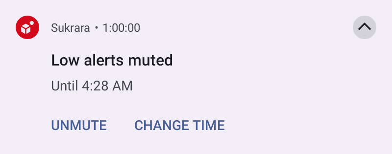
  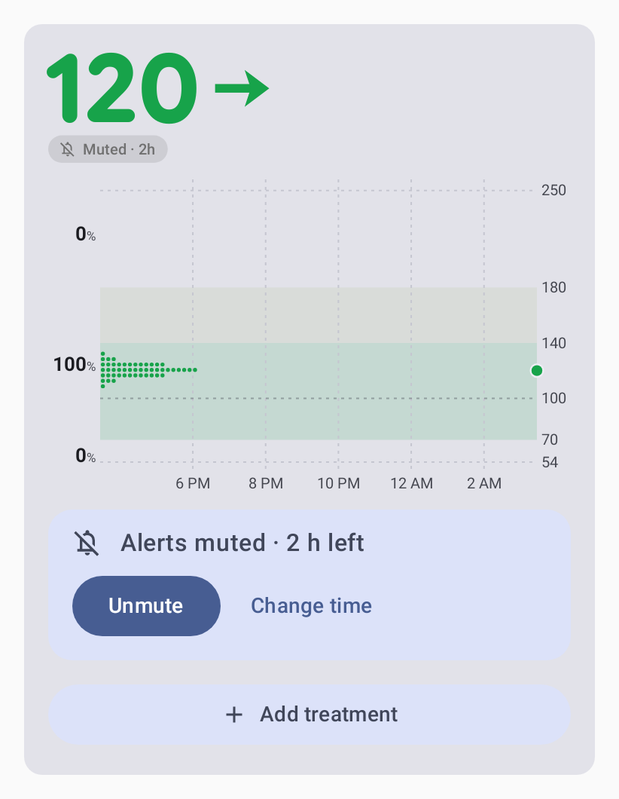
  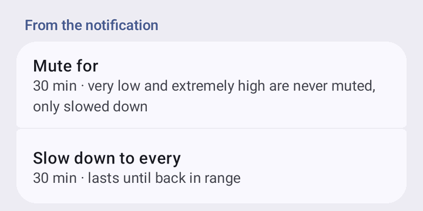

- Countdown and copy (round f31; the user, 2026-10-22: "muted alerts should show a countdown, and the Never option makes no sense … figure out the best copywriting"): every muted state counts down. Android's muted notification uses a count-down chronometer (`when` = the mute's end) titled *Low alerts muted* with *Until 10:42*; the pill, sheet, Active now and Mute-all line tick on each minute boundary; widgets and the lock screen re-render each minute while a mute runs. Mac rows, pill, Active now and menu-bar tooltip tick; Mac notifications say *Until 10:42* (they can't count down). The state lines come from one builder per platform (`MuteCopy`) tested against `spikes/alerts/copy.json` (en + es): *Low alerts muted · 12 min left*, *Low reminders every 30 min*, *Alerts muted · 1 h 12 min left*, *Alerts muted until you turn it off*; choices *For 30 min* … *For 8 h*, *Until you turn it off* (AOSP DND's *Until you turn off* / *For 1 hour*); buttons *Unmute* / *Change time*, *Remind less* / *Remind as usual*; pill *Muted · 1h 12m* / *Muted*. Mac uses title-style buttons and menu items (*Change Time*, *Remind as Usual*, *Until You Turn It Off*). Round f33: the quiets after a treatment say it the same way and count down to the rule's end like a mute (*Low alerts muted after carbs · 12 min left*, *High alerts muted after insulin · 1 h left*; was *Low quiet after carbs until 10:42*), and the falling rule reads *High alerts muted while falling back into range*; the badge's screen-reader text (TalkBack on the widgets and the card, Mac VoiceOver) is the same line as the app's rows. Spanish agrees with the time left: *queda 1 h* / *queda 1 min*, *quedan 2 h* / *quedan 1 h 5 min* (Android `plurals` for every *queda(n) %s*: the mute lines, the pill *queda 1 h*, *Sensor: queda 1 d*, Sensor end's *Termina el … · queda 1 d*; the quantity is the duration's one number, `Durations.*Quantity`; `StringsParityTest` fails on a plain-string *quedan %s*). The Mac is English only (*left* doesn't change).
- **States and exits** (rounds f29, f30, f31; SPEC §2 "States and exits"; scenarios `actions.txt`, `exits.txt`, `devices.txt`; Android `AlertMuteTest`, `AlertExitsTest`, `MuteAllGallery`, `QuietGallery` read back the posted notifications; Mac `-alerts-selftest` notification checks on the real `Alerts` class). Every way out acts on this device only and updates history, badge, widgets and ring at once.
  - *Normal*: the alert notification (Mute…, Relax), the *Eat carbs* / *Take insulin* pill. Out: the episode ends.
  - *Side muted (N left)*: Android the silent *Low muted until 10:42* notification with **Unmute** / **Change…** (es *Reactivar*, *Cambiar…*); the tonal pill *Nm left* → sheet (**Unmute**, **Change to** 15 min / 30 min / 1 h / 2 h); Settings → Alerts → **Active now**. Mac: the passive notification with the same two, panel rows (Unmute, Change To), the pill's menu, Settings › Alerts › Active now. Out: Unmute (still out of range → alerts at once), its end (alerts at once if it still matches), back by the margin; Change = a new end from now.
  - *Quiet after carbs / rapid insulin*: the tonal pill and ring; the line *Low alerts muted after carbs · 12 min left* (ticks; Android home chip, sheet, Active now; Mac panel row, Active now); sheet / panel / Active now **Alert me anyway** (this device only). On a mirroring follower the wearer's phone decides (the sheet says *Low alerts muted after a treatment. The wearer's phone decides when they come back.*, *Alert settings*).
  - *Quiet: falling back into range*: Active now / panel **Alert me anyway**.
  - *Side relaxed*: Android chip under the card *Low reminders every 30 min* (es *Avisos de glucosa baja cada 30 min*), the notification's **Remind as usual**, sheet / Active now; Mac panel row, pill menu, Active now. Out: Remind as usual (an overdue repeat at once), back by the margin.
  - *Muted + relaxed*: both lines and both exits; the margin ends both.
  - *All alerts muted (time / Never)*: Android under the card *Alerts muted · 1 h 12 min left* (counting down) / *Alerts muted until you turn it off* (es *Alertas silenciadas · quedan 1 h 12 min* / *… hasta que lo desactives*) with **Unmute** (es *Reactivar*) and **Change**, the muted pill everywhere, Active now, TalkBack actions on the card (*Alerts: Unmute*, *Alerts: Change time*); Mac dropdown row with **Unmute** and **Change Time**, the menu bar's bell.slash (tooltip and VoiceOver *Alerts muted …*), the pill's menu, Settings › Alerts › Active now. Out: Unmute (what matches alerts at once), its end (never with Never), Change.
  - History lines (Android; the Mac logs them): *Low alerts muted for 1 h*, *Low reminders every 30 min*, *Low alerts unmuted*, *Low reminders as usual (every 5 min)*, *Low back in range: alerts as usual*, *All alerts muted for 2 h* / *… until you turn it off*, *Alerts unmuted*.

- Falling-high mute (default 20 min): no high/very high alert while `sgv + rate × min < high`; it only postpones (a
  repeat that came due fires when it ends).
- Headlines: "Very low glucose", "Low glucose", "High glucose", "Very high glucose", "Extremely high glucose",
  "Falling fast", "Rising fast", "No glucose data"; body "69 mg/dL ↘ · < 70 mg/dL".
- Headlines acknowledge treatments logged in the episode (or within the mute length before it): lows "· eat more"
  (1 carbs entry) / "· eat more again" (2+); highs "· still high after insulin" / "· still high after more insulin"
  (never advise more insulin). Counted even when the mute is off.
- The wearer's `alert` event carries `tr` (that count) so followers and the Mac show the same headline.
- Notification body (Android + Mac): the value and arrow only (`69 mg/dL ↘`); falling / rising fast add the rate (`120 mg/dL ↓ · falling 2.4 mg/dL/min`); no data: `Nothing received for 20 min · last 120 mg/dL`. No threshold, no source ("from the wearer's phone").
- Android timer: exact alarm (`USE_EXACT_ALARM`) at the engine's next check, so a mute end alerts on time between
  readings; Mac: one-shot timer at the next check plus the 60 s tick.
- Badge status (`AlertStatus`): None / Needed / Taken / Paused use the same thresholds and treatment windows as the engine.
- Notification channels: two per kind (`alert_n_<kind>`, `alert_a_<kind>`); any other `alert_*` channel is deleted.
- One sound per alert: each channel rings only its Sukrara sound; the app restores its episodes after a restart (an
  update kills it) and shows the alerts that were up again without sound; the next sound is the normal repeat
  (Android + Mac: Mac UserDefaults `alertEpisodes`, restored at launch with the last stored reading; history/log line
  "resumed High (no sound)"; scenario event `restart`, SPEC §7).
- Default sound pack: Quest, a different variant each time, no per-kind packs; followers mirror the wearer by default.

## Treatments

- Amounts are written lowercase with no space before the unit everywhere (Android + Mac): `4.5u`, `18u`, `30g` (dialog suffixes, lists, chart labels, the slot; also the Nightscout API's long-acting note; the Mac's treatment rows and amount field).
- Short durations read `now` (< 1 min), `12m`, `1h 5m` (whole hours: `3h`), only hours from 6 h (`7h`), days from 48 h (`2d`); time left rounds up (`1m` until it is over).
- The home treatments list (wearer) and the follower's list end each row with the time since the entry (`12m`, `3h`), refreshed every 30 s. Mac: Treatments window rows end with the time of day and the same `12m` / `3h` (refreshed every 30 s while shown).
- The treatment dialog (Android + Mac) focuses carbs instead of rapid insulin when the latest fresh reading is below an enabled low-side alert threshold (`AlertStatus.level` in `Kind.LOW_SIDE`); otherwise rapid.
- The treatment dialog on Android (home screen and `QuickTreatmentActivity`): the Rapid / Long / Carbs labels always sit small on the field outline on one line, with the unit (`u` / `g`) shown throughout, so no field and not the dialog changes height when the focus moves (`TreatmentDialogHeightTest`, en + es, 360 / 412 dp).
- The treatment dialog's time (Android + Mac): *When?* switches between a clock time and *Minutes ago* (Android: M3 segmented button, a number field with 5 / 15 / 30 / 60 min filter chips; Mac: segmented control, field + buttons). Minutes ago are 0–1439 (under a day, like the clock time; OK disabled when empty or 1440+, the field outlined red), 0 = now; the chip shows *16 min ago* (es *Hace 16 min*) and the entries get the time 16 min before the moment of saving, not of picking. The quiet line counts from that time. Cases in `spikes/libreview/treatment-form.json` (`minutes`, `minute_filters`); `TreatmentTimeTest` (also at 411 dp).
- The treatment dialog's form (Android + Mac, `TreatmentForm`, cases in `spikes/libreview/treatment-form.json`): insulin rounds to 0.1u (≤ 100u), carbs to whole grams (≤ 500g), `,` or `.` as decimal mark; 0, or 0 after rounding, is invalid; one invalid field blocks Save; a blank note adds nothing, a note is trimmed and clipped to 100 bytes.
- Writer scope (investigation 24, P4; Android + Mac; `WriterScope`): a follower allowed to add entries (a writer) creates entries and changes or deletes **only the ones it created**; the wearer changes any. The wearer's phone refuses a writer's change to the wearer's own or another writer's entry (logged `treatment REJECTED: … may only change its own entries`; no echo, so the writer's copy stays *not accepted yet*). Followers apply the same rule: each entry's creator is the key that signed its first accepted version; a writer's copy that arrives after the wearer's echo of it is ignored, not counted as rejected; the wearer's own entry replaces a copy a writer forged first, whatever its version.
- Every writer sends `o: follower` (the Mac too; its own rows stay `mac` locally). Mac following someone: Delete (context menu, ⌫, Undo) works only on entries made on this Mac; the wearer's and other followers' rows are read-only.

## Mac menu and windows

  
  
  
  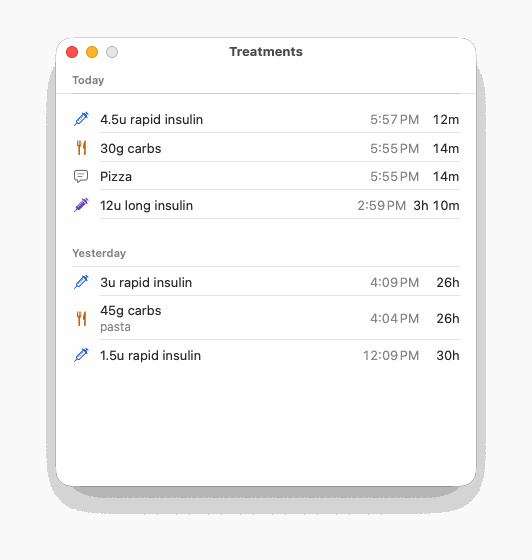

- A click on the menubar number opens the glance panel (a borderless panel under the item, like `MenuBarExtra(.window)`: the menu material, 14 pt corners, a shadow); a second click, Escape, a click outside or another app taking focus closes it. Opening it brings Sukrara to the front, because macOS sends trackpad gestures only to the app in front (the user, 2026-10-22: "I pinch on the trackpad and nothing happens": the non-activating panel had the keyboard but never got a pinch); closing it gives the front back to the app that had it, so it still behaves like a menu: a second click, Escape or the right-click menu return to that app at once; a click outside returns to it unless the click went to another app or a Sukrara window (that one stays in front); a row that opens a Sukrara window (Add Treatment…, Treatments…, Glucose Report…, Settings…, Follow Someone…) leaves Sukrara in front with that window (`-panelselftest`: opened through a real status item, Sukrara in front with the panel key, a pinch posted to the app zooms the chart, a second click gives the front back, a row keeps it). Right-click (or Control-click) opens a short menu: Treatments…, Glucose Report…, Settings… ⌘,, Quit Sukrara ⌘Q.
- The panel, top to bottom: the glucose card in a recessed module (12 pt corners; black 18 % in dark mode, white 50 % in light mode, a separator outline with Increase Contrast); *Add Treatment…* ↩, *Treatments…*, *Glucose Report…* and *Settings…* ⌘, as menu-like rows (hover highlight). No source, follow or error lines (Settings › General / Following show them), no treatment list (Glucose Report › Treatments).
- The card in the panel uses the shared palette without a background colour (no halo disc / marker hole) and a grid one step stronger (#4A4A4F dark, #C8C8CE light); with Increase Contrast secondary ink #D8D8DC / #3C3C40 and grid #7C7C82 / #8A8A90.
- No data: *No readings yet* in the module, *Follow Someone…* when not following, else "Waiting for the wearer's phone."; no *Add Treatment…* row.
- *Add Treatment…* (the first menu-like row, the panel's default button: Return chooses it, shown as ↩) closes the panel and opens the Add Treatment window, the Mac form of Android's treatment dialog: an auxiliary window (HIG Windows) with the system frame and no title text, centred near the top of the menubar's screen, brought to the front. Inside, as on Android: *Add Treatment* and the time chip (*Now* / *16 min ago* / *Today 14:05* / *Yesterday 23:10*; a popover *When?* with a segmented control *Time* / *Minutes ago*: an hour:minute field (a time later than now is yesterday, within the current minute is now) or a minutes field with 5 / 15 / 30 / 60 min buttons; Now, Cancel, OK); Rapid `u`, Long `u`, Carbs `g` side by side (each with its chart marker; digits, `.` and `,`, at most 5 characters), Note below (placeholder *Pizza, exercise, sick…*, one line, at most 100 UTF-8 bytes, `n / 100` from 80 bytes); the quiet line (*Highs quiet for 60 min · lows quiet for 15 min*, Settings › Alerts minutes, not while this Mac mirrors the wearer's alerts or with alerts off); the limits line in red with a red outline on the bad field (*Insulin: up to 100u · carbs: up to 500g*); Cancel and Save (disabled until something valid is filled). Focus starts in Rapid, in Carbs when the latest fresh reading is below an enabled low threshold; Tab walks Rapid → Long → Carbs → Note; Return saves (every filled field becomes its own entry at the same time, in kind order rapid, long, carbs, note, each through the same path as before: v2 to the wearer as a writer, local when following no one); Escape or the close button cancels. When this Mac can't log, the row stays in place dimmed (HIG Menus) with the reason on a second, smaller line under it, also its tooltip (`TreatmentPaths.Blocked`): *Waiting for Marta to approve this Mac*, *Marta hasn’t turned on “Can add entries” for this Mac*, *Marta stopped sharing with this Mac*, *Not following Marta: ask for a new invite* (*the wearer* when the name is unknown). Settings › Following › *Treatments logged here* shows the same reason.
- Glucose Report window (panel row or right-click): the report only (no treatments; they have their own window): 1 day / 7 days / 14 days / 30 days (`reportDays`, default 14), the report, *Export CSV…*. Position remembered (`SukraraReport`).
- Treatments window (*Treatments…*, panel row or right-click; its own item like Android's treatments list, apart from the report): the last 7 days grouped by day (Today, Yesterday, weekday date), each row with the kind's symbol in its colour, amount, note, for entries made on this Mac a delivery symbol (clock = sending, paper plane = sent, ⚠︎ orange = not on the phone after 2 min, ✓ green = on the phone) whose tooltip says it in words ("Sent 14:05, waiting for Ana's phone", "On Ana's phone since 14:07"), then the time of day and the time since (`12m`); who logged it as the row's tooltip ("Logged on this Mac", "Logged on Ana's phone"); Delete in the context menu and ⌫ when this Mac may log, and while following someone only on entries made on this Mac. Position remembered (`SukraraTreatments`); ⌘W closes.
- Settings window (⌘, from the panel or the right-click menu; redesigned in round f28 after the HIG's macOS settings guidance): a non-customizable preference toolbar of five panes General · Graph · Rings · Alerts · Following (a toolbar, not a sidebar: five panes, HIG "Typically, a custom settings window contains a toolbar …"), title = the pane's name, close only (minimize/zoom dimmed), 600 pt wide, each pane its own height (520 / 720 / 680 / 720 / 340 pt) keeping the top edge, reopens on the last pane (`settingsPane`) at the last position (`SukraraSettings`); changes apply at once; grouped forms with standard controls only.
- One number input (`NumberSettingRow`, every number on the Mac; the format of each is the shared schema's, `spikes/settings/settings.json` → `SettingsSpec.swift`, the same file Android's dialogs use): a pop-up menu of the presets and special values (*Off*, *Only once*, *None*, *Same as default (12 hours)*) and *Custom…* where custom values are allowed (the ellipsis character: it needs more input; `-settingsselftest`); Custom (or a stored value that is no preset) shows a number field + stepper (one click = the format's nudge, Shift-click 10 ×) + the unit, with the range under it (*Enter 1–48 h*). Typed text that isn't in range or on step turns that note red and is not applied; Return or leaving the field commits. Ranges: the six bands (very low 30–80, low 40–120, very good 80–250, high 100–300, very high 150–400, extremely high 200–450 mg/dL, kept in order), time shown 1–48 h, per-place time shown (Same as default or 1–48 h), ring periods 12 h or 1–90 days, sensor countdown 1–24 h, thresholds (very low 40–80, low 50–120, high 120–300, very high 150–400, extremely high 200–450 mg/dL, rates 0.5–5.0 mg/dL/min in 0.1 steps, no data 5–240 min), repeat (once or 1–240 min), quiet after insulin 10–360 min, falling back / after carbs 5–120 min, notification Mute… first length 1–720 min, Remind less (only presets slower than every enabled alert's repeat; custom from that repeat + 1 to 120 min), the margin 0–50 mg/dL and 0–60 min, Mute all 5 min–24 h or until you turn it off; minute presets read as *1 h*, *2 h*. Rings and numbers (None, 1–3) and vertical lines (Off, every 1/2/3/4/6/12 h) are plain pop-ups. Every stored value is loaded through its format (`NumberSpec.coerce`), so any value the settings accept persists (custom hours were dropped back to 12 h before) and nothing else gets in.
- Settings from (General; schema `follower.settingsFrom`, UserDefaults `settingsFrom`): **Wearer** (default; *Ana (wearer)* when following), **Default** or **Custom**, for the mirrored settings: the six ranges, time shown (default), rings and numbers, each slot (kind, period, fainter), a ring's centre, ring order, rewards on the rings, time in range and crown beside the graph, lines across the graph, vertical lines, last treatment position and fallback, sensor countdown, and per alert (except no data) on / threshold / repeat plus the three quiet rules. Wearer = the wearer's latest settings event (`wearerSettings`, PROTOCOL-v2 *Settings*; until one arrives, or when not following anyone, the defaults, and the pane says so: *Waiting for Ana's settings…* / *Not following anyone, so Sukrara's defaults are used.*); Default = Sukrara's defaults; Custom = this Mac's own values. Always this Mac's in every mode: sounds, like an alarm, the no-data alert, the notification's Mute… / Remind less and the margin, Mute all, the alerts main switch, each place's own window and sensor time, open at login. Only Custom shows the mirrored controls; Default and Wearer show a read-only summary of what's in use (*Settings from*, then the values) with *Change…* (opens General). In Custom, **Copy the Wearer's Settings…** (when one was received) and **Reset to Defaults…** overwrite only the mirrored values, after a confirmation. One merge for every reader (`GraphConfig.load`: menubar card, panel, widgets, report; `AlertSettings.load`: the alert engine, badge, mute lines, Add Treatment's quiet line); a new wearer event or a mode change redraws them at once (`WearerSettings.changed`). Stopping following forgets the wearer's settings. The alert source follows the mode: Wearer mirrors the wearer's alert events (as before), Default and Custom run the rules on this Mac; the separate *Alert source* picker is gone.
- General: Open at login (`SMAppService.mainApp`; a note when it needs approval in Login Items or isn't the installed app), *Settings from* with *In use* (where the mirrored settings come from now) and, in Custom, the copy / reset buttons; the data source and last reading (date, time, relative), the last poll error, **Reconnect Now** (restarts Wi-Fi discovery, relays and Bluetooth), the version, **Quit Sukrara**.
- Graph: *Time shown*: Default (Custom only) and one per place, *Menu bar dropdown* and *Widgets* (`menubarHours`, `widgetHours`; *Same as default (12 hours)* = 0, like Android's per-place windows); *Graph*: *Time in range distribution* (the % column and the dots beside the chart; Android: the same title, no summary, Material Symbols `bar_chart` icon; the user, 2026-10-21) and crown beside the graph, vertical lines; the lines across the graph (each with a remove button, *Add a line at* validated by the line format, 40–400 mg/dL, up to 6); the six ranges, Reset Ranges; *Sensor*: sensor countdown (Custom only), time left in the menu bar dropdown / on widgets; Reset All Graph Settings… (Custom only, confirmation). Rings pane (Custom; otherwise the summary): rings and numbers (None, 1–3), each slot's kind and period, *Fainter* on the second and third only (the main ring is always full strength, as on Android), what a ring's centre counts, rewards on the rings; ring order as a list you drag to reorder (an insertion line shows where it lands; Control-click or VoiceOver actions *Move Up* / *Move Down*; Reset Order); last treatment: position, fallback kind, its period and *Fainter*. Same UserDefaults keys as before.
- Alerts: main switch and state line; in Default / Wearer a summary of the quiet rules in use; one row per alert (name, one-line summary of what applies such as `Off · Below 70 mg/dL · repeats every 5 min · Quest · like an alarm`, Details…, and its switch in Custom; no data always has its switch); in Custom quiet highs / quiet lows as switches with their minutes; *From the notification*: Mute… first length, Remind less every, the margin (mg/dL and minutes); sound pack and *Different sound each time* (a random variant of 3, never the one this alert played last, like Android), **Notification Settings…** (System Settings › Notifications › Sukrara; installed app only). The sound pack row and an alert's *Sound* row are buttons with the current choice that open a popover list with Android's options and words: (*Pack default (Quest)*, per alert only) *Arcade (8-bit)*, *Kart (racing)*, *Quest (adventure)*, *Soft (calm)*, *System default*, *None*; a checkmark on the chosen one and ▶︎ on every one that plays (the pack list plays the high alert's sound; each ▶︎ press another variant than the last). Files: the 96 IMA4 CAFs (4 packs × 8 kinds × 3 variants, 1.5–4.6 s) in `Sukrara.app/Contents/Resources`; each notification first copies the sound it rings to `~/Library/Sounds/Sukrara <pack> <kind> <n>.caf` (only sounds that have rung, so System Settings' alert-sound list shows those few, all starting with *Sukrara*) and names that copy, the same for mirrored alerts and this Mac's own rules; copies of sounds that no longer exist are removed at launch. Naming the bundled file played Apple's default sound (2026-10-21). `-alerts-selftest` builds every kind's notification (mirrored / own, alarm or not, every pack, system, none) and fails unless its sound is such a copy; `-alerts-selftest` fails on a file that isn't PCM / IMA4 / µLaw / aLaw or is 30 s or longer (the system would play the default sound). Details… opens a sheet: in Custom (and always for no data) the alert's switch and *Alert when* (threshold and *Repeat*: Only once / every n min); otherwise what applies, read-only; then sound (that list), *Like an alarm* and **Send Test Alert** (a real notification titled *Test ·* with its sound; the wearer doesn't get it, like Android's *Send a test alert*); Done (Return).
- Following: not following → a short explanation, **Follow from QR Image…** and **Follow with Invite Link…** (default button); following → the wearer's avatar and state, where entries logged here go, this Mac's own picture and name (*How you appear to Marta*) with **Edit…**, **Stop Following…** with a confirmation sheet. Edit… opens a sheet like Android's *How you appear* (`IdentityUI.swift`): the 88 pt picture, *Shuffle* (a new random picture), *Customize* / *Done* (shape as a segmented control Cube · Drop · Dots · Rings · Letter, the 8 colours as circular swatches, *Turn the colours* = 45° further and the next dots seed), *Your name* (at most 40 characters), the privacy note, *The person you follow sees the change as soon as it reaches them.*, Cancel and Save (disabled while the name is blank). Save stores it and sends the wearer a `profile` gift wrap (relays + the phone over Bluetooth), exactly as the Android follower; the wearer's phone applies it once this Mac is approved. Generated pictures only (no photo: PROTOCOL-v2 sends the numbers, never an image). Name and picture rules pinned by `spikes/nostr/identity/profile-v1.json` (Android `ProfileFixtureTest`, Mac `-identityselftest`).
- The app installs a main menu (Settings… ⌘,, Close Window ⌘W, Quit ⌘Q, Edit: Undo, Redo, Cut, Copy, Paste, Select All) so the standard shortcuts work in its windows and dialogs, although a menubar-only app never shows it.

- Mac launch guard (`LaunchGuard`): an argument the binary doesn't understand (an unknown `-…selftest`, a bare unknown `-flag`, a stray word) prints why and exits 2 without starting anything; a dev build (the `swift build` executable, or an app inside a git checkout such as `build/Sukrara.app`) starts the full app only with `SUKRARA_DEV=1` (else exit 3), so it can't share the installed app's Keychain item, data files and settings by accident. Installed and downloaded copies start as before.

**States and exits**: *Add Treatment… dimmed* (this Mac can't log) → the reason is on the row and its tooltip and in Settings › Following; it becomes available as soon as the wearer approves / allows entries (nothing to undo here). *Panel open* (Sukrara in front) → Escape, a second click or the right-click menu close it and return to the app you were in; a click outside closes it and leaves you where you clicked; a row's window keeps Sukrara in front until you close or leave that window. *Quiet alerts* → the rows under the card (Alerts › States and exits).

## Readings and backfill

- Android user-facing errors are sentences in the app's language (`ui/UserErrors`, round 22; `UserErrorsTest`), never an exception's class or a socket address: the home panel's and the source page's source line (*Can't reach Juggluco. Open it and check that its web server is on.*, *Juggluco stopped sending readings. Reconnecting…*, *Bluetooth is off*, *No sensor paired*, *The sensor has ended. Pair a new one.*, *This sensor isn't supported*, *Lost the sensor. Reconnecting…*, the Nearby devices permission, else *Can't get readings from the sensor. Retrying…*), and the failures of LibreView / Tidepool sign-in, the Nightscout test, settings export / import, CSV export, invite lookup and password-manager restore (network failures by kind: can't find the server / can't connect / didn't answer in time / secure connection failed; our own short messages as written; else *Something went wrong. Try again.*). The technical text stays in the log and the DebugReceiver state. The home panel shows the newest of the engine's and the source's reading and takes the current time again when the app comes back to the front (round 22: it once showed a 3-min-old value).
- Mac user-facing words never use protocol terms (v2, relay, roster, writer, epoch, BLE): the data source reads `Internet`, `Bluetooth · <phone>` or `Wi-Fi · Juggluco`; the follow state `Following Ana`; logs stay technical.
- Mac: every backfilled reading (v2 hour chunks over relays or Bluetooth, the BLE backlog, v1 Nostr, Juggluco's Wi-Fi history) goes into the 31-day readings store as it arrives, whatever its age; only the live 3 h working window is trimmed (a chunk older than 3 h before the newest reading used to be dropped, which left gaps in the graph after every launch, wake or reconnect).
- Mac follower (protocol v2): the chunk subscription starts 1 h before the newest stored reading, at least 13 h and at most 7 days back (the chunks' expiry); recomputed on every reconnect (wake, manual reconnect).
- Mac follower: 90 s after the chunk subscription starts (and again 90 s later) it checks the last 12 whole hours of the store; hours still empty while the stream is fresh (newest reading ≤ 15 min old) send one `history` request (`since` = the first empty hour) to the wearer over relays and Bluetooth, at most every 30 min (PROTOCOL-v2 "Missing history", as Android's follower).

## Graph and value card

  
  

- Treatment marks on every chart (Android + Mac: app, widgets, notification, lock screen, menubar panel, report window, Mac widgets) are labelled with the amount and the time since it (`4.5u 12m`), **under** the markers: in the time axis' row (an hour label that touches a treatment label is not drawn) and, when needed and the chart is ≥ 90 dp tall, a second row 11 dp under it (the plot shrinks by that row only then). Labels are never drawn over the glucose line.
- **Treatments on the graph** (the user, 2026-10-21: "I don't care about the carbs amount and time label (and also line)"): per kind, what every chart draws: the **point** (marker), the **mute line**, the **amount label** and the **time label**, each on its own; only the parts a kind has (long-acting: no mute line, it mutes nothing; notes: the point only). Defaults: rapid and long-acting everything, **carbs the point only**, notes their point. One setting for every graph (Android app panel, notification, every widget, lock screen; Mac dropdown and widgets): global, not per place or widget (no comparable per-widget option exists for the marks). Schema `graph.marks` (`rapid:point+line+amount+time,long:point+amount+time,carbs:point,note:point`), mirrored: a follower in *Settings from: Wearer* draws the wearer's choice. Android: Settings › Graph › *Treatments on the graph* (a page with a group per kind and a switch per part, the live panel on top); Mac: Settings › Graph › *Treatments on the graph* (a row per kind, a checkbox per part). An entry with nothing shown is left out; the marker lane under the plot is there only when a point or a mute line is drawn. Labels: an entry takes part in a label only when its amount or time label shows; a shared label holds only the amounts that show, and its time shows **once**, since the newest member whose time label shows (`4u · 40g 1h 4m` → carbs time only: `4u 1h 3m`; nobody's time: `4u · 40g`; a label of times only: `25m`); the placing (rows, sliding, dropping the time, collisions with the hour labels and the sensor badge) works on what shows. Pinned by `spikes/graph-fixtures/labels` (cases with `marks`) and the cross-surface rule `marks` (layout/rules.json: what each entry shows is the same on every surface and both platforms; settings variants `marks-all`, `marks-mixed`).
- Treatment labels: entries ≤ 3 min apart (a meal, chained) or whose marker is < 9 dp from the group's first marker share one label, amounts in kind order (insulin, long-acting, carbs) joined by ` · ` plus the time since the newest (`4.5u · 45g 1h 35m`); notes get a marker only. Newest group first, each takes the first free place of: row 1 with its time, row 2 with its time, row 1 without, row 2 without; else no label (markers stay). A label may slide sideways while its marker stays ≥ 3 dp inside it; labels keep 4 dp apart and stay inside the chart's width.
- Treatment labels are laid out with a fixed per-character width model (`TextModel`, same table on both platforms), so Android (Roboto) and the Mac (SF Pro) make the same decisions. The side columns are not: the % column and the values on the right are each their widest label as drawn plus 3 dp on each side (layout/rules.json `gaps`). Pinned by `spikes/graph-fixtures/labels/` (Android `GraphFixtureTest.labels`, Mac `-graphselftest`, which also checks the real SF Pro text fits every modelled box).
- Every treatment label has a 3 dp halo: its outline is erased from the chart (the chart is drawn in its own layer; `DST_OUT` / `.destinationOut`), so it reads over anything on any background (card, transparent widget, lock screen, notification colour, Mac material, tinted Mac widget).
- From each rapid / carbs mark a 2 dp line in its colour runs along the treatment lane to where its alert mute ends (`AlertStatus.muteUntil`: rapid + insulin mute, carbs + carbs mute); insulin's line sits 1.5 dp above the lane centre, carbs' 1.5 dp below. Ended: a vertical tick at the end. Still running: the line reaches the chart's right edge with a chevron. Long-acting, notes and kinds whose mute is off get no line.
- The card's big numbers are rounded on both platforms: the Mac uses SF Pro Rounded (value bold, ring / slot numbers heavy, their window labels semibold); Android uses Google Sans Flex with its roundness axis at full (ROND 100, opsz 18, weights 600 / 700 / 800, SIL OFL 1.1, bundled in `assets/fonts/` with `OFL.txt`) for the same texts, with proportional figures for the value (like the Mac): app panel (rolling digits), widgets, lock screen and the notification's value (drawn as a picture, since RemoteViews text can't use an app font).
- Status badge under the value (app panel, value/combined widgets, lock screen value; Mac dropdown and value/combined widgets) from `AlertStatus` (Mac: `AlertRules.swift`, the same functions the Mac AlertEngine uses): None → nothing; Needed → filled pill in the colour of what to log with its marker: `Eat carbs` (low side), `Take insulin` (high side, extremely high included); Taken → the same pill tonal (colour at ~24 % dark / 18 % light, text in the colour) with the "notifications paused" bell and the time left of the mute (`9m left`).
- **The pill is an action** (round f33, the user: "tapping Eat carbs does nothing"; Android `ui/PillAction.kt`, Mac `PillAction` in Panel.swift, the same decision): *Eat carbs* opens Add treatment with **Carbs** focused (Android: the number pad up), *Take insulin* with **Rapid** focused; a side's mute pill (`45m left`, *Muted*) opens its ways out (the sheet / the menu); Mute all's pill opens Mute all's lengths (Android) or its menu (Mac). Only where this device may add entries (the wearer, a writer follower, a Mac that can log); elsewhere *Eat carbs* stays a label (the follower home says why it can't add entries). Android app panel: the renderer still draws the pill; a button node sits on it (`PillButton`: Button role, the pill's words as its description, click label *Add treatment* / *Show alert options*, capsule ripple, a touch target of at least 48 dp). Mac dropdown: a click on the pill, and VoiceOver sees it as a button (`PillAccessibilityElement`: label *Eat carbs*, help *Add Treatment*, VO-Space presses it). Cancel closes the dialog with nothing saved, back on home (Android) or with the dropdown closed (Mac). Home-screen widgets, the lock screen widget and the glucose notification are pictures with one tap target: their tap already opens the quick Add treatment dialog, which focuses Carbs while the reading is low (the *Eat carbs* state) and Rapid otherwise, so the pill's field is the one asked for there too. Mac widgets have no tap action (a click only opens Sukrara; no widget-action pattern exists there), so they stay pictures. Tests: Android `PillGallery` (Eat carbs → carbs, Take insulin → rapid, the asked field takes the focus, Cancel, a muted pill → its sheet, a follower that can't add has no action, every pill status has an action), Mac `-treatmentsselftest` (`PillAction.selfTest`: the same table, and the real `CardView` with a low reading: the VoiceOver button exists and presses like a click).
- The badge needs the value box to keep ≥ 26 dp of number after a row of 14–24 dp; otherwise it becomes an icon-only circle beside the arrow when there is room, else it is left out. A late reading's time sits after the badge on its row.
- Widgets redraw when the alert settings change (badge, mute lines and slot depend on them; Mac: the host writes its alert settings into the widget snapshot); the Android widget's description for screen readers includes the badge's words.
- A treatment's mute ending between two readings never leaves the widgets on its last minute while the alert sounds: Android widgets redraw when an alert fires or clears (the wearer's own engine, and a follower mirroring the wearer's alert events); Mac widgets get a timeline entry at each mute end, so the ring empties and the badge turns from Taken to Needed on time (also when the Mac mirrors the wearer).
- Mac widgets in tinted rendering (desktop not focused: accented / vibrant, where the system keeps opacity or luminance and drops the hue) knock text out of filled shapes: the Needed pill is solid with its words and marker cut out (transparent); Taken stays a faint pill under solid words; the last-treatment slot gets a faint track under a solid mute arc, and the gap around the latest dot is cut out of the lines. Full-colour rendering is unchanged. Mac-only: Android widgets have no tinted mode.
- Last-treatment slot beside the value (Android + Mac; on by default, *Next to the number* = leftmost; *At the right end*; *Off*): kind marker, amount and time since, inside a ring in the kind's colour for the share of the alert mute left (shrinking towards 12 o'clock); empty grey track once the mute is over or when the kind's mute is off.
- Insulin and carbs together (the user, 2026-10-21): while rapid insulin's mute runs, the newest carbs still inside their keep time (3 min per gram, 30 min–3 h) ride along in the same slot (`LastTreatment.Info.carbs`, fixtures `status.json` `last.with`): two concentric rings, the outer one (0.16 × the radius) the insulin's mute left, the inner one (0.13 ×, 0.05 × apart) the carbs' mute left, each in its kind's colour over a grey track, and the two amounts stacked inside in their colours, one size (`8u` over `5g`); no markers and no time (the colours and units say which is which). Only on slots at least 40 dp across (radius ≥ 20 dp: every card size, the app panel, the lock screen, the notification strip without a laurel); a smaller slot shows the insulin alone (the priority below). Same on the Mac (`LastSlot.drawPair`).

  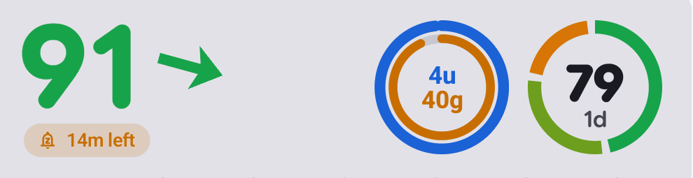

- The slot shows rapid insulin while its mute runs (carbs logged on top of it show only once that mute is over, or in the inner ring above), else the treatment that mutes the current alert, else the newest rapid insulin (kept 4 h) or carbs (kept 3 min per gram, 30 min–3 h: 15 g → 45 min, 60 g → 3 h); a meal logged at the same minute shows the insulin. Long-acting insulin and notes never show.
- Without a recent treatment the slot shows its fallback (default: time in range, 30 days, faded 55 %; any slot kind and period, or nothing), only where the slot's data covers ≥ 25 % of its window.
- Slot priority when room is short: main ring, recent treatment, second ring, fallback, third ring. Slots are sized from the height of the box they sit in (≤ 84 dp) and never squeezed; beside the value they take at most 55 % of the row (the number shrinks to fit the rest), in a box of their own (lock screen, notification) as many as fit whole, laurels included (≤ 4). The app panel is the same card (its header is 76 dp tall: 73 dp slots, two beside the value on a phone), so it follows the same rule as the widgets and the Mac.
- Settings `lastPlace` (`OFF` / `NEAR_VALUE` / `END`) and `lastElse` (`TIR:2592000:1`, `""` = nothing): Android in the graph settings JSON, Mac in UserDefaults keys of the same names and spellings, set in Settings → Rings → *Last treatment* (place, fallback kind, period, fainter).

- Time shares next to a goal (Android report card rows and its coverage note and footer, the time-in-range rings' number on the card, widgets, lock screen and notification slots, the Live Update metric; Mac report rows and coverage line, the rings in the dropdown and widgets) use one rule (`ShareText`, fixtures `spikes/graph-fixtures/share`): whole percent from 10 %, one decimal under 10 % (`4.2 %`, `0.6 %`), and more decimals (up to two) whenever whole-number rounding would put the number on the other side of its goal than the value: 5.2 % very high reads `5.2 %` against `< 5 %` (not `5 %`), 70.2 % in range `70.2`, 24.6 % above range `24.6 %`, 69.7 % coverage `69.7 %` against the 70 % the report needs, 0.96 % very low `0.96 %`. A value that is on the same side as its rounding stays whole (69.8 % in range → `70`, not > 70, missed). A non-zero share that rounds to nothing is `<0.1 %`; one that isn't all never reads `100` (that number is the crown's): 99.6 % is `99.6`, 99.96 % `99.96`, closer than that `>99.9`. Goals: very high < 5 %, above range < 25 %, in range > 70 %, below range < 4 %, very low < 1 %, coverage ≥ 70 %; the very-good (tight) ring has no goal. Decimal separator from the locale on Android (`5,2` in Spanish), `.` on the Mac. A ring's number with more than three characters (`70.2`, `<0.1`) is drawn at 70 % size, and any number (`100`) is shrunk to fit inside the ring.
- Time-in-range marks (the user, 2026-10-19; `TirMark`, fixtures `spikes/graph-fixtures/mark`; Android and Mac, every surface that draws a ring: app panel, widgets, lock screen, notification slots, Mac dropdown and widgets): only when the ring's window has ≥ 70 % data. **Crown** when no reading in the window was outside the ring's range (in range: nothing below or above; very good: nothing outside 70–140): a crown in the text colour (white in dark, black in light; 0.74 × the ring's radius wide) set into 12 o'clock like a cap (its base at 0.72 × the radius inside the ring, its top above it; a faded ring fades it as one layer, no darker rim), cut out of the ring and of the countdown ring with a margin; a crowned ring wears the flowered laurel too. **Laurel** from 90 % as the ring shows it, **with a flower on each branch tip** from 95 % (`94.6` → `95` counts), one per shown percentage (`Bloom`, picked by the user on the flower options page): 95 lavender (a violet bud spike growing from the stem's end, tangent to it), 96 forget-me-not, 97 daisy, 98 cherry blossom, 99 and the crowned 100 golden rosette (99.6 counts as 99). Where two flowered laurels meet, one shared piece replaces their inner tip flowers, the flower of the ring that isn't faded, or of the higher number when both are faded or neither is: two lavender spikes (one per branch, each in its ring's fade), a dome of five forget-me-nots, a double daisy among small daisies, a branch of three blossoms, or an award rosette with ribbon tails, on two leaves where it has them (by the share alone: lows don't take the mark away, the user 2026-10-19): two green branches of six leaf pairs up the ring's sides (from 45° below to 30° above the middle), clear of the ring (leaves 0.27 × its radius long, at 1.17 × and 1.35 ×). Laurels move the slots apart (`Slots.extraGap`): 0.22 × the radius more gap next to a laurel (a 0.5 × gap), and a laurelled ring at the card's edge keeps 0.3 × the radius from it (`Slots.edgeInset`; the app panel's value fits in what is left). One laurel's branch then clears the neighbour; between two laurelled rings the facing stems (on circles of 1.25 × the radius) touch in the middle of the gap, so the two wreaths meet there, both still circles, and those sides leave out the outer leaves that would cross into the other branch. Rings keep their size: a mark overflows the slot; laurels are drawn for all slots before any ring, so what is next to them (the next ring, the value) covers them; home-screen widgets (Android, Mac) draw the card inset in a picture that covers their margin (Android 10 dp, Mac 15 pt of the 16), so overflow at the card's edge shows in the margin; faded rings fade their mark. The share of time in range is exactly 1 when nothing is below or above (`TimeInRange.inRange`). Static: the mark stays for as long as the window qualifies, no animation. Settings (both on by default; Android Graph settings, Mac Settings › Rings (rewards) and › Graph (crown); `ringMarks`, `columnCrown` in the graph settings JSON and UserDefaults): *Rewards on the rings* (laurel, flowers, crown; off also drops the extra gaps) and *Crown at 100 %* beside the chart (es *Premios en los anillos*, *Corona al 100 %*). Tinted Mac widgets draw it white, the flowers with their details cut out or half see-through (centres, petal edges, stamens, every other lavender bud) so they don't read as one solid shape. The glucose notification's slot strip has no room around it: when a slot wears a laurel, its rings are drawn at the strip's height / 3 so laurel, crown and flowers fit.
- The % column beside the chart is exactly as wide as its widest label as drawn (number + `%`, measured with the drawing font: Roboto on Android, SF Pro on the Mac) plus 3 dp on each side, on every surface and size (the user, 2026-10-21: "it should depend on the longest text width"; layout/rules.json `gaps`, CardLayoutTest + Mac `-graphselftest`); labels are right-aligned 3 dp before the distribution; its in-range `100` wears the same green crown (0.62 × the number's width, 1.5 dp above its caps) when the chart's window qualifies (`TirMark.column`, same rule), only where it clears the label above; the three numbers (largest remainder) give `100` to in range only when below and above are both nothing (0.4 % low → `1 / 99 / 0`).
- **Scrolling the chart through time** (the user, 2026-10-21): the Android app panel and the Mac dropdown (the only cards that can scroll: widgets, the notification, the lock screen and the Mac widgets are pictures the system shows, so they always end at now). Android: a horizontal drag or fling with the platform's own scroll physics and stretch overscroll (`scrollableArea` + `rememberScrollableState`, the Compose guidance for custom scroll containers; default fling decay); Mac: two-finger horizontal swipes with the system's own momentum (the scroll events' `momentumPhase`, what NSScrollView follows) or a mouse wheel (10 pt per line), the content following the fingers 1:1 in points; a trackpad gesture's axis is decided by its first movement and a mostly vertical one is left alone (Mac `ScrollSelfTest` in `-graphselftest` feeds synthetic trackpad, momentum and wheel events through the real `CardView` and store path). The window moves through the stored history (the wearer's 31 days, a follower's received history; the Mac's 31-day store, all of it handed to the dropdown's card), from the first reading at the left edge to now; it stays on the same hours while new readings arrive, and the Mac dropdown opens at now again. The renderer draws the window it is given (`ChartView`), so **everything on the chart is about the visible window**: the line, the distribution and the % column (time in range of that window), the y range, the hour labels, the treatment marks; the slots and the value stay about now. The y range is the window's own (the 54 / 250 rules included) and **eases** there (critically damped, no bounce), and so does the plot's bottom when the treatment lane comes or goes, so nothing jumps; only the newest reading gets the big dot. Away from now a **Now** pill (the action pill, neutral colour, Material `arrow_forward` / SF `arrow.right`; `Ahora` in Spanish) shows at the plot's top right; a tap / click on it scrolls back to now (Android: the spatial spring through the scroll state; screen readers get it as a custom action). Pinned by `layout/scenes.json` `scroll` (CardLayoutTest `scrolledWindowShowsOnlyItsData`, Mac `-graphselftest`): a scrolled chart equals the chart of the visible data alone, its y range is the visible readings', the pill shows only when scrolled, a tap on it goes back to now, a drag scrolls into the past. Cost per scrolled frame over 31 days of 1-minute readings: ~3 ms on the JVM (`ChartScrollPerfTest`, sorted history cut by binary search), ~2.7 ms for the whole Mac card (release).
- **Zooming the chart's time axis** (the user, 2026-10-21: "zoom in and out the x axis with pinch gesture"; "24h max limit is too low. vertical lines and axis labels should adapt"): the same two cards. Android: two fingers zoom the x axis only, anchored at their centroid so the moment under the fingers stays put, and move it with their centroid (Compose multi-touch `calculateZoom` / `calculateCentroid` / `calculatePan`); one finger stays the scroll's (drag, fling). Only fingers down in two events in a row count, so a finger landing or lifting never jumps; once one lifts the window's length is frozen, the remaining finger pans the chart 1:1 and, lifted, flings it with the scroll's fling (the user, 2026-10-21: "release only one finger, it suddenly changes the scale"; `CardLayoutTest` lifts one finger, then the other). Mac: a trackpad pinch or ⌘-scroll, anchored at the cursor; the dropdown's window hands pinches (and a two-finger double tap: the place's window ↔ 3 h) to its card wherever they land on it; opening the dropdown brings Sukrara to the front, without which macOS sent it no pinches at all (the user, 2026-10-22: "I pinch on the trackpad and nothing happens"; Mac menu and windows; `-panelselftest` pinches the real dropdown through the app's event loop). From 2 h up to the whole history (at most 31 days, the stores' keep); a window that reaches now keeps following now. The renderer draws the zoomed window like a scrolled one (`ChartView` span): line, distribution, %, y range, treatments. The vertical lines and their labels pick their step for the zoom: 1, 2, 3, 4, 6, 12 h, then 1, 2, 3 days and a week (Mondays), fixed to the calendar so they don't shift while scrolling, the day steps labelled with dates (`17 Oct`). Far out (more than 6 readings per dp) the line is drawn as 1 dp columns from each column's lowest to highest reading, split and coloured by band, instead of tens of thousands of dots. Past 24 h of window (zoomed out, or a place set longer) the treatment labels (amounts, times) are left out on every surface (the user, 2026-10-21: "when I zoom out a lot, the treatment labels become irrelevant"; `layout/rules.json` `treatmentLabels` `maxHours` 24, checked on both platforms); points and mute lines still follow the mark settings, and on a scrolling card the second label row and the marker lane ease away with the plot instead of jumping. The Now pill shows while zoomed and returns to now **and** the place's "time shown"; leaving home (Android) or closing the dropdown (Mac) resets the zoom too. Pinned by `layout/scenes.json` `scroll` cases with `span` (a zoomed chart equals a place set to that time shown, on both platforms), the pinch / magnify / ⌘-scroll / Now tests (`CardLayoutTest`, Mac `ScrollSelfTest`) and the 31-day frame timing (~6 ms JVM, ~5 ms Mac release).
- The distribution's outline is erased (`DST_OUT` / `.destinationOut`) 3 dp around its dots (was 1.6), so the lines behind stop further from them (the user, 2026-10-21: "more outline so it masks out more of the content behind"); one value for every surface and both platforms: `layout/rules.json` `distribution` (`pitch` 3.6, `dot` 1.35, `cut` 3), checked against the renderers' constants and against every drawn distribution (the erased box is the dots' box plus `cut`).

**States and exits**: *scrolled into the past* (Android panel, Mac dropdown) → the **Now** pill (tap / click; Android also a TalkBack action) eases back to now; the Mac dropdown opens at now again. *A muted level alert* → the tonal pill opens its ways out (Alerts › States and exits). *Eat carbs* / *Take insulin* (where this device can add entries) → the pill opens Add treatment with Carbs / Rapid focused; Cancel, back or Escape closes it with nothing saved, back where the user was (TalkBack / VoiceOver: a button). *Sensor ended* → the *Replace sensor* pill opens the new-sensor flow (wearer).

## One card on every surface

- Every place that shows the card or its value is registered once (`spikes/graph-fixtures/surfaces/surfaces.json`; Android `CardSurface`, Mac `CardSurface`): Android home widgets (value, graph, combined; their settings preview is the widget's own picture), app panel, *Sensor ready* screen, lock screen widget, glucose notification (chart and slots; its text, icons, chip and Live Update), SystemUI hook text, root status-bar icons, Quick Settings tile, the widgets' and lock screen's screen-reader words; Mac menubar dropdown and title, widgets of every kind and family.
- Card pixels come only from `GlucoseCard` (Android) / `GlucoseCard` in `SukraraGraph.swift` (Mac): a surface chooses its size, its place's settings and the part (`CardPart`: whole card, value + slots, value, slots, chart), nothing else. The app panel is drawn by the card too (header + chart); its motion is paint only (the number rolls digit by digit, the arrow turns, the colour fades). Text and icon places take the value, the trend mark and the freshness steps from `GlucoseCard.face` (the card's `Freshness.look` with the sensor's state), so a warming-up sensor shows its time left in the SystemUI text (`42m`), *Warming up* on the Quick Settings tile and in the screen-reader words, and no root status-bar icons until the first reading (they exist only as numbers).
- Guards: `tools/check` (card-surface, card-api, card-text) and the cross-surface tests (Android `CardLayoutTest` + `FreshnessFixtureTest`, Mac `-graphselftest`) render every registered surface through its real code with the scenes of `spikes/graph-fixtures/layout` and fail when two surfaces lay out the same input differently, or Android and the Mac disagree (`layout/expect.json`).

## Freshness (every glucose surface)

  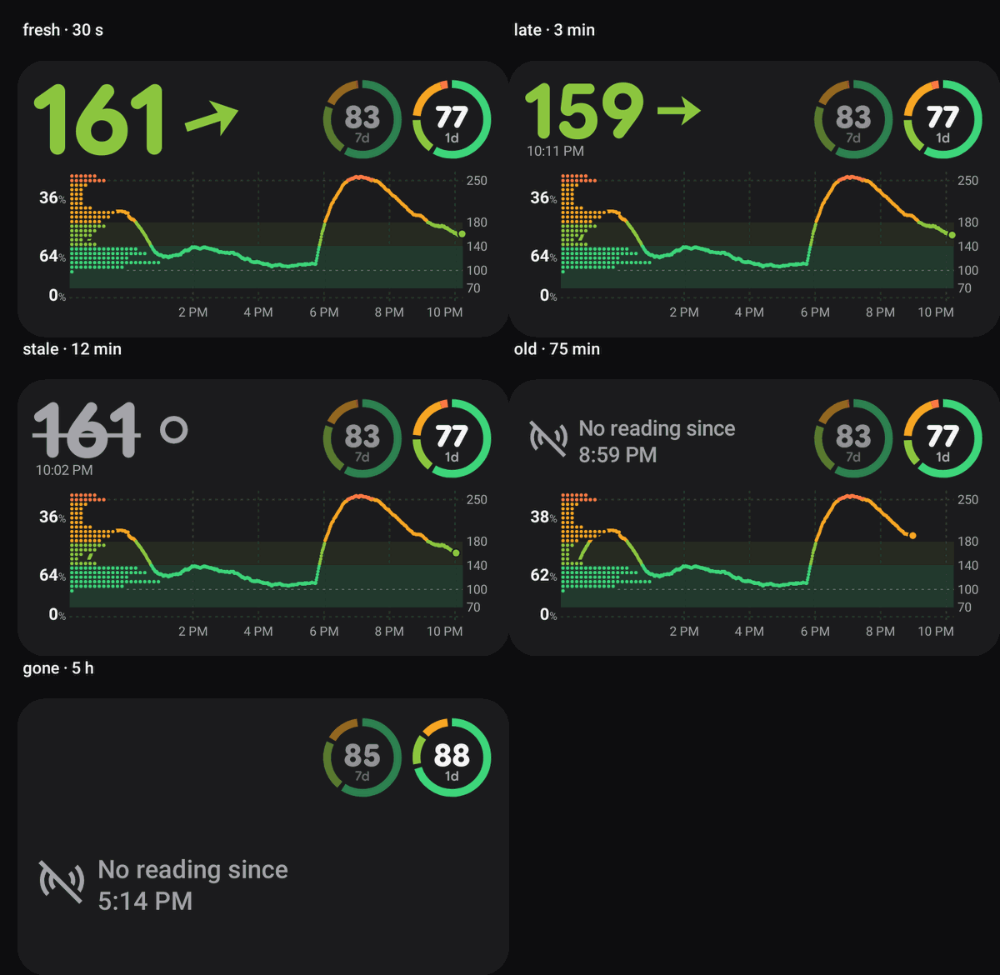

- One decision per platform (the user, 2026-10-21): `Freshness.look` (Android `graph/Freshness.kt`, Mac `SukraraGraph.swift`) turns the latest reading's age into what every surface shows: Android app panel, home widgets of every kind, lock screen widget, glucose notification (title, small icon, card, Live Update chip and card), root status-bar icons, LSPosed SystemUI text, Quick Settings tile, widget descriptions for screen readers; Mac menubar title, dropdown and widgets. Steps: up to 90 s the value alone; from 91 s the reading's time too; **from 5 min struck through and grey** (no range colour) with the "no trend" ring; **from 20 min no value**: *No reading since 00:32* and the "no readings" icon; **from 3 h no chart**. Shared cases in `spikes/graph-fixtures/freshness` (Android `FreshnessFixtureTest`, Mac `-graphselftest`); `tools/check` `freshness-surface` fails a listed surface that formats a value itself or judges the age on its own.
- "No readings" icon: Material Symbols `sensors_off` (`res/drawable/ic_stat_no_readings.xml`, `GlucoseLook.NO_READINGS_PATH`); Mac SF Symbol `antenna.radiowaves.left.and.right.slash` (a template image in the menubar). Status bar: the icon alone in the trend slot (number slot removed) / in the hook's text; notification small icon; the card and the app panel draw it before *No reading since*. Menubar: the symbol alone, tooltip `Sukrara · no reading since 00:32`.
- "No trend" (no rate from the sensor, or the value is struck through): a hollow ring in the arrow's place, the arrow's size (radius 0.24, stroke 0.11 of its box; text `○`), everywhere an arrow goes (card, app panel, widgets, notification, chip icon, status bar `sb_t_none` / grey `sb_t_none_s`, SystemUI text, tile, alert notification body, Mac menubar and dropdown). Not a dot (read as a speck) nor `?` (doubts the number); a circle has no direction, so it can't be read as steady (→).
- Root status bar slot icons: SystemUI spaces the number and the trend icons like its own status icons (5.7 dp on the user's Pixel, root path), so the drawables add no padding between them (0.11.34–0.11.37 added 1.5 dp: 7.2 dp, "too separated"); `SlotDrawablesTest` keeps the visible gap at 5.0–6.5 dp (SystemUI's share 5.74 dp, measured) for root alone; with the LSPosed module the pair sits at the card's own gap, about 3 dp (*Root status bar (system icons)* below). They are two slots (`glucose`, `glucose_trend`); how a full status bar keeps them together: *Root status bar (system icons)* below.
- Struck through where a line can't be drawn: the root status bar uses per-value struck drawables at half strength (`sb_s40`…`sb_s400`, `sb_slo`, `sb_shi`; SystemUI tints them, so they read grey; tools/gen-slot-drawables.swift derives them); the chip and the tile strike each character (U+0336); the notification card turns grey instead of its range colour; screen readers say "123 (old)" (es "123 (antiguo)").
- Redraws without a reading: Android arms one non-waking exact alarm (`FreshnessTicker`, `RTC`) at the latest reading's next step, re-planned on every reading and at each step, which redraws the notification, the status bar and the widgets (the screen-on render catches up while the screen is off; the SystemUI text also re-checks every 30 s); the Mac menubar re-arms a timer at each step and the Mac widgets get a timeline entry per step.

## Sensor life

- Sensor families are described by a `core/SensorProfile` (id, name, brand, models, pairing kind, warm-up, lifetime, grace, calibration, needs-scan, **verified**). `SensorProfiles.LIBRE_3` is the only verified one: NFC-tap pairing, 60 min warm-up, 15 d lifetime (the 3 Plus; a sensor's own patch info wins), 12 h grace (unused yet), no calibration, no scanning. Every default that was a Libre 3 constant (`SensorLife.DEFAULT_WEAR_MIN` / `DEFAULT_WARMUP_MIN`, the New sensor screen's warm-up fallback) reads the profile. The **untested** families (investigation 23 steps 2–5, `verified = false`): *Dexcom G7 / ONE+* (vendor app, 30 min, 10 d, 12 h grace), *Dexcom G7 15 Day / Stelo* (the same, 15 d), *Accu-Chek SmartGuide* (Android's PIN dialog, 60 min, 14 d), *Aidex X / LinX / GlucoRx* (10-character serial, 60 min, 15 d), *Dexcom G6 / ONE* (6-character transmitter id, 2 h, 10 d); all scan, the Dexcom ones and the SmartGuide take an optional calibration on the sensor (not offered in Sukrara). Typed ids are normalised (letters and digits, upper case; `PairingInput`). `verified` is the single switch that removes a family's untested tag, confirmation and banner.
- The direct source runs a `direct/SensorDriver` chosen from the `direct/Drivers` registry by the saved pairing's `profile` (`sensor.json`; a file without the field is the Libre 3's) over a `direct/GattLink` transport (connect by address with autoConnect, one GATT operation at a time, reconnect 1 s after a drop). `Libre3Driver` is the Libre 3 / 3 Plus protocol: same operations, timers and status words as the former `Libre3Client`, pinned by `Libre3DriverTest` (fresh pairing, resume, glucose, history, patch status, warm-up, ended, errors).
- The other families' drivers (`direct/BrandDriver` and its subclasses; **none tested on a real sensor**, each pinned by open-source traces in `src/test/resources/traces`): **Dexcom G7 / ONE+ / Stelo** observer mode (`direct/dexcom/G7Driver`: only a `DXCM`/`DX01`/`DX02`/`DX04` device this phone is bonded with, i.e. the one the Dexcom app paired; subscribes to authentication, waits for the Dexcom app's `05 01 01`, then subscribes to control + backfill; **writes nothing**; `0x4E` readings, backfill records the Dexcom app asked for, flushed on `0x59`; "stopped" before the session is a wait, expired / ended / failed is the end), **Dexcom G6 / ONE** (`G6Driver`: key = the transmitter id, verifies the transmitter's hash before answering, bonds on the first session, `0x24` for the session start, `0x4E`, `0x50` backfill of the gap ≤ 24 h), **Accu-Chek SmartGuide** (`direct/cgms/SmartGuideDriver`: an `AC-…` device with service 0x181F; bonds first through Android's PIN dialog, then measurement / RACP / SOCP with the E2E-CRC, reads the CGM Status for the session start, RACP from the last record; below-range = 39 mg/dL; a stopped session ends it), **Aidex X** (`direct/aidex/AidexXDriver`: `AiDEX X-<serial>`; keys from the serial, session key read after the key notification, start time, glucose, then a poll every minute; readings also from its advertisement, CRC-32 checked). Status words: `scanning for the sensor`, `authenticating` / `pairing` / `exchanging keys` / `waiting for the Dexcom app`, `reading`, `warming up`, `live`, `reconnecting` + why, `failed` + why (wrong id, refused PIN: the link is given up), `sensor ended`. A reading more than 3 min old is history, not the current value. Readings are tagged with the family's id (`Reading.dev`: `libre3`, `dexcom-g7`, …).
- Outputs name the real sensor (`core/SensorOutputs`, by each reading's `dev`; tests `SensorOutputsTest`, `BroadcastPayloadsTest`, `LibreViewUploaderTest`): **an unverified family sends no local broadcast at all** (no xDrip+ `BgEstimate`, LibreLink or glucodata: AAPS gives `SourceInfo=Libre3` advanced filtering, so untested data must never feed a closed loop); only a verified profile with a `broadcastLabel` broadcasts, with that label (`Libre3`). Settings → Share with apps → *Apps on this phone* then shows *Paused: <family> support is untested* and the overview leaves the app count out. Health Connect: Abbott · FreeStyle Libre 3 for the Libre 3, else the brand and *<model> (untested)*, nothing for an unknown tag. Tidepool: each `cbg` carries `payload.sensor` (*FreeStyle Libre 3*, *Dexcom G7 / ONE+ (untested)*; none for a follower's copy). Nightscout upload, the phone's Nightscout and xDrip+ APIs, the CSV's Device column: `Sukrara` for the Libre 3 (as before; Nightscout dedupes on it), `Sukrara · <model> (untested)` otherwise; an entry whose device starts with `Sukrara · ` is still this uploader for the conflict pause. Nightscout's Sensor Change / Start notes name the family. LibreView only for the Libre 3 (`SensorProfile.libreView`): another family's sensor clears the buffered glucose and sends no glucose, sensor or sensor start. The Sensor page names the family (*Dexcom G6 / ONE · 8GABCD*).
- Scanning (`direct/SensorScanner`; never for the Libre 3, `DirectSource.transport`): a family without a saved address scans 30 s on / 60 s off, always filtered (service UUID or exact name), until its driver accepts a device; the address is saved in `sensor.json`, so later connections go by address with autoConnect and no more scanning. The saved sensor (`sensor.json`) is one record keyed by `profile`: the other families keep the typed id (or none), no PIN, address and start once known; the start the sensor reports becomes the `SensorInfo` with the profile's warm-up and lifetime.
- The owner knows the current sensor's start, end and warm-up end (`core/SensorLife`, persisted): the direct source gives serial, start, end = start + the wear length from the NFC patch info (LE16 at +6, minutes; Libre 3 Plus 21600 = 15 d; the profile's 15 d when unknown or for a pairing saved before this field) and warm-up end = start + the patch info's warm-up (byte 13 × 5 min; the profile's 60 min default).
- Juggluco source: the start comes from Juggluco's `sgv.json?count=1&sensor=Y` (`sensor_status` `"dd-mm-yy HH:MM (…)"`, the phone's local time; serial = the entry's `_id` before `#`), read with every history fetch and again when the SSE `sensorId` changes; end = start + 15 d, warm-up 60 min (Juggluco publishes neither length).
- Sensor badge (the time left) on every card: Android app panel, every widget kind and size, lock screen, the glucose notification's chart; Mac dropdown and every widget. **One decision for all of them** (the user, 2026-10-21: the move had reached only some surfaces): `GlucoseCard.sensorSpot` (Android) / `GlucoseCard.sensorSpot` (Mac), from the whole card's style, also where a surface draws the value and the chart in boxes of their own (`CardPart`: the app panel, the lock screen). **In the chart** whenever the card shows a chart with hour labels (with or without the % column: narrow charts, side off, graph-only widgets, the notification): at the start of the hour labels' row, at the chart's left edge under the % column and the distribution (10 dp tall, centred on the labels' x-height, `GlucoseGraph.sensorTop`); it is drawn last, over the time row, with its outline erased 2 dp around it (`DST_OUT` / `.destinationOut`) from whatever passes under it: hour and treatment labels are laid out as if it weren't there, so it never pushes a label to the second row, drops its time or makes the chart jump while scrolling (the user, 2026-10-22; `layout/rules.json` `badge`: every render with and without the badge has the same labels, second row, plot and hour labels; scene `live` has a labelled treatment right under it). **Nowhere else**: a card without such a chart (value widgets; a chart with the time labels off) shows just the number and its trend (the user, 2026-10-21: "It should not be there at all if we just show the number"; beside the arrow, top right, it turned `120 ○` into `120°`). Also nowhere when the place's setting hides it, nothing is known, or the sensor warms up / has ended (the value's place shows those states). Fixtures: `spikes/graph-fixtures/place` (Android `GraphFixtureTest.place`, Mac `-graphselftest`); every surface draws it through the one card renderer and the cross-surface tests check it lands in the same place on all of them (below, *One card on every surface*). The badge: a small Libre sensor disc (circle + centre dot) whose outline is an arc depleting clockwise from 12 o'clock with the share of the sensor's life left (faint full track under it), then the time left: ≥ 24 h → whole days `13d`, ≥ 1 h → hours `20h`, else minutes `45m` (floor), in the secondary text colour. Ended: the header turns into the ended text instead (below); `0m` in the very-low colour is the label's rule (fixtures). Screen readers (app): `Sensor: 13d left` / `Sensor ended`.
- Setting *Sensor time left* per place (on by default): Android Graph settings, one switch per place (App, Notification, Widgets = home widgets and lock screen; `sensorHidden` in the graph settings JSON, e.g. `"NOTIFICATION"`), and per home widget in its own settings (`sensor`, over the place's); Mac Settings › Graph › *Sensor*: *Time left in the menu bar dropdown* / *Time left on widgets* (`menubarSensorTime`, `widgetSensorTime`; always this Mac's, whatever Settings from says). es *Tiempo restante del sensor*. Off leaves the badge out of that place's cards; the warm-up, *Sensor ended* and the countdown ring stay.

  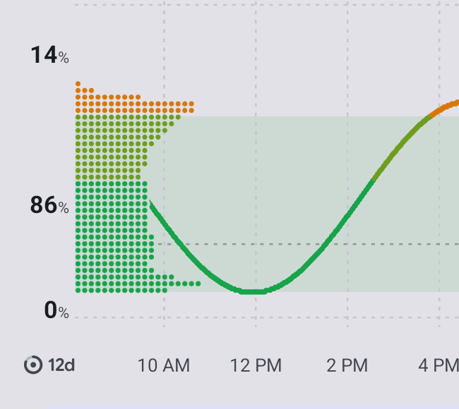
  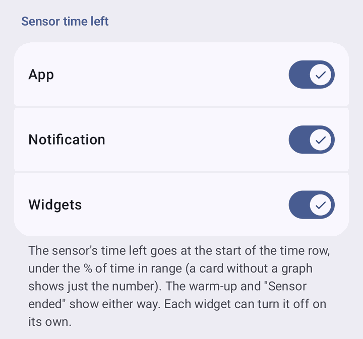

- Countdown ring: in the sensor's last `countdownHours` (1–24, default 8; Android: `SensorLife.setCountdownHours`, shared with the end-countdown notification; Mac: Settings → Graph → *Sensor countdown*, UserDefaults `countdownHours`), a ring over the main slot (the first ring; else the only slot) drains clockwise from 12 o'clock, full at N h left, empty at the end; same size as the slot ring (on its stroke's centre line), ink 0.3 × the ring's stroke on a background halo 0.62 × (black / white where the background is transparent, cut out in tinted Mac widgets), round caps. Also on the glucose notification's slots and the lock screen's slots. No ring when no slot is drawn.
- Warm-up (a new sensor, no reading since its start, until 15 min past the warm-up's end): the card shows the warm-up's time left where the number goes (minutes rounded up, `42m`; from 60 of them hours, `1h`, one rounding on every surface so 59:15 left never shows `60m` on one and `1h` on another; secondary colour, rounded bold), the sensor disc alone beside it filling up, and `Ready at 19:45` under it (es `Listo a las 19:45`); the ring over the main ring fills 0 → 1 over the warm-up (the opposite of the countdown). The first reading ends it. From the warm-up's end until the first reading no countdown is shown (never `0m` or a negative time): the figure says `Almost ready` (es `Casi listo`) with `Waiting for the first reading` (es `Esperando la primera lectura`) under it, the ring full; same on the app's value card, widgets, the New sensor screen, the notification title and the Mac. Notification title `Ready at 19:45` / `Almost ready`; Mac menubar title `42m` / `Almost ready` (secondary colour, ticks every minute) with the tooltip `Sukrara · Ready at 19:45` / `Sukrara · Waiting for the first reading`. Screen readers (app): `Warming up. Ready at 19:45` / `Almost ready. Waiting for the first reading`; the empty chart beside it still says `Warming up`.
- Ended sensor: as soon as `SensorLife` says it has ended, the value header says `Sensor ended` in the secondary text colour (a state, not an error; no time), after the checkered flag (the status bar's glyph, so users connect the two) with the action pill `Replace sensor` under it: the same pill as `Eat carbs` (StatusBadge, kind `sensor`: neutral note colour, the sensor-disc marker; full words, short `Sensor`, or icon only as room allows; a box too short for the pill's row gets the icon-only pill beside the words). No value, arrow or badge (the last value stays greyed in the chart). Everywhere: app card (pill opens the New sensor screen on the wearer's phone), every widget size (on the wearer's phone the widget tap opens the New sensor screen while ended), lock screen, chart placeholder, widget screen-reader text (`Sensor ended. Replace sensor`), Mac dropdown and widgets (pill only, no tap: the Mac follows). Ongoing notification: title `Sensor ended`, the checkered-flag small icon, no chip, and on the wearer's phone the action `Replace sensor` (and tap) opening the New sensor screen.
- Ended sensor in the status bar: a checkered flag from each platform's icon set (Android: Material Symbols `sports_score`, `res/drawable/ic_stat_sensor_ended.xml` = `SensorLife.FLAG_PATH`; Mac: SF Symbol `flag.checkered`) instead of a stale value: the notification icon, the root system-icon slots (flag in the trend slot, number slot removed) and the LSPosed SystemUI text (no number, the flag drawn in the text colour; it switches by itself at the end, `sensorEnd` in the hook broadcast). The wearer's and the follower's notification and status bar re-render as soon as the sensor info changes. Mac menubar: the SF Symbol `flag.checkered` as a template image (follows light / dark), no text, tooltip `Sensor ended — replace sensor`; a timer switches it at the end. The flag also marks the sensor-end settings: Android Settings → *Sensor end* (its row icon) and the Mac's Settings → Graph → *Sensor countdown*.
- `no_data` alerts stay quiet while the sensor has ended or warms up (Android and Mac, wearer and followers); a running one clears; a warm-up that brings no reading alerts 15 min after its end (scenarios in `spikes/alerts/scenarios/other.txt`).
- Followers and the Mac get the sensor from the live events' `ss`/`se`/`sw` (PROTOCOL-v2 "Sensor life"): every reading's live event carries it, and the owner publishes a reading-less live event when the sensor changes and every 5 min while it warms up; the newest by `created_at` wins, one without `se` clears it. Mac: kept in UserDefaults (`sensorStart`, `sensorEnd`, `sensorWarmupEnd`) and in the widget snapshot (`sensor`).
- Debug builds: `DebugReceiver --es cmd sensor --el left <s> [--el len <s>] [--ei countdown <h>] [--ez clear true]` sets a synthetic sensor; the status JSON lists `sensor` (serial, start, end, label).
- Direct source, ended sensor (`direct/PatchState`; seen on the user's Libre 3 Plus: `state=5 currentLifeCount=21635`, then no glucose and a reconnect every 2 min for ever): the BLE patch state ≥ 5 (5 expired, 6 terminated, 7 error, 8 error terminated) or a life count ≥ the wear length marks the sensor ended (its end moves to now if earlier) and the source state reads `sensor ended` / `Replace sensor: tap Pair new sensor on the home screen`. States 6–8 stop at once; an expired sensor (5, or past its wear length) keeps the session for one glucose wait (120 s, a possible grace period) and then stops for good. Stopped = no reconnects (`ended:<serial>` in the direct prefs) until a new sensor is scanned; a reading that does arrive keeps it running.

## New sensor (pairing flow)

Wearer only (`ui/NewSensorScreen.kt`; rules in `ui/NewSensorFlow.kt`, tests `NewSensorFlowTest`; docs/21).
- Ways in: home *Pair a sensor* / *Pair new sensor* under the glucose card (`NewSensorDue`: filled while the direct source says `no sensor` (*Pair a sensor*), `sensor ended` or `unsupported sensor`, or `SensorLife` says the sensor has ended; tonal in its last 24 h; hidden otherwise), the card's *Replace sensor* pill, the ended / reminder notification actions and widget taps (`MainActivity.sensorIntent`), Settings → Glucose source → *Pair new sensor*, Glucose source → *This phone* (from Juggluco) → *Pair a sensor*, and tapping a sensor while Sukrara doesn't listen (the `NfcLaunch` alias: the tap's `EXTRA_TAG` is read at once, no second tap; owner role only).
- Brand step first: *Which sensor are you starting?*, a radio list of every family (`NewSensorFlow.choices`), *FreeStyle Libre 3 / 3 Plus* first and preselected; every other family carries the *Untested* tag (red: error container, with the Material Symbols `science` flask; the same tag in Settings → Glucose source). *Continue* (an untested family asks first, below). NFC reader mode is already on here, so tapping a Libre 3 skips straight to its scan. Back from a later step (before pairing) returns to this list. The Libre 3 then gets exactly the NFC flow below; the others get their setup: *Open the Dexcom app* (Sukrara reads along, sends nothing; keep it installed and running), *Enter the transmitter ID* (G6 / ONE, 6 characters), *Enter the sensor's serial number* (Aidex X, 10 characters), *Have the PIN ready* (SmartGuide: Android asks for the cap's 6-digit PIN), then *Pair* (enabled once a typed id is valid) and *Choose another sensor*.
- Untested confirmation (every family but the Libre 3, on *Continue* of the brand step; `NewSensorFlow.onContinue`): an AlertDialog in red (the error colour roles for the warning icon, the title *Untested sensor* and the accept button; the user's ask, the one exception to "red only for errors") · support for <family> is untested, readings may be wrong or missing, keep using the official app or a meter before treatment decisions, the feedback banner stays until it's verified. *Continue anyway* is disabled for 10 s with the count in its label (*Continue anyway (10)* … *(1)*; `UntestedConfirm`); *Cancel* is always enabled, the tonal (emphasised) button, and what back / a tap outside do: it stays on the brand step. Every opening starts the wait again. *Continue anyway* opens the family's setup. *Pair* then saves the sensor (`SensorPairing.forBrand`), clears its ended flag, forgets the old sensor's dates and starts the direct source on it; the pairing and readings steps follow as for the Libre 3 (named by the typed id or the family). A `failed` status → *Couldn't pair the sensor* with the reason, *Try again* (back to the setup) and *Choose another sensor*; slow pairing → *Open the Dexcom app and keep it running* / *Keep the phone near the sensor*.
- One full screen: close button, title *New sensor*, a step bar *Sensor · Scan · Pair · Readings* (*Set up* instead of *Scan* for a family without NFC; done and current steps filled, the current label in the primary colour; screen readers: "Step 2 of 4: Scan"), an illustration, a title and one line, the stage's action at the bottom. The screen stays on until the warm-up or the first reading.
- Scan — waiting: the back of a phone with the sensor on this phone's NFC antenna spot (`NfcAntennaInfo`; else the upper middle) and rings pulsing out from it; *Hold your phone to the sensor* · *Touch the sensor with the back of your phone, where the circle is, and keep still until it vibrates.* No button: *Nothing happens?* (and after 10 s by itself) opens the tips. Cards: Bluetooth off (*Turn on Bluetooth*: the system's request dialog), no LibreView receiver ID known (*Starting a new sensor?* · *Sign in*, optional), Juggluco is the source (force-stop it first). A note says what a scan does (a new sensor starts and warms up for an hour; a running one moves to Sukrara and the other app stops getting readings and alarms). NFC reader mode only while this screen is in front and waiting (off during the sign-in and after a successful tap).
- Scan — reading: indeterminate wavy ring around the sensor disc, *Reading the sensor…* · *Keep your phone still.* Result: success vibrates (`CONFIRM`) and saves the pairing (source switches to direct, or the source restarts); failure vibrates `REJECT` and shows *Couldn't read the sensor* (the only red: error container) with *Try again*; *This sensor has ended* (flag, neutral) with *Scan another sensor*; Libre 1/2 (*Glucose source* + *Scan another sensor*); not a Libre 3 (*Not supported*, *Try again*). A sensor that needs the LibreView account (new, or started by another app under another account) → *Sign in to LibreView* (email, password, nothing sent to the sensor) → *Now hold your phone to the sensor again*.
- Pair: Bluetooth in an indeterminate wavy ring, *Pairing with your sensor* · *Sensor <serial>. You can put the phone down: this takes up to a minute.*, then three ticked steps from the direct source's status: *Connecting over Bluetooth* (connecting, discovering services, waiting for sensor, reconnecting), *Pairing securely* (pairing with the sensor, authorizing), *Starting readings* (authorized, subscribing; or live without a reading yet). After 45 s without finishing: *Taking longer than usual?* (another app may hold the sensor: force-stop LibreLink or Juggluco). `waiting for Bluetooth` → *Bluetooth is off* (step Pair) with *Turn on Bluetooth*.
- Readings: a started sensor (or one taken over during its warm-up) → *Sensor warming up*: the minutes left (rounded up) in the rounded face inside a determinate wavy ring that fills over the warm-up, *Readings start at 21:08. You can close this screen: Sukrara tells you when the sensor is ready.*, *Done*. The first reading after the tap (a started sensor: newer than the tap; one taken over: from the tap's minute, 90 s slack) → *Sensor ready* with the reading as on the card (number, arrow, band colour), *Readings have started. Sensor <serial> ends <date>.*, *Done*.
- NFC missing → *This phone can't scan sensors*; NFC off → *NFC is off* with *Turn on NFC* (system NFC settings), re-checked on resume.
- Settings → Glucose source, one page (`ui/SourceScreen.kt`, 0.11.28; was a Source choice "Libre 3 directly" / Juggluco plus a nested Sensor page). Laid out like AOSP's device details (`bluetooth_device_details_fragment.xml`: header, action button, categories): a header card with the current sensor (family name, the red *Untested* tag when unverified, serial, *Started …*, *Ends …*, *Now: <source status>*; *No sensor yet* · *Pair your sensor to start reading it here*; under Juggluco: *Juggluco* · *Now: …*) and *Pair a sensor* / *Pair new sensor* (the New sensor screen; from Juggluco it asks first). Group *Read glucose from*: an inline radio choice (SPA `RadioPreferences`) *This phone* (*Sukrara reads the sensor itself: FreeStyle Libre 3 / 3 Plus, or an untested Dexcom, Accu-Chek or Aidex sensor*; with a sensor: *Reads your Dexcom G7 / ONE+*) or *Juggluco* (its web server; Juggluco keeps the sensor and its alarms). Choosing *This phone* from Juggluco asks *Read the sensor directly?* → *Pair a sensor*. Group *Sensor* (this phone only): *Open Sukrara when you scan a sensor* (on Android 16+ when the user blocked Sukrara's tag intents: *Blocked in Android settings. Tap to allow* → `ACTION_CHANGE_TAG_INTENT_PREFERENCE`), *Forget this sensor*. Footer: only one app can read a sensor at a time. The Settings overview's row says *This phone · Dexcom G7 / ONE+ · live* / *Juggluco · …*. Search finds every row, *Pair new sensor* included.
- Debug builds: `DebugReceiver --es cmd newSensor [--es stage waiting|reading|signin|pairing|slow|warmup|ready|ended|libre2|failed|bluetooth|nfcoff|choose|untested|pairfailed|setup-<profile id>]` forces a stage while the screen is open (cleared when it closes; `untested` = the brand step with the G7 selected and its confirmation open).

## Untested sensor banner

Wearer only (`ui/SensorFeedback.kt`, tests `SensorFeedbackTest`). While the direct source runs with a sensor whose profile isn't verified (`core/ActiveSensor`), home shows a permanent card directly under the glucose panel: a flask icon, *<family> support is untested. Tell us how it works.* and the pill *Send feedback*. Not dismissible, not red (surface container). The pill opens a pre-filled GitHub issue (`.github/ISSUE_TEMPLATE/sensor-feedback.yml`, label `sensor-feedback`): title *Sensor feedback: <family>*, fields sensor model, Sukrara version, Android version (`16 (API 36)`), phone model — no glucose values, serials or anything personal. Followers and the Mac never show it (it is about the wearer's own sensor). Setting the family's `SensorProfile.verified` to true removes it. Debug builds: `DebugReceiver --es cmd sensorProfile --es profile <id>` forces the active family (screenshots).

**States and exits**: *shown* (an unverified sensor profile on the direct source) → *Send feedback* opens the issue form and the card stays; it leaves when the source or sensor changes or the profile is verified. No close button by design (it asks for feedback the project needs).

## Share-with-your-clinic banner

Android, wearer only: home (under the profile row) and the top of the Settings overview (`ui/UploadBanner.kt`, tests `UploadBannerTest`; 2026-10-21, was *Set up LibreView*). While neither clinic upload is set up, a card shows the cloud-upload symbol, *Share your data with your clinic* (es *Comparte tus datos con tu clínica*), a close button and two pills side by side: *LibreView* and *Tidepool*, each with the service's own icon at the AOSP Settings app-icon size (32 dp, `ServiceIcon`), opening Settings → LibreView or Settings → Tidepool. No helper text, not red. Set up = LibreView: switch on, email and password saved; Tidepool: switch on and signed in. Either one hides it (`UploadBanner.shows`). Close hides it for good (`FeatureState.uploadBannerDismissed`, `uploadBanner` in the settings export; kept by *Reset options*). Not in the settings search index. Followers: none (they upload to Tidepool from Apps). Mac: none (no such banner there).

  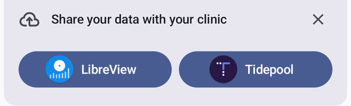

**States and exits**: *shown* (no clinic upload set up) → a pill opens LibreView / Tidepool setup; it leaves once either is set up. *Closed* (on this phone) → *Undo* in the snackbar right after, or later Settings → *Show closed tips* ([Closed tips](#closed-tips)); the setup itself stays in Settings → LibreView / Tidepool.

## Add-the-widget banner

Android, wearer and follower homes (`widgets/WidgetPresence.kt`, `ui/WidgetBannerCard.kt`, tests `WidgetBannerTest`). Sukrara is meant to be used through the big home-screen widget, so while no graph widget is placed (`AppWidgetManager.getAppWidgetIds` of *Glucose + graph* or *Glucose graph* is empty; the value widget and the lock screen widget don't count) home shows a card under the glucose panel: the widgets icon, *Put your glucose on the home screen* (es *Pon tu glucosa en la pantalla de inicio*), a close button and the pill *Add widget* (es *Añadir widget*). The pill asks the launcher to place *Glucose + graph* (`requestPinAppWidget`; the launcher's own dialog, with the widget's preview in the request: `EXTRA_APPWIDGET_PREVIEW` = Glance `composeForPreview` of the picker's `providePreview`, one layout per preview size, round 22: without it Pixel Launcher showed a blank card with the app icon). When the launcher can't pin (`isRequestPinAppWidgetSupported` false, or the request is refused) the pill is replaced by *Touch & hold the home screen, then Widgets › Sukrara*. Checked again whenever home resumes and on the pin's success callback, so the card leaves as soon as the widget is placed. Not red, not before setup. Close hides it for good on this phone (`widget-banner` prefs, not in the settings export: widgets are per launcher); placing a widget is not a dismissal, so removing it later (or a launcher reset) brings the card back. Debug builds: `DebugReceiver --es cmd widgetBanner` prints the state, `--ez reset true` undoes the dismissal. Mac: none (the menubar is its main surface; macOS has no API to place a widget).

  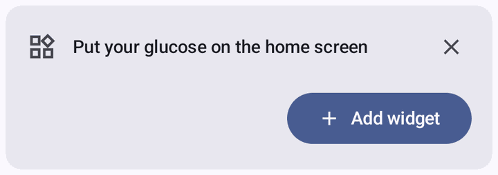

**States and exits**: *shown* (no graph widget placed) → *Add widget* (or the long-press hint when the launcher can't pin); it leaves when a widget is placed and comes back when none is. *Closed* (on this phone) → *Undo* in the snackbar right after, or later Settings → *Show closed tips* ([Closed tips](#closed-tips)); placing a widget from the launcher still works.

## Restart-System-UI card

Android, wearer and follower homes (`ui/SystemUiBanner.kt`, `features/SystemAccess`, tests `SystemAccessTest`; 2026-10-21) and, as a SettingsBanner, Settings → Status bar / Lock screen. LSPosed marks System UI STALE after **every** Sukrara install (the module is the app), yet System UI keeps running the old code fine; a restart only matters when the code System UI runs changed. Each build carries a fingerprint of that code (`BuildConfig.HOOK_CODE`: SHA-256 of `hook/`, `graph/` and every file a `hook/` file names, computed by Gradle) and records it per versionCode on the phone. Decision (`SystemAccess.decide`): not in scope → *System UI not in scope*; in scope but not running or FAILED → restart; UP_TO_DATE or RELOADING → fine; STALE from a build with the same fingerprint → fine; another or unknown fingerprint (a build from before the record, a rebuild with the same versionCode) → restart. Home shows the card only while a module feature is on (lock screen widget, or the status-bar value with its colour, hidden notification icon or a module placement; `usesModule`): the restart icon, *Restart System UI*, a close button, one line (*The status bar and lock screen still use the previous version*) and the pill *Restart*; the whole card does the same. The action is always the root restart of System UI, never a reboot (LSPosed loads a module when System UI's process starts; System UI is persistent, so after the kill Android starts it again within ~2 s): `su -c 'kill $(pidof com.android.systemui)'`, not `am crash` (crashes count towards rescue mode). That `su` call is the root request when Sukrara isn't granted yet (waits up to 30 s for the prompt); if it fails, *Couldn't restart System UI: <reason from su>* shows on the card in the error colour (`RootStatusBar.restartError`, `SystemUiRestartTest`). Then it asks LSPosed every second for up to 20 s until System UI runs the module again. The card never depends on a root check (0.11.37's home never ran one, so it showed a "restart your phone" line and no pill). Close hides it until the state or the build changes. Mac: none.

**States and exits**: *shown* (System UI runs older module code while a module feature is on) → *Restart* (or the whole card); *restarting* (waits up to 20 s for LSPosed) → it leaves when System UI runs the module; *failed* (*Couldn't restart System UI: …* in the error colour) → *Restart* again or Close; *Closed* → hidden until the state or the build changes, then it comes back; *Undo* in the snackbar right after, or Settings → *Show closed tips*, brings it back at once ([Closed tips](#closed-tips)).

## Closed tips

Android, both roles (round f33, the user: closed tips never came back; `features/Tips.kt`, `ui/TipsUi.kt`, tests `TipsTest`, `TipsGallery`). Every card with a close button is a `Tips.Tip` in one registry: *Share your data with your clinic*, *Put your glucose on the home screen* and *Restart System UI*; each keeps its closed state where it always did (`FeatureState.uploadBannerDismissed`, `widget-banner` prefs, `system_access` prefs). The close buttons go through `Tips.close`, which shows an M3 snackbar *Tip closed* with the action *Undo* (es *Consejo cerrado*, *Deshacer*; long duration, which Android stretches for users who set *Time to take action*; over home or the settings overview, wherever the card was closed); *Undo* puts the card back at once. Settings overview (wearer and follower, above *Advanced*, a lightbulb icon): *Show closed tips* with *2 tips closed* (es *Mostrar consejos cerrados*, *2 consejos cerrados*) brings every closed card back; while none is closed it is greyed out with *No closed tips*. A card that comes back shows only where its own conditions hold (no clinic upload set up, no graph widget placed, System UI behind). `TipsTest` closes and restores every `Tip` through the real stores, one at a time, and fails when a home card's close button doesn't go through `Tips.close` (a closable card outside the registry couldn't be restored). Mac: none (the dropdown has no closable tip cards, so there is nothing for *Show closed tips* to bring back).

**States and exits**: *Tip shown* → its close button (TalkBack *Dismiss*) closes it. *Just closed* → the snackbar's *Undo* (a TalkBack-focusable button) brings it back; the snackbar leaves by itself or with a swipe. *Closed* → Settings → *Show closed tips* brings every closed tip back; nothing closed → the row is unavailable (*No closed tips*).

## Sensor scan: other sensors

- The New sensor screen's NFC tap checks the chip first (UID maker byte): only 0x7A (Abbott, Libre 3 / 3 Plus) gets Libre 3 commands. 0x07 (Texas Instruments: Libre 1 / 2 / 2 Plus) gets no command at all and shows *Libre 2 sensors aren't supported* — start it with Juggluco, then pick Juggluco as the glucose source — with a *Glucose source* button; any other tag → *Not supported* / "not a FreeStyle Libre 3".
- Starting a never-started Libre 3 (patch state 1, NFC `A0`) uses only the LibreView account's receiver ID (Juggluco's default), so another app can take the sensor over later; if it isn't known yet, nothing is sent and the screen asks for the LibreView sign-in (*Sign in to LibreView*), then a second tap starts it. A takeover (`A8`) still tries the LibreView ID, then Sukrara's own.

## Data export

- Settings → Export data (wearer and follower; Mac: Glucose Report › Report › *Export CSV…*): readings and treatments of a period as one CSV in LibreView's "Glucose Data" layout (the file Tidepool Uploader's LibreView import reads) plus three columns at the end: `Time (ISO 8601)` with the offset, `Trend (mg/dL/min)`, `Entered By`.
- Line 1 `Glucose Data,Generated on,<UTC> UTC,Generated by,Sukrara`, line 2 the 22 column names, then one row per entry oldest first (readings before treatments at the same time), CRLF line ends, UTF-8, RFC 4180 quoting; a note that starts with `= + - @` (or tab / CR) gets a leading `'` so spreadsheets show it as text.
- Readings: Record Type 0, `Historic Glucose mg/dL` whole numbers (mmol/L one decimal at 18.0182 when asked; the apps are mg/dL only), at most one row per 5 minutes (a reading ≥ 280 s after the last row), trend one decimal when the reading has one. Treatments: rapid → type 4 + `Rapid-Acting Insulin (units)`, long → type 4 + `Long-Acting Insulin (units)` (one decimal), carbs → type 5 + `Carbohydrates (grams)` (whole), note → type 6; the note text in `Notes`; deleted entries skipped.
- `Device` is `Sukrara`; `Serial Number` is the current sensor's serial for rows inside its wear time, else empty (followers and the Mac don't know serials). `Device Timestamp` is local `yyyy-MM-dd HH:mm` (year first, no offset); the ISO column keeps the repeated hour apart when the clocks go back.
- No person's name anywhere: the file is `sukrara-glucose-<first day>-to-<last day>.csv`, `Generated by` is `Sukrara`, `Entered By` is the device kind (`phone`, `mac`, `follower`).
- Android period: This sensor (only when a sensor is known), Last 7 / 14 / 30 days, All time (from the oldest reading or live entry on the phone; `Export.ALL`, `ExportPeriodTest`) (default 14, not saved); Settings → Share with apps links to Export data too; the page shows how many readings and treatments the file will have. *Save file* opens the system file picker (create document, `text/csv`); *Share* writes the file to the app's cache (`cache/export/`, replaced each time) and opens the share sheet with a read grant for that file only. Only data already on the phone: the wearer's 31-day store and treatment log, a follower's received readings and treatments.
- Mac: the same periods as Android (`GlucoseCsv.Period`, in the order of the schema's `exportPeriod` options): This sensor (only when the wearer's sensor start is known, `SensorStore`; until its end), Last 7 / 14 / 30 days, All time (from the oldest reading or treatment the Mac holds: its 31-day readings store and its treatment log), as a *Period* pop-up in the save panel's accessory view (HIG File management: an accessory view with options in the Save dialog); it starts on the report's period (14 days when the report shows 1 day) and the file name follows the period. `-exportselftest` checks the ranges.

## Settings
- Followers' *Settings from* (round f28; schema `follower.settingsFrom`, Android `WearerSettings`, Mac `WearerSettings`): **Wearer** (default), **Default** or **Custom**. It decides the settings marked `"mirror": true` in `spikes/settings/settings.json`: the six graph ranges, time shown (default), rings beside the value (count, slots, centre count, order, rewards), time in range beside the graph, crown at 100 %, lines across the graph, vertical lines, last-treatment place and fallback, the sensor countdown hours, each alert's on / threshold / remind every (not *No data*) and the three quiet rules. *Wearer* = the wearer's own values from its settings event (PROTOCOL-v2 "Settings"; the defaults until the first one arrives; newest `u` wins); *Default* = the schema's defaults; *Custom* = this device's own. Everything else stays per device in every mode: sounds, like an alarm, the notification's Mute / Remind less, Mute all, *No data*, the alerts main switch, time shown and sensor time left per place. The alert source follows it: *Wearer* mirrors the wearer's alert events, *Default* / *Custom* run the rules on this device (SPEC §3 `source`). Android: `GraphSettings.state`, `Alerts.settings` and `SensorLife.countdown` are the effective values; `GraphSettings.own`, `Alerts.own`, `SensorLife.ownCountdown` this phone's (what settings export writes); *Copy the wearer's settings* / *Reset to default* overwrite only the mirrored fields of the own ones (`WearerSettings.copyWearerToCustom`, `resetCustomToDefault`). Tests: `WearerSettingsTest`, Mac `-v2selftest`.
- The wearer's phone publishes its mirrored settings (PROTOCOL-v2 "Settings": kind 30078, `d = H("cgm2:settings:"+sid)`, encrypted to the group key) 3 s after a change of one of them, at every start, on a new epoch and weekly, over relays and Bluetooth (backlog key `settings`); followers and the Mac accept it only from a roster device under a known epoch.
- Number settings take every value the schema's number format allows (presets, specials, custom values in range on step; `NumberSpec`); a stored or received value out of spec comes back as the nearest valid one (Android `GraphConfig`, `AlertSettings`, `FeatureState`, `SensorLife`: `SettingsSchemaTest`).

- Settings pages are AOSP SettingsLib SPA (android17-release, vendored as `settingslib-spa`): SettingsTheme, SettingsScaffold, Category, Preference / SwitchPreference / TwoTargetSwitchPreference / MainSwitchPreference / CheckboxPreference, Footer, SettingsBanner, HighlightBox.
- A page opens with the large title (36 dp) expanded; scrolling collapses it into the 22 dp title of the top bar; the round tonal back button stays.
- Groups are 20 dp rounded cards (4 dp inner corners) 16 dp from the screen edges, 2 dp between rows, surfaceBright on a surfaceContainer page; group titles in primary.
- Rows: 72 dp min height, centred vertically, title 16 sp medium (500), summary 14 sp onSurfaceVariant, icons 24 dp in a 40 dp box tinted onSurfaceVariant; plain rows show no chevron.
- A row that both toggles and opens something (two targets) shows › then a 1 × 40 dp line, then the switch; switches show a check (on) / close (off) thumb icon.
- Overview category icons: the 24 dp glyph in the hue's tone 30 on the device's adaptive-icon shape (40 dp) in tone 90 (dark theme: 80), AOSP homepage colours.
- Every row has an icon (2026-10-21; the number and slider cards excepted, and the *Can add entries* switch in a follower's dialog: user: no icon), so a page can be scanned by its icons: Material Symbols Outlined (`res/drawable/ic_sym_*`), the services' own icons, and custom icons for diabetes things drawn on the Material Symbols grid (960 units = 24 dp, 80-unit strokes, `res/drawable/ic_dia_*`): the sensor disc (glucose source, *This sensor*, Nightscout sensor upload), rapid insulin (the graph's filled triangle, *Quiet after insulin*), carbs (the graph's dot), a range (two lines with the trace between: TIR counts), and one per level alert, the reading as a dot below one / two lines (*Low*, *Very low*) or above one / two / three lines (*High*, *Very high*, *Extremely high*); fast falls / rises use Material's double arrows, no data the no-readings icon. The status bar chip has its own (`ic_glyph_chip`, a capsule with the value).
- Adding to a list is a button under the list, not a row of it: SettingsLib's SectionButtonPreference drawn by SPA's CategoryButton (medium button, surfaceBright, + icon; *Add reminder*). A list's hidden rest is a pill with its count (SettingsLib NumberButtonPreference, as BannerMessagePreferenceGroup folds dismissed items: *2 Removed*), and *See less* folds it again.
- Page intros are plain body-large text (TopIntroPreference), no illustration.
- Choice dialogs are SPA ListPreference dialogs: choosing saves and closes.
- A row shows a changed value at once (switch, summary), without reopening the page (`SettingsGroupTest`).
- **One settings schema** (round f28, the user 2026-10-21: settings must not diverge across platforms): `spikes/settings/settings.json` lists every setting of both apps (store and key per platform, or the one platform with the reason), the number formats and what a follower mirrors from the wearer; `tools/settings/gen.py` generates `SettingsSpec.kt` / `SettingsSpec.swift` from it. `tools/check` rule `settings` fails on a stale generated file, an entry on one platform without a reason, a stored key without an entry (or an entry whose key isn't stored), or a number input that doesn't take its spec; `SettingsSchemaTest` (Android) and `-settingsselftest` (Mac) test the models' keys, defaults and every valid number against it.
- **One number input** for every number setting on both platforms (schema `numbers`: presets, special values, range, step, unit): the special values (*Off*, *Once*, *None*, *Default (12 h)*, *Every reading*) and presets as choices, then *Custom…* (es *Personalizado…*, the ellipsis character because it asks for more input, like the Mac's; only where the schema allows custom values; `StringsParityTest`) with a number field: unit as its suffix, "From 1 to 48 h" under it, the same text as the error while the value isn't in range on the step; OK saves only a valid value. A custom value shows as *Custom…* selected with its value and round-trips through settings export / import. Closed lists (rings 0–3, vertical lines Off / 1 / 2 / 3 / 4 / 6 / 12 h) are plain choices. Android: the dialog (`NumberDialog`); Mac: a pop-up of the same choices plus *Custom…*, which shows a field with a stepper and the unit. No sliders: the range limits are typed exactly.
- Number formats (stored units; custom range): ranges very low 30–80 (presets 50 / 54 / 55 / 60), low 40–120 (65 / 70 / 75 / 80), very good 80–250 (120 / 140 / 160), high 100–300 (160 / 180 / 200), very high 150–400 (220 / 250 / 300), extremely high 200–450 (300 / 350 / 400) mg/dL, kept in order by `Bands.sane`; graph time 1–48 h (3 / 6 / 12 / 24), per place the same or *Default*; ring and fallback periods 12 h / 1 / 3 / 7 / 14 / 30 days or 1–90 days; lines 40–400 mg/dL, up to 6; sensor countdown 1–24 h (2 / 4 / 8 / 12 / 24); thresholds very low 40–80, low 50–120, high 120–300, very high 150–400, extremely high 200–450 mg/dL (five presets each), rates 0.5–5.0 mg/dL/min in 0.1 steps (1 / 1.5 / 2 / 2.5 / 3), no data 5–240 min; remind *Once* / 5 / 10 / 15 / 30 / 60 / 120 or 1–240 min; quiet after insulin 10–360 min, falling 5–120, carbs 5–120; notification Mute 1–720 min, Remind less 5–120 min (only slower than every level alert's repeat), the margin 0–50 mg/dL / 0–60 min (10 / 10), Mute all 5–1440 min or until you turn it off (For 30 min / 1 h / 2 h / 4 h / 8 h / Until you turn it off); Nostr interval *Every reading* / 5 / 15 / 30 or 1–120 min, LibreView 5 / 15 / 60 or 1–240 min. Values outside a format are brought back into it when the settings load.
- **Settings from** (followers, Android and Mac; schema `follower.settingsFrom`): *Wearer* (default), *Default* or *Custom*, for what a follower mirrors (`"mirror": true`: the six ranges, the graph's default time, lines, vertical lines, rings (count, kind, period, fainter, centre count, order, rewards), time in range and crown beside the graph, last treatment (place, fallback), sensor countdown hours, each alert's on / threshold / remind except no data, and the three quiet rules). The wearer's phone sends those as its settings event (PROTOCOL-v2 *Settings*). Only in Custom are they shown and changed; there *Copy the wearer's settings* and *Reset to defaults* (each after a confirmation) start Custom from either. Always the follower's own: per-place times, sensor time per place, sounds, *Like an alarm* / volume, the notification's Mute / Remind less, Mute all, no data, the alerts main switch. Android: the follower's overview, Graph and Alerts pages (alert rows stay, read-only "Set by the wearer's app" / "Sukrara's default", for their sound pages); it replaces the old *Alert rules* choice. Wearer mode waits for the wearer's settings with the defaults (says so).
- Ring order (Android + Mac; the user 2026-10-21: the first version fought the page's scroll and looked wrong on the Mac): rows show the segment's colour and name, no position number. States: idle → dragging → dropped (saved, the row settles with a spring) or cancelled (the order before the drag comes back, nothing saved). Android (`ReorderList`): pick up at once on touch-down on the trailing drag handle (the handle owns the touch, so the page never scrolls from it) or by a long press on the row (a swipe before that scrolls the page and never reorders); the held row lifts (8 dp elevation, 2 % larger, dragged state layer), follows the finger, and the other rows slide out of its way live (`animateItem`); the page auto-scrolls near its top / bottom edge; haptics on pick-up, each slot change and the drop; TalkBack actions *Move up* / *Move down* / *Move to top* / *Move to bottom*. Mac (`RingOrderTable`): the system's reorderable list (NSTableView, gap feedback as in the Finder sidebar): the drag image is the row itself, the source row leaves a gap and the others slide apart where it will land; Escape or a drop outside flies it back; *Move Up* / *Move Down* in each row's context menu and for VoiceOver. Reset beside the heading (Android) / Reset Order (Mac). Tests: `ReorderDragTest` (handle drag reorders without scrolling, a swipe on a row scrolls without reordering, long press then drag, a drop in place saves nothing), `-settingsselftest` (move logic, Move Up / Down).
- Alerts page: main switch, then one two-target row per alert (switch = on/off, row = the alert's page), quiet rules, sounds.
- Each alert has its own page: main switch "Use <alert> alert", Alert when (threshold, remind), Sound (sound, volume), Test (play sound, Play with vibration, send a test alert, notification category). Followers not in Custom (Settings from) see threshold and reminders read-only ("Set by the wearer's app" / "Sukrara's default").
- Every ▶ (sound pack list, an alert's sound list, Play sound) also plays that alert's vibration (AlertHaptics, alarm or notification usage) unless "Play with vibration" is unticked; the check box is a per-phone UI preference, on by default, and only affects previews.

**States and exits**: *Settings from* Wearer / Default / Custom (follower phone and Mac) → switch any time on the same row; Custom keeps this device's values and offers *Copy the Wearer's Settings…* and *Reset to Defaults…* (each with a confirmation); Wearer / Default show what's in use read-only with *Change…*. A number's *Custom* value → the presets again from the same input.

## Root status bar (system icons)

- *Value in the status bar* with a `slot:` placement (Settings → Status bar → Placement: *With the system icons* = leftmost, *After the VPN icon* / *Bluetooth icon*, *Before the mobile signal* (the default, 2026-10-23: left of the more permanent mobile / Wi-Fi / battery, right of vibrate, Do Not Disturb, VPN…), *After the mobile signal* / *Wi-Fi icon*) shows the reading as Android system icons, set by the root helper (`status/SlotDaemon`, `IStatusBarService.setIcon`): two slots, `glucose` (the number, `sb_n…` / struck `sb_s…` / `sb_lo` / `sb_hi`) and `glucose_trend` (the arrow every 5°, the ring, `sb_t…`); no readings / sensor ended = one icon in the trend slot (number slot removed); warming up = none. SystemUI draws and tints them; with the LSPosed module they get the range colour.
- **Glucose wins the space (LSPosed module, 2026-10-22).** Android 17 lays the icons out right to left and turns the first one that doesn't fit, and everything left of it, into one overflow dot; ours are external icons, so they were the leftmost and the number went first, leaving a lone arrow when vibrate / hotspot icons appeared. The module hooks SystemUI's `EllipsizingRow` measurement (`hook/SystemUiHook.hookIconFit`, logic in `hook/IconFit`, `IconFitTest`): SystemUI's own fit runs with our icons first in line, then the shown icons go back to their on-screen order. Other icons fold into SystemUI's dot (from the left, in SystemUI's order) before ours; number and arrow are one unit: both shown, or both inside the one dot (never one without the other) when even the pair alone doesn't fit. The placement only decides where they sit. Our icons are recognised by their TalkBack text (`RootStatusBar.isOurDescription`). If SystemUI's code doesn't match, the hook logs `icon fit … failed` and SystemUI's own behaviour stays.
- *Before the mobile signal* (`slot:<mobile`): right before the mobile icon; with mobile hidden (no SIM, Wi-Fi only), where it would be: after the last shown icon ranked before mobile in `config_statusBarIcons` (`IconFit.insertBefore`). On the user's Pixel that order is … speakerphone … vpn, bluetooth … mute, volume (vibrate), zen … hotspot, stacked_mobile, mobile, wifi, airplane, battery, so the pair lands after vibrate and never between mobile and Wi-Fi. Same on the lock screen status bar (the same icon list).
- **Without the module** (root only, or the module not in System UI's scope / not loaded, per `SystemAccess`): every `slot:` placement still shows the icons, as plain system icons first among them (SystemUI's own position, no priority, gap or order fixes); the Settings rows say so (*Before the mobile signal needs the LSPosed module. For now, it shows first among the system icons.*) and those placements stay selectable in the dialog with that line under them. The clock / left-of-icons placements show nothing without it, so they stay disabled with *Needs the Sukrara LSPosed module*. No root: the switch is unavailable, as before.
- "After X" while X is hidden (Bluetooth off, no VPN): SystemUI's list only has the shown icons, so ours go where X would be, by the platform's slot order (`config_statusBarIcons`): after the last shown icon that comes no later than X (`IconFit.insertAfter`). Before, they jumped to the far left.
- **Number and arrow at the card's gap (LSPosed module, 2026-10-22; the user: "closer, less spacing").** SystemUI puts its 6 dp icon spacing between our two slots (5.74 dp measured). The module brings the trend to the card's own number → arrow gap, so every surface reads alike: the renderer's geometry (`ValueGlyphs` `MARK_GAP` 0.08, `MARK_BOX` 0.62, `ARROW_IN_BOX` 1.05 of the text size, the arrow's outline) with the card's font, ink to ink, averaged over the digits and the 5° angles = 0.27 of the digits' height (`IconFit.CARD_GAP_OF_DIGIT`, recomputed by `IconFitTest`); at the status bar's 13 sp icons (digits 28 px at 420 dpi) that is 8 px ≈ 3 dp instead of 16 px. How: the measure hook makes the row that many px narrower and SystemUI's own placement block (hooked) moves the trend and everything after it left by as much, so the gaps to the neighbours and the dot stay SystemUI's; each icon is still placed once by SystemUI. Those px go to the other icons (2026-10-22; the user saw the dot where vibrate would fit): SystemUI's fit is offered the row's width plus the pull (its own measure Constraints, widened through Compose's `Constraints.copy`), so an icon that fits once the pair is closer shows instead of the dot. Ours are fitted first, so either both fit, side by side, and the pull takes the px back (the row ends within the real width), or they fold into the dot together and nothing else fits either (`IconFit.pulledRow`, a 20,000-row check in `IconFitTest`). Only when the number sits right before the trend in SystemUI's order (the order hook) and the gap hook is in place; SystemUI's fitting rules are otherwise unchanged. The trend slot's TalkBack text is *Glucose trend ↗* (the number's stays *Glucose 120 mg/dL ↗*), which is how the module tells them apart. Only left-to-right layouts, only when number and trend are shown side by side; anything unexpected → SystemUI's spacing (`icon fit … failed`). Root alone keeps SystemUI's spacing (nothing can move a system icon without the module).
- **After a System UI restart (2026-10-22; the user: the arrow showed on the left, then jumped).** system_server hands System UI our two icons back in hash order, trend first. With the module, the order hook always shows number then trend (`IconFit.arrange`), with every placement including the plain one and before the app's state arrives, so the pair is right from the first frame. The slot daemon's own fix (re-adding both icons 8–13 s after it sees a new System UI) was that visible jump and a remove / add blink, so it is skipped when the module said hello in that System UI with its order hook in place (the app sends `order module` to the daemon; keyed by System UI's pid, so a restart without the module re-adds again).
- **Root without the module**: after a System UI restart the arrow can show left of the number until the daemon re-adds them (8–13 s). The placement is always leftmost and SystemUI fits the row on its own, so a crowded row can still drop the number and keep the arrow. Not fixed with one combined icon per (value, trend): the Compose status bar ignores the icon level, so that needs 14,883 drawables (363 values × 40 marks + struck), measured +6.4 MB on the release APK.
- Not done: hiding the mobile network type (LTE / 5G) or the signal bars to make room. SystemUI hides the type only when mobile data isn't the active connection; hiding it while on mobile data drops real information without any sign, whereas the overflow dot is the platform's own "more icons" signal.

**States and exits**: *Shown* (value pair, or the single no-readings / ended icon): turn it off in Settings → Status bar → *Value in the status bar*, or move it with *Placement*. *Folded into the overflow dot* (the row is too narrow even for the pair, or other icons win without the module): the value stays in the glucose notification and the app; the dot is SystemUI's own and goes away as soon as there's room (an icon leaves, or another placement). *After a hidden icon*: shown where that icon would be; it moves next to it when the icon appears. *Just after a System UI restart*: with the module, number then trend at once; without it, swapped until the daemon re-adds them (seconds, by itself). *Module missing or failed*: a `slot:` placement shows first among the system icons, SystemUI's own fit; the *Value in the status bar* and *Placement* rows name the placement and say it needs the LSPosed module and shows first for now; Settings → Status bar says what's missing and home's *Restart System UI* card reloads the module; leave it by enabling the module (then the placement applies by itself) or by choosing *With the system icons*. A clock placement without the module shows nothing: its rows say it needs the module and the dialog offers the system-icon placements (selectable) to leave it. All of it reachable with TalkBack (Settings rows; the icons read "Glucose 120 mg/dL ↗", "Glucose trend ↗"). The closer gap is not a state: it follows the module (on with it, SystemUI's spacing without it).

## Live notification

  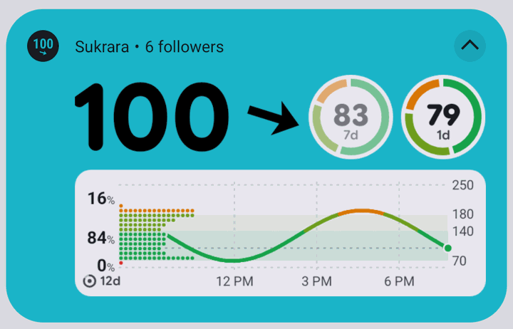

- Chip off (or Live Updates unavailable): a colorized foreground-service card (background = range colour, grey once the value is struck through; ink black or white by contrast) with a custom layout inside the system's decoration.
- The value row is the card's header as the one renderer draws it on every card (`GlucoseCard`, `CardPart.HEADER`; registered surface `notification`, parts header + graph): value, arrow or "no trend" ring, the late reading's time, the status pill (`Eat carbs`, `Take insulin`, the mute's `45m left`; the same pill as the widgets and the app, 2026-10-21: the notification used to have its own value row without it) and the slots (same choice as the home widgets: `GraphConfig.slots`, ring count, last-treatment slot and fallback) right-aligned. On the card's colour the value, trend and time are drawn in the card's ink (black or white) instead of the range colour.
- Collapsed (≤ 48 dp): that row 48 dp tall. Expanded: the row 64 dp tall; below it the graph (notification window, default 12 h) at the content column's full width, 96 dp tall, on a rounded surface (surface container high, light/dark), scaled uniformly (never stretched).
- Slot discs: each slot on a disc of the light surface (surface container high, light) with the light palette in both themes, as the card's colour doesn't follow the theme either (2026-10-21: dark discs looked heavy on the bright card); as many as fit beside the value (≤ 4).
- The follower/state line ("1 follower · 1 nearby") is the header's sub text beside "Sukrara", not a row of its own.
- Android 12+ keeps custom content in the column right of the icon and clips it there (a −52 dp margin was cut off on API 36; Android 17's column starts at 72 dp): nothing can be drawn under the icon, so the card is kept short instead.
- One post path (`GlucoseNotification.post`, `PostGate`): the same content (reading, detail line, switches, minute, sensor life, treatments, graph / alert settings, theme, locale) is never posted again; at most one post per second, the first change after a quiet second at once (a new value is never late), a burst (a BLE backfill sends a history packet every few ms) conflated into its latest content at the end of the second. Screen on and SystemUI's re-post bypass the dedupe, not the rate. Keeps Android's ~5 posts/s per app limit ("enqueue rate … Shedding") out of reach. The gate runs on the monotonic clock (`elapsedRealtime`) and never waits longer than its second: on the wall clock a time set back (round 22) held every later post, so the notification stayed at *waiting for glucose…*. At the service's start the role's state takes the newest stored reading (`Live.seed`), so after a restart the notification shows *No reading since …* / the struck value, not *waiting for glucose…*; a treatment logged, deleted or received, and a mute from an alert notification, redraw it at once (its marks and slots; the status pill), not at the next reading.
- Pictures (graph + slots) are cached per reading / 5-min tick / theme / treatments / graph and alert settings, and not redrawn while the screen is off.
- Chip on (Android 17 Live Update, MetricStyle): metrics = value (mg/dL, semantic colour by range), then the slots as text (`86%` · `in range 1d`, `6.7%` · `GMI 14d`, `4.5u` · `12m ago`), three metrics in all; once the reading is late its time takes the last one. The trend is the chip's arrow and the title's word.

## Lock screen widget

- Background (Settings → Lock screen → Background, `lockBg`): None, Shadow, Dim, Card, **Frosted glass** (`frosted`, default): the wallpaper blurred (24 dp, SystemUI's BackgroundBlurDrawable) and tinted; falls back to the card when cross-window blur is off. Unknown values fall back to Frosted glass.
- Appearance (`lockLook`): **Automatic** (default, follows the system dark theme), Light, Dark.
- Dark: the widget's dark palette; frosted tint black 35 %, card = surface container high dark 88 %, dim = black gradient (0 → 30 % → 60 %), shadow = black 60 %.
- Light: the home widgets' look; light palette, frosted tint = Glance's widget background (`system_accent2_50`, Material You, near white) 60 %, card = the same colour 88 %, dim = white gradient, shadow = white glow 70 %.
- A dark-theme flip redraws at once: the module re-tints on its view's configuration change, the app redraws the widgets from a `ComponentCallbacks` night-mode watcher.
- Slots right of the lock icon use the same choice as the home widgets (`appSlots`: rings, report numbers, last treatment, fallback), main rightmost, as many as fit (≤ 4).

## Sensor reminders and countdowns

Wearer only (`sensorend/`; rules in `SensorEndPlan`, tests `SensorEndPlanTest`); followers get none of these. Settings → **Sensor end**.
- Reminders: a list of (days before the end day 0–3, time of day), at most 6; default *1 day before at 09:00* and *on the end day at 09:00*. Each fires in the phone's time zone on (end day − days) at its time, only if that is after the sensor's start and before its end (a sensor ending at 07:30 skips "end day 09:00"). Text: *Sensor ends today / tomorrow / on Wednesday at 14:30* (≥ 7 days: the date) · *Have a new sensor ready.* One notification slot: the later reminder replaces the earlier one.
- Reminders that passed before Sukrara knew them (new sensor, edited list) never fire; one missed while the phone was off fires late if the sensor hasn't ended (of several, only the latest).
- The page lists the reminders, then *Add reminder* as a button under the list (the same dialog, empty; hidden at 6), then the first-unlock switch in its own group.
- **First unlock** (switch *Remind at first unlock*, default on; 0.11.19): a reminder set for the morning (after 05:00, before 12:00) shows at the first unlock (`ACTION_USER_PRESENT`, registered at runtime by the wearer service; it can't be in the manifest) of its day from 05:00, if that comes before its time; otherwise at its time (the exact alarm stays as the fallback). The evening reminder below works the same way. An unlock counts only if it brings a reminder forward (`SensorEndPlan.unlockWanted`; other unlocks do nothing) and only if it is newer than the last reminder / the last settings change. The slot is remembered (`PlanMemory.lastReminder` = its time), so a later unlock, the fallback alarm or a restart never shows it twice; no alarm is left at its time.
- **Night-time end** (group *Night*: switch *Remind the evening before*, default on; *Bedtime* 23:00, *Wake-up time* 07:00, editable with the time picker; Android doesn't share its Bedtime schedule with other apps, so the window is Sukrara's own): if the end falls in the night window (bedtime inclusive, wake-up exclusive; it may wrap midnight), one more reminder at bedtime − 2 h (21:00) the evening before that night (for an end at 03:10 on Wednesday: Tuesday 21:00), or at the first unlock from bedtime − 4 h (19:00) if earlier: *Sensor ends tonight at 3:10* · *Change it before bed*. A night-time end means a gap in readings and a no-data alert during sleep. Same channel as the other reminders; not an alarm, not a Live Update (Live Update guide: "Inappropriate uses: … upcoming calendar events").
- **Last day, take the spare**: a reminder shown on the end day for an end later that day outside the night window says *Sensor ends today at 7:08 pm* (the phone's 12/24 h format) · *Take your spare sensor with you*; an end inside the night window keeps *Have a new sensor ready.* (the evening reminder covers it). Wording per the notification design guide (developer.android.com/design/ui/mobile/guides/home-screen/notifications): when it ends in the title, what to do in a short text that doesn't repeat it.
- End countdown (default on): an ongoing ProgressStyle notification from end − *Countdown starts* (`SensorLife.countdownHours`, 1–24 h, default 8, shared with the card's countdown ring) to the end: *Sensor ends at 14:30* · *Have a new sensor ready to replace it.*, the bar = time left in the window (empties; a plain bar, no tracker icon at its tip), a chronometer counting down to the end, no action buttons. Silent channel, refreshed every 15 min (non-waking).
- It is promoted (Live Update chip with the timer) only while the glucose chip is off: the status bar shows one chip and the countdown would take it from the glucose value for hours. With the glucose chip on it stays in the shade and lock screen. On Android 16 without QPR2 (API 36.0, no promoted notifications) both countdowns are plain ongoing notifications (the promotion calls are tried, never required; `SensorEndNotifyTest` posts both on Robolectric's 36.0).
- Warm-up countdown (default on): from a new sensor's start to the warm-up's end (`SensorInfo.warmupEndEpoch`, 60 min), always promoted: *Sensor warming up* · *Readings at 19:45*, the bar fills up (`SensorLife.warmupFraction`), the chip counts down; refreshed every 5 min. **A countdown never goes below zero**: at the warm-up's end (exact alarm) it becomes *Almost ready* · *Waiting for the first reading*, bar full, no timer, until the first reading; it gives up 15 min after the warm-up end without a reading (`SensorLife.WARMUP_GRACE_S`). The first reading cancels it (in any state) and posts its own *Sensor ready* · *Readings have started.* (sound, gone after 10 min), only if the warm-up countdown was shown and within 1 h of that reading. The first reading's time is remembered per sensor, so a restart (an app update) doesn't bring the countdown back; every re-plan without a warm-up cancels a leftover one. The end countdown likewise stops at the end (exact alarm) and hands over to *Sensor ended*.
- No *Hide* button on either countdown (0.11.20: the user wants no Hide button on any notification). The way out: **swipe it away** (since Android 14 an ongoing notification is dismissible except while the phone is locked and on *Clear all*, developer.android.com/about/versions/14/behavior-changes-all; a Live Update can be "temporarily dismiss[ed] or demote[d] … to a standard notification", developer.android.com/develop/ui/views/notifications/live-update), which keeps it away for that sensor through the delete intent (the guide: "Don't repost Live Updates that the user dismissed. Use setDeleteIntent to detect dismissed updates"), the warm-up one then also skipping *Sensor ready*; or **turn it off**: Settings → Sensor end → *End countdown* / *Warm-up countdown*, the system's *Sensor countdowns* channel, or Live Updates for Sukrara in the system settings (`ACTION_MANAGE_APP_PROMOTED_NOTIFICATIONS`).
- At the end (or when the sensor reports it ended early, end moved to now): *Sensor ended* with the action *Replace sensor* (tap or action: the New sensor screen; the card's wording) once, on the reminders channel, at most 12 h after the end; a new sensor clears it.
- Channels: *Sensor reminders* (default importance, sound) for reminders / ended / ready; *Sensor countdowns* (default importance so it shows on the lock screen, no sound or vibration) for both countdowns. Not the alert channels.
- Scheduling: one AlarmManager alarm at a time for the next moment that matters, re-planned on every alarm, new sensor or end change, settings change, boot, app update, clock and time-zone change. Reminders, window start, warm-up end, warm-up give-up and end: `setExactAndAllowWhileIdle` (Sukrara already holds `USE_EXACT_ALARM` for alerts; 10-min window if exact alarms are unavailable); progress refreshes: non-waking `setWindow` (≤ 1 min late), used only when they land before the next event even if late, so a late tick never runs a countdown past its end. The first reading re-plans at once (while the warm-up may be up), and a failing re-plan doesn't stop that watch.
- Settings export / import / reset include the reminders, the first-unlock and evening switches, the night window, both countdown switches and the countdown hours.
- Debug (DebugReceiver, adb only): `--es cmd sensorEnd` without extras only reads the state (nothing changes); it takes the settings `--ez unlock B`, `--ez evening B`, `--es night 'MIN-MIN'`. Debug builds only (`DebugFakes`; a release build changes nothing and says `debug builds only, nothing changed`): `sensorEnd --ei inMin N` (a made-up sensor), `sensorStart`, `sensorUnlock` (an unlock), `fakeSensor`, `sensor`, `backfill`, `alertFeed`, `alertTest` (a test alert), `previewSgv` (a status-bar preview), `locktest`, `newSensor --es stage`, `treat` (an adb treatment): the release app never shows a glucose value, an alert, a treatment or a sensor state that isn't real. Guarded by `DebugFakesTest` and the `tools/check` rule `debug` (0.11.20, after `cmd sensorEnd` on a release build replaced the real sensor).

## Sensor end in calendar

- Setting "Sensor end in calendar" (wearer only, off by default; Settings → Sensor end, its own group): turning it on asks for READ_CALENDAR + WRITE_CALENDAR; refused → stays off with "needs access to your calendar"; refused for good → the next tap opens the app's system settings. Permission revoked later → the setting turns itself off.
- Summary: "On · <calendar>" or "Off".
- Default calendar: Sukrara's own **"Sukrara"** calendar (`ACCOUNT_TYPE_LOCAL`, account "Sukrara", brand colour #1BB5C9, read-only for the user), created when needed and found by account (never twice). It shows in the phone's calendar apps but is **not synced** to other devices (local calendars never sync; an app can't create a calendar in a Google account without the Google Calendar API).
- **Google Calendar hides it by default** (seen 2026-10-18 on the user's Pixel, Google Calendar 2026.39, with the event correctly in the provider): Google Calendar shows a non-Google account's calendars only after the user turns the account on under Google Calendar → Settings → Manage accounts → "Non-Google Accounts" → Sukrara (On this device), and that switch starts off. Its decompiled code (`ica.b`) keeps the state in its private prefs as `account:<name>:type:<type>|account_enabled_state`; with no stored state the account is hidden (Exchange excepted), so Sukrara can't turn it on. Hence the hint row below.
- "Show in Google Calendar" row (only while on, with Sukrara's own calendar, and when Google Calendar `com.google.android.calendar` is installed; manifest `<queries>`): "Turn on Sukrara in Google Calendar → Settings → Manage accounts, or the events won't show there"; tapping it opens Google Calendar (its launch intent; no deep link to that page is known).
- "Calendar" row: pick Sukrara's own calendar or any writable calendar on the phone (e.g. the user's Google calendar, "syncs to your other devices"); events in a picked calendar are written as a normal app so the account syncs them, and their ids are remembered for updates. Changing the choice moves the events (removes them from the old place).
- One event per sensor: title "Sensor ends", description "Libre sensor <serial>, started <date>. Sukrara keeps this event up to date.", 30 minutes long from the sensor's end (SensorLife), busy = free, no reminder of its own (Sukrara notifies). Not a point event: Google Calendar drew start = end as a title-less sliver. No RSVP: Google Calendar read the event out as "Response: Not responded" (its `SELF_ATTENDEE_STATUS` was 0). Setting `ORGANIZER` = the calendar's `OWNER_ACCOUNT` ("Sukrara" for the own calendar, read from the picked calendar otherwise) with `HAS_ATTENDEE_DATA` 1 was not enough (verified on the phone), and the provider refuses a direct `SELF_ATTENDEE_STATUS` update. So each event also gets exactly one Attendees row for that owner (email and name = owner, accepted, relationship organizer, type required; sync-adapter URI for the own calendar, plain URI for a picked one): the provider then sets `SELF_ATTENDEE_STATUS` 1 and Google Calendar reads "Sensor ends, 7:08 pm – 7:38 pm, Sukrara" with no guest list or RSVP. Every write checks all of Sukrara's events in the target calendar (past ones too) and inserts the row only when none with that email exists (never a second one); skipped when the calendar has no owner account. ORGANIZER and HAS_ATTENDEE_DATA stay set. The current sensor's existing event gets the 30 minutes on the next write while it is still ahead (a past event keeps its start and end). Keyed by serial (`_SYNC_ID` "sensor:<serial>" in the own calendar), so restarts and repeated updates update it instead of adding another.
- When the sensor ends early (SensorLife pulls its end to now) a still-future event moves to the real end; once an event's time has passed it never moves again (start and end stay).
- Changing the calendar carries only the current sensor's event to the new place.
- Past sensors' events stay (a history of sensor changes); a sensor's event still in the future is deleted once another sensor is the current one (replaced early, that end won't come).
- Turning it off deletes the Sukrara calendar with all its events, or Sukrara's events in the picked calendar (as deletions the account syncs).
- Only the wearer's app writes events; followers never do (no serial on the wire).
- Research and options weighed (Juggluco's ACTION_INSERT, local vs Google account vs picked calendar vs Google Calendar API): `features/SensorCalendar.kt` header.

## Sharing over Bluetooth

- Settings → Share with people (wearer): *How readings travel* has *Over the internet* (a globe icon; *Encrypted, through Nostr relays*), the upload interval and *Over Bluetooth nearby* (*2 connected*). While Bluetooth sharing is on, *Nearby devices* lists the follower devices connected now (*Connected*, oldest link first; the title is the follower's name and the device type, *Sam · Mac* / *Robin · Phone*, with their picture) and then the followers paired with *Pair nearby* that aren't (*Disconnected*), like Settings' Connected devices (`owner/NearbyDevices`, `NearbyDevicesTest`). A connection is named by the identity proof in its `HELLO` (spec/ogs-ble.md B§5/B§6, 2026-10-21): every follower that knows `sid` (Android and Mac) signs a kind-21080 event with content `H("cgm2:ble-id:"+sid+":"+nonce+":"+dev)` with its follower key, and the wearer's phone checks it against each roster follower and device type (`Ble.identify`, plain-Kotlin BIP-340 `Schnorr.verify`; `BleTest`, Mac `-bleselftest`, vector `ble.hello_id`). An unnamed link is not listed (no made-up name); a replayed `HELLO` names nothing. Strangers learn nothing new: without `sid` the signature can't be tested against any key. Which followers paired nearby is kept on this phone only (`OwnerState.nearbyPaired`, not in the backup). Removed followers are folded under a *2 Removed* pill (tap: their group and *See less*).
- **Forget this device** (round f33; Android's Bluetooth settings call it *Forget*): a row in Nearby devices opens the device's dialog (its picture, *Sam · Mac*, *Connected* / *Disconnected*, *Following since …*) with *Forget* and *Done*. *Forget* asks *Forget this device?* · *Sam · Mac will stop getting your glucose. To share with it again, use Pair nearby.* (es *¿Olvidar este dispositivo?*, *Olvidar dispositivo*) with *Forget device* (filled) and *Cancel*. Forgetting (`OwnerEngine.forget`, `NearbyDevices.forget`) clears everything this phone keeps for that device and nothing else: its trust (the follower is revoked, so it gets the revoked notice and the read key rotates as with Remove; its record folds under *Removed*), its nearby pairing (`nearbyPaired`), its *Can add entries* and any request it left waiting; its Bluetooth link is dropped (`BleOwner.disconnect`), and if it connects again its identity proof names no current follower, so it is neither listed nor trusted. Pairing it again with *Pair nearby* is a fresh approval (`NearbyDevices.approved`, the same path as a first pairing; `NearbyDevicesTest`, `NearbyForgetGallery`). Mac: none (the Mac is a follower and lists no nearby devices).
- The wearer's phone advertises the Sukrara service with **no name** (no scan response; investigation 24, P12). *Find phones nearby* lists each phone as *Phone nearby* / *Teléfono cercano* with its address and signal; the wearer's name and picture come after *Ask*, from the pairing INFO.
- `HELLO` carries a fresh random nonce; the phone's `INFO` answers `m = H("cgm2:ble:"+sid+":"+nonce)`, and only while *Pair nearby* is open also the identity, relays and the invite with the profile. A stranger in range no longer learns the wearer's identity key.
- A follower (Android and Mac) writes nothing to a phone (requests, rekeys, history requests, treatments) until its `INFO` proves our stream (`m` over one of its last 4 nonces, or the identity while pairing). Another wearer's phone is left; Android avoids it for 10 min and keeps scanning for ours. A pending request with pairing closed: receive only. Events are verified as before, whatever the link.
- Limits (P13): reassembly drops a message idle for 30 s or over 256 KiB, at most 16 open at once (Android and Mac). The wearer's phone takes at most 8 followers at once, checks each write before answering (a malformed frame or more than 256 KiB a minute → error and disconnect; more than 30 messages a minute → dropped), sends one backlog per follower per 5 s (a sooner `HELLO` is answered when due), and never re-sends an expired event from its backlog.
- Mac follower: gift wraps (access request, rekey, history request) carry an absolute expiration (7 d; history 1 d); a key delivery naming another stream id is rejected; a chunk whose `c`/`d` tags don't match its hour is rejected; a rekey request goes out only for an unknown key on an event from the wearer's identity or device.

**States and exits**: a follower *Connected* / *Disconnected* in Nearby devices → it moves between the two by itself; a device's row opens its dialog (*Done* closes it); *Forget* → *Forget this device?* → *Forget device* forgets it (*Cancel* or back keeps it), and *Pair nearby* pairs it again from scratch; a paired follower also leaves the list when it's removed from Followers; *Removed* followers fold under the *N Removed* pill and *See less* folds them again.

## Share with apps on this phone (investigation 22)

- Settings → Share with apps → *Apps on this phone* (wearer only): every installed app that declares a receiver for `com.eveningoutpost.dexdrip.BgEstimate`, `com.librelink.app.ThirdPartyIntegration.GLUCOSE_READING` / `SENSOR_ACTIVATE` or `glucodata.Minute` (manifest `<queries>`, `queryBroadcastReceivers`), by label with its own icon, each with a switch. **All off by default**; no app found → "No app on this phone listens for glucose broadcasts. Garmin watches read the xDrip+ server below." No switch per format: an allowed app gets every action it declares. While the wearer's sensor family is untested (`SensorProfile.verified` false) nothing is broadcast and the group's first line says *Paused: <family> support is untested* (investigation 23; a closed loop must never take untested data).
- Apps that read the local xDrip+ server instead of broadcasts are listed in the same group when installed: Garmin Connect (`com.garmin.android.apps.connectmobile`) and Connect IQ (`com.garmin.connectiq`), each with its real icon, "Reads your glucose through the xDrip+ server" and a switch that **is** the xDrip+ server switch (same state, both places change together). The xDrip+ server row adds "read by Garmin Connect" when one is installed.
- App and service icons (every role and page): installed apps show their real icon loaded like AOSP Settings' app lists (IconDrawableFactory: unbadged icon, launcher shadow under adaptive icons, work-profile badge) at 32 dp, unclipped, in the 40 dp icon slot; legacy square icons are shown as they are. Services show their own app icon: Juggluco, xDrip+ and Health Connect from the installed app (bundled copy when not installed), LibreView, Nightscout (API switch and upload row) and Tidepool from bundled adaptive icons; feature rows keep 24 dp symbols.
- One explicit copy per allowed package (`setPackage`, `FLAG_INCLUDE_STOPPED_PACKAGES | FLAG_RECEIVER_FOREGROUND`), on each new live reading, at most one per 55 s and never the same or an older reading twice (Juggluco's throttle). Backfilled history is not broadcast.
- Only the wearer's phone reading the sensor itself sends them: never a follower (AAPS must not take someone else's readings as a local sensor), and not in Juggluco mode (Juggluco broadcasts itself; the switches are greyed with "Only while Sukrara reads the sensor itself").
- xDrip+ `BgEstimate`: `BgEstimate` double mg/dL, `Time` long ms, `BgSlopeName` (`DoubleUp`…`DoubleDown` at ±3.5 / ±2 / ±1 mg/dL/min, `""` unknown), `BgSlope` double mg/dL per ms (left out when unknown), `SensorStartedAt` long ms (left out when unknown), `SourceInfo` **`Libre3`** (AAPS → `LIBRE_3`, advanced filtering), `SourceDesc` `Sukrara`. Never a Dexcom label or the Dexcom BYODA intent.
- LibreLink `GLUCOSE_READING`: `glucose` double, `timestamp` long ms, `bleManager{sensorSerial}`, `sas{currentSensor{sensorStartTime}}`. `SENSOR_ACTIVATE` (`sensor{sensorStartTime}`, `bleManager{sensorSerial}`) once per new sensor serial, before the reading.
- `glucodata.Minute`: `.SerialNumber`, `.mgdl` int, `.glucose` float (mg/dL), `.Rate` float mg/dL/min, `.Alarm` 0, `.Time` long ms.
- *Health Connect* switch (wearer only, off by default): turning it on opens Health Connect's own permission sheet (WRITE_BLOOD_GLUCOSE); refused → stays off with "Off · needs access in Health Connect". On → the stored history (≤ 30 days) is written once, then every reading and every backfill. Off → stops writing; records already there stay.
- Records: `BloodGlucoseRecord`, specimen interstitial fluid, relation to meal and meal type unknown, recording method automatically recorded, device Abbott "FreeStyle Libre 3" (type unknown: Health Connect has no CGM type), mmol/L = mg/dL ÷ 18. `clientRecordId` = `sukrara-glucose-<epoch minute>`, version 1: writing the same minute again updates the record instead of adding one (no duplicates).
- Overview summary of Share with apps: `LibreView · 2 apps · Health Connect · Tidepool · xDrip+ · Nightscout` (only what is on).
- The phone's Nightscout API serves long-acting insulin as a `Note` with the dose only in `notes` (`Long-acting insulin 14u`), never an `insulin` field, so Nightscout clients that sum `insulin` (IOB) don't count it as a bolus. Rapid insulin stays a `Correction Bolus` with `insulin`, carbs a `Carb Correction`; entries use `NONE` when there is no trend and UTC `dateString`.

## Tidepool upload (docs/27)

- Settings → Share with apps → *Tidepool* (both roles; Android only, the Mac doesn't upload). **Off by default**: the account row opens *Tidepool account* (email, password, *Sign in*; signed in: *Sign out*). The password is sent once to Tidepool's `POST /auth/login` and never stored; only the session token and the account's user id are kept, Keystore-encrypted (`tidepool.bin`). A refused login shows "Tidepool didn't accept this email and password".
- *Upload to Tidepool* main switch (enabled once signed in), then *Status*, *Glucose readings* (on; "One every 5 minutes, the last 31 days included") and *Insulin, carbs & notes* (on; edits and deletions follow), each greyed "Unavailable while the upload is off" while it is off.
- Wearer: uploads its own readings and treatments. Follower: one more switch, *Upload the person you follow*, **off by default** ("Off: nothing is uploaded from this phone"); until it is on the status says "Waiting for your choice below" and nothing is sent.
- What goes up: one upload record per account, install and role (`client.name` `app.mauri.sukrara`, device `Sukrara-wearer-…` / `Sukrara-following-…`, `continuous`, deduplicated by origin id). Readings: `cbg`, mg/dL, the earliest reading of each 5-minute UTC slot, `sampleInterval` 5 min, trend rate in mg/dL/minute. Carbs → `food` (net carbohydrate, grams); rapid / long insulin → `insulin` with acting type `rapid` / `long`; an entry's note → the datum's `notes`; a note on its own → a Tidepool note on the daily view (edited and removed with it). Every datum: `time` (UTC), `deviceTime` (local), `timezoneOffset` (minutes at that instant, so the repeated hour when the clocks go back stays apart), `timezone` (IANA).
- No duplicates: a slot or an entry sent again replaces the earlier one (origin id `sukrara-cbg-<slot>` / `sukrara-tr-<entry id>`). An edited entry is sent again, a deleted one is deleted on Tidepool, one deleted before it was ever sent is never sent.
- Queue: every 5 minutes, at once when an entry changes or a setting changes. The first upload sends everything the phone keeps (31 days); afterwards any slot not on Tidepool yet goes up, so an outage or a sensor backfill fills itself in. Readings go in batches of 500, each remembered when Tidepool accepts it. A failure retries after 1, 2, 4 … minutes, at most an hour ("Will retry · <reason>"); an expired session that can't be refreshed shows "Signed out by Tidepool: sign in again" (the switch stays on and the queue catches up after signing in).
- *Sign out*: the session and the switches are forgotten on the phone; what was uploaded stays on Tidepool. Signing in to the same account again continues where it left off (no note twice); another account starts from scratch.
- *Status*: "Up to date · last upload <date time>", "Waiting for the first upload", or the retry / sign-in states above. Overview summary of Share with apps includes `Tidepool` while it uploads.

## Nightscout upload (docs/25)

- Settings → Share with apps → *Nightscout* group → *Nightscout upload* (wearer only; Android only, the Mac doesn't upload). **Off by default**; the row reads "Not set up", "Off · <host>" or "Uploading to <host>", and Share with apps' summary includes `Nightscout upload` while it uploads.
- *Site* opens a dialog: address, *Access token (recommended)* or *API secret*, the token / secret field (empty keeps the saved one), *Test* ("Connected · Nightscout <version>", "The site refused the token or secret", "Could not reach it · …") and *Save*. The token or secret is kept in a Keystore-encrypted file and never shown again.
- Addresses: `https://` always; `http://` only for this phone (`localhost`, `127.x`, `::1`) and the home network (`10/8`, `172.16/12`, `192.168/16`, `169.254/16`, `fe80::/10`, `fc00::/7`, `.local`), decided on the literal host; home-network http shows "Not encrypted: anyone on this network can read what is sent…" in the dialog and under the site row. Anything else: "Use https:// (http:// only on your home network)".
- *Upload to my Nightscout* main switch (enabled once a site is saved), *Status* (the shared upload status line: "Up to date · last upload <date time>", "Waiting for the first upload", "Will retry · <reason>"; plus "Set up the site first", "The site refused the token or secret: change it", "Paused: another app (<device>) is uploading to this site" with *Upload anyway*).
- *What to send*: *Glucose readings* ("Every reading, the last 30 days included"), *Insulin, carbs & notes* ("Edits and deletions are uploaded too"), *Sensor changes*, *Phone battery*; all on. *Advanced*: *API* (v1 recommended; v3 only with an access token) and *Remove this site* (forgets the site, the credential and what was sent; the site keeps its data).
- What goes up: every reading (`sgv`, integer `date`, UTC `dateString` as stored, the phone's `utcOffset`, `direction` from the trend thresholds or `NONE`, 5-minute `delta`, `noise` 1, `device`/`app` `Sukrara`, Nightscout's own v5 identifier); rapid insulin as `Correction Bolus`, carbs as `Carb Correction`, notes as `Note`, long-acting as a `Note` with the dose only in `notes` (no `insulin`, so IOB isn't inflated), each with the entry's id as identifier; a new sensor as both `Sensor Change` and `Sensor Start`; the phone battery as devicestatus `uploader.battery` when it changes or every 30 min.
- When: right after each reading, when an entry or the sensor changes, and every 5 minutes. API v1 sends readings 500 per request; v3 one per request, at most 240 per cycle (newest first). No duplicates: the site dedupes a reading by time and an entry by its identifier; an edited entry replaces its document (moved in time: deleted and created again), a deleted one is deleted for good.
- Catch-up: what the site lacks is worked out from the phone's own store every cycle, so an outage or late sensor history fills in; on the first run, after failures and every 6 h the phone compares with the site and re-sends minutes the site lost. Failures retry after 30 s doubling to 15 min (or the site's Retry-After); a refused token / secret stops uploading until it's changed.
- Another uploader: entries from another device on the site in the last 30 minutes pause the readings (entries still go up) until *Upload anyway*. Upload only: nothing is read back from Nightscout.
## Languages

- English (default) and Spanish (Spain) everywhere, settings pages included (every page, alert page, dialog, search and the alerts page's "lately" list); the phone's language picks one, or Settings → Apps → Sukrara → Language (per-app language, Android 13+).
- Settings search finds rows in the shown language, accents optional ("insulina rapida" finds "Tras insulina rápida"): the index is built from the pages as they are drawn.
- Settings words follow Android's own Spanish where a stock setting exists: Ajustes, Activado / Desactivado, Pantalla de bloqueo, Barra de estado, No molestar, Restablecer, Buscar en Ajustes.
- Text lives in `res/values/strings.xml` and `res/values-es/strings.xml`; a unit test fails when a key or a format argument is missing in a translation.
- Numbers, dates and times follow the chosen language (decimal comma in Spanish, localized day and month names); units stay as they are (mg/dL, `4.5u`, `30g`).
- Every clock time follows the device's 12/24-hour setting, not the language's default (Android: Settings → System → Date & time → *Use 24-hour format*, read live; Mac: System Settings → Date & Time → *24-hour time*): `21:08` / `9:08 PM` (es `9:08 p. m.`). That covers the card (`Ready at`, *No reading since*, a late reading's time), the graph's hour labels, widgets, lock screen widget, the live notification, sensor reminders and countdowns, the calendar event's description, treatments (list, dialog, followers' entries), alerts list, access requests, settings summaries (reminder times, sensor end, LibreView), the Mac menubar tooltip, dropdown, report and treatments. One helper per platform (Android `graph/Clock.kt`, Mac `Clock` in SukraraGraph.swift), and it is the only place the setting is read (Android: `Clock.hour24Source`, installed by the app; Mac: `Clock.hour24`, formatting with the bare locale so the cycle asked for is the one shown): no surface passes a 24-hour flag of its own (2026-10-21: the value widget showed `08:59` beside the chart cards' `8:59 AM`). Shared cases in `spikes/graph-fixtures/clock`; every surface is rendered in 12- and 24-hour time by the cross-surface tests (`clock12` / `clock24`: every time any surface formats or draws must be in that cycle); `tools/check` `clock` rejects an own flag or time formatter. Switching the setting (or the time zone) while Sukrara runs redraws everything at once: Android's role receivers take Settings' `ACTION_TIME_CHANGED` / `ACTION_TIMEZONE_CHANGED` and re-render the notification and the widgets, and `Clock.signature()` is in every redraw key (widgets, notification, its pictures; `ClockRefreshTest`); the Mac redraws the menubar and dropdown and re-publishes to the widgets on the current locale's change and the time zone's (`Clock.observeChanges`, `-graphselftest`). The log and debug output keep 24 h.
- Spanish terms: hidratos (carbs), insulina rápida / lenta, tiempo en rango, seguidores; alert headlines like "Glucosa baja · come más".
- Changing the language renames the notification channels and redraws the widgets, the notification and the lock screen widget at once.
- Alert rules and their timeline scenarios stay in English: the engine reports the kind and what was logged, and the notification and the settings pages word them. The log and the debug dump stay in English.
