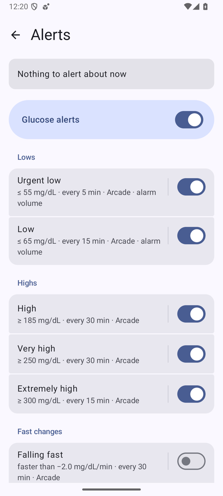
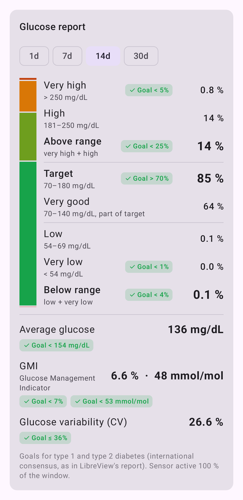
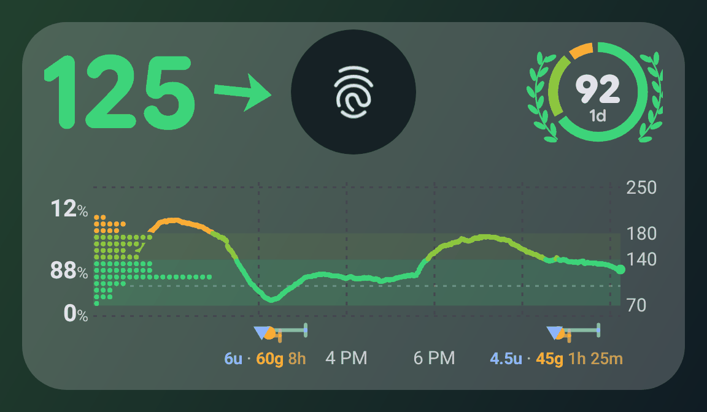

# Sukrara — your sugar, now

Live glucose from a **FreeStyle Libre 3** on your **Mac menubar**, **Android status bar and home screen**, **Garmin
watch** and your **family's devices**. End-to-end encrypted, over Bluetooth nearby or public Nostr relays from
anywhere. **No cloud account, nothing to host.** The name: *sucre* (sugar) + *ara* (Catalan: now).

**[Download for Android](https://github.com/mauriciabad/cgm-reading-mac-spike/releases/download/v0.11.42/Sukrara-0.11.42.apk)**
· **[Download for Mac](https://github.com/mauriciabad/cgm-reading-mac-spike/releases/download/v0.11.42/Sukrara-0.11.42.dmg)**
· [All releases](https://github.com/mauriciabad/cgm-reading-mac-spike/releases)
· [Source and install steps](https://github.com/mauriciabad/cgm-reading-mac-spike#try-it)

**Mac** (Apple Silicon, macOS 14+): open the dmg and drag Sukrara onto Applications, or
`brew install --cask mauriciabad/tap/sukrara`. The app isn't notarized yet, so the first launch says *"Sukrara" Not
Opened — Apple could not verify "Sukrara" is free of malware…*: click **Done**, then **System Settings → Privacy &
Security**, scroll to **Security**, click **Open Anyway** next to *"Sukrara" was blocked to protect your Mac* and
confirm with your password or Touch ID. Only once; Control-click → Open no longer skips this on macOS 15+
([Apple: open a Mac app from an unknown developer](https://support.apple.com/guide/mac-help/mh40616/mac)). Sukrara
lives in the menu bar.

**Android** (16+, arm64): open the APK and allow installs from your browser when asked (**Settings → Allow from this
source**), then **Install**. [Obtainium](https://obtainium.imranr.dev/) can keep it updated.

> **Alpha, built from research spikes.** Each feature started as a proof of concept with a written report (below);
> The app bundles them for daily use. The real Sukrara will be rebuilt from scratch with what we learned.
> **Not a medical device:** don't make treatment decisions from it.

  
  
  

  
  
  

  
  

  
  
  
  

  
  

  

  

  

Screenshots: Android emulator (fed a synthetic day with meals) and a Mac test copy with synthetic data (the
alert's low threshold was raised for the picture). Renderer sheets, drawn by the app's own code on the JVM: the lock
screen (it needs root + LSPosed; wallpaper and fingerprint icon added), the status-bar icon states and the freshness
steps.

## Features

- **Phone:** value, continuous trend arrow and 12 h chart; the doctor's report; status-bar chip and number icon;
  home-screen widgets; with root + LSPosed, the graph on the lock screen; insulin, carbs and notes (also from the lock
  screen); a CSV export. Source: Juggluco, or the sensor read directly, with a guided *New sensor* screen and sensor-end
  reminders.
- **Settings like Android 16/17:** sections, search, the system's page and back-gesture motion, export / import /
  reset, and it tells you when root or the LSPosed module is missing and how to fix it.
- **Mac (Sukrara for Mac):** number and trend arrow in the menubar, a panel with the same card as the phone and the
  doctor's report (with CSV export); follows over Bluetooth or Nostr
  (paste the same `https://sukrara.mauri.app/join#…` link the phone shares); the same glucose alerts as the phone.
- **Alerts:** very low, low, high, very high, extremely high, fast changes and no data, each with your own
  threshold and sound. Highs stay quiet after rapid insulin and while already falling back into range, lows after
  carbs, and the alert after a treatment says so ("Low glucose · eat more"); extremely high always alerts. Video-game sound packs
  ([listen](sounds/)), a different sound each time, and a vibration per alert.
- **Sharing:** a one-time short link or small QR code that shows who is inviting; you see their name next to who you
  sent it to, then **Allow**. Names and generated pictures travel only end-to-end encrypted, never public. Followers alert when
  you do. Removing someone rotates the key; everyone else carries on. The way it shares is becoming an open
  standard anyone can implement: the [Open Glucose Stream](ogs).
- **Offline:** nearby pairing and following over Bluetooth, no internet needed.
- **Watch and smart home:** existing Garmin watch apps work unchanged through the xDrip+ server; stock Home
  Assistant reads it through the Nightscout-compatible API (both off until you switch them on).
- **Other apps and services** (all off until you switch them on): AAPS, GlucoDataHandler and xDrip+ on the same phone
  get each reading; Health Connect; uploads to LibreView, Tidepool and your own Nightscout site.
- **Keys without lock-in:** back up to Proton Pass, Bitwarden or KeePassDX as a normal password; a new phone restores
  everything and followers don't notice.

## Use cases

- Glucose at a glance while working on the Mac, about 0.3 s behind the phone.
- A parent following their kid, with alarms, and approve / remove in one tap.
- No internet around: followers in the same room use Bluetooth.
- Away from home on mobile data: readings reach followers through Nostr relays in about a second.
- A bedroom light that turns red at night when glucose runs high (Home Assistant).
- The doctor keeps seeing everything in LibreView.
- Glucose on a Garmin watch face.

## Investigations

| # | Topic | Result |
|---|---|---|
| [01](01-connectivity) | Live glucose onto a Mac without the cloud | Wi-Fi ~0.3 s; Bluetooth works with no shared network |
| [02](02-direct-sensor) | The phone reads the sensor itself | No Juggluco needed, values match, no wakelocks |
| [03](03-nostr) | Nostr relays as a no-hosting Nightscout | ~1 s live, 12 h backfill in 8 s, stock Home Assistant works |
| [04](04-libreview) | Treatments and glucose to LibreView | Phone + Mac as one device, no duplicates |
| [05](05-android-status-bar) | Glucose in the Android status bar | Chip, icon, system icons and an LSPosed hook all work |
| [06](06-sharing-and-keys) | Sharing and keys without lock-in | QR + Allow, revoke, restore; 19/19 end-to-end checks |
| [07](07-bluetooth-followers) | Bluetooth followers and nearby pairing | Same encrypted events over BLE, fully offline, Android + Mac |
| [08](08-garmin) | Glucose on a Garmin watch | Existing watch apps work with our server |
| [09](09-brand) | Name, icon and style | Sukrara |
| [10](10-showcase) | Sukrara, the showcase app | Every feature in one app, in daily use |
| 11 | Battery cost, with and without root | Harness ready; the run waits for the app to settle |
| [12](12-android-widgets) | Android home-screen widgets | Value, graph, graph + value |
| [13](13-macos-widgets) | macOS widgets | Running in Sukrara for Mac, live, every minute (Apple certificate needed) |
| [14](14-nostr-identity) | Nostr identity | Public profiles that don't reveal the glucose stream, 63-char invites, log in with Nostr. In the app since 0.11: short invites and private names + pictures |
| [15](15-alerts) | Glucose alerts and sound packs | Same rules on phone and Mac, followers alert with the wearer, game-style sounds and vibrations |
| [16](16-graph) | One glucose graph everywhere | Time at each level beside the chart, time-in-range rectangles and rings, six ranges, freshness instead of "time ago", per-widget settings |
| [17](17-lockscreen-widget) | Glucose on the lock screen | The graph around the fingerprint icon (root + LSPosed); log a treatment without unlocking |
| [18](18-metrics) | The doctor's report in the app | Time in ranges, average, GMI and CV with their goals, on the home screen and in widget slots |
| [19](19-notification-templates) | Notification templates | Which templates use the space under the icon: only Android 17's Live Update bar and buttons. Not in Sukrara yet |
| [20](20-publishing) | Publishing on every platform | Research; the Homebrew tap is live since 0.11.14. Next: notarized Mac app, Google Play plus GitHub/IzzyOnDroid for Android, Connect IQ Store for Garmin |
| [23](23-sensors) | More sensors, more brands | Dexcom G7 / ONE+ (reading along with the official Dexcom app), Dexcom G6 / ONE, Accu-Chek SmartGuide and Aidex X ported as a proof of concept, tested against recorded traces; what every other brand would cost. In the app: the sensor-driver layer and the four other families as untested, with a feedback banner until each is verified |
| [21](21-new-sensor-flow) | Starting a new sensor | One guided screen from the NFC tap to the first reading |
| [22](22-ecosystem-outputs) | Sukrara in the diabetes-tech ecosystem | The xDrip+, LibreLink and Juggluco broadcasts, Health Connect and a CSV export Tidepool imports |
| [24](24-open-standard) | An open standard for CGM sharing | The [Open Glucose Stream](ogs), draft 1, with an independent reference; its security fixes are in the app |
| [24b](24b-open-standard-draft3) | Open Glucose Stream draft 3 | A clean-sheet redesign; Sukrara moves to it next (followers will need a new invite) |
| [24c](24c-draft3-review) | Independent review of draft 3 | 26 findings, 2 critical holes fixed and tested |
| [25](25-nightscout-upload) | Nightscout upload | Upload to your own Nightscout site, healing outages with no gaps or duplicates |
| [26](26-agp-report) | The full AGP report | Percentile profile and daily profiles, checked against pandas and d3; the in-app report will be its own investigation |
| [27](27-tidepool) | Tidepool upload | Glucose, insulin, carbs and notes to your Tidepool account |

Code, numbers and the full overview: [github.com/mauriciabad/cgm-reading-mac-spike](https://github.com/mauriciabad/cgm-reading-mac-spike)
(GPL-3.0-or-later). FreeStyle Libre is a trademark of Abbott; this project isn't affiliated with Abbott or Juggluco.
